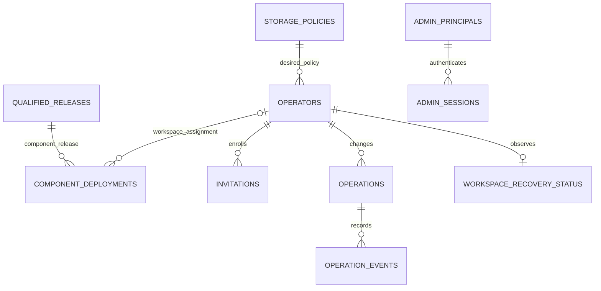
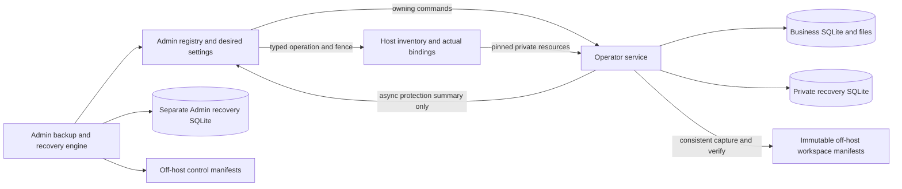
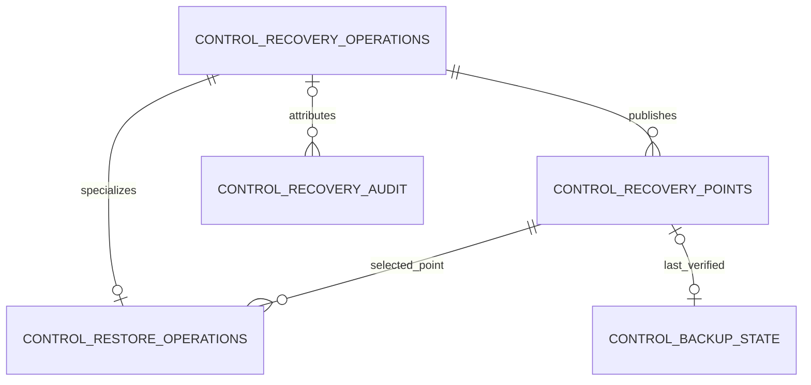
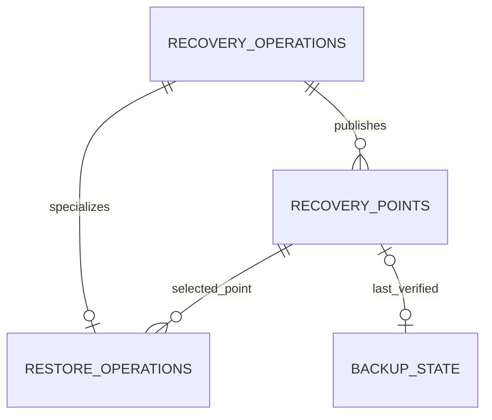

# Database schema master

Status: H01 design, November 10, 2026; proposed hosted tables are not implemented.
This is the master schema reference for current business-store ownership and the
planned hosted stores. [HOSTED-001](hosting/design/HOSTED_MVP_DESIGN.md#implementation-slices)
owns delivery; [H01](hosting/design/HOSTED_MVP_H01_DESIGN.md) owns the initial design.
All executable schema definitions must live under `application/database/`. Owning versioned resources there become executable authority when implemented; this Markdown file is the design/data dictionary, not a second executable schema.
Update this dictionary and those resources together; do not create another field
catalog in a feature design.

## Store boundaries and current implementation

| Store | Authority and readers | Current evidence / proposed resources |
| --- | --- | --- |
| Operator business SQLite | Domain modules own records, business audit and files. Only the owning operator runtime accesses it. No Admin/session/billing tables. | Current [baseline](../application/database/sqlite-migrations/versions/0001_initial_schema.py), [environment](../application/database/sqlite-migrations/env.py) and [module guides](README.md#current-modules) own existing definitions. No H01 business-table additions. |
| Admin SQLite | Central assignments, desired settings, Admin sessions, infrastructure operations/audit and non-authoritative workspace protection summaries. Admin backup/recovery authority is in the separate Admin recovery DB. Admin/control service only; gateway reads through a bounded service port. | New proposed `application/database/admin-migrations/` plus separate Alembic configuration; proposed `modules/hosted_admin/` owning adapter. |
| Admin recovery SQLite | Admin service owns platform/control backup catalog, checkpoints, recovery operations/audit and authenticated recovery mode. Remains intact when the main Admin DB is restored/replaced. | Proposed `application/database/admin-recovery-migrations/`, independent Alembic configuration/version and private persistent recovery directory; not a new service or VM. |
| Host inventory SQLite | Privileged agent owns actual resource identities/effect receipts for one host. Control service reads typed observations, never opens the file. | New proposed `application/database/host-inventory-migrations/` and agent adapter. Protected configuration pins its location/host identity. |
| Per-operator hosted-access SQLite | Effective access/session authority, source fences and bounded storage admission. Owning runtime only; Admin/agent use typed application commands. | Current [schema](../application/apps/server/app/modules/hosted_access/infrastructure/schema.py), [store](../application/apps/server/app/modules/hosted_access/infrastructure/session_store.py). Replace greenfield inline schema creation with proposed `application/database/hosted-access-migrations/` and separate Alembic configuration. |
| Per-operator recovery SQLite | Operator service owns workspace backup checkpoints, catalog and restore operations independently of the business DB. Only normal/authenticated recovery mode uses the store; no offline customer restore/decrypt command. Never replace it with business data during restore. | Proposed `application/database/recovery-migrations/`, separately versioned resources in a private control directory mounted persistently into the operator container. Local composition can use this recovery boundary without a hosted-access/login dependency. |
| Off-host immutable manifests | Recovery object membership, integrity and key references; catalog rows are verified projections, not an alternate editable manifest. | H05 implements verified publication/readback; no relational table per backed-up object required. |

Paths labelled proposed are implementation destinations, not existing files. Admin
and inventory are different trust boundaries even on one VM. Business DB IDs and
host/access IDs may be logical references across stores; never declare a cross-store
foreign key or imply a transaction spans those files. No operator mounts another
operator's tree, the Admin DB or host inventory. Live secrets/keys are outside all
business archives; hashes/references below are not secret material itself.

## Required schema definition location

Use independent versioned resource sets under `application/database/` for business,
main Admin, Admin recovery, host inventory, hosted access and per-operator recovery. Table/column definitions, constraints, indexes,
views/triggers and baseline/revision DDL belong exclusively there. Alembic revision
files may be Python, following the existing business pattern; the prohibition is on
schema definitions inside application/runtime modules, not the migration file language.
Keep owning Alembic configurations/environments and packaged schema resources with
these resource sets.

Application services/adapters may invoke the owning resource runner, bind/reflection-map
existing tables, query/mutate records and validate the installed revision/structure.
They must not define an alternate schema or create/alter it with inline SQL/DDL,
`Operations.create_table`, ORM `metadata.create_all`, or startup fallbacks under
`apps/server/app/`, host-agent modules or other runtime code. Derive validation schema
fingerprints from the owning resources rather than maintaining competing DDL in a
validator. Test initialization uses the same resources, not a separate test schema.

The existing hosted-access `infrastructure/schema.py` is a current-code gap, not an
approved pattern. Its definitions must move to `application/database/hosted-access-migrations/`
in the owning implementation slice; adapters retain only schema-resource invocation,
binding and validation. No code move is performed by this design update.

Development uses the same owning schema resources with isolated synthetic stores. All four portals may run locally in development, but that does not merge main Admin, Admin recovery, inventory, hosted-access, operator recovery and business authority or permit connections to production stores. Production local Operator needs its business/local resources only; it does not initialize or serve hosted Admin/Tenant/Owner authority merely because development supports those portals.

## Schema conventions

- `ID` = canonical lowercase UUID TEXT; `REF` = bounded opaque TEXT reference;
  `HASH` = 64-character lowercase SHA-256 TEXT; `TIME` = UTC epoch milliseconds
  INTEGER; `COUNT`/`BYTES` = nonnegative signed-64-bit INTEGER. `REV` starts at 1.
  External seconds/timestamps are converted at the adapter boundary. Business dates
  retain their existing domain conventions.
- The column tables explicitly show nullability and defaults. `—` means no default
  is specified; values must be supplied by the owning initializer/command. REV starts
  at 1 by convention, not by an implicit SQL default. Booleans use INTEGER CHECK IN (0,1). Enum columns use closed CHECK lists.
  IDs are never reused, including after retirement. Policy/release versions are immutable.
- SQLite foreign keys enabled on every connection; RESTRICT deletes unless stated.
  Each store has its own `alembic_version` (defined below), containing
  exactly one owning revision and a validated schema fingerprint/constraint inventory.
  Do not accept version text alone as proof of the actual schema.
- Each update carries expected revision; increment revision atomically. External
  effects have original operation ID, request hash and source fence; no network/host
  call under a SQLite transaction. Store bounded schema-validated JSON only where
  explicitly named; JSON validity alone is insufficient.
- Times, lengths, nonnegative counts and required state-dependent fields are checked.
  References are resolved through registered IDs, never caller-selected filesystem
  paths. Text limits: names 120, email 254, slug 63, status/error codes 80,
  explanations 1,000, object references 1,024. Never persist raw provider tokens,
  passwords, email-link secrets, session cookies or shell output in JSON/audit.
- One writer authority per store. Owning services use short immediate writes and
  deferred snapshot reads, reusing platform transaction/error/audit patterns.

### `alembic_version` — each SQLite store

| Column | Type | Nullable | Default | Description / column rules |
| --- | --- | --- | --- | --- |
| `version_num` | `TEXT` | No | — | Primary key identifying the single installed owning Alembic revision. |

Exactly one row per store; validate actual schema structure as well as revision text.

## Relationships

Solid relationships in the first diagram below are within the main Admin DB. Inventory/access references
are deliberately shown separately as logical bindings rather than foreign keys.

## Pilot 0 Admin database

### `control_meta` — H04 initialization

One row (`id = 1`).

| Column | Type | Nullable | Default | Description / column rules |
| --- | --- | --- | --- | --- |
| `id` | `INTEGER` | No | — | Singleton row key. PK. |
| `deployment_id` | `ID` | No | — | Hosted deployment identity. UNIQUE. |
| `public_base_domain` | `TEXT` | No | — | Configured public domain for workspace subdomains. |
| `login_origin` | `TEXT` | No | — | Exact configured central login origin. |
| `registry_generation` | `REV` | No | — | Registry recovery/rebinding generation. |
| `created_at` | `TIME` | No | — | Creation time. |

Origin/domain match protected deployment configuration, not request
headers. Generation changes only through explicit recovery/rebinding. No secret values.

### `storage_policies` — H04 Free policy

| Column | Type | Nullable | Default | Description / column rules |
| --- | --- | --- | --- | --- |
| `policy_id` | `ID` | No | — | Immutable storage policy identity. PK. |
| `plan_code` | `TEXT` | No | — | Plan to which this policy applies. (Pilot 0 CHECK = `free`). |
| `policy_version` | `INTEGER` | No | — | Version of the plan policy. > 0. |
| `usable_bytes` | `BYTES` | No | — | Advertised logical workspace allowance in bytes. > 0. |
| `backup_interval_seconds` | `COUNT` | No | — | Scheduled backup interval in seconds; not a recovery SLA. > 0. |
| `retained_nightly_points` | `COUNT` | No | — | Number of nightly recovery points to retain. > 0. |
| `keep_warm` | `BOOLEAN` | No | — | Whether the policy keeps the runtime running. |
| `created_at` | `TIME` | No | — | Creation time. |

UNIQUE `(plan_code, policy_version)`. H04 inserts Free v1: 50,000,000 bytes,
86,400-second scheduling baseline, seven nightly points, keep_warm=1 for Pilot 0.
Actual protection health uses completed-point age; the interval is not an SLA.
No MB/MiB conversion ambiguity. No paid rows before H08; no arbitrary policy editor.

### `qualified_releases` — H02 release qualification

| Column | Type | Nullable | Default | Description / column rules |
| --- | --- | --- | --- | --- |
| `release_id` | `ID` | No | — | Qualified release identity. PK. |
| `component` | `TEXT` | No | — | Portal component to which this record applies. (`admin`, `operator`, `tenant`, `owner`). |
| `artifact_kind` | `TEXT` | No | — | Release artifact format. (`oci_image`, `web_bundle`). |
| `artifact_digest` | `HASH` | No | — | Digest of exact immutable artifact bytes. |
| `artifact_ref` | `REF` | No | — | Registered immutable artifact location/reference. |
| `compatibility_manifest_ref` | `REF` | No | — | Reference to the pinned compatibility manifest. |
| `compatibility_manifest_sha256` | `HASH` | No | — | Digest of the compatibility manifest. |
| `business_schema_revision` | `REF` | Yes | — | Owned business schema revision, when applicable. |
| `access_schema_revision` | `REF` | Yes | — | Owned hosted-access schema revision, when applicable. |
| `admin_schema_revision` | `REF` | Yes | — | Owned main Admin schema revision, when applicable. |
| `admin_recovery_schema_revision` | `REF` | Yes | — | Owned separate Admin recovery schema revision, when applicable. |
| `inventory_schema_revision` | `REF` | Yes | — | Owned host inventory schema revision, when applicable. |
| `recovery_schema_revision` | `REF` | Yes | — | Owned per-operator recovery-store schema revision, when applicable. |
| `qualification_ref` | `REF` | No | — | Reference to release qualification evidence. |
| `state` | `TEXT` | No | — | Lifecycle state; see table-specific values and transition rules. (`qualified`, `withdrawn`). |
| `qualified_at` | `TIME` | No | — | Time release qualification was recorded. |
| `revision` | `REV` | No | — | Optimistic concurrency revision. |

UNIQUE `(component, artifact_digest)` and `(release_id, component)`. The digest identifies
exact immutable bytes; OCI references also pin the registry manifest digest. Typed
compatibility manifest pins API contracts, required source/agent versions and supported
owned/read schema revisions. Null means the artifact does not own that store, never
“accept any schema.” Admin/Operator OCI images are separate Pilot 0 artifacts;
Tenant/Owner artifacts are registered only by their later portal backlog. Portal
web bundles own no schema revisions and never run schema upgrades.
Only verified release tooling inserts a qualified row. A tag alone is invalid.
Withdrawal blocks new admission, not blind destruction of existing runtimes. Record
exact compatible versions for Pilot 0; broader coexistence/rollout qualification is H10.

### `component_deployments` — H02 shared Admin; H04 Operator assignments

| Column | Type | Nullable | Default | Description / column rules |
| --- | --- | --- | --- | --- |
| `component_deployment_id` | `ID` | No | — | Scoped component deployment assignment identity. PK. |
| `deployment_id` | `ID` | No | — | Hosted deployment identity. FK control_meta.deployment_id. |
| `component` | `TEXT` | No | — | Portal component to which this record applies. (`admin`, `operator`, `tenant`, `owner`). |
| `scope_kind` | `TEXT` | No | — | Scope classification; see the table-specific allowed values. (`deployment`, `workspace`). |
| `operator_id` | `ID` | Yes | — | Operator identity; see table scope and relationship rules. |
| `workspace_id` | `ID` | Yes | — | Stable business workspace identity. |
| `desired_release_id` | `ID` | No | — | Qualified target release for this component assignment. |
| `observed_release_id` | `ID` | Yes | — | Last verified running release projection. |
| `operation_id` | `ID` | Yes | — | Original owning operation identity; see local FK or logical-reference rules. FK operations. |
| `state` | `TEXT` | No | — | Lifecycle state; see table-specific values and transition rules. (`pending`, `applying`, `applied`, `needs_attention`, `unknown`). |
| `observation_ref` | `REF` | Yes | — | Receipt/manifest reference proving the observed artifact and target generation. |
| `observed_at` | `TIME` | Yes | — | Time the state or usage was observed. |
| `revision` | `REV` | No | — | Optimistic concurrency revision. |

Constraints and indexes:

- CHECK Operator requires workspace scope and non-null operator/workspace IDs.
  Admin/Tenant/Owner require deployment scope with both IDs null.
- Composite FK `(operator_id, workspace_id)` references operators
  `(operator_id, workspace_id)`, preventing a mismatched workspace assignment.
- Partial UNIQUE `(deployment_id, component)` WHERE scope_kind=deployment;
  partial UNIQUE `(deployment_id, component, workspace_id)` WHERE scope_kind=workspace.
  These enforce one shared assignment per component and one Operator assignment per
  workspace without relying on nullable-key uniqueness.
- Composite FKs `(desired_release_id, component)` and `(observed_release_id, component)`
  reference qualified_releases `(release_id, component)`; cross-component assignments
  are invalid. Index `(state, component, component_deployment_id)` supports bounded
  status/rollout reads. CHECK applied requires desired_release_id=observed_release_id,
  non-null observation_ref and observed_at.

This is the only editable release-assignment authority for all four components.
H02 initializes the shared Admin assignment; H04 creates each Operator assignment
atomically with its operator/operation/audit before provisioning can start. Within
that transaction insert identity and assignment with operation_id null, insert the
operation referencing the assignment, then link operation_id before commit; this
resolves the local FK cycle without disabling foreign-key enforcement. Reject
provision/enable if that exact assignment is missing or incompatible. Tenant/Owner
rows arrive only with their later qualified portal delivery; no placeholder releases.
Operator identity rows contain no desired release column.

Actual running images/resource identities remain authoritative in host inventory or
the owning component's deployment observation. observed_release_id is a verified
projection tied to its receipt/manifest and target generation through observation_ref,
not another manually editable actual state. A changed desired release increments
revision and returns pending; preserve the prior observation until new proof arrives.
Only a matching current operation/revision may mark applied; stale observations cannot
undo a newer assignment. Unknown effects remain unknown until reconciled.

A rollout changes only the targeted component_deployment_id; another Operator workspace
or compatible shared portal retains its own assignment. H10 adds scheduling/rollout
records. Admin self-upgrade status/recovery remains accessible through supported
restricted tooling if its UI stops. Retain assignments for retired operators as history;
release status never overrides account retirement or access disablement.

### `operators` — H03/H04 assignment and desired state

| Column | Type | Nullable | Default | Description / column rules |
| --- | --- | --- | --- | --- |
| `operator_id` | `ID` | No | — | Operator identity; see table scope and relationship rules. PK. |
| `workspace_id` | `ID` | No | — | Stable business workspace identity. UNIQUE. |
| `display_name` | `TEXT` | No | — | Operator display name. |
| `invited_email` | `TEXT` | No | — | Intended operator sign-in email. |
| `email_key` | `TEXT` | No | — | Provider-qualified normalized email used for matching. UNIQUE. |
| `workspace_slug` | `TEXT` | No | — | Normalized public workspace subdomain slug. UNIQUE. |
| `issuer` | `REF` | No | — | Verified identity provider issuer. |
| `subject` | `TEXT` | Yes | — | Provider subject bound to the identity. |
| `desired_policy_id` | `ID` | No | — | Requested storage policy. FK storage_policies. |
| `desired_access` | `TEXT` | No | — | Requested account access state, not effective authority. (`enabled`, `disabled`, `retired`). |
| `setup_state` | `TEXT` | No | — | Provisioning and claim lifecycle state. (`pending`, `preparing`, `ready_for_claim`, `active`, `needs_attention`, `retired`). |
| `support_contact` | `TEXT` | No | — | Operator support contact. |
| `access_epoch` | `REV` | No | — | Access authority fence; stale operations must not override it. |
| `revision` | `REV` | No | — | Optimistic concurrency revision. |
| `created_at` | `TIME` | No | — | Creation time. |
| `updated_at` | `TIME` | No | — | Most recent update time. |
| `retired_at` | `TIME` | Yes | — | Time explicit retirement was recorded. |

UNIQUE `(operator_id, workspace_id)` for the assignment composite FK;
UNIQUE `(issuer, subject)` WHERE subject IS NOT NULL. Slug normalized lowercase,
reserved infrastructure slugs rejected; retain retired rows/slugs initially. `email_key`
is provider-qualified normalization, not Gmail dot/plus rewriting. Email equality
alone never links subjects. Default desired access is enabled but source access starts
DISABLED until readiness and claim; this is intent, not effective authority. No operator
expiry column. Only explicit Admin actions disable/retire an operator. Release selection
is owned solely by the workspace-scoped component_deployments row, not this table.
CHECK active setup requires a bound subject; retired setup requires retired_at and
desired_access=retired. CHECK updated_at >= created_at.
Indexes: `(setup_state, operator_id)`, `(desired_access, operator_id)`.
Rebinding subject/email needs a dedicated recent-auth Admin operation, new epoch,
revoked invitations/sessions and fresh verified claim; no generic PATCH of identity.

### `invitations` — H03

| Column | Type | Nullable | Default | Description / column rules |
| --- | --- | --- | --- | --- |
| `invitation_id` | `ID` | No | — | Single-use enrollment invitation identity. PK. |
| `operator_id` | `ID` | No | — | Operator identity; see table scope and relationship rules. FK operators. |
| `token_hash` | `HASH` | No | — | Hash of the invitation secret; plaintext is not retained. UNIQUE. |
| `email_key` | `TEXT` | No | — | Provider-qualified normalized email used for matching. |
| `assignment_revision` | `REV` | No | — | Assignment revision to which this capability is bound. |
| `access_epoch` | `REV` | No | — | Access authority fence; stale operations must not override it. |
| `state` | `TEXT` | No | — | Lifecycle state; see table-specific values and transition rules. (`pending_delivery`, `sent`, `claimed`, `revoked`, `expired`). |
| `expires_at` | `TIME` | No | — | Expiry of this temporary capability/session/lease, not of the operator account. |
| `claimed_at` | `TIME` | Yes | — | Time the invitation was claimed. |
| `claimed_issuer` | `REF` | Yes | — | Verified issuer of the identity that claimed the invitation. |
| `claimed_subject` | `TEXT` | Yes | — | Verified subject that claimed the invitation. |
| `delivery_attempts` | `COUNT` | No | `0` | Number of invitation delivery attempts. |
| `last_delivery_code` | `TEXT` | Yes | — | Safe status/error code from the latest delivery attempt. |
| `created_at` | `TIME` | No | — | Creation time. |
| `revision` | `REV` | No | — | Optimistic concurrency revision. |

Index `(operator_id, state, expires_at)`. At most one unclaimed live invitation per
operator via partial UNIQUE index on pending_delivery/sent states; reissue first
revokes the old row in the same transaction. Claim requires matching verified identity,
current assignment/epoch, unused hash and unexpired link. Record claim identity/time
together. Expiry is invitation expiry, never account expiry. Plaintext invite secret
is transient; after uncertain email delivery reconcile/reissue safely rather than
storing an unencrypted reusable link. H07 adds an encrypted delivery-outbox mechanism
if required for unattended delivery; it does not reuse an expired/claimed secret.

### `admin_principals` — H03

| Column | Type | Nullable | Default | Description / column rules |
| --- | --- | --- | --- | --- |
| `principal_id` | `ID` | No | — | Admin principal identity. PK. |
| `issuer` | `REF` | No | — | Verified identity provider issuer. |
| `subject` | `TEXT` | No | — | Provider subject bound to the identity. |
| `enabled` | `BOOLEAN` | No | `0` | Whether this Admin principal may authenticate. |
| `session_generation` | `REV` | No | — | Generation used to invalidate prior sessions. |
| `revision` | `REV` | No | — | Optimistic concurrency revision. |
| `created_at` | `TIME` | No | — | Creation time. |

UNIQUE `(issuer, subject)`. Initial Admin is inserted from a protected bootstrap input,
not first user to sign in. Recent verified MFA is required, with provider method proof.

### `admin_sessions` — H03

| Column | Type | Nullable | Default | Description / column rules |
| --- | --- | --- | --- | --- |
| `session_hash` | `HASH` | No | — | Hash of the session secret; no raw cookie is stored. PK. |
| `principal_id` | `ID` | No | — | Admin principal identity. FK admin_principals. |
| `csrf_hash` | `HASH` | No | — | Hash of the CSRF secret. |
| `generation` | `REV` | No | — | Session generation bound at issuance. |
| `authenticated_at` | `TIME` | No | — | Time identity authentication was verified. |
| `mfa_verified_at` | `TIME` | No | — | Time MFA proof was verified. |
| `expires_at` | `TIME` | No | — | Expiry of this temporary capability/session/lease, not of the operator account. |
| `last_seen_at` | `TIME` | No | — | Throttled last-observed session activity. |
| `revoked_at` | `TIME` | Yes | — | Explicit session revocation time. |

Indexes `(principal_id, revoked_at, expires_at)` and `(expires_at)`.
Hash-only host-only session cookies; validity checks enabled/generation and actual
expiry. Initial Admin session maximum eight hours, recent authentication within
15 minutes for sensitive confirmations; do not log cookies or MFA claims.

### `login_handoffs` — H03 central login

| Column | Type | Nullable | Default | Description / column rules |
| --- | --- | --- | --- | --- |
| `handoff_id` | `ID` | No | — | Central-login handoff identity. PK. |
| `operator_id` | `ID` | No | — | Operator identity; see table scope and relationship rules. FK operators. |
| `browser_state_hash` | `HASH` | No | — | Hash binding the handoff to the initiating browser state. |
| `nonce_hash` | `HASH` | No | — | Hash of the single-use authentication nonce. UNIQUE. |
| `code_hash` | `HASH` | Yes | — | Hash of the one-time issued handoff code. UNIQUE. |
| `target_origin` | `TEXT` | No | — | Exact registered portal origin receiving the handoff. |
| `issuer` | `REF` | Yes | — | Verified identity provider issuer. |
| `subject` | `TEXT` | Yes | — | Provider subject bound to the identity. |
| `assignment_revision` | `REV` | No | — | Assignment revision to which this capability is bound. |
| `access_epoch` | `REV` | No | — | Access authority fence; stale operations must not override it. |
| `state` | `TEXT` | No | — | Lifecycle state; see table-specific values and transition rules. (`initiated`, `issued`, `redeemed`, `expired`). |
| `expires_at` | `TIME` | No | — | Expiry of this temporary capability/session/lease, not of the operator account. |
| `redeemed_at` | `TIME` | Yes | — | Time the handoff was consumed. |
| `created_at` | `TIME` | No | — | Creation time. |

Indexes `(expires_at)` and `(operator_id, state)`. Fixed registered target origin;
maximum five-minute lifetime. State/nonce bound to the initiating browser; code issued
only after provider verification; redemption records the intended verified subject.
No ID token in redirect URL. Single-use redemption plus source receipt coordinates
session creation: loss of response never releases a second session token from the
same handoff. If completion cannot be recovered safely, require a new login handoff.
Expired/redemption replay fails closed. Purge after expiry plus bounded diagnostic
retention (24 hours), not after each request.

### `operations` — H04 supported manual effects

| Column | Type | Nullable | Default | Description / column rules |
| --- | --- | --- | --- | --- |
| `operation_id` | `ID` | No | — | Original owning operation identity; see local FK or logical-reference rules. PK. |
| `operator_id` | `ID` | Yes | — | Operator identity; see table scope and relationship rules. FK operators. |
| `component_deployment_id` | `ID` | Yes | — | Scoped component deployment assignment identity. FK component_deployments. |
| `kind` | `TEXT` | No | — | Typed operation/effect kind; see allowed values below. (`provision`, `repair_runtime`, `disable`, `enable`, `rebind`, `retire`, `maintenance_release`). |
| `idempotency_key` | `TEXT` | No | — | Stable caller key identifying the original semantic request. |
| `request_hash` | `HASH` | No | — | Hash of the canonical consequential request parameters. |
| `request_json` | `TEXT` | No | — | Bounded canonical non-secret request for safe replay/reconciliation. |
| `actor_principal_id` | `ID` | Yes | — | Admin principal authorizing the operation, when applicable. FK admin_principals. |
| `system_actor` | `REF` | Yes | — | Registered system actor for an automated operation. |
| `expected_revision` | `REV` | Yes | — | Owning revision expected by the command. |
| `access_epoch` | `REV` | Yes | — | Access authority fence; stale operations must not override it. |
| `state` | `TEXT` | No | — | Lifecycle state; see table-specific values and transition rules. (`pending`, `running`, `needs_attention`, `unknown`, `succeeded`, `failed`). |
| `effect_reference` | `REF` | Yes | — | Reference to verified external/source effect evidence. |
| `result_json` | `TEXT` | Yes | — | Bounded typed original operation result; excludes secrets. |
| `error_code` | `TEXT` | Yes | — | Safe classified failure code. |
| `created_at` | `TIME` | No | — | Creation time. |
| `updated_at` | `TIME` | No | — | Most recent update time. |
| `revision` | `REV` | No | — | Optimistic concurrency revision. |

UNIQUE `(kind, idempotency_key)` deployment-wide. Require exactly one non-null actor
among actor_principal_id and system_actor. These are main Admin/infrastructure operations;
backup/restore records do not belong here. Admin backup/restore uses the separate
Admin recovery DB; workspace backup/restore uses its own operator recovery DB.
Workspace recovery likewise requires no main Admin DB transaction or availability. Runtime repair instead uses kind=repair_runtime,
with current operator/workspace, resource binding, compatible release and expected fence
in its canonical request. It replaces only the runtime, preserves all business/auth/
recovery data and account identity, and cannot authorize a restore or initialize an
empty portfolio. Original operation/host receipts provide safe repair retry proof.
Schema-validated allowlisted request/result <=16 KiB each, no business content/secrets.
Persist the canonical non-secret intent alongside its hash so retry never reconstructs
old parameters from a subsequently changed assignment. For `provision`, the request
contains `initial_data` (`empty` by default, or `synthetic`), with the selected seed
bundle/version reference when synthetic. Include these in the semantic request hash.
The same request records `capacity_profile_ref` and a typed `admission_commitment`
covering reserved warm memory/CPU and physical workspace/control/scratch byte/inode
budgets. Admission checks active plus pending/unknown commitments in one control
transaction; no hard-coded five-operator limit or duplicate capacity ledger is added.
Five is an initial qualification target. Release commitments only after verified
cleanup/reconciliation; retained data allocations remain counted.
This is historical provisioning intent, not an operator mode or continuing entitlement.
After enablement all operators follow the same access, tier and business rules; never
branch runtime behavior on how their starting records were created. Replaying a completed
provisioning operation returns its result and cannot seed again or overwrite live data. Terminal
result immutable; unknown is not failed. Operator ID required for operator effects, including workspace-scoped releases;
validate it matches the referenced component assignment. Null operator is allowed for a deployment-scoped component release, not for
backup/restore operations owned by another store. A release operation
pins component_deployment_id, target release and expected assignment revision in its
canonical request; a scope mismatch is rejected by the owning transaction. Index `(operator_id, created_at, operation_id)`
and `(state, updated_at, operation_id)`. H04 manually invokes supported tools with this
identity; no job scheduler/lease/step journal required for optional synthetic seeding.

### `operation_events` — H04

| Column | Type | Nullable | Default | Description / column rules |
| --- | --- | --- | --- | --- |
| `operation_id` | `ID` | No | — | Original owning operation identity; see local FK or logical-reference rules. FK operations. |
| `sequence` | `INTEGER` | No | — | Monotonic event number within an operation. > 0. |
| `event_code` | `TEXT` | No | — | Safe typed progress/result event. |
| `safe_summary` | `TEXT` | No | — | Bounded operator-safe event description. |
| `recorded_at` | `TIME` | No | — | Time the record or event was persisted. |

PK `(operation_id, sequence)`.
Append-only coarse operator-safe progress/result, not raw subprocess logs. Events and
operation status commit together; cursor on PK. This is bounded lifecycle evidence,
not a per-business-write or synthetic-seed replay journal.

### `admin_audit` — H03/H04

| Column | Type | Nullable | Default | Description / column rules |
| --- | --- | --- | --- | --- |
| `audit_id` | `ID` | No | — | Immutable audit event identity. PK. |
| `actor_ref` | `REF` | No | — | Safe identity reference for the attributed actor. |
| `action` | `TEXT` | No | — | Audited action code. |
| `operator_id` | `ID` | Yes | — | Operator identity; see table scope and relationship rules. FK operators. |
| `operation_id` | `ID` | Yes | — | Original owning operation identity; see local FK or logical-reference rules. FK operations. |
| `recorded_at` | `TIME` | No | — | Time the record or event was persisted. |
| `safe_facts_json` | `TEXT` | No | — | Bounded allowlisted non-secret audit facts. (<=8 KiB). |

Append-only, allowlisted IDs/revisions/status only; no token/email/body dumps.
Indexes `(operator_id, recorded_at, audit_id)` and `(operation_id)`.
Owning mutation/result/audit commit together; audit failure rolls back its transaction.
Cross-store effects get independent source receipts, not fictitious central atomicity.

### `workspace_recovery_status` — H05

| Column | Type | Nullable | Default | Description / column rules |
| --- | --- | --- | --- | --- |
| `operator_id` | `ID` | No | — | PK/FK operators; one latest summary per operator. |
| `workspace_id` | `ID` | No | — | Logical owning workspace; validate against registry assignment. |
| `source_epoch` | `REV` | No | — | Verified reporting source incarnation/fence. |
| `source_revision` | `REV` | No | — | Monotonic recovery-store observation revision within that epoch. |
| `latest_point_ref` | `REF` | Yes | — | Logical local/off-host recovery point reference, not an Admin FK. |
| `captured_at` | `TIME` | Yes | — | Actual capture time of the latest protected point. |
| `verified_at` | `TIME` | Yes | — | Actual completed off-host verification time. |
| `checked_at` | `TIME` | No | — | Time the owning source last evaluated protection. |
| `observed_at` | `TIME` | No | — | Time Admin received the observation. |
| `dirty_since` | `TIME` | Yes | — | Earliest known unprotected committed change. |
| `protection_state` | `TEXT` | No | — | CHECK healthy, unchanged, overdue, unavailable or unknown. |
| `active_operation_ref` | `REF` | Yes | — | Logical local recovery operation for support/status. |
| `revision` | `REV` | No | — | Admin projection revision. |

Visibility only: async source-authenticated reports, no recovery authorization or queue.
Accept reports only for the current registered workspace/source epoch and increasing
source_revision. A stopped/unreachable source leaves the last observation stale/unknown,
not zero or healthy. Do not rewrite capture time on heartbeat. Admin outages do not stop
workspace backup or restore; retry publishing the newest summary afterward. Index
`(protection_state, observed_at, operator_id)` supports bounded monitoring.

## Admin recovery database — H05

This is a separate private SQLite file, owned by the Admin service, outside the main
Admin database and every destination restored from it. Its catalog, operation identities,
checkpoints and audit survive replacement/corruption of the main Admin DB. Definitions
live only in `application/database/admin-recovery-migrations/`, with independent owning
Alembic configuration/version/fingerprint checks and packaged resource validation.
A separate schema does not mean another public service or VM.

The Admin service's recovery mode starts from protected configuration and this store
without opening the damaged main Admin DB. Authenticate the current recovery principal
through a protected recovery-authority binding with verified strong MFA/step-up; an old
Admin session, restored principal row or operator identity is not emergency authority.
H03/H05 must qualify this separately protected identity-policy/bootstrap path, recovery
API exposure and revocation checks before enabling recovery. If it cannot establish
current authority, fail closed. Existing restricted platform recovery tooling may use
the same engine/store after exclusive fencing; it cannot decrypt/restore customer
business data or bypass the separate operator confirmation policy.

All references to main Admin IDs, releases, resource inventory or principals are logical
references validated through current protected configuration/owning ports. No foreign
keys, SQL joins or atomic-commit claims span these files. Recovery writes must not depend
on appending to main `operations` or `admin_audit`; optional post-recovery summaries are
not a second operation authority. Keys/live credentials remain outside both stores.

### `admin_recovery_meta` — H05

| Column | Type | Nullable | Default | Description / column rules |
| --- | --- | --- | --- | --- |
| `id` | `INTEGER` | No | — | PK CHECK = 1; singleton. |
| `deployment_id` | `ID` | No | — | UNIQUE protected deployment binding; logical reference, no main Admin FK. |
| `recovery_authority_ref` | `REF` | No | — | Reference to separately protected current recovery identity policy; not a role grant from a backup. |
| `source_generation` | `REV` | No | — | Recovery-store incarnation fencing stale control recovery work. |
| `active_admin_resource_ref` | `REF` | No | — | Verified main Admin resource binding; logical inventory reference. |
| `created_at` | `TIME` | No | — | Explicit protected initialization time. |
| `revision` | `REV` | No | — | Owning metadata revision. |

Protected configuration pins the store location/deployment/authority policy and permitted
resource roots. Startup validates both; editing a DB row alone cannot select another
identity policy/path. Initialization creates no operator, usable session or secret.

### `control_recovery_operations` — H05

| Column | Type | Nullable | Default | Description / column rules |
| --- | --- | --- | --- | --- |
| `operation_id` | `ID` | No | — | PK; local Admin recovery operation identity. |
| `kind` | `TEXT` | No | — | CHECK backup or restore. |
| `idempotency_key` | `TEXT` | No | — | Stable semantic request identity; UNIQUE with kind. |
| `request_hash` | `HASH` | No | — | Canonical non-secret request hash. |
| `request_json` | `TEXT` | No | — | Typed intent <=16 KiB; deployment, selected point/target and expected generation. |
| `actor_kind` | `TEXT` | No | — | CHECK admin or system; restore requires current Admin authorization. |
| `actor_ref` | `REF` | No | — | Verified current Admin recovery principal or registered backup scheduler; no FK into damaged Admin DB. |
| `authorization_ref` | `REF` | Yes | — | Required for restore: retained strong-step-up/exact-action proof, not bearer token. |
| `authorized_at` | `TIME` | Yes | — | Required for restore: verified confirmation time. |
| `authorization_expires_at` | `TIME` | Yes | — | Required for restore: deadline to begin under this authorization. |
| `source_generation` | `REV` | No | — | Admitted recovery-store generation. |
| `state` | `TEXT` | No | — | CHECK pending, running, needs_attention, unknown, succeeded or failed. |
| `result_json` | `TEXT` | Yes | — | Typed immutable original terminal result <=16 KiB. |
| `error_code` | `TEXT` | Yes | — | Safe classified failure code. |
| `created_at` | `TIME` | No | — | Admission time. |
| `updated_at` | `TIME` | No | — | Last progress/result time. |
| `revision` | `REV` | No | — | Optimistic concurrency revision. |

UNIQUE `(kind, idempotency_key)`; indexes `(state, updated_at, operation_id)` and
`(created_at, operation_id)`. Validate deployment/current authority independently of the
main DB; restore proof fields are all required together. Same request replays original
identity; changed intent conflicts. A scheduler cannot originate a restore authorization.
One mutating control-recovery executor holds exclusive ownership; restore excludes
conflicting capture/upgrade/recovery work. Persist intent/result/audit in this store
atomically, then reconcile external capture/filesystem effects through original identity;
never hold its writer during network or host work. No restored historical operation is
a command to resume automatically. H05 specifies bounded proof lifetime and recovery
mutex/fence behavior before implementation.

### `control_recovery_points` — H05

**Purpose: Admin/platform backup catalog.** Each row identifies a verified off-host
backup of the Admin database and associated hosting-control/inventory state, used to
recover the Admin service/control plane after failure. It stores backup metadata, not
the backup contents. These are not operator business-data backups: those are cataloged
by `recovery_points` in each operator's private recovery store. Platform tooling owns
these backups; only authorized Admin/infrastructure recovery may consume them.

| Column | Type | Nullable | Default | Description / column rules |
| --- | --- | --- | --- | --- |
| `point_id` | `ID` | No | — | PK; verified off-host platform/control recovery point. |
| `operation_id` | `ID` | No | — | FK control_recovery_operations; local Admin/system backup operation. |
| `manifest_ref` | `REF` | No | — | UNIQUE immutable configured control-manifest location. |
| `manifest_sha256` | `HASH` | No | — | Verified manifest digest. |
| `manifest_format` | `REF` | No | — | Manifest format pinning main Admin, Admin recovery and inventory schema/release references. |
| `captured_at` | `TIME` | No | — | Control capture time. |
| `verified_at` | `TIME` | No | — | Completed off-host verification time. |
| `retain_until` | `TIME` | No | — | Retention deadline. |
| `key_ref` | `REF` | No | — | Protected control-key reference, never key material. |
| `stored_bytes` | `BYTES` | No | — | Stored bytes observed for the control point. |
| `state` | `TEXT` | No | — | CHECK verified, unavailable or expired. |
| `last_checked_at` | `TIME` | No | — | Latest integrity/availability check. |
| `revision` | `REV` | No | — | Catalog projection revision. |

Index `(state, captured_at, point_id)` and `(state, retain_until)`; verified_at >=
captured_at and retain_until > captured_at. Publish after off-host readback; keep protected
bootstrap/manifests/keys accessible without this DB. No customer business content or
usable sessions in the control recovery set; historical grants/jobs are reconciled,
not replayed. This table does not catalog each operator's backups.

### `control_restore_operations` — H05

**Purpose: Admin/platform restore workflow.** Tracks an authorized restore of the
Admin database and hosting-control state from `control_recovery_points`. It does not
restore an operator's business workspace; that uses the operator-local `restore_operations`.

| Column | Type | Nullable | Default | Description / column rules |
| --- | --- | --- | --- | --- |
| `operation_id` | `ID` | No | — | PK/FK control_recovery_operations in this Admin recovery DB. |
| `point_id` | `ID` | No | — | FK control_recovery_points. |
| `target_resource_ref` | `REF` | No | — | Registered private control restore destination, not arbitrary path. |
| `prior_resource_ref` | `REF` | Yes | — | Prior control store retained until acceptance. |
| `new_registry_generation` | `REV` | No | — | New control incarnation fencing old workers. |
| `phase` | `TEXT` | No | — | CHECK prepared, fenced, restored, validated, switched, accepted or needs_attention. |
| `validation_ref` | `REF` | Yes | — | Control/inventory/provider reconciliation evidence. |
| `started_at` | `TIME` | No | — | Start time. |
| `updated_at` | `TIME` | No | — | Last progress time. |

Retain this local restore record while a separate main Admin destination is prepared,
fenced, restored, validated and switched. Its operation FK/catalog remain available
throughout. Reconcile protected inventory and provider/source facts before reopening;
advance generation and revoke old Admin sessions. Neither historical principal/session
rows nor pending main Admin jobs reactivate themselves after restore.
If the portal cannot start, restricted platform tooling uses this same recovery store
and current recovery authority, with the former engine stopped/fenced. If the store
itself is lost, explicit bootstrap/verified-manifest reconstruction initializes a new
recovery incarnation with previous operations inert, not a fresh empty main Admin DB.
No operator may roll back the platform through workspace recovery APIs.

### `control_backup_state` — H05

| Column | Type | Nullable | Default | Description / column rules |
| --- | --- | --- | --- | --- |
| `id` | `INTEGER` | No | — | PK CHECK = 1; singleton. |
| `last_point_id` | `ID` | Yes | — | FK control_recovery_points in this store. |
| `protected_admin_snapshot_ref` | `REF` | Yes | — | Protected main Admin snapshot revision/fingerprint. |
| `protected_inventory_manifest_ref` | `REF` | Yes | — | Protected host-inventory snapshot set reference. |
| `protected_config_revision` | `REF` | Yes | — | Protected non-secret deployment/configuration version. |
| `protected_source_generation` | `REV` | Yes | — | Recovery incarnation at capture. |
| `last_checked_at` | `TIME` | Yes | — | Latest consistent current-versus-protected comparison. |
| `last_attempt_at` | `TIME` | Yes | — | Backup attempt time, not success evidence. |
| `dirty_since` | `TIME` | Yes | — | Earliest known unprotected control change. |
| `last_error_code` | `TEXT` | Yes | — | Safe latest backup failure. |
| `revision` | `REV` | No | — | Checkpoint revision. |

Last point and protected-state tuple are all null initially or all set after verified
point publication, with checkpoint/audit/result committed together here. Capture main
Admin and each inventory/config source through their owning consistent snapshot ports;
the manifest pins versions/times/fences and cannot claim a global SQLite transaction.
A non-atomic dirty marker cannot conceal a main Admin commit-before-crash; reconcile
source state on restart. Unknown/damaged source is not unchanged. Do not back up this
store's live job queue as executable recovery authority; manifests retain enough verified
catalog/schema information for explicit reconstruction. Retained catalogs may be captured
as inert evidence, never as old runnable grants/operations.

### `control_recovery_audit` — H05

| Column | Type | Nullable | Default | Description / column rules |
| --- | --- | --- | --- | --- |
| `audit_id` | `ID` | No | — | PK; immutable Admin recovery event. |
| `operation_id` | `ID` | Yes | — | FK control_recovery_operations in this store. |
| `actor_ref` | `REF` | No | — | Verified original authorizer or narrowly privileged executor. |
| `action` | `TEXT` | No | — | Typed control backup/recovery/checkpoint action. |
| `recorded_at` | `TIME` | No | — | Persisted event time. |
| `safe_facts_json` | `TEXT` | No | — | Allowlisted identities/generations/results <=8 KiB; no tokens, keys or data bodies. |

Append-only; indexes `(operation_id)` and `(recorded_at, audit_id)`. Failure to persist
required local audit rolls back the owning local mutation. The main admin_audit may
later receive an operation reference/status summary, but is not required for authorizing
or finishing recovery and cannot replace this evidence. Reserve bounded private space;
retention never deletes unresolved recovery receipts to make room.

## Pilot 0 protected host inventory — H02/H04

### `host_identity`

| Column | Type | Nullable | Default | Description / column rules |
| --- | --- | --- | --- | --- |
| `id` | `INTEGER` | No | — | Singleton row key. PK CHECK=1. |
| `host_id` | `ID` | No | — | Protected host identity. UNIQUE. |
| `deployment_id` | `ID` | No | — | Hosted deployment identity. |
| `filesystem_identity` | `REF` | No | — | Verified filesystem identity. |
| `agent_contract_version` | `REF` | No | — | Version of the restricted host-agent protocol. |
| `created_at` | `TIME` | No | — | Creation time. |

Protected root ownership pins actual host/filesystem identity. No caller-selected paths.

### `resource_bindings`

| Column | Type | Nullable | Default | Description / column rules |
| --- | --- | --- | --- | --- |
| `binding_id` | `ID` | No | — | Registered resource binding identity. PK. |
| `operator_id` | `ID` | No | — | Operator identity; see table scope and relationship rules. |
| `workspace_id` | `ID` | No | — | Stable business workspace identity. |
| `resource_generation` | `REV` | No | — | Generation distinguishing resource incarnations. |
| `role` | `TEXT` | No | — | Binding role in active/staging/retained lifecycle. (`active`, `restore_staging`, `retained`). |
| `workspace_relative_ref` | `REF` | No | — | Workspace location relative to protected roots. UNIQUE. |
| `access_relative_ref` | `REF` | No | — | Hosted-access/control location relative to protected roots. UNIQUE. |
| `scratch_relative_ref` | `REF` | No | — | Bounded temporary-processing location relative to protected roots. UNIQUE. |
| `container_ref` | `REF` | Yes | — | Registered container identity. UNIQUE. |
| `image_digest` | `TEXT` | No | — | Pinned immutable running image digest. |
| `workspace_byte_ceiling` | `BYTES` | No | — | Physical workspace byte ceiling, separate from usable allowance. > 0. |
| `workspace_inode_ceiling` | `COUNT` | No | — | Physical workspace inode ceiling. > 0. |
| `control_byte_ceiling` | `BYTES` | No | — | Reserved control-tree byte ceiling. > 0. |
| `control_inode_ceiling` | `COUNT` | No | — | Reserved control-tree inode ceiling. > 0. |
| `scratch_byte_ceiling` | `BYTES` | No | — | Temporary-tree byte ceiling. > 0. |
| `scratch_inode_ceiling` | `COUNT` | No | — | Temporary-tree inode ceiling. > 0. |
| `state` | `TEXT` | No | — | Lifecycle state; see table-specific values and transition rules. (`allocated`, `prepared`, `running`, `stopped`, `needs_attention`, `retired`). |
| `provision_operation_id` | `ID` | No | — | Original provisioning operation; logical Admin-store reference. |
| `last_verified_at` | `TIME` | Yes | — | Time actual resource identity/limits were verified. |
| `revision` | `REV` | No | — | Optimistic concurrency revision. |

Partial UNIQUE `(operator_id)` WHERE role=active AND state!=retired; UNIQUE
`(workspace_id, resource_generation)`. Filesystem project IDs, when used, live in `project_assignments` below. Relative refs
resolve only below protected roots with symlink/ownership/mount verification. Workspace,
control and scratch each have explicit bounded ceilings, never an implicit unlimited
side directory. Exact mechanism and
physical ceiling sizes remain H02 proof results, not arbitrary H01 constants.

### `project_assignments` — H02 if project quotas qualify

| Column | Type | Nullable | Default | Description / column rules |
| --- | --- | --- | --- | --- |
| `project_id` | `INTEGER` | No | — | Exclusive positive filesystem project allocation ID. PK CHECK > 0. |
| `binding_id` | `ID` | No | — | Registered resource binding identity. FK resource_bindings. |
| `tree_kind` | `TEXT` | No | — | Tree protected by the project assignment. (`workspace`, `control`, `scratch`). |
| `filesystem_identity` | `REF` | No | — | Verified filesystem identity. |
| `assigned_at` | `TIME` | No | — | Time the resource allocation was recorded. |

UNIQUE `(binding_id, tree_kind)`.
The primary key prevents project reuse across every tree and binding on this host.
Retain allocation after a binding retires until ownership-verified cleanup explicitly
releases it. If another qualified quota mechanism is chosen, document its equivalent
unique resource allocation in this master before implementing H02, rather than adding
a second competing allocation ledger.

### `host_receipts`

| Column | Type | Nullable | Default | Description / column rules |
| --- | --- | --- | --- | --- |
| `operation_id` | `ID` | No | — | Original owning operation identity; see local FK or logical-reference rules. PK. |
| `request_hash` | `HASH` | No | — | Hash of the canonical consequential request parameters. |
| `binding_id` | `ID` | Yes | — | Registered resource binding identity. FK resource_bindings. |
| `access_epoch` | `REV` | No | — | Access authority fence; stale operations must not override it. |
| `kind` | `TEXT` | No | — | Typed operation/effect kind; see allowed values below. |
| `state` | `TEXT` | No | — | Lifecycle state; see table-specific values and transition rules. (`pending`, `unknown`, `applied`, `rejected`). |
| `observed_json` | `TEXT` | Yes | — | Bounded typed effect observations, excluding raw shell output. (typed <=16 KiB). |
| `recorded_at` | `TIME` | No | — | Time the record or event was persisted. |
| `revision` | `REV` | No | — | Optimistic concurrency revision. |

Matching operation replays observed identity; changed semantics conflict. Inspect actual
effects after restart/unknown; never reallocate merely because the receipt is incomplete.
CHECK kind IN (`prepare_resources`, `initialize_container`, `repair_runtime`, `start_container`,
`stop_container`, `apply_limits`, `stage_restore`, `switch_binding`, `retire_resources`).
The repair_runtime effect replaces only a stopped/fenced container from a registered
compatible image, retaining data/control identities; it cannot call business initialization
or silently switch to another workspace. Read-only inspect needs no receipt. No generic path/command string is admitted.

## Pilot 0 per-operator access store

### `access_meta` — H03/H04

| Column | Type | Nullable | Default | Description / column rules |
| --- | --- | --- | --- | --- |
| `id` | `INTEGER` | No | — | Singleton row key. PK CHECK=1. |
| `deployment_id` | `ID` | No | — | Hosted deployment identity. |
| `operator_id` | `ID` | No | — | Operator identity; see table scope and relationship rules. UNIQUE. |
| `workspace_id` | `ID` | No | — | Stable business workspace identity. UNIQUE. |
| `binding_id` | `ID` | No | — | Registered resource binding identity. |
| `resource_generation` | `REV` | No | — | Generation distinguishing resource incarnations. |
| `issuer` | `REF` | No | — | Verified identity provider issuer. |
| `subject` | `TEXT` | Yes | — | Provider subject bound to the identity. |
| `email_key` | `TEXT` | No | — | Provider-qualified normalized email used for matching. |
| `effective_access` | `TEXT` | No | — | Verified source access state, independent of central desired state. (`disabled`, `enabled`). |
| `access_epoch` | `REV` | No | — | Access authority fence; stale operations must not override it. |
| `session_generation` | `REV` | No | — | Generation used to invalidate prior sessions. |
| `not_before` | `TIME` | No | — | Authentication validity boundary rejecting older proof. |
| `effective_policy_id` | `ID` | No | — | Verified applied policy; logical Admin-store reference. |
| `usable_bytes` | `BYTES` | No | — | Advertised logical workspace allowance in bytes. > 0. |
| `policy_revision` | `REV` | No | — | Applied policy revision. |
| `maintenance_operation_id` | `ID` | Yes | — | Operation owning the current maintenance gate, if any. |
| `restore_generation` | `REV` | No | — | Generation advanced for restored source authority. |
| `revision` | `REV` | No | — | Optimistic concurrency revision. |

Initialize disabled, subject null, fixed Free policy/allowance, no session, epoch pinned
to the admitted registry assignment. Enable only with current readiness/off-host point,
verified claim and exact resource identity; compare source fence in the same transaction.
Subject rebinding invalidates generations. CHECK enabled requires subject and an admitted binding; freshness/readiness proofs
are service invariants checked under the source fence, not expressible as cross-store
SQL CHECKs. No account-expiry field or wall-clock auto-disable.
Policy references are logical; source checks command proof, never opens the Admin DB.

### `access_sessions` — H03

| Column | Type | Nullable | Default | Description / column rules |
| --- | --- | --- | --- | --- |
| `session_hash` | `HASH` | No | — | Hash of the session secret; no raw cookie is stored. PK. |
| `csrf_hash` | `HASH` | No | — | Hash of the CSRF secret. |
| `actor_subject` | `TEXT` | No | — | Verified identity subject owning the session. |
| `handoff_id` | `ID` | No | — | Central-login handoff identity. UNIQUE. |
| `generation` | `REV` | No | — | Session generation bound at issuance. |
| `access_epoch` | `REV` | No | — | Access authority fence; stale operations must not override it. |
| `issued_at` | `TIME` | No | — | Session issuance time. |
| `expires_at` | `TIME` | No | — | Expiry of this temporary capability/session/lease, not of the operator account. |
| `managed_valid_until` | `TIME` | No | — | Independent validity limit of managed authentication proof. |
| `last_seen_at` | `TIME` | No | — | Throttled last-observed session activity. |
| `revoked_at` | `TIME` | Yes | — | Explicit session revocation time. |

Indexes `(generation, revoked_at, expires_at)` and `(expires_at)`.
30-day maximum EPM remembered session; managed proof must remain independently valid
through supported refresh, never beyond its own validity. Hash-only cookie, do not
archive usable sessions. Bound each operator to 32 live sessions initially, with visible
old-device revocation; throttled last-seen updates avoid a DB write on every read.
No tenant/owner role enum yet: their grant/session extension belongs to portal tasks.

### `access_receipts` — H03/H04

| Column | Type | Nullable | Default | Description / column rules |
| --- | --- | --- | --- | --- |
| `operation_id` | `ID` | No | — | Original owning operation identity; see local FK or logical-reference rules. PK. |
| `request_hash` | `HASH` | No | — | Hash of the canonical consequential request parameters. |
| `kind` | `TEXT` | No | — | Typed operation/effect kind; see allowed values below. |
| `access_epoch` | `REV` | No | — | Access authority fence; stale operations must not override it. |
| `source_revision` | `REV` | No | — | Owning source revision recorded in the receipt. |
| `result_json` | `TEXT` | No | — | Bounded typed original operation result; excludes secrets. (typed <=16 KiB). |
| `recorded_at` | `TIME` | No | — | Time the record or event was persisted. |

CHECK kind IN (`initialize_binding`, `enable`, `disable`, `revoke_sessions`,
`rebind`, `claim`, `maintenance_fence`, `restore_binding`, `apply_policy`).
Persist result/audit and owning access mutation atomically; use the receipt for retry
without returning a raw session token. Expired authority cannot be extended by replay.

### `access_audit` — H03

| Column | Type | Nullable | Default | Description / column rules |
| --- | --- | --- | --- | --- |
| `audit_id` | `ID` | No | — | Immutable audit event identity. PK. |
| `operation_id` | `ID` | Yes | — | Original owning operation identity; see local FK or logical-reference rules. |
| `action` | `TEXT` | No | — | Audited action code. |
| `actor_ref` | `REF` | No | — | Safe identity reference for the attributed actor. |
| `recorded_at` | `TIME` | No | — | Time the record or event was persisted. |
| `safe_facts_json` | `TEXT` | No | — | Bounded allowlisted non-secret audit facts. (<=8 KiB). |

indexes `(operation_id)` and `(recorded_at, audit_id)`.
No business source data in access audit; control backup may retain this audit separately.

### `usage_state` — H04

| Column | Type | Nullable | Default | Description / column rules |
| --- | --- | --- | --- | --- |
| `id` | `INTEGER` | No | — | Singleton row key. PK CHECK=1. |
| `business_revision` | `REF` | No | — | Captured/observed business source revision. |
| `committed_db_bytes` | `BYTES` | No | — | Committed non-freelist business database bytes, including indexes. |
| `retained_file_bytes` | `BYTES` | No | — | Retained managed blob bytes counted once per content identity. |
| `observed_at` | `TIME` | No | — | Time the state or usage was observed. |
| `measurement_version` | `REF` | No | — | Version of the logical storage measurement definition. |
| `revision` | `REV` | No | — | Optimistic concurrency revision. |

Total is derived, not another mutable column.
Count committed non-freelist business pages times page size, including indexes; count
retained managed blob bytes once per immutable content identity. Do not count the same
state again as WAL, backup or scratch. Missing/stale measurement is unknown, not zero.
H04 must reconcile this definition against exact source/store snapshots and physical
headroom; if proof fails, block growth rather than silently redefine the allowance.

### `usage_reservations` — H04

| Column | Type | Nullable | Default | Description / column rules |
| --- | --- | --- | --- | --- |
| `reservation_id` | `ID` | No | — | Durable storage admission reservation identity. PK. |
| `operation_id` | `ID` | No | — | Original owning operation identity; see local FK or logical-reference rules. UNIQUE. |
| `request_hash` | `HASH` | No | — | Hash of the canonical consequential request parameters. |
| `reserved_bytes` | `BYTES` | No | — | Bytes reserved before the source operation. > 0. |
| `purpose` | `TEXT` | No | — | Typed reason for the storage reservation. |
| `source_epoch` | `REV` | No | — | Source authority epoch at reservation admission. |
| `state` | `TEXT` | No | — | Lifecycle state; see table-specific values and transition rules. (`held`, `committed`, `released`, `unknown`). |
| `created_at` | `TIME` | No | — | Creation time. |
| `updated_at` | `TIME` | No | — | Most recent update time. |
| `result_revision` | `REF` | Yes | — | Confirmed business result revision used to reconcile the reservation. |

Index `(state, created_at, reservation_id)`. Reservation admission is serialized against
usage+held/unknown reservations; unknown effects retain their allocation until source
reconciliation, not time-based release alone. Because stores cannot commit atomically,
reserve first, perform the source-owned command, reconcile its immutable result and
measurement, then settle reservation. Crashes may overreserve temporarily, never admit
extra growth on an assumed rollback. Operational headroom is bounded separately.

### `draft_leases` — H03 reuse existing unfinished-form fencing

| Column | Type | Nullable | Default | Description / column rules |
| --- | --- | --- | --- | --- |
| `record_id` | `ID` | No | — | Unfinished-form record whose edit ownership is fenced. PK. |
| `session_hash` | `HASH` | No | — | Hash of the session secret; no raw cookie is stored. |
| `lease_token_hash` | `HASH` | No | — | Hash of the edit-ownership lease secret. UNIQUE. |
| `access_epoch` | `REV` | No | — | Access authority fence; stale operations must not override it. |
| `expires_at` | `TIME` | No | — | Expiry of this temporary capability/session/lease, not of the operator account. |
| `renewed_at` | `TIME` | No | — | Most recent edit-lease renewal time. |

Index `(expires_at)`. Logical session reference: no cascading deletion that silently
releases an unresolved business attempt. Check session/grant/epoch and current form
ownership through owning ports; explicit takeover preserves existing conflict semantics.
No raw unfinished form body in this access store.

## Per-operator recovery store — H05, normal and recovery modes

This file is in private persistent control storage, outside the replaceable business
DB/files and excluded from the advertised usable-workspace allowance. It has its own
bounded reserve and schema resources under `application/database/recovery-migrations/`.
The operator service owns it in normal and authenticated minimal recovery mode. No
offline customer restore/decrypt tool or alternate executor is included; never run a
second recovery executor against the same workspace. Local production uses
its supported loopback/OS-owner boundary; hosted mode requires current identity/access
checks from the separate auth store. No new hosted login is imposed on local use.

### `recovery_meta` — H05

| Column | Type | Nullable | Default | Description / column rules |
| --- | --- | --- | --- | --- |
| `id` | `INTEGER` | No | — | PK CHECK = 1; singleton. |
| `workspace_id` | `ID` | No | — | UNIQUE owning workspace identity. |
| `deployment_ref` | `REF` | No | — | Protected hosted deployment or local-installation identity. |
| `source_generation` | `REV` | No | — | Monotonic recovery incarnation; changes on binding/restore. |
| `active_business_ref` | `REF` | No | — | Validated active business location under the protected workspace root. |
| `revision` | `REV` | No | — | Current recovery-store revision. |

Startup must validate private ownership, exact schema and workspace identity before
serving recovery routes. Stable configuration locates this store, not the damaged business
manifest alone. Auth keys/cookies and live provider credentials are not stored here.

### `recovery_operations` — H05

| Column | Type | Nullable | Default | Description / column rules |
| --- | --- | --- | --- | --- |
| `operation_id` | `ID` | No | — | PK; backup or workspace restore command identity. |
| `kind` | `TEXT` | No | — | CHECK backup or restore. |
| `idempotency_key` | `TEXT` | No | — | UNIQUE with kind within this workspace. |
| `request_hash` | `HASH` | No | — | Canonical semantic request hash. |
| `request_json` | `TEXT` | No | — | Typed non-secret request, <=16 KiB. |
| `actor_kind` | `TEXT` | No | — | CHECK operator or system; restore requires operator authorization. |
| `actor_ref` | `REF` | No | — | Verified operator subject/local owner or scheduler; never caller-supplied impersonation. |
| `state` | `TEXT` | No | — | CHECK pending, running, needs_attention, unknown, succeeded or failed. |
| `source_generation` | `REV` | No | — | Admitted recovery/source generation. |
| `result_json` | `TEXT` | Yes | — | Immutable original terminal result, typed <=16 KiB. |
| `error_code` | `TEXT` | Yes | — | Safe classified failure. |
| `created_at` | `TIME` | No | — | Admission time. |
| `updated_at` | `TIME` | No | — | Most recent result/progress time. |
| `revision` | `REV` | No | — | Optimistic concurrency revision. |

UNIQUE `(kind, idempotency_key)`; indexes `(state, updated_at, operation_id)` and
`(created_at, operation_id)`. Matching replay returns original identity/result; changed
intent conflicts. Persist intent/audit before side effects; local record commits and
business/file/object effects are coordinated through receipts and inspection, never
claimed cross-store atomic. Exactly one mutating recovery executor per workspace; a
pending/running/unknown restore excludes backup/restore/upgrade conflicts until resolved.
Admin DB authorization/progress is not part of this routine path. Restore authorizer
must be the verified operator: system may execute that exact admitted operation, not
originate a new restore authorization. No offline_admin actor or Admin impersonation
path. Persist the strong-step-up/exact-action proof; never accept an expired historical
session/claim from a business backup.

### `recovery_points` — H05

| Column | Type | Nullable | Default | Description / column rules |
| --- | --- | --- | --- | --- |
| `point_id` | `ID` | No | — | PK; verified workspace point in this local catalog. |
| `workspace_id` | `ID` | No | — | Must equal recovery_meta.workspace_id. |
| `operation_id` | `ID` | No | — | FK recovery_operations; successful backup publication. |
| `manifest_ref` | `REF` | No | — | UNIQUE immutable object/archive manifest reference. |
| `manifest_sha256` | `HASH` | No | — | Verified manifest digest. |
| `manifest_format` | `REF` | No | — | Format version. |
| `business_revision` | `REF` | No | — | Captured committed business revision. |
| `files_generation` | `REF` | No | — | Captured retained-file inventory/version identity. |
| `source_generation` | `REV` | No | — | Recovery/source incarnation at capture. |
| `release_ref` | `REF` | No | — | Qualified source release reference; logical, not Admin FK. |
| `schema_revision` | `REF` | No | — | Captured owning business schema revision. |
| `captured_at` | `TIME` | No | — | Actual consistent database/file capture time. |
| `verified_at` | `TIME` | No | — | Actual completed destination verification time. |
| `retain_until` | `TIME` | No | — | Promised retention deadline. |
| `key_ref` | `REF` | No | — | Protected key reference; not key material. |
| `stored_bytes` | `BYTES` | No | — | Observed stored bytes. |
| `state` | `TEXT` | No | — | CHECK verified, unavailable or expired. |
| `last_checked_at` | `TIME` | No | — | Most recent point availability/integrity check. |
| `revision` | `REV` | No | — | Catalog observation revision. |

Indexes `(state, captured_at, point_id)` and `(state, retain_until)`; verified_at >=
captured_at and retain_until > captured_at. Insert only after consistent capture and
verified off-host publication for hosted use (supported destination for local mode).
The immutable manifest contains complete object membership/digests/schema and ownership
pins. A lost catalog may be reconstructed in the authenticated recovery-mode service
through explicit own-workspace manifest verification; a central workspace catalog or
offline decrypt tool is not required. Expiry does not prove object deletion.
Never delete content still referenced by retained points or the last usable point merely
because an unchanged workspace produced no replacement. Hosted runtime credentials are
scoped to its own backup namespace; no platform-wide Admin/bucket secrets in containers.
Hosted uses separately protected platform key custody; local mode keeps its supported
passphrase/destination workflow through its local adapter. Retention/delete permissions
and recovery-key availability require H05 qualification.

### `backup_state` — H05

| Column | Type | Nullable | Default | Description / column rules |
| --- | --- | --- | --- | --- |
| `id` | `INTEGER` | No | — | PK CHECK = 1; singleton checkpoint. |
| `last_point_id` | `ID` | Yes | — | FK recovery_points; latest verified protected state. |
| `protected_business_revision` | `REF` | Yes | — | Business revision protected by last_point_id. |
| `protected_files_generation` | `REF` | Yes | — | Retained-file generation protected by last_point_id. |
| `protected_source_generation` | `REV` | Yes | — | Protected source incarnation. |
| `dirty_since` | `TIME` | Yes | — | Earliest known unprotected committed change. |
| `last_checked_at` | `TIME` | Yes | — | Latest consistent current-versus-protected comparison. |
| `last_backup_attempt_at` | `TIME` | Yes | — | Last attempted backup; not success proof. |
| `last_error_code` | `TEXT` | Yes | — | Safe last protection failure. |
| `revision` | `REV` | No | — | Checkpoint revision. |

Point identity and protected tuple are all null initially or all present. Publish them
only after verified point insertion, in the same recovery-store transaction. Compare
business revision AND retained-file generation AND source incarnation under consistent
source coordination; an in-memory dirty boolean is insufficient. Reconcile on startup
and before any unchanged skip: a crash after business commit cannot be hidden by a
missing dirty update in this separate store. Never rewrite capture/verification times
just because a timer checked unchanged data. Missing/unreadable/ambiguous source state
is unknown, not unchanged. Restore advances generation and forces a new protection
check rather than trusting an old checkpoint copied with business data.

### `restore_operations` — H05

| Column | Type | Nullable | Default | Description / column rules |
| --- | --- | --- | --- | --- |
| `operation_id` | `ID` | No | — | PK/FK recovery_operations; authorized workspace restore. |
| `point_id` | `ID` | No | — | FK recovery_points; immutable selected point. |
| `prior_business_ref` | `REF` | No | — | Original business tree kept intact until acceptance. |
| `target_business_ref` | `REF` | No | — | Separate registered restore directory within allowed roots. |
| `new_source_generation` | `REV` | No | — | New recovery incarnation for switchover. |
| `new_access_epoch` | `REV` | Yes | — | Required hosted access fence; null for no-login local mode. |
| `authorized_subject` | `REF` | No | — | Verified hosted operator/local OS-owner identity. |
| `authorization_ref` | `REF` | No | — | Retained confirmation proof reference, not bearer token. |
| `authorized_at` | `TIME` | No | — | Explicit consequence confirmation time. |
| `execution_authorization_expires_at` | `TIME` | No | — | Deadline to begin under this authorization. |
| `preview_source_revision` | `REF` | Yes | — | Preview revision; null only for unreadable business DB with explicit recovery warning. |
| `executor_ref` | `REF` | No | — | Owning internal executor only; no Admin impersonation/offline executor or Admin DB FK. |
| `phase` | `TEXT` | No | — | CHECK prepared, fenced, restored, validated, switched, accepted or needs_attention. |
| `validation_ref` | `REF` | Yes | — | Validation/ownership/schema evidence. |
| `started_at` | `TIME` | No | — | Execution start time. |
| `updated_at` | `TIME` | No | — | Latest phase time. |

Validate current identity/authority and point/workspace against recovery_meta; recent
hosted auth, qualified strong step-up and single-use exact-action confirmation required.
The proof is bound to workspace/point/source epoch and is neither a browser-chosen
key/path nor an Admin override; no recovery-specific plaintext download/export route. H05 specifies bounded preview/auth expiry
before implementation. Missing business reads do not bypass auth; missing auth/control
store keeps restore unavailable until runtime/identity repair and fresh verification. The internal runner drains/closes business connections,
fences jobs/sessions and restores a separate tree, leaving recovery/auth stores untouched.
Retain healthy pre-state via a consistent point; if the DB is damaged preserve the
original tree as forensic/pre-restore state instead, never label it a verified backup.
No mount/Docker privilege is given to the operator process. Use recovery_meta.active_business_ref as the canonical in-volume business locator;
commit its validated target/generation with restore phase evidence in this recovery DB.
Never create a second independently editable locator. An interruption is resolved from
that transaction and the prepared target evidence before business opening; host-owned mount
changes, if needed, use a narrow registered-ID helper. Reopening requires source
validation, current authority, session revocation and future payment reconciliation.
An already fenced operation may finish through its own session revocation; later Admin
disable still prevents reopening. Interrupted phases inspect local intent/locator and
reuse the original operation; never initialize an empty business DB to escape an error.
Retain prior state until operator acceptance and defined cleanup. No business restore
replaces this store or replays historical recovery jobs from a backup.

A runtime repair does not clear this table or recovery_meta: container replacement is
an infrastructure operation, not a business reset. The original business locator remains
retained/fenced until this separately operator-authorized restore validates a new target.
No database row or desired-release change implies permission to bypass fresh identity
verification. Missing trusted metadata is a repair blocker, not permission to fabricate
operator/session/point records from an empty template.

### `recovery_audit` — H05

| Column | Type | Nullable | Default | Description / column rules |
| --- | --- | --- | --- | --- |
| `audit_id` | `ID` | No | — | PK; immutable local recovery audit event. |
| `operation_id` | `ID` | Yes | — | FK recovery_operations when tied to a command. |
| `actor_ref` | `REF` | No | — | Verified original actor or technical executor. |
| `action` | `TEXT` | No | — | Typed backup/restore/checkpoint action. |
| `recorded_at` | `TIME` | No | — | Persisted event time. |
| `safe_facts_json` | `TEXT` | No | — | Allowlisted IDs/generations/status, <=8 KiB; no secrets or business bodies. |

Append-only; indexes `(operation_id)` and `(recorded_at, audit_id)`. Owning local
mutation/result/checkpoint/audit commit together; audit failure rolls back that local
transaction. Registry status may lag and never controls the outcome. Control storage
must have bounded reserved space for required receipts even at the business allowance.

## Initialization, recovery and retention

1. Install owning schema resources. Private file creation is exclusive and rejects
   existing mismatched/nonempty stores, unsafe paths and wrong permissions. Never let
   ordinary startup silently create a new empty registry or workspace after loss.
2. Initialize main Admin schema/meta, protected Admin subject, Free policy, qualified
   Admin/Operator releases and the Admin component assignment. Separately initialize
   Admin recovery schema/meta from protected deployment/recovery-authority bindings,
   with null checkpoint and no active operation. Initialize agent inventory from verified
   host/filesystem identity.
   No example operators, paid policy rows, sessions or credentials are seeded.
3. Add operator transaction inserts the operator identity, workspace-scoped Operator
   component_deployments assignment, one operation and audit. Agent allocates
   registered resources with access disabled; source initializes business, access and private recovery
   schemas, Free policy binding and counters. Optional synthetic seed is a supported
   wrapper around `application/demo/seed.py`, not a new seed journal. Verify source
   readiness/routing/isolation and a first recoverable point before invitation.
4. Identity claim and effective enablement use operation/epoch receipts; central
   `active` setup observation follows source proof. A later disable increments epoch
   and wins over delayed activation. Unknown effects require inspection/reconciliation.
5. The internal operator scheduler captures/verifies workspace backups and commits its
   local recovery catalog/checkpoint/audit. It asynchronously reports a safe summary to
   Admin; reporting failure never invalidates or stops the completed backup. The Admin service
   backs up main Admin/inventory/config state through its separate Admin recovery store;
   restricted platform tooling supports recovery when the service cannot start. Off-host manifests and protected
   bootstrap/key custody remain recoverable without either local DB or the Admin portal.
6. Normal self-service restore runs in the same operator service; minimal recovery
   mode starts auth/recovery routes without business schema/DB bootstrap. No offline
   workspace restore/decrypt command. Repair failed runtime/identity before fresh
   authentication; reconstruct missing catalog only inside authenticated recovery mode
   by verified own-workspace manifests. Never restore old sessions or jobs.

Audit/operation/receipt/retired assignment records are retained through Pilot 0; monitor
size in separate control reserves. Expired sessions/handoffs/invitations can be purged
after 24-hour diagnostic retention, but keep non-secret claim/audit lineage. Admission
must stop if reserves cannot hold required evidence; do not delete unresolved receipts
or grow unlimited event logs. H07 designs compaction/retention before scaling. Backup
point expiry follows seven-night policy without deleting chain objects still referenced
by another retained manifest. Recovery metadata references outlive their object expiry
until verified cleanup is recorded.

## Later-slice schema additions — not Pilot 0 tables

| Slice | Required extension design |
| --- | --- |
| H07 | Durable job claims/leases, effect steps, delivery outbox, host placement/reservations; keep original H04 operation identities and receipts. |
| H08 | Qualify internal backup execution against paid protection objectives before selling them; versioned paid policies, effective allocation/metering changes, safe overage ceilings and recovery thinning/reference retention. Free runtime warm policy changes only with H11 acceptance. |
| H09 | Billing event inbox, provider subscription references, desired/effective capability projection, scheduled changes/grace and compensation. No provider/card secrets or parallel financial truth. |
| H10 | Per-component API/schema compatibility paths and independent rollout/upgrade operations; per-operator preferred time zone/window and bounded batches. Never couple all portal versions to one release row. |
| H11 | Desired/observed sleep/runtime state and deduplicated wake operations; bounded ephemeral activity preferred over durable per-request history. |
| PORTAL/FIN/PAY | Separate role grants and source-owned late-fee/payment records. Extend this master when designed; never add them speculatively to H01. |

## Schema validation matrix

| Area | Required proof by the owning implementation slice |
| --- | --- |
| Happy paths | Fresh private stores, one Free operator, verified claim, multiple devices, first/nightly recovery and supported restore. |
| Invalid combinations | Duplicate slug/subject/project ID; null policy; wrong workspace/epoch; source enabled without readiness; unknown enum; malformed JSON/result; wrong schema/permissions. |
| Retry/idempotency | Original operation replay; changed hash conflict; duplicate claim/handoff; unknown host/access result; reserve/source-success/crash reconciliation. |
| Rollback | Failure between record/audit/receipt writes leaves none committed; cross-store failure stays safely pending/unknown, not falsely atomic. |
| Persistence | Exact current columns/types/constraints/indexes, FK checks, revision/state transitions, initial population, latest greenfield baseline and restart behavior. |
| Backup/restore | Operator-selected/authorized own-workspace restore, no Admin approval; qualified strong-step-up and exact-action proof; no offline/Admin impersonation path; cross-workspace/tenant/owner denial, authorization expiry and duplicate/conflicting jobs; DB/files and separate main Admin and Admin recovery stores recover consistently without losing active restore evidence; current recovery principal is verified without trusting damaged/restored Admin rows; corrupt/missing/key failure; stale jobs/sessions/grants never revived; prior destination retained; internal authenticated business-DB-independent recovery mode, interrupted switch, runtime/auth failure stays closed; stolen session, forged Admin, replay/path/key/object attacks rejected; Admin outage does not block workspace backup/restore. |
| Admin recovery separation | Main Admin corruption/replacement leaves catalog/checkpoint/operation/audit readable; reject main-DB FKs and recovered-session authority; independently authenticate current recovery principal; main-only/recovery-only/host loss, interrupted switch, duplicate restore and local audit rollback; no automatic job replay. |
| Query budget | Indexed session lookup and expiry cleanup, bounded Admin list/status projection without per-row source calls, bounded events/catalog pages and indexed reservation sum. |

Before deployment keep one latest greenfield schema per store, with no legacy migration
project. Once real Pilot 0 records exist, future slices must upgrade admitted versions
safely; recreating stores is not an acceptable way to avoid preserving customer records.
