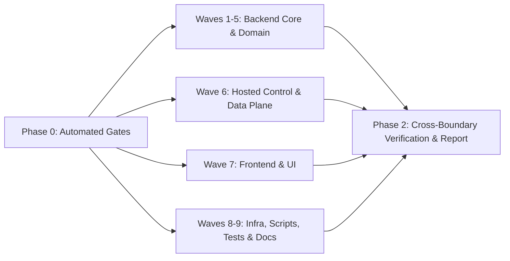

# Full Codebase Review Plan

**Date:** 2026-11-24
**Branch:** `hosted_mvp`
**Status:** Completed (2026-11-24) — see [FULL_CODEBASE_3db88c2c_REVIEW_COMMENTS.txt](../pending_code_review_comments/FULL_CODEBASE_3db88c2c_REVIEW_COMMENTS.txt) and [FULL_CODEBASE_REMEDIATION_PLAN.md](FULL_CODEBASE_REMEDIATION_PLAN.md)

## 1. Scope & Codebase Inventory

This plan covers the entire Easy Property Management repository on branch `hosted_mvp` (~212k production LOC, ~110k test LOC, excluding generated OpenAPI contracts and lockfiles), covering both **local single-operator mode** and **hosted Pilot 0 mode**.

| Area | Production | Tests | Key Directories |
| --- | ---: | ---: | --- |
| Backend Server | 701 files (143,482 LOC) | 198 files (81,339 LOC) | `application/apps/server/app/{bootstrap,platform,modules/*}` |
| Frontend & Shared UI | 145 files (46,264 LOC) | 84 files (25,350 LOC) | `application/apps/web/src/`, `application/packages/ui/src/` |
| Database Schemas | 31 files (3,736 LOC) | — | `application/database/*` (7 stores) |
| Deploy & Infrastructure | 56 files (12,865 LOC) | — | `application/deploy/hosted-mvp/`, `application/deploy/hosted-demo/` |
| Tooling, Scripts & Demo | 31 files (6,012 LOC) | 16 files (2,960 LOC) | `application/scripts/`, `application/demo/` |
| Contracts & Docs | — | — | `application/packages/contracts/`, `docs/database/`, `docs/hosting/operations/` |

> [!NOTE]
> The `hosted_mvp` branch diff was reviewed on 2026-11-24 ([HOSTED_MVP_BRANCH_27e9025d_REVIEW_COMMENTS.txt](../pending_code_review_comments/HOSTED_MVP_BRANCH_27e9025d_REVIEW_COMMENTS.txt)). This plan covers the **entire** codebase—including all 18 local/business domain modules, the full React frontend, database DDL, and infra—while also verifying post-`27e9025d` changes.

---

## 2. Review Standards & Output Contract

- **Actionable findings only** (per [AGENTS.md](../../AGENTS.md)): every finding must cite exact `file:line` references, concrete defect mechanics, real impact, and a recommended fix. No speculative style nits.
- **Severity rubric**:
  - **P0 (Critical)**: Data loss/corruption, security or tenant-isolation breach, broken backup/restore, unrecoverable crash/outage.
  - **P1 (High)**: Functional defect, financial/ledger calculation bug, auth/session/epoch flaw, DDL-vs-ORM mismatch, API contract break.
  - **P2 (Medium)**: Edge-case bug, missing rollback/idempotency, N+1 or unbounded query, race condition, UI state/error-handling bug, operational fragility.
  - **P3 (Low)**: Minor hygiene, dead code, stale docs/runbooks, non-blocking test gaps.
- **Deliverable**: A single consolidated plain-text review report saved to:
  `docs/pending_code_review_comments/FULL_CODEBASE_<short_sha>_REVIEW_COMMENTS.txt`
  grouped by architectural boundary/module with priority tags and summary metrics.

---

## 3. Execution Phases

### Phase 0: Automated Baseline & Structural Scans

Run deterministic checks first to surface mechanical, typing, contract, and boundary violations before deep code inspection:

1. **Python static checks**: `ruff check` and `ruff format --check` across `application/` using [pyproject.toml](../../application/pyproject.toml).
2. **Frontend static checks**: `npm run lint`, `npm run format:check`, and `npm run typecheck` from `application/` (per [CODE_QUALITY.md](../CODE_QUALITY.md)).
3. **OpenAPI & generated contract parity**: verify `openapi.json` and `packages/contracts/src/generated` match current FastAPI routers without drift.
4. **Architecture boundary scan**: automated import check verifying no module under `app/modules/*` directly imports another module's `infrastructure/` ORM models or repositories (enforcing [ARCHITECTURE.md](../ARCHITECTURE.md)).
5. **Hygiene & secret scan**: check for hardcoded credentials/tokens, bare `except Exception: pass` swallowing DB/schema errors, debug flags, and stray tracked artifacts.

---

### Phase 1: Deep-Dive Review Waves (9 Domains)

Each wave is scoped to a cohesive architectural boundary so reviewers can inspect complete call chains (`api -> application -> domain -> infrastructure -> DDL`) without context loss.

#### Wave 1 — Platform, Bootstrap, Database DDL & Core Storage (~18k prod LOC)
- **Scope**: `app/bootstrap/`, `app/platform/`, `app/hosted_candidates/`, `application/database/` (all 7 stores), `modules/workspace/`, `modules/audit/`, `modules/files/`.
- **Checklist**:
  - Local vs. hosted composition isolation (local mode never mounts hosted/test-auth routes).
  - SQLAlchemy ORM models vs. Alembic migrations (`sqlite-migrations`, `admin-migrations`, `hosted-access-migrations`, `host-inventory-migrations`, `recovery-migrations`, `admin-recovery-migrations`).
  - Transaction boundaries, SQLite writer locking/WAL, foreign keys, immutability triggers.
  - File content store path traversal, hash verification, orphan cleanup, and portable backup/restore layout.
  - Append-only audit integrity and snapshot read markers.

#### Wave 2 — Portfolio, Parties, Tenants, Leases & Inspections (~26k prod LOC)
- **Scope**: `modules/parties/`, `modules/portfolio/`, `modules/tenants/`, `modules/leases/`, `modules/inspections/`.
- **Checklist**:
  - Property/Space occupancy and availability timeline invariants.
  - Atomic Lease ↔ Portfolio transitions within one caller transaction, independent revisions, optimistic locking / ETag handling.
  - Timezone handling (stored Property zones for business dates, aware UTC instants for event time, explicit `asOf` for read classifications).
  - Inspection evidence linkage, comparison logic, and acknowledgment immutability.
  - N+1 query patterns in list/detail endpoints.

#### Wave 3 — Finance & Owner Accounting/Management (~22k prod LOC)
- **Scope**: `modules/finance/`, `modules/owner_accounting/`, `modules/owner_management/`.
- **Checklist**:
  - Monetary representation: integer USD cents everywhere, no float arithmetic, exact decimal string formatting.
  - Lease ↔ Finance explicit sync (no silent expectation creation); quotes/claims never counted as received income/spending.
  - Owner report verification ↔ Finance receipt adoption/creation atomicity and idempotency.
  - Deposit deductions, refunds, partial payments, and edge cases (zero/negative amounts, voiding, reversals).
  - Summary/aggregation query correctness and performance.

#### Wave 4 — Operations, Workflows, Intake & AI Governance (~31k prod LOC)
- **Scope**: `modules/maintenance/`, `modules/vendors/`, `modules/tasks/`, `modules/communications/`, `modules/intake/`, `modules/ai_governance/`.
- **Checklist**:
  - Source-owned transactional ports for creating linked Tasks and Files; task completion does not silently resolve physical issues.
  - State machine transitions and invalid-combination rejection across maintenance, vendor references, and tasks.
  - Intake canonical evidence retention, identity, and revision lineage.
  - AI governance: verify production registries remain empty/gated, no unguarded external model calls, proper cloud/device disclosure and redaction boundaries.

#### Wave 5 — Operator Composition Layer (~17k prod LOC)
- **Scope**: `modules/operator/`.
- **Checklist**:
  - Strict adherence to source-adapter boundaries (no direct cross-module ORM/repo access).
  - Home dashboard aggregation, cross-entity search, and information review query budgets (N+1, pagination, unbounded scans).
  - Incomplete-form recovery: prepares attempts and reads original owning results without dispatching or authorizing business commands.
  - Operator preferences persistence and validation.

#### Wave 6 — Hosted Control Plane, Identity, Recovery & Host Agent (~39k prod LOC)
- **Scope**: `modules/hosted_access/`, `modules/hosted_admin/`, `modules/hosted_recovery/`, `modules/host_agent/`.
- **Checklist**:
  - Auth/session lifecycle, CSRF/Origin/Host validation, handoff tokens, `access_epoch` fencing, and privilege separation (Operator vs. Admin vs. Host Agent).
  - Operator and Admin backup/restore pipelines, `SO_PEERCRED` UID alignment, manifest verification, and failure recovery.
  - Regression check on all fixes from `HOSTED_MVP_BRANCH_27e9025d` plus all subsequent commits (`0b80227e`..`HEAD`).

#### Wave 7 — Frontend Application, Shared UI & Contracts (~46k prod LOC)
- **Scope**: `application/apps/web/src/` (`app/`, `workflows/`, `shared/`, `admin/`, `central/`, `assets/`), `application/packages/ui/src/`.
- **Checklist**:
  - API contract consumption, error/problem-envelope rendering, and stale-closure/race-condition bugs in data fetching & form submission.
  - Local vs. hosted route and capability gating (ensuring no hosted-only UI leaks into local mode and vice versa).
  - Form recovery, dirty-state handling, optimistic UI vs. server revision conflicts.
  - Security (XSS, `dangerouslySetInnerHTML`, URL/redirect handling, auth token storage) and accessibility (keyboard nav, focus management, ARIA, semantic controls).
  - CSS/layout regressions across Operator, Admin, and Central apps.

#### Wave 8 — Deployment, GCP Infra, Gateway, Packaging & Scripts (~19k prod LOC)
- **Scope**: `application/deploy/hosted-mvp/` (`Dockerfile.*`, `gateway/`, `gcp/`, `identity/`, `lab/`, `sandbox/`), `application/deploy/hosted-demo/`, `application/scripts/`, `application/demo/`.
- **Checklist**:
  - Container hardening: non-root UIDs, exec-form `HEALTHCHECK`, pinned dependencies, offline/reproducible builds, no secret leakage into layers.
  - Gateway & network boundary: Cloudflare tunnel/proxy headers, host routing, rate limits, TLS/origin assumptions.
  - GCP infra & systemd units: IAM least privilege, Cloud KMS / R2 backup proxy permissions, host guardian, maintenance scripts.
  - Release/packaging scripts (`epm-release-*.sh`, `hosted_package.py`, `build_wheel.sh`, `stage_*.py`) for quoting bugs, partial-failure cleanup, and idempotency.

#### Wave 9 — Test Suite Audit & Documentation Alignment (~110k test LOC + key docs)
- **Scope**: Server `tests/`, Web `tests*` / `component-tests/`, `scripts/tests/`, `docs/database/`, `docs/hosting/operations/`.
- **Checklist**:
  - Identify high-risk blind spots where mocks hide real DDL/runtime bugs (e.g., mismatched SQL column/table names, flat vs. nested workspace paths).
  - Check for flaky timing assumptions, skipped/xfailed critical assertions, and missing rollback/idempotency tests.
  - Verify `docs/database/` store dictionaries match executable DDL in `application/database/` and operational runbooks match live scripts/units.

---

### Phase 2: Cross-Boundary Verification & Consolidated Report

1. **Cross-wave reconciliation**: trace findings across boundaries (e.g., Frontend ↔ FastAPI ↔ Service ↔ DDL, and Deploy scripts ↔ Host Agent ↔ Runtime).
2. **Evidence verification**: re-read every cited file/line on current `HEAD` to eliminate false positives and ensure exact line ranges.
3. **Prioritization & report generation**: write the consolidated report to `docs/pending_code_review_comments/FULL_CODEBASE_<short_sha>_REVIEW_COMMENTS.txt` with:
   - Executive summary (counts by severity P0–P3 and Phase 0 static check results)
   - Findings grouped by the 9 boundaries, sorted by priority within each group
   - Top remediation sequence recommendation (what to fix first)

---

## 4. Confirmed Execution Decisions

Confirmed on 2026-11-24 before starting Phase 0:

1. **Execution cadence**: **Option B** — Run wave-by-wave and pause after each wave for incremental triage, documenting confirmed findings incrementally into `docs/pending_code_review_comments/FULL_CODEBASE_3db88c2c_REVIEW_COMMENTS.txt` as each wave completes.
2. **Hosted MVP waves (Waves 6 & 8)**: **Option A** — Full fresh pass across all 9 waves so nothing is missed.
3. **Behavioral test execution in Phase 0**: **Option A** — Static checks + contract/boundary scans only during Phase 0 (fast, read-only).
