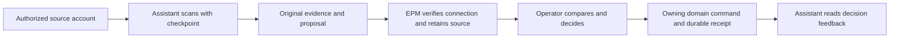

# Agent triage for property maintenance

Status: accepted design direction for remaining backlog, 2026-10-20. The assistant connection and source-backed issue review described here are not claims of shipped behavior. [INGEST-002](INGEST-002_DESIGN.md) owns issue review; [ASST-001](ASST-001_DESIGN.md) owns the shared assistant boundary. This design covers EPM-initiated assistance, channel discovery, and alternative local transports for that boundary.

This is the readable, current design. The [original detailed draft](../research/archive/agent-triage-design-original-2026-10-19.md), including its four diagrams, remains available for historical detail. Where the two differ, this document and the linked domain designs govern; the original contains several proposals that later review superseded.

## The experience we want

A tenant emails, “Water is leaking under the kitchen sink,” with a photo. An assistant that the operator connected to that mailbox finds the message and suggests an issue. EPM retains the original message and relied-on photo, then shows them beside the suggestion. The operator can correct the property, space, reporter, category, or priority before deciding what belongs in the official record.

There is **one review queue for submitted suggestions**. The operator can create an issue, link the source to an existing issue, apply selected changes to an existing issue, dismiss it as no issue, or discard the proposal for rework. The assistant's confidence never makes that decision. Manual issue entry remains available when no assistant is connected.

The product idea is “messages from the channels tenants and providers already use, in one place for review.” The stronger promise “never miss a maintenance emergency” is **not supported by an agent merely reporting consecutive proposal numbers**. The product must show source coverage and unknown gaps honestly. Email and SMS scanning are not emergency-response channels; an urgent alert can only follow discovery and admission of a message.

An assistant may later help acknowledge, assess, coordinate, compare quotes, verify, and close work. The recurring pattern is **assistant drafts, operator decides, EPM records**. Every outbound message remains operator-sent, and each official change goes through its owning module. The app remains useful with intake assistance off, lifecycle assistance off, or both off.

### At a glance

| Concern | Owner |
| --- | --- |
| Mail, SMS, and call-transcript access; provider checkpoints; interpretation | The separately authorized assistant. EPM holds no channel credentials or mailbox poller. |
| Connection grants, bounded context exports, source admission, retained evidence, receipts, audit, and health display | EPM, through Intake, AI Governance, and the shared assistant boundary. |
| Official issues, appointments, quotes, assignments, work journal, and paid spending | Their existing EPM domains, after an operator-approved command. |
| What is watched and what becomes official | The operator. |

## 1. What the operator configures and sees

The operator chooses the source mailboxes, labels, SMS threads or numbers, and call-transcript sources. They can scope the connection to selected properties and units, permitted reads, proposal types, data classes, and an expiry. A property-level enablement option can narrow a broader connection. No channel is enabled by default. Settings explain what EPM exports and what the assistant itself can see through its separately granted channel access.

Intake triage and lifecycle help are independent switches. All four combinations are valid: fully manual; intake only; lifecycle help on manually entered issues; or both. The first assistance opportunity can be a contextual **Draft follow-up** on an existing issue using a qualified EPM-invoked model, without pairing an external assistant or granting mailbox access. An on-device model needs no external disclosure; a hosted model still needs its task-specific disclosure permission. Connected-assistant setup appears when the chosen task actually needs its channel or ongoing work capabilities. A change mid-issue does not alter the official issue lifecycle. Disabling assistance leaves already admitted drafts for operator disposition and cancels pending agent work requests. A global AI pause and per-connection pause/revoke control EPM-mediated access and submissions. They cannot retract data already disclosed or stop an independently scheduled mailbox scan; the UI must say that clearly.

Daily screens use property-management language: “assistant,” “connection,” “suggestions,” and “last checked.” They do not require an operator to understand JSON, sequence counters, or heartbeat files. Suggestions stay in EPM's review queue; drafts and follow-up help stay on the relevant issue, where the operator can inspect, edit, and decide. Settings holds connection grants and troubleshooting, not a second daily work queue in the assistant's app. The queue makes evidence and uncertainty easy to inspect, with quick actions to approve, edit, dismiss, or request rework. Low-confidence suggestions and unresolved property, space, or reporter matches are visibly distinguished and cannot be presented as ready for one-tap approval. A suggestion offers direct corrections such as “wrong property,” “wrong category,” or “not maintenance,” with the source visible while editing; a correction is an operator decision, not a silent learning rule. An unmatched-property view groups suggestions that need an explicit property choice. A separate connection-problem view shows quarantined submissions with safe reasons and next steps—correct the adapter, grant, or source data and resubmit through admission; a malformed or unauthorized file cannot be promoted into review by clicking it. The queue needs a good phone layout, since operators may triage away from a desk. Batch review can reduce clicks, but each selected item still receives an explicit, visible operator decision; it is not an auto-create rule. A decision's correction history and the relevant original source remain inspectable. Any undo affordance must use the owning domain's supported correction or replacement action rather than erase an audit event.

The first run should set a realistic expectation: early suggestions may need property and category corrections, and every suggestion still needs review. EPM retains those corrections and may publish bounded feedback to an authorized assistant, but improvement over time must be measured; neither the setup flow nor report card should claim automatic learning or a guaranteed accuracy curve.

The same screen distinguishes “nothing new to review” from “a source has not been checked.” For example: “Gmail last fully checked at 9:15; Outlook needs reconnection; no known gaps in Gmail's verified interval.” It displays last contact, last complete scan per source, unresolved intervals, queue age, and connection or source errors separately. A persistent, dismissible degraded/offline banner explains what is affected, the last verified scan, and the relevant reconnect or manual-entry action without promising that unseen messages will be found later. Connection detail shows pending submissions, the oldest unacknowledged item, admission-receipt delay, pack compatibility, and per-source progress separately; receipt delay measures EPM handoff, not mailbox discovery. An empty state can say “No new maintenance suggestions; last complete check 12 minutes ago” only when that is true. One non-repeating alert for a prolonged outage or source authorization error is preferable to repeated notifications. Urgent *admitted* suggestions may notify immediately; routine items can collect into a digest. A weekly “what the assistant caught” summary can report measured outcomes, not guessed coverage.

For a local assistant, setup and connection status must say that scans may stop when its computer sleeps, shuts down, loses access, or the assistant is not running. On return, show a catch-up state and its verified source interval; provider pagination and retention determine how much can actually be recovered. Do not promise that every message missed during an outage will be found. Manual EPM entry remains available throughout.

### A trust ladder, not a required sequence

Operators may enter at any level that solves their immediate problem. A new customer seeking quote help should not have to use automated intake first. What changes between levels is the task and access granted, not whether human approval is required.

| Level | Operator-facing outcome | Access and boundary |
| --- | --- | --- |
| 0. Use EPM manually | Record and manage work without an assistant. | No assistant access. |
| 1. Help me write | Draft a reply or summary from app data. | A registered on-device model can do this without external disclosure. |
| 2. Watch selected sources | Suggest issues from selected messages. | Explicit read access to the selected source accounts; every submitted candidate enters EPM review. |
| 3. Track the back-and-forth | Surface linked tenant/provider updates and draft coordination messages. | Read only permitted issue threads and bounded EPM context. |
| 4. Help with bidding | Suggest known providers, source an unverified shortlist, draft requests, and compare replies. | Additional bounded context or web access as needed; operator chooses contacts and sends messages. |

The onboarding question can be “What brings you here?” and offer the matching capability directly. A level includes only its necessary technical prerequisites: bidding may need drafting and linked-thread monitoring, but not automated intake. Contextual invitations should follow demonstrated need (many manual issues, repetitive replies, or a difficult comparison), be dismissible, and include “Don't suggest this again” for that invitation type until the operator resets it in Settings. A report card can show actual correction rate and time saved once enough observations exist; it cannot invent claims such as “47 of 50 right” before evidence exists. A guided first run, exact scope receipt, test suggestion, and prominent pause control make entry possible without requiring the user to earn trust through unrelated levels. Settings provides a plain-language “What this assistant can see now” view with granted sources, property/data scope, roles, expiry, and recent EPM-mediated exports, submissions, and decisions, plus pause and revoke. It distinguishes EPM-mediated activity from whatever the assistant can do independently through its channel accounts. Certification can help only after a real conformance test. Social proof must be evidence-based, not assumed.

Earlier drafts proposed unlocking reduced supervision after a run of accurate suggestions: batch approvals, standing draft approvals, and routine auto-creation. **The current initial contract does not permit automatic issue dismissal, creation, update, outbound sending, or spending.** Convenience can improve review ergonomics, but any future reduced-supervision rule needs its own backlog, explicit consent, domain policy, and evidence. A day-one user of a complex feature still gets the full help with close review, visible activity, and easy reversal.

## 2. How a channel message reaches the record

1. **Discover.** The assistant scans its authorized channel accounts with provider-supported pagination, overlap, and durable per-source checkpoints. Each discovered message receives a disposition: submitted, excluded with a reason, or pending retry. The assistant does not advance past an unresolved page.
2. **Prepare.** For a candidate, it packages the bounded original message or transcript, provider/account/message identity, occurrence time and time zone, participants, and each attachment on which the suggestion relied. A separate typed proposal describes the likely issue and uncertainty. A source ID and short snippet help the preview but do not replace reviewable evidence.
3. **Submit.** The transport authenticates the writer and carries the source plus proposal through the shared assistant admission service. EPM checks the current grant, pause, scope, schema, sizes, action registration, and idempotency before Intake retains evidence and AI Governance stages the external proposal. External admission does not run another model.
4. **Review.** The operator compares the exact retained source revision, attachment set, governed input, and proposal. An unresolved property, space, reporter, category, priority, or event time stays unresolved until the operator supplies valid values. Possible duplicate issues are shown as suggestions, never merged automatically.
5. **Decide.** [INGEST-002](INGEST-002_DESIGN.md) applies exactly one selected outcome: create; link without changing an issue; update only selected mutable fields and link; dismiss as no issue; or discard the proposal for rework while leaving the source unprocessed. Source and target revisions are checked in the transaction; a stale comparison returns to review.
6. **Acknowledge.** EPM records an authoritative admission and decision receipt and publishes a retryable projection to the assistant. If channel permissions and operator settings allow it, the assistant may label or archive the exact source message after the final outcome; it must not delete it.

### Details that affect classification

The assistant may classify a message as a new request, provider reply, unrelated chatter, or likely non-maintenance, with a reason. It may exclude clearly unrelated scanned messages before submission, but scan reports count those exclusions and preserve reasons. A submitted candidate labeled “ignore” still receives an operator decision, especially if it has possible emergency cues. An uncertain property goes into an unassigned review bucket; low confidence gets a prominent review cue. The queue may sort by admitted urgency and recency, without treating the assistant's urgency as official.

For SMS, a six-text conversation can be grouped into one queue item, but each text retains its own provider identity and original evidence. A voice suggestion uses an actual transcript with provenance; speech recognition uncertainty is visible, and relied-on audio is retained under [Files](../modules/files.md) if allowed by the source contract. Terms such as “flooding,” “no heat,” or “locked out” can raise a review flag; keywords alone cannot make an official priority. Cross-mailbox or cross-source duplicates are only hints. A deterministic first-pass heuristic can compare property, category, recency (for example 14 days), and summary overlap; the operator decides whether to link or create. A future semantic matcher may improve candidate ranking without changing that rule.

The assistant can use exported addresses, units, and aliases such as “the Elm St duplex” to suggest a match. It must not convert a sender or nickname into an authoritative Property ID without review. The proposal uses Maintenance's fixed issue category vocabulary and `low`, `normal`, `high`, `urgent` priorities. Provider trade/category, Finance expense category, and custom operator language are separate concepts; a transport-specific category list cannot redefine Maintenance policy.

### The proposed envelope

The versioned submission carries a stable intent ID, connection-scoped idempotency key, source kind, verified provider/account/message identifiers, per-source *proposal* sequence, canonical payload fingerprint, evidence manifest, and typed issue proposal. The proposal has bounded summary and description, reporter/property/space text copied or inferred from the source, suggested category and priority, rationale, confidence, and explicit unknowns. An optional existing-issue candidate has its own reason and provenance. The effective connection and grant identity come from the verified transport, not from `agent_id` inside the JSON.

Evidence follows [Intake](../modules/intake.md) and File limits: bounded subject and plain-text body or transcript, original participants and event time, qualified source identity, and relied-on attachments. Provider content is untrusted. Corrections append retained Intake revisions; they do not rewrite the original. The source revision and fingerprint cited by the proposal must be the ones the operator sees during review.

## 3. The proposed local file adapter

File exchange is a **candidate transport**, not a new business boundary. [ASST-001](ASST-001_DESIGN.md) supplies the connection, grant, admission, receipt, health, and audit semantics. A file adapter calls those same services; it never writes Intake, AI Governance, Maintenance, or Finance tables directly. Muse is the first file-adapter qualification trial because its reported file commands make this plausible. Its actual unattended schedule, access to the chosen local folder, and trustworthy writer isolation still need testing. If it cannot meet them, output can be imported manually; EPM must not present that as a live connected assistant.

EPM creates and manages one exchange per connection inside the selected workspace, for example `integrations/assistant-exchange/<connection-id>/`. The operator chooses and backs up one EPM workspace, rather than maintaining a second exchange location. The assistant receives access only to its connection's exchange subfolder, never the workspace root. EPM binds the folder to the workspace and connection IDs in app-owned settings and presents the external assistant's folder authorization as part of the same connection setup. The assistant platform may still require its own permission prompt. The recoverable exchange state joins the normal encrypted workspace backup as specified below. This follows the [Muse adapter boundary](../research/META_MUSE_RESEARCH.md#exchange-directory-and-access).

Automatic admission requires an exchange isolated per connection and tested operating-system attribution of the actual writer. File ownership, directory permissions, and read/write separation must enforce the granted role and data scope; a sibling directory is not an access boundary if the assistant can read the workspace as the same OS user. Setup must verify that the assistant can reach only its exchange subfolder. If a product cannot enforce and demonstrate that scope and attribution, automatic file exchange stays disabled and the operator uses manual handoff. Knowing the folder path, writing valid JSON, or claiming an `agent_id` is not authentication. The app verifies writer, connection, active grant, scope, registered action, pause state, and bounds on every admission and before every export. Two agents may be assigned to intake and lifecycle roles separately; each gets its own grant and exchange. Same-role or overlapping-source claims are surfaced and resolved through EPM grants, not trusted heartbeat labels. Role separation limits prompt-injection exposure only if the data and OS permissions are truly separate.

EPM's authoritative settings, including any `agent-bridge.json`, remain app-only. The assistant never reads or edits that file. An agent-facing export is a scoped, versioned projection, not a copy of app settings.

| File or record | Writer | Content and use |
| --- | --- | --- |
| `properties.json` | EPM | Permitted Property IDs, addresses, unit designations, and aliases; hints for matching, refreshed after relevant changes. |
| `triage.json` | EPM | Selected source accounts/filters, requested cadence, first-run lookback, classification hints, and relevant taxonomy labels. The assistant reports what it actually used. |
| `issues.json` | EPM | Optional bounded open-issue watch list and thread references, only with a lifecycle grant. Current issue facts and revisions remain source-owned. |
| `providers.json` | EPM | Optional permitted Provider trade, area, preference, and bounded history for later assistance; not a complete unscoped vendor book. |
| `inbox/*.json` | Assistant | Completed source evidence and proposal; write `*.tmp`, then atomically rename. |
| `acks/*.ack.json` | EPM | Versioned projections of durable admission and later operator-decision receipts. |
| `quarantine/` | EPM | Visible malformed, oversized, unauthorized, or conflicting files with safe error detail. |
| `requests/` | EPM | Optional later drafting requests, state versions, and cancellation tombstones. |
| `state/` | Assistant, if supported | Portable provider checkpoints, pending-submission ledger, and receipt cursor for recovery. EPM backs up only a validated, completed snapshot; it cannot recover hidden agent state or account credentials. |

### Delivering the integration

Ship a versioned **assistant contract pack** with EPM, separate from any third-party assistant installation. Its manifest names the contract version, supported transport and action schemas, and the files' digests. The pack contains the proposal/evidence and result schemas; file-publication and idempotency rules for the file transport; scoped export formats; receipt status and correction-feedback handling; health and source-coverage reporting; classification guidance with uncertainty and urgency examples; and the request runbook for each registered lifecycle action. It describes behavior to implement, not a claim that a named assistant already performs it. Agent-specific adapters or setup instructions can add product details without changing EPM's admission and review contract. A transport that does not use files needs its own transport instructions, while sharing the same grant, action, result, and review semantics.

Setup is a short, task-specific sequence:

1. **Choose the job.** The operator selects a concrete assistant and task, such as drafting on an existing issue or watching a selected mailbox. EPM shows only the access that task requires; drafting does not request mailbox access.
2. **Preflight EPM.** Before sending the operator to another app, EPM checks its workspace, managed exchange if needed, contract/action version, and proposed grant. It creates the scoped exchange and presents non-secret connection instructions only when these checks pass.
3. **Authorize the assistant.** EPM guides the operator through the exact folder or channel permission required by that product, then returns to the test. EPM cannot install the external assistant or grant its channel accounts on the operator's behalf.
4. **Prove the round trip.** A synthetic request or proposal and durable receipt test connection identity, submission, and acknowledgment without creating an official issue or communication. File exchange also requires independently qualified subfolder isolation and writer attribution; a test file or heartbeat cannot prove either. Drafting, source access, scheduling, and catch-up are enabled only after their separate checks pass. A draft test does not establish that a mailbox is being watched.

The wizard identifies the failing stage—assistant unavailable, folder permission/isolation, EPM grant, source-account permission, unsupported version, submission, or missing receipt—and gives a plain-language next action with **Retry test**. Routine recovery may republish a receipt or refresh an export from EPM's durable state, but it must not silently widen access, repeat an uncertain outbound action, or relabel an unverified scan as complete. An unqualified capability remains unavailable with manual handoff offered where appropriate. The connection-problem view links to the same guidance for later failures: **Reconnect source** opens the assistant's account-permission instructions, **Update adapter** shows the required version, and **Retry test** checks the repaired connection. These actions do not pretend EPM can change external permissions itself. Backup failures stay in EPM's normal backup guidance; the assistant connection must not imply it can recover a lost backup key or external account access. This is an onboarding target, not a promise of five-minute setup across all assistants.

EPM records the contract version and adapter identity demonstrated by the connection and shows a specific mismatch or failed-capability status in Settings. On an EPM or pack update, a compatible connection may continue under an explicitly supported version range; an incompatible one pauses automatic submissions or requests until its adapter is updated and the relevant round trip passes again. Do not infer an assistant upgrade merely because the pack was replaced. Pack delivery may be a file copy for a file-capable assistant, but installation and updates remain product-specific. Connection health continues to distinguish version/contact status from actual per-source scan coverage.

### Admission, acknowledgments, and feedback

EPM watches for completed inbox files while running, using an OS watcher with periodic reconciliation where useful. It parses JSON, validates schema and bounds, verifies the actual writer and grant, and then checks idempotency. An identical key and fingerprint within a connection returns the original receipt; a changed payload under the same key is a conflict. If two connections claim the same provider message, Intake may deduplicate only when the account identity is verified; otherwise the UI offers a duplicate hint. A proposal `seq` gap warns of a missing submission file without blocking other files.

Within the owning transaction rules, admission retains source evidence, stages the proposal, stores the receipt and audit, and advances durable submission progress. Moving the file to `processed/` and publishing the ack occur **after** commit. If either file step fails, startup reconciliation repairs it from durable state. Malformed or unauthorized files are quarantined visibly and are not called “received for review.” An exact replay cannot create a second source, draft, or issue.

The first receipt means `accepted_for_review`. A later version records `approved_committed`, `dismissed`, or `superseded`, with the selected INGEST-002 mode and stable result IDs only after the domain transaction commits. A rejected admission includes safe retry guidance. The app stores the receipt before projecting an ack file. The assistant consumes acks before scanning a source again: it stops resending accepted submissions, then uses final outcomes to avoid re-proposing the exact message. It may apply a channel label or archive action only under its separate channel permission and operator setting. It never removes an EPM-owned inbox, ack, or quarantine file.

The earlier design treated edited-property feedback as a sender-to-property override and “not maintenance” as a sender exclusion. That would turn one operator correction into a broad, unreviewed rule. **Current design:** corrections and dismiss reasons are bounded examples for future suggestions. A durable sender mapping or exclusion needs a separate, explicit operator confirmation, limited source and property scope, expiry, and a way to revoke it. EPM publishes labeled outcomes; it does not push model updates to the assistant.

Acks are transport projections, while EPM's database is the authority. Terminal files may be collected after **90 days** only if an authorized, bounded receipt-resync operation can reconstruct missed outcomes. The old proposal for a never-collected `acks/digest.json` is unnecessary and would grow without bound. An agent down longer than retention reauthorizes and resynchronizes instead of assuming its local cursor is complete.

The assistant retries an unacknowledged submission with the **same bytes, key, fingerprint, and proposal sequence**, with backoff. A working target is to report repeated failure after roughly five attempts rather than silently drop it; the exact interval is a qualified-agent setting, not a correctness guarantee. If the app has accepted it but the ack file is missing, EPM republishes the same receipt. A final decision may arrive days after the admission ack. The assistant retains pending-submission state until it has an admission receipt and enough information for its own source disposition.

### Connection and source health are different

A heartbeat may report agent instance, kind, pack version, observed poll cycle, source statuses, pending submissions, and errors. The app can show the time of its own last authenticated contact, but neither a file mtime nor a replayed agent counter proves fresh source coverage. Agent timestamps can have clock skew; EPM's receipt time is used for app-observed contact. A stale heartbeat is advisory: it never gates a valid authorized write and does not replace grant validation.

Each source report includes the actual account/filter scope, poll ID, last fully successful scan, provider checkpoint range, scanned/submitted/excluded/retry counts, failed pages, and unresolved intervals. EPM reconciles submitted counts with admitted submissions. A connection can be online while one mailbox has an expired authorization; the UI should say “degraded: 1 of 3 sources failing.” A fresh heartbeat with unchanged source progress is not “caught up.” Thresholds for degraded/offline display and a one-time alert can be configurable; a suggested baseline is two expected intervals for degraded and four for offline. The UI uses measured intervals and clear last-seen times instead of a hard-coded claim that a 15-minute scan always finishes in ten minutes.

Proposal sequence numbers expose only gaps between submissions. They cannot detect a message the assistant never discovered or excluded incorrectly. The assistant therefore persists provider checkpoints, paginates, overlaps after interruption, records a disposition per discovered message, and never advances past unresolved work. Reports such as “47 scanned, 12 submitted, 33 excluded, 2 pending retry” are useful if scope and intervals are known. EPM can compare receipts with submissions and display uncertainty, but cannot claim “zero dropped” merely because counts reconcile. A rolling last-24-hours search is inadequate after longer downtime; provider retention and a fresh-agent lookback create honest coverage limits. False-negative emergency samples should be evaluated during qualification.

Normal scanning may be requested every 15 minutes and EPM may admit an already-written local file within about a minute while open, but provider latency, agent scheduling, offline devices, and review time vary. A burst-pipe email may wait a full cycle or more. Tenant-facing guidance must direct immediate emergencies to an appropriate immediate channel. Emergency recall should be an evaluation priority, with classification biased to surface uncertain danger; it is not a guarantee. Category and duplicate precision, time to proposal, and time to operator decision are measured separately. Items pending operator review around 48 hours can receive a follow-up reminder; that is not an agent-delivery failure.

## 4. Restart, cancellation, and restore

Three durable areas have different owners: EPM's database for admitted evidence, proposals, decisions and receipts; the assistant's own provider checkpoints and pending work; and exchange files as retryable transport. Neither process should depend on irreplaceable in-memory state. Restart order does not matter to the EPM admission contract, but complete source catch-up depends on the assistant and provider.

| Situation | Required recovery |
| --- | --- |
| EPM stops before admission | Re-scan the inbox on startup; validate the current grant and process normally. |
| Admission commits, then file move or ack write fails | Use durable result to move/republish; an exact replay receives the same receipt. |
| Assistant stops after writing but before receiving an ack | Reload pending state and retry the identical submission. |
| Assistant misses final decisions during a long outage | Reauthorize if necessary and resync bounded permitted receipts. |
| Scan fails mid-page | Keep the checkpoint before unresolved messages; retry with overlap, report partial coverage. |
| Assistant is down for days | Manual EPM workflow continues; the source provider retains messages only according to its own policy, so coverage outside retention is marked unknown. |
| EPM is down while the assistant works | Files may accumulate within explicit disk limits; the assistant reports unacknowledged submissions and does not invent successful delivery. |

On EPM startup, reload persisted review state, ingest eligible waiting files, repair receipt projections, recompute health, and collect transport files only after their durable results and retention rules are checked. On assistant startup, read final receipts first, refresh grant-scoped exports, reconcile pending submissions, then resume each source from its durable checkpoint with pagination and overlap. It can report “catching up: 212 messages” if it has a valid count. It must not report “all caught up” before every authorized source scan has completed and unresolved intervals are displayed.

The file-adapter implementation must extend EPM's existing encrypted, consistent workspace archive to include recoverable state from the managed exchange. Include completed, unadmitted inbox files and validated portable `state/` snapshots where the assistant supports them. EPM's database remains authoritative for admitted evidence, decisions, receipts, and request state; exports, acknowledgment projections, heartbeats, and temporary files may be regenerated. Capture only atomically completed regular files within the assigned subfolder, reject symlink escapes, and verify size and digest so a concurrent assistant write cannot silently produce a partial backup. If a consistent capture cannot be made, the backup fails clearly and publishes no archive labeled complete. There is one EPM backup operation, with no separate exchange backup for the operator. It cannot contain the provider mailbox, assistant account credentials, cloud memory, or hidden agent checkpoints. Cloud-synced folders remain unsuitable as a live SQLite workspace; backup archives may be stored in a chosen external location under the app's backup policy. A workspace lock prevents two EPM writers. Multiple assistants with overlapping source roles must be resolved through grants and coverage checks, not assumed to cooperate silently.

Restore invalidates live assistant grants and quarantines restored unadmitted files; it never admits them under a new grant automatically. EPM recreates scoped exports and receipt projections from durable records after the operator reauthorizes the connection and confirms the actual account and filters. A portable checkpoint, if present, is reconciled with EPM receipts and the provider before use; an assistant without exportable state needs a provider-supported lookback and overlap. A fresh assistant may offer a configurable first-run lookback, for example seven days, with older time clearly labeled outside verified coverage. Outstanding EPM work requests are recovered from their durable status and reconciled or cancelled rather than reissued blindly. One workspace backup makes EPM's exchange files portable, but does not imply exact continuation of the assistant's external state. After restore, verify the review queue, receipt history, source coverage, and new authenticated contact before calling the connection healthy.

## 5. Assistance on existing issues

Lifecycle assistance is a sidecar. An issue created manually and one created from reviewed Intake evidence follow the **same Maintenance workflows**. The assistant may supply a draft or suggestion wherever a registered action and operator review exist. Enabling lifecycle help on an older issue can add it to a bounded, permissioned watch projection; disabling it does not strand the operator. In lifecycle-only mode the assistant watches explicitly linked open-issue threads and work requests, rather than scanning every channel message for new issues.

### EPM-initiated work requests

This subsection describes **EPM asking an assistant to help with an existing issue**, such as drafting a tenant follow-up. It is the opposite direction from intake: in intake, the assistant finds an external message and submits a suggestion to EPM; here, EPM starts a bounded task and waits for a draft or an error. The two capabilities can be built independently. An operator-triggered, tightly scoped request may be the better first assistant integration: it provides useful help without requiring mailbox discovery, source-coverage claims, or unsolicited-message triage. The request exchange described here is not yet implemented.

For example, the operator clicks “Draft follow-up” on an issue. EPM records a request containing the issue's current revision, the relevant facts the assistant is allowed to see, the requested draft type, and an expiry. EPM publishes that request to the assigned assistant. The assistant either returns a draft for operator review or explains why it cannot complete the task. The operator may edit and send the message through their own channel; the assistant's response never sends it or changes the issue by itself.

The request/response file exchange is available only after that specific action is registered with AI Governance and its owning domain. EPM stores the request ID, connection, type, issue revision, bounded context, creation and expiry times, and state version. The request file is a projection of this record. The assistant uses a stable response key derived from its connection and request ID. Retries may happen, but EPM accepts **at most one terminal response for the current request version**. “Exactly one response” is the assistant runbook's aim, not a guarantee an unreliable assistant can make.

On each cycle, the assistant reads receipts first, then processes requests by priority and creation time, then scans sources. It checks the request type, grant, issue context, and expiry. It drafts only from supplied context, permitted reference exports, and authorized channel threads. Missing essential facts produce a typed error; a minor gap can appear as an operator-fillable placeholder such as `[TIME]`, never an invented fact. Possible future request types include acknowledgment, follow-up, bid-request, and digest drafts, each registered separately.

If the operator cancels, EPM durably changes the request to `canceled` and publishes a versioned tombstone. Deleting a file alone cannot cancel work the assistant may already have read. A late answer is rejected against current request state. If there is no usable response by an example timeout of one hour, EPM shows `timed_out` and offers manual drafting; a new attempt uses a new request ID. EPM's Tasks or other owning module holds any real-world deadline. Turning off lifecycle assistance cancels pending requests but leaves already admitted drafts for operator disposition.

The earlier proposal added a new chain of issue statuses—`acknowledged`, `assessing`, `awaiting_bids`, `verified`, `awaiting_payment`, `paid`, `closed`—and new `issue_events`, `drafts`, `payments`, and equipment-memory tables. **Those are not EPM's current domain model.** [Maintenance](../modules/maintenance.md) owns its existing issue statuses, appointments, quotes, assignments, costs, and work journal. [Finance](../modules/finance.md) owns actual paid Expenses, not invoice drafts. [Communications](../modules/communications.md) records interactions and does not send. Tasks owns follow-up commitments; Files owns evidence. This design maps useful stages onto those owners instead of creating a second issue lifecycle or ledger.

### What help could look like, stage by stage

| Operator task | Helpful assistant work | Operator and EPM consequence |
| --- | --- | --- |
| Acknowledge a new report | Draft a tenant reply from permitted issue context, expected next step, and timing. | Operator edits/sends in their channel and records the interaction. Task reminders can flag an operator-set response target, such as four business hours, with special urgency for admitted emergencies. |
| Assess | Summarize past issues at the property, known equipment facts if available, and possible cause or fix-versus-replace questions. | Advisory only. Operator confirms Maintenance category/priority or other issue changes. No equipment inventory is assumed to exist. |
| Inspect | Draft a checklist, photo request, or scheduling note. | Operator sends; Maintenance records an appointment, Files links actual photos and notes. |
| Seek quotes or dispatch | Suggest a preferred known Provider or an unverified web shortlist; draft consistent requests; extract price, ETA, warranty, and exclusions from replies. | Operator chooses recipients, sends requests, and selects quotes/assignments in Maintenance. A portfolio-average comparison needs a separately specified, valid aggregate. |
| Monitor work | Identify “parts delayed,” a new proposed time, or a tenant/provider reply in a linked thread. | Operator confirms any issue/journal/appointment changes. Task reminders can flag stale follow-up or missed target dates. |
| Verify | Draft a completion summary and tenant confirmation request; surface “still broken.” | Operator sends and records confirmation or further work. A reply about the same repair is proposed as an update linked to that issue, not a new issue by default; the operator confirms the link and any Maintenance change. An appointment's completion does not resolve an issue automatically. |
| Handle invoice | Extract invoice amount and reference; compare with selected quote and recorded paid Expenses; flag duplicate references or changed payment instructions. | Invoice remains evidence/advisory context. Only operator-confirmed actual spending becomes a Finance Expense. No bank instruction in inbound content is authoritative. |
| Finish | Draft closure summary, tenant update, or work-history note. | Operator reviews a closure checklist of physical outcome, remaining follow-up, invoice/Expense disposition, and tenant communication, then uses Maintenance, Tasks, Communications, Finance, and Files as appropriate. A future equipment record may receive a separately confirmed replacement/update; no equipment inventory or invented “paid” issue status is assumed. |

The assessment request should normally include only what this task needs: relevant same-property and same-category issue dates, verified outcomes, linked Provider work, and costs where available; related open issues; and permitted equipment install dates or warranties **if an equipment source later exists**. These are bounded facts, not an inferred equipment inventory. The assistant can suggest cause, urgency, and fix-versus-replace questions, while the operator confirms any official change. Operator corrections may be published back as scoped, labeled examples under the feedback rules above; a correction does not silently retrain a model or create a standing property rule.

A standing Provider export can contain permitted trades, service areas, preferred flags, and bounded job history when those domains expose them. For known Providers, a future shortlist may explain its ranking using actual preferred state, matching trade/area, and supported past-work measures; do not invent response-time, cost-versus-quote, or operator-rating scores from incomplete records. For an unknown trade or area, web results need source links and an **unverified** label; the assistant never contacts a provider without the operator choosing and sending. A quote comparison can display price, ETA, warranty, and exclusions. A “2.3× normal cost” callout is a later analytic idea, not a number to show until its source, sample size, and calculation are specified.

**Future possibility: bounded Provider-term negotiation.** The first useful capability is preparation: compare offers, identify missing scope, timing, warranty, and exclusions, draft a counteroffer, track replies against the current quote, and recommend a next response. The operator approves and sends every message and makes the final quote and assignment decision. An agent conducting the exchange itself is a separate, later capability because Communications does not currently send and an outbound counteroffer can create expectations beyond a draft. If explored, an operator would authorize a mandate for one issue and named Provider with explicit price and concession bounds, permitted topics and channel, maximum rounds, expiry, and conditions that require immediate handoff. EPM would need a qualified outbound adapter, retained original messages and proposed terms, revision-aware quote matching, per-message authorization and idempotency, a visible stop/revoke control, and recovery after an uncertain send. The agent could ask or counter only within that mandate; acceptance, dispatch, spending, and any change to official records remain operator-confirmed domain commands. Test the draft-and-approve workflow first, then evaluate whether bounded agent-sent counteroffers save enough time to justify the added trust and operational cost. Lease-term negotiation is a separate design question.

Scheduling may involve tenant-proposed and provider-counterproposed windows. The assistant can summarize the back-and-forth and suggest an appointment, while the operator confirms the final time. If the operator's calendar busy blocks are disclosed, that is a separate scoped read. A silent tenant after a completion request may prompt a Task or draft nudge. None of this implies EPM sends a message itself.

For invoice safety, compare the stated amount with the selected quote and show variance (a 10% highlight is a possible UI threshold, not a Finance rule). Check for a likely duplicate invoice reference and whether job completion has been recorded; display a prominent warning if payment instructions differ from known Provider details. A high-dollar banner (for example $5,000) could direct extra operator attention. These are **advisory checks** until a Finance design explicitly owns them. They do not create a payment record, forbid unrelated Expenses, or establish that a bank account is valid.

Additional later opportunities include photo interpretation (“possible supply-line leak”), recurring-failure insights, seasonal property checklists, a weekly opened/closed/stuck/awaiting-decision digest, and a plain-language reading of a lease or HOA excerpt. Each requires an explicit data source, scope, registered action, review route, and privacy check. An insight can be dismissed or converted into planned work only through the relevant Task or Maintenance command. Document interpretation remains advisory.

### How each task gets its context and tools

Choose an execution path from the **work required**, not a vendor name. Three questions are separate: What information and tools does the task need? Who starts it—EPM after an operator action, the operator in an agent conversation, or an assigned schedule? Which model or agent product performs it? An EPM-initiated “Draft follow-up” can use a registered model call or a bounded request to a connected agent; an agent discovering new mail needs separately authorized channel access and reliable source scanning.

| Work | EPM records sufficient? | Illustrative performer |
| --- | --- | --- |
| Draft an acknowledgment, follow-up, assessment, closure note, digest, or preventive suggestion from permitted EPM context | Yes | An app-invoked on-device model, such as a qualified Gemma runtime; a hosted OpenAI GPT, Claude, Grok, or Muse Wonder model through its API; or a connected task agent given the same bounded context. |
| Normalize a quote or interpret a photo already retained in EPM | Yes, if the chosen model supports that input | A qualified local or hosted model, or an agent through a separately authorized request. The output remains a reviewed suggestion. |
| Read a tenant/provider thread, scan mail, coordinate through external channels, or search the web | No | A qualified agent with the needed channel/web tools and explicit grants. A model API call alone does not supply those tools. |

The product names refer to different layers:

| Layer | Examples | Meaning for EPM |
| --- | --- | --- |
| **Model used by EPM** | On-device Gemma; hosted [OpenAI GPT models through the OpenAI API](https://developers.openai.com/api/docs/guides/text), Claude or Grok models through their APIs, or Meta [Muse Wonder](https://dev.meta.ai/docs/overview) | EPM owns the call, governed input, output, and review. The model may run locally or through an API. It can also power an agent harness, but the model name alone says nothing about tools, scheduling, or EPM access. |
| **Operator-invoked task agent or assistant** | [Codex or ChatGPT Work](https://learn.chatgpt.com/docs/use-chatgpt), [Claude Cowork or Claude Code](https://claude.com/resources/guides/claude-cowork-product-guide/product-overview), [Grok](https://docs.x.ai/grok/overview), or Meta's [Muse](https://ai.meta.com/muse/) | The operator asks for a specific task. The agent may use a model, tools, and its own harness; EPM still needs a qualified connection and an EPM review before accepting its result. “Claude” or “Grok” alone does not identify whether this means a model API or a user-facing product. |
| **Agent assigned ongoing work** | A [ChatGPT dot](https://learn.chatgpt.com/docs/dots), [Grok Bot](https://docs.x.ai/grok-bot/overview), Muse, or a suitably configured scheduled task in another agent product | The agent may initiate a check or follow-up between conversations. EPM must separately verify the actual schedule, source coverage, connection identity, and proposal delivery. These abilities are not inferred from the product label. |

These rows are **roles, not exclusive product buckets**: Muse or Grok Bot can answer a direct request as well as work on an ongoing assignment; a scheduled Claude Cowork task can recur; a model such as Muse Wonder can run inside a harness without becoming the Muse personal agent. For each EPM connection, record the concrete product/client, model and execution environment when verifiable, initiation mode, transport, granted sources/data classes, and demonstrated capabilities separately. A chat approval or agent-side action never substitutes for EPM's operator review.

**ChatGPT is a product, not the model API.** [ChatGPT Chat, ChatGPT Work, and Codex](https://learn.chatgpt.com/docs/use-chatgpt), plus [dots](https://learn.chatgpt.com/docs/dots), are user-facing ways to work with OpenAI agents; EPM calling an OpenAI GPT model through the API is a separate integration and authorization path. A ChatGPT product connection does not automatically provide an OpenAI API credential, and an API credential does not connect an operator's ChatGPT conversations or dot.

An app-only task need not leave the device if a suitable local model is configured. Sending it to a hosted model or agent requires the task's explicit disclosure permission; a local-model failure must not silently trigger cloud fallback. Channel-bound work needs the assistant's separately authorized account access. Different agents may serve intake and lifecycle roles for cost or capability fit, but only actually isolated grants and context exports reduce exposure to hostile inbound text. A heartbeat's claimed role is not security; overlapping source or role assignments need visible resolution.

## 6. Which integration to try

### Agent neutrality

**EPM's application contract is agent-neutral.** Connection grants, bounded work requests and context reads, source and proposal admission, operator review, durable receipts, audit, pause, and revocation retain the same meaning whichever qualified agent is connected. EPM's official records use application-owned identities and provenance; they do not require Muse, Dot, Codex, Claude, or Grok-specific fields or workflows. An adapter translates a particular product and transport into this contract without gaining a separate path to official domain writes. The operator may use no agent, change a connection, or assign different qualified agents to different roles without changing the underlying Maintenance workflow.

Agent neutrality **does not mean universal compatibility**. Products differ in scheduling, channel access, local file access, MCP support, and recovery. Each connection advertises only capabilities demonstrated for its actual client, version, permissions, and transport; unsupported actions stay unavailable. A direct work-request capability can qualify independently of scheduled message discovery. No agent is the mandatory default, and switching agents never silently carries over a grant or disclosed data.

A candidate for scheduled intake must prove source discovery and catch-up, trustworthy admission, scope and pause behavior, complete evidence transfer, receipts, and restart recovery in a real integration test. Schema validation alone is not qualification.

**Muse: first file-adapter trial.** The reported `files.read`, `files.write`, and rename-style capabilities suggest it could exchange local files without MCP or localhost HTTP. We still need to verify actual local-folder reachability, OS writer attribution, unattended operation, and source coverage. If isolation or scheduling fails, the safe path is manual import of its suggestions, clearly labeled as such. The earlier phrase “Muse is the certified reference agent” was premature; certification follows qualification, not a design choice.

**ChatGPT Dot: strong next candidate, not first.** [OpenAI's Dot documentation](https://learn.chatgpt.com/docs/dots) describes an ongoing cloud agent; [computer and app access](https://learn.chatgpt.com/docs/dots/computers-and-apps), [local computer access](https://learn.chatgpt.com/docs/enterprise/cloud-local-access), and [controls](https://learn.chatgpt.com/docs/dots/controls) make connected-app discovery and operator follow-up worth testing. This does **not** prove it can meet this exact isolated-folder, source-checkpoint, receipt, and unattended-scheduling contract. The user's product judgment is that membership cost and present adoption make it a later priority. A connected local computer needs to be online with the ChatGPT desktop app running, and Dot's task context is not exclusively local. A future hosted EPM could separately test an authenticated remote MCP plugin; [MCP Events](https://developers.openai.com/plugins/build/mcp-events) may trigger tasks but do not themselves supply original source evidence. Dot approval never replaces EPM approval. These are the reasons Dot is a strong next candidate despite not leading the first trial.

**Other assistants.** Any assistant, including a future Grok or another tool, can be evaluated against the same contract. The original claim that every named agent could already perform the three file operations was too broad. Per-agent differences include channel access, the actual bridge transport, scheduling, and recovery behavior—not just model quality. A candidate may use qualified local MCP instead of file exchange if it has a suitable client.

**MCP.** [MCP-001](MCP-001_DESIGN.md) plans a qualified local MCP client over the shared [ASST-001](ASST-001_DESIGN.md) boundary. It is a parallel transport, not a future rewrite of review semantics. Direct calls may lower handoff latency and permit scoped live reads, but require authentication, lifecycle management, and auditable tool calls. A server must expose proposal or request tools through its registered actions, never unrestricted domain writes. File exchange offers inspectable, durable files but brings watcher, attribution, and retention work. Muse's reported lack of an MCP client explains the file trial; it does not make MCP inappropriate for ChatGPT or another client. A hosted remote MCP endpoint is a separate deployment and security decision.

## 7. Delivery order and validation

The original phased plan began with unsolicited message intake. A lower-risk first integration may be an operator-initiated request on an existing issue. This is a sequencing recommendation to validate with operators, not a dependency between the two capabilities:

1. Register one bounded “Draft follow-up” action with its owning domain and AI Governance. Give it an operator trigger, governed context, draft/error result, review and manual-send path, cancellation, timeout, and retry tests. A qualified EPM-invoked model can provide the first version without an assistant connection, INGEST-002, or mailbox access.
2. For a connected-agent version, establish the ASST-001 connection, grant, disclosure, result, and audit boundary, then qualify its chosen transport and assistant in a synthetic workspace. Test identity, scope, pause/revoke, stale issue revision, retry, cancellation race, timeout, restart, and duplicate response. Compare its value with the EPM-invoked draft for the same task; external disclosure needs a reason beyond merely producing text.
3. Complete INGEST-002's exact-evidence issue review before accepting assistant-discovered maintenance messages. Then qualify channel discovery and the file or MCP submission path with disposable source accounts: filters, scheduling, OS isolation where applicable, complete evidence, catch-up, receipt recovery, and unknown coverage.
4. Add measured intake health and quality views: per-source coverage, queue aging, emergency recall samples, triage precision, correction rate, duplicate-hint quality, and time from source to proposal and from proposal to decision. Do not advertise unsupported “zero dropped” numbers.
5. Evaluate Dot as the next candidate when cost and product adoption fit. Test connected-computer access separately from any hosted remote MCP deployment. Add other lifecycle actions one at a time with their domain owners and review handlers.

| Validation area | Cases |
| --- | --- |
| Happy paths | Operator starts a bounded request on an existing issue → assistant returns a draft or typed error → operator reviews and sends manually. Separately, complete source → evidence → suggestion → each of the five INGEST-002 outcomes → correct domain result and final receipt. Manual-only and lifecycle-only modes remain usable. |
| Invalid combinations | Unknown or misattributed writer; paused, expired or wrong-role grant; out-of-scope property/source; ambiguous space/reporter; unregistered action; malformed or oversized evidence; missing relied-on attachment; stale source or issue. |
| Idempotency and retry | Exact submission replay; changed content under same key; qualified duplicate provider message across connections; missed ack; failed file move; late or duplicate work-request answer. |
| Transaction rollback | Admission or operator-decision failure leaves no partial official result; a committed receipt can repair its file projection. |
| Persistence and schema | Closed versions; exact source/revision links; grants, poll reports, receipts, decisions, and audit survive restart with bounded retention. |
| Backup and restore | One encrypted EPM backup includes completed pending exchange files and validated portable state; concurrent writes cannot enter partially. Cached projections and usable grants do not survive. Restored pending files remain quarantined until a new grant and reconciliation; hidden assistant state needs source catch-up. |
| Query budget | Review queue, detail, and health use bounded source-owned reads without per-row evidence, issue, or Provider queries. |
| Coverage and safety | Partial pages, failed filters, source outages, retention expiry, overlapping mailboxes, false-negative emergency samples, and urgent items awaiting review show actual uncertainty. |

## 8. Why the boundaries matter

File exchange was proposed because the initial Muse capabilities reportedly reach files but not a local MCP or HTTP endpoint. Atomic files can wait through an outage and are easy to inspect, but they do not authenticate themselves. Two-moment receipts separate delivery from human judgment. Stable idempotency keys make retries safe. Source checkpoints and per-message dispositions, not proposal sequences alone, make missing coverage visible. Operator correction feedback improves future suggestions without silently changing authority. EPM-owned deadlines and manual paths keep the workflow alive without an assistant.

There is another possible product shape: let an agent own the whole workflow and use EPM as a record API, with chat as the main interface. That would make cross-app reasoning easy and let agent behavior evolve rapidly, but the app could not guarantee its own review gate, deadlines, complete audit, or recovery if those lived only in the agent. The earlier comparison called this “agent outside” versus “agent inside.” For EPM's current local-first, operator-controlled design, the app owns records, domain rules, decisions, and timers; assistants provide bounded labor. A future agent-facing UI can still call the same proposal-only boundary. Giving it direct create, payment, or send powers would be a separate architecture and product decision.

The earlier design's useful intuition survives: use assistants where they remove repetitive work, let an operator see why they suggested something, and make pausing easy. The correction is to make every assurance demonstrable—what evidence was retained, which source interval was actually checked, which connection wrote the file, what the operator decided, and which domain committed the result.
