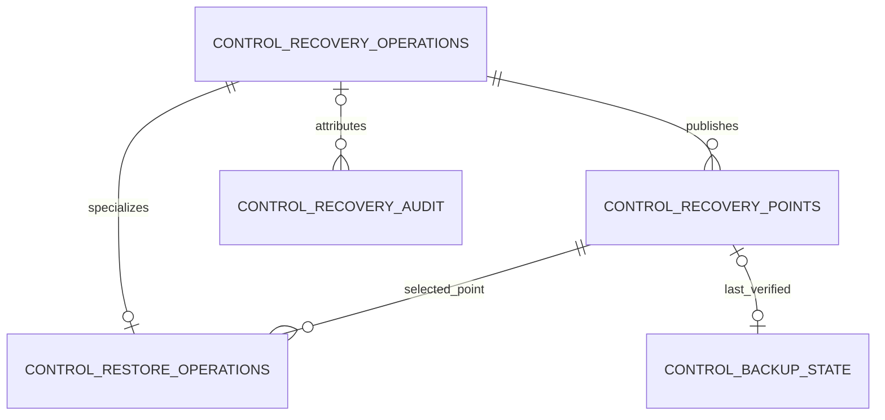

# Admin recovery database

[Database schema catalog](../DATABASE_SCHEMA.md) · [Shared conventions](overview.md)

Part of the schema master. Proposed hosted tables are design contracts, not claims of implemented schema. Executable definitions belong exclusively under `application/database/`; see [resource ownership](overview.md#required-schema-definition-location).

In this guide: [Admin recovery database — H05](#admin-recovery-database--h05) · [`admin_recovery_meta` — H05](#admin_recovery_meta--h05) · [`control_recovery_operations` — H05](#control_recovery_operations--h05) · [`control_recovery_points` — H05](#control_recovery_points--h05) · [`control_restore_operations` — H05](#control_restore_operations--h05) · [`control_backup_state` — H05](#control_backup_state--h05) · [`control_recovery_audit` — H05](#control_recovery_audit--h05)

## Admin recovery database — H05

This is a separate private SQLite file, owned by the Admin service, outside the main
Admin database and every destination restored from it. Its catalog, operation identities,
checkpoints and audit survive replacement/corruption of the main Admin DB. Definitions
live only in `application/database/admin-recovery-migrations/`, with independent owning
Alembic configuration/version/fingerprint checks and packaged resource validation.
A separate schema does not mean another public service or VM.

The Admin service's recovery mode starts from protected configuration and this store
without opening the damaged main Admin DB. Authenticate the current recovery principal
through a protected recovery-authority binding with verified strong MFA/step-up; an old
Admin session, restored principal row or operator identity is not emergency authority.
H03/H05 must qualify this separately protected identity-policy/bootstrap path, recovery
API exposure and revocation checks before enabling recovery. If it cannot establish
current authority, fail closed. Existing restricted platform recovery tooling may use
the same engine/store after exclusive fencing; it cannot decrypt/restore customer
business data or bypass the separate operator confirmation policy.

All references to main Admin IDs, releases, resource inventory or principals are logical
references validated through current protected configuration/owning ports. No foreign
keys, SQL joins or atomic-commit claims span these files. Recovery writes must not depend
on appending to main `operations` or `admin_audit`; optional post-recovery summaries are
not a second operation authority. Keys/live credentials remain outside both stores.

### `admin_recovery_meta` — H05

Binds this separate recovery store to the protected deployment and its current recovery
generation. It remains available while the main Admin database is damaged or replaced;
current recovery authorization comes from the protected bootstrap policy.

| Column | Type | Nullable | Default | Description / column rules |
| --- | --- | --- | --- | --- |
| `id` | `INTEGER` | No | — | PK CHECK = 1; singleton. |
| `deployment_id` | `ID` | No | — | UNIQUE protected deployment binding; logical reference, no main Admin FK. |
| `recovery_authority_ref` | `REF` | No | — | Reference to separately protected current recovery identity policy; not a role grant from a backup. |
| `source_generation` | `REV` | No | — | Recovery-store incarnation fencing stale control recovery work. |
| `active_admin_resource_ref` | `REF` | No | — | Verified main Admin resource binding; logical inventory reference. |
| `created_at` | `TIME` | No | — | Explicit protected initialization time. |
| `revision` | `REV` | No | — | Owning metadata revision. |

Protected configuration pins the store location/deployment/authority policy and permitted
resource roots. Startup validates both; editing a DB row alone cannot select another
identity policy/path. Initialization creates no operator, usable session or secret.

### `control_recovery_operations` — H05

Tracks Admin/platform backup and restore intent, authorization and outcomes independently
of main Admin operations. This allows recovery progress and safe retry to survive
main Admin database loss or replacement.

| Column | Type | Nullable | Default | Description / column rules |
| --- | --- | --- | --- | --- |
| `operation_id` | `ID` | No | — | PK; local Admin recovery operation identity. |
| `kind` | `TEXT` | No | — | CHECK backup or restore. |
| `idempotency_key` | `TEXT` | No | — | Stable semantic request identity; UNIQUE with kind. |
| `request_hash` | `HASH` | No | — | Canonical non-secret request hash. |
| `request_json` | `TEXT` | No | — | Typed intent <=16 KiB; deployment, selected point/target and expected generation. |
| `actor_kind` | `TEXT` | No | — | CHECK admin or system; restore requires current Admin authorization. |
| `actor_ref` | `REF` | No | — | Verified current Admin recovery principal or registered backup scheduler; no FK into damaged Admin DB. |
| `authorization_ref` | `REF` | Yes | — | Required for restore: retained strong-step-up/exact-action proof, not bearer token. |
| `authorized_at` | `TIME` | Yes | — | Required for restore: verified confirmation time. |
| `authorization_expires_at` | `TIME` | Yes | — | Required for restore: deadline to begin under this authorization. |
| `source_generation` | `REV` | No | — | Admitted recovery-store generation. |
| `state` | `TEXT` | No | — | CHECK pending, running, needs_attention, unknown, succeeded or failed. |
| `result_json` | `TEXT` | Yes | — | Typed immutable original terminal result <=16 KiB. |
| `error_code` | `TEXT` | Yes | — | Safe classified failure code. |
| `created_at` | `TIME` | No | — | Admission time. |
| `updated_at` | `TIME` | No | — | Last progress/result time. |
| `revision` | `REV` | No | — | Optimistic concurrency revision. |

UNIQUE `(kind, idempotency_key)`; indexes `(state, updated_at, operation_id)` and
`(created_at, operation_id)`. Validate deployment/current authority independently of the
main DB; restore proof fields are all required together. Same request replays original
identity; changed intent conflicts. A scheduler cannot originate a restore authorization.
One mutating control-recovery executor holds exclusive ownership; restore excludes
conflicting capture/upgrade/recovery work. Persist intent/result/audit in this store
atomically, then reconcile external capture/filesystem effects through original identity;
never hold its writer during network or host work. No restored historical operation is
a command to resume automatically. H05 specifies bounded proof lifetime and recovery
mutex/fence behavior before implementation.

### `control_recovery_points` — H05

**Purpose: Admin/platform backup catalog.** Each row identifies a verified off-host
backup of the Admin database and associated hosting-control/inventory state, used to
recover the Admin service/control plane after failure. It stores backup metadata, not
the backup contents. These are not operator business-data backups: those are cataloged
by `recovery_points` in each operator's private recovery store. Platform tooling owns
these backups; only authorized Admin/infrastructure recovery may consume them.

| Column | Type | Nullable | Default | Description / column rules |
| --- | --- | --- | --- | --- |
| `point_id` | `ID` | No | — | PK; verified off-host platform/control recovery point. |
| `operation_id` | `ID` | No | — | FK control_recovery_operations; local Admin/system backup operation. |
| `manifest_ref` | `REF` | No | — | UNIQUE immutable configured control-manifest location. |
| `manifest_sha256` | `HASH` | No | — | Verified manifest digest. |
| `manifest_format` | `REF` | No | — | Manifest format pinning main Admin, Admin recovery and inventory schema/release references. |
| `captured_at` | `TIME` | No | — | Control capture time. |
| `verified_at` | `TIME` | No | — | Completed off-host verification time. |
| `retain_until` | `TIME` | No | — | Retention deadline. |
| `key_ref` | `REF` | No | — | Protected control-key reference, never key material. |
| `stored_bytes` | `BYTES` | No | — | Stored bytes observed for the control point. |
| `state` | `TEXT` | No | — | CHECK verified, unavailable or expired. |
| `last_checked_at` | `TIME` | No | — | Latest integrity/availability check. |
| `revision` | `REV` | No | — | Catalog projection revision. |

Index `(state, captured_at, point_id)` and `(state, retain_until)`; verified_at >=
captured_at and retain_until > captured_at. Publish after off-host readback; keep protected
bootstrap/manifests/keys accessible without this DB. No customer business content or
usable sessions in the control recovery set; historical grants/jobs are reconciled,
not replayed. This table does not catalog each operator's backups.

### `control_restore_operations` — H05

**Purpose: Admin/platform restore workflow.** Tracks an authorized restore of the
Admin database and hosting-control state from `control_recovery_points`. It does not
restore an operator's business workspace; that uses the operator-local `restore_operations`.

| Column | Type | Nullable | Default | Description / column rules |
| --- | --- | --- | --- | --- |
| `operation_id` | `ID` | No | — | PK/FK control_recovery_operations in this Admin recovery DB. |
| `point_id` | `ID` | No | — | FK control_recovery_points. |
| `target_resource_ref` | `REF` | No | — | Registered private control restore destination, not arbitrary path. |
| `prior_resource_ref` | `REF` | Yes | — | Prior control store retained until acceptance. |
| `new_registry_generation` | `REV` | No | — | New control incarnation fencing old workers. |
| `phase` | `TEXT` | No | — | CHECK prepared, fenced, restored, validated, switched, accepted or needs_attention. |
| `validation_ref` | `REF` | Yes | — | Control/inventory/provider reconciliation evidence. |
| `started_at` | `TIME` | No | — | Start time. |
| `updated_at` | `TIME` | No | — | Last progress time. |

Retain this local restore record while a separate main Admin destination is prepared,
fenced, restored, validated and switched. Its operation FK/catalog remain available
throughout. Reconcile protected inventory and provider/source facts before reopening;
advance generation and revoke old Admin sessions. Neither historical principal/session
rows nor pending main Admin jobs reactivate themselves after restore.
If the portal cannot start, restricted platform tooling uses this same recovery store
and current recovery authority, with the former engine stopped/fenced. If the store
itself is lost, explicit bootstrap/verified-manifest reconstruction initializes a new
recovery incarnation with previous operations inert, not a fresh empty main Admin DB.
No operator may roll back the platform through workspace recovery APIs.

### `control_backup_state` — H05

Records which Admin, inventory and configuration state the last verified control backup
protects. Comparing that checkpoint with current sources reveals unprotected changes;
a recent backup attempt alone does not establish protection.

| Column | Type | Nullable | Default | Description / column rules |
| --- | --- | --- | --- | --- |
| `id` | `INTEGER` | No | — | PK CHECK = 1; singleton. |
| `last_point_id` | `ID` | Yes | — | FK control_recovery_points in this store. |
| `protected_admin_snapshot_ref` | `REF` | Yes | — | Protected main Admin snapshot revision/fingerprint. |
| `protected_inventory_manifest_ref` | `REF` | Yes | — | Protected host-inventory snapshot set reference. |
| `protected_config_revision` | `REF` | Yes | — | Protected non-secret deployment/configuration version. |
| `protected_source_generation` | `REV` | Yes | — | Recovery incarnation at capture. |
| `last_checked_at` | `TIME` | Yes | — | Latest consistent current-versus-protected comparison. |
| `last_attempt_at` | `TIME` | Yes | — | Backup attempt time, not success evidence. |
| `dirty_since` | `TIME` | Yes | — | Earliest known unprotected control change. |
| `last_error_code` | `TEXT` | Yes | — | Safe latest backup failure. |
| `revision` | `REV` | No | — | Checkpoint revision. |

Last point and protected-state tuple are all null initially or all set after verified
point publication, with checkpoint/audit/result committed together here. Capture main
Admin and each inventory/config source through their owning consistent snapshot ports;
the manifest pins versions/times/fences and cannot claim a global SQLite transaction.
A non-atomic dirty marker cannot conceal a main Admin commit-before-crash; reconcile
source state on restart. Unknown/damaged source is not unchanged. Do not back up this
store's live job queue as executable recovery authority; manifests retain enough verified
catalog/schema information for explicit reconstruction. Retained catalogs may be captured
as inert evidence, never as old runnable grants/operations.

### `control_recovery_audit` — H05

| Column | Type | Nullable | Default | Description / column rules |
| --- | --- | --- | --- | --- |
| `audit_id` | `ID` | No | — | PK; immutable Admin recovery event. |
| `operation_id` | `ID` | Yes | — | FK control_recovery_operations in this store. |
| `actor_ref` | `REF` | No | — | Verified original authorizer or narrowly privileged executor. |
| `action` | `TEXT` | No | — | Typed control backup/recovery/checkpoint action. |
| `recorded_at` | `TIME` | No | — | Persisted event time. |
| `safe_facts_json` | `TEXT` | No | — | Allowlisted identities/generations/results <=8 KiB; no tokens, keys or data bodies. |

Append-only; indexes `(operation_id)` and `(recorded_at, audit_id)`. Failure to persist
required local audit rolls back the owning local mutation. The main admin_audit may
later receive an operation reference/status summary, but is not required for authorizing
or finishing recovery and cannot replace this evidence. Reserve bounded private space;
retention never deletes unresolved recovery receipts to make room.

