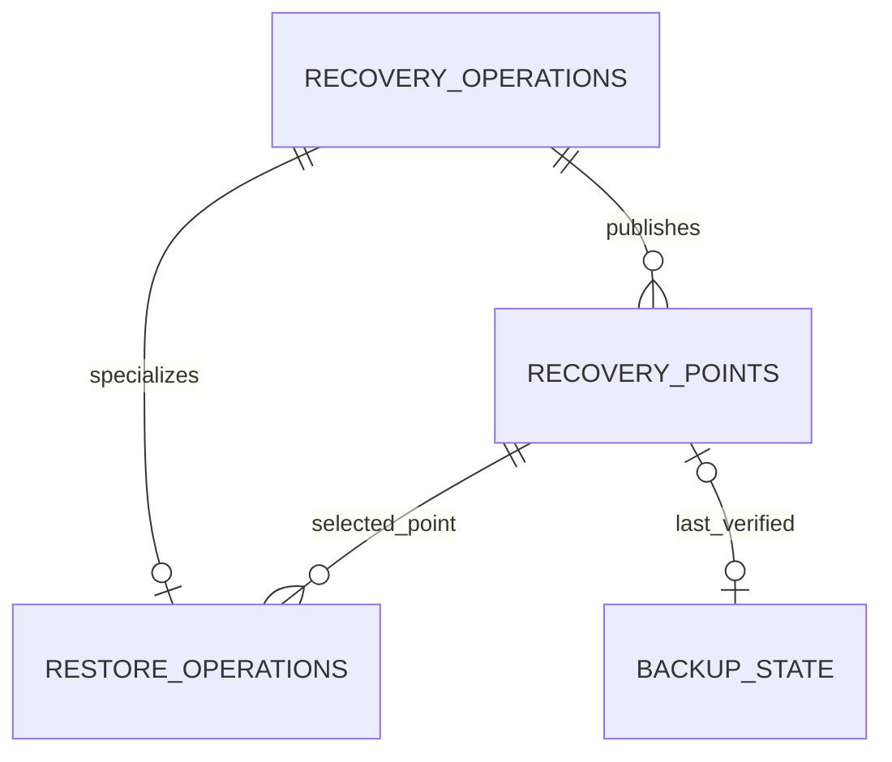

# Operator recovery database

[Database schema catalog](../DATABASE_SCHEMA.md) · [Shared conventions](overview.md)

Part of the schema master. Proposed hosted tables are design contracts, not claims of implemented schema. Executable definitions belong exclusively under `application/database/`; see [resource ownership](overview.md#required-schema-definition-location).

In this guide: [Per-operator recovery store — H05, normal and recovery modes](#per-operator-recovery-store--h05-normal-and-recovery-modes) · [`recovery_meta` — H05](#recovery_meta--h05) · [`recovery_operations` — H05](#recovery_operations--h05) · [`recovery_points` — H05](#recovery_points--h05) · [`backup_state` — H05](#backup_state--h05) · [`restore_operations` — H05](#restore_operations--h05) · [`recovery_audit` — H05](#recovery_audit--h05)

## Per-operator recovery store — H05, normal and recovery modes

This file is in private persistent control storage, outside the replaceable business
DB/files and excluded from the advertised usable-workspace allowance. It has its own
bounded reserve and schema resources under `application/database/recovery-migrations/`.
The operator service owns it in normal and authenticated minimal recovery mode. No
offline customer restore/decrypt tool or alternate executor is included; never run a
second recovery executor against the same workspace. Local production uses
its supported loopback/OS-owner boundary; hosted mode requires current identity/access
checks from the separate auth store. No new hosted login is imposed on local use.

### `recovery_meta` — H05

Binds the operator’s recovery store to its workspace and identifies the active business
tree and recovery generation. It lets recovery mode find and safely switch business
data without opening a damaged business database to discover its own identity.

| Column | Type | Nullable | Default | Description / column rules |
| --- | --- | --- | --- | --- |
| `id` | `INTEGER` | No | — | PK CHECK = 1; singleton. |
| `workspace_id` | `ID` | No | — | UNIQUE owning workspace identity. |
| `deployment_ref` | `REF` | No | — | Protected hosted deployment or local-installation identity. |
| `source_generation` | `REV` | No | — | Monotonic recovery incarnation; changes on binding/restore. |
| `active_business_ref` | `REF` | No | — | Validated active business location under the protected workspace root. |
| `revision` | `REV` | No | — | Current recovery-store revision. |

Startup must validate private ownership, exact schema and workspace identity before
serving recovery routes. Stable configuration locates this store, not the damaged business
manifest alone. Auth keys/cookies and live provider credentials are not stored here.

### `recovery_operations` — H05

Tracks workspace backup/restore intent and outcomes inside the operator’s recovery
store, independently of Admin availability. Restore requires the operator’s authorization;
the internal executor carries out that exact admitted request.

| Column | Type | Nullable | Default | Description / column rules |
| --- | --- | --- | --- | --- |
| `operation_id` | `ID` | No | — | PK; backup or workspace restore command identity. |
| `kind` | `TEXT` | No | — | CHECK backup or restore. |
| `idempotency_key` | `TEXT` | No | — | UNIQUE with kind within this workspace. |
| `request_hash` | `HASH` | No | — | Canonical semantic request hash. |
| `request_json` | `TEXT` | No | — | Typed non-secret request, <=16 KiB. |
| `actor_kind` | `TEXT` | No | — | CHECK operator or system; restore requires operator authorization. |
| `actor_ref` | `REF` | No | — | Verified operator subject/local owner or scheduler; never caller-supplied impersonation. |
| `state` | `TEXT` | No | — | CHECK pending, running, needs_attention, unknown, succeeded or failed. |
| `source_generation` | `REV` | No | — | Admitted recovery/source generation. |
| `result_json` | `TEXT` | Yes | — | Immutable original terminal result, typed <=16 KiB. |
| `error_code` | `TEXT` | Yes | — | Safe classified failure. |
| `created_at` | `TIME` | No | — | Admission time. |
| `updated_at` | `TIME` | No | — | Most recent result/progress time. |
| `revision` | `REV` | No | — | Optimistic concurrency revision. |

UNIQUE `(kind, idempotency_key)`; indexes `(state, updated_at, operation_id)` and
`(created_at, operation_id)`. Matching replay returns original identity/result; changed
intent conflicts. Persist intent/audit before side effects; local record commits and
business/file/object effects are coordinated through receipts and inspection, never
claimed cross-store atomic. Exactly one mutating recovery executor per workspace; a
pending/running/unknown restore excludes backup/restore/upgrade conflicts until resolved.
Admin DB authorization/progress is not part of this routine path. Restore authorizer
must be the verified operator: system may execute that exact admitted operation, not
originate a new restore authorization. No offline_admin actor or Admin impersonation
path. Persist the strong-step-up/exact-action proof; never accept an expired historical
session/claim from a business backup.

### `recovery_points` — H05

Catalogs verified workspace backups available for recovery, including immutable manifest
references, captured data versions, key references and retention. These rows describe
recovery points; they do not contain the backed-up business records themselves.

| Column | Type | Nullable | Default | Description / column rules |
| --- | --- | --- | --- | --- |
| `point_id` | `ID` | No | — | PK; verified workspace point in this local catalog. |
| `workspace_id` | `ID` | No | — | Must equal recovery_meta.workspace_id. |
| `operation_id` | `ID` | No | — | FK recovery_operations; successful backup publication. |
| `manifest_ref` | `REF` | No | — | UNIQUE immutable object/archive manifest reference. |
| `manifest_sha256` | `HASH` | No | — | Verified manifest digest. |
| `manifest_format` | `REF` | No | — | Format version. |
| `business_revision` | `REF` | No | — | Captured committed business revision. |
| `files_generation` | `REF` | No | — | Captured retained-file inventory/version identity. |
| `source_generation` | `REV` | No | — | Recovery/source incarnation at capture. |
| `release_ref` | `REF` | No | — | Qualified source release reference; logical, not Admin FK. |
| `schema_revision` | `REF` | No | — | Captured owning business schema revision. |
| `captured_at` | `TIME` | No | — | Actual consistent database/file capture time. |
| `verified_at` | `TIME` | No | — | Actual completed destination verification time. |
| `retain_until` | `TIME` | No | — | Promised retention deadline. |
| `key_ref` | `REF` | No | — | Protected key reference; not key material. |
| `stored_bytes` | `BYTES` | No | — | Observed stored bytes. |
| `state` | `TEXT` | No | — | CHECK verified, unavailable or expired. |
| `last_checked_at` | `TIME` | No | — | Most recent point availability/integrity check. |
| `revision` | `REV` | No | — | Catalog observation revision. |

Indexes `(state, captured_at, point_id)` and `(state, retain_until)`; verified_at >=
captured_at and retain_until > captured_at. Insert only after consistent capture and
verified off-host publication for hosted use (supported destination for local mode).
The immutable manifest contains complete object membership/digests/schema and ownership
pins. A lost catalog may be reconstructed in the authenticated recovery-mode service
through explicit own-workspace manifest verification; a central workspace catalog or
offline decrypt tool is not required. Expiry does not prove object deletion.
Never delete content still referenced by retained points or the last usable point merely
because an unchanged workspace produced no replacement. Hosted runtime credentials are
scoped to its own backup namespace; no platform-wide Admin/bucket secrets in containers.
Hosted uses separately protected platform key custody; local mode keeps its supported
passphrase/destination workflow through its local adapter. Retention/delete permissions
and recovery-key availability require H05 qualification.

### `backup_state` — H05

Records the business revision and file generation covered by the last verified point.
It distinguishes genuinely unchanged data from new unprotected changes without
pretending that each successful scheduler check created a new backup.

| Column | Type | Nullable | Default | Description / column rules |
| --- | --- | --- | --- | --- |
| `id` | `INTEGER` | No | — | PK CHECK = 1; singleton checkpoint. |
| `last_point_id` | `ID` | Yes | — | FK recovery_points; latest verified protected state. |
| `protected_business_revision` | `REF` | Yes | — | Business revision protected by last_point_id. |
| `protected_files_generation` | `REF` | Yes | — | Retained-file generation protected by last_point_id. |
| `protected_source_generation` | `REV` | Yes | — | Protected source incarnation. |
| `dirty_since` | `TIME` | Yes | — | Earliest known unprotected committed change. |
| `last_checked_at` | `TIME` | Yes | — | Latest consistent current-versus-protected comparison. |
| `last_backup_attempt_at` | `TIME` | Yes | — | Last attempted backup; not success proof. |
| `last_error_code` | `TEXT` | Yes | — | Safe last protection failure. |
| `revision` | `REV` | No | — | Checkpoint revision. |

Point identity and protected tuple are all null initially or all present. Publish them
only after verified point insertion, in the same recovery-store transaction. Compare
business revision AND retained-file generation AND source incarnation under consistent
source coordination; an in-memory dirty boolean is insufficient. Reconcile on startup
and before any unchanged skip: a crash after business commit cannot be hidden by a
missing dirty update in this separate store. Never rewrite capture/verification times
just because a timer checked unchanged data. Missing/unreadable/ambiguous source state
is unknown, not unchanged. Restore advances generation and forces a new protection
check rather than trusting an old checkpoint copied with business data.

### `restore_operations` — H05

Tracks the execution phases of an operator-authorized restore, including the selected
point, separate target, retained prior tree and switchover fences. It extends the
original `recovery_operations` request so interrupted restoration can be inspected
and continued safely.

| Column | Type | Nullable | Default | Description / column rules |
| --- | --- | --- | --- | --- |
| `operation_id` | `ID` | No | — | PK/FK recovery_operations; authorized workspace restore. |
| `point_id` | `ID` | No | — | FK recovery_points; immutable selected point. |
| `prior_business_ref` | `REF` | No | — | Original business tree kept intact until acceptance. |
| `target_business_ref` | `REF` | No | — | Separate registered restore directory within allowed roots. |
| `new_source_generation` | `REV` | No | — | New recovery incarnation for switchover. |
| `new_access_epoch` | `REV` | Yes | — | Required hosted access fence; null for no-login local mode. |
| `authorized_subject` | `REF` | No | — | Verified hosted operator/local OS-owner identity. |
| `authorization_ref` | `REF` | No | — | Retained confirmation proof reference, not bearer token. |
| `authorized_at` | `TIME` | No | — | Explicit consequence confirmation time. |
| `execution_authorization_expires_at` | `TIME` | No | — | Deadline to begin under this authorization. |
| `preview_source_revision` | `REF` | Yes | — | Preview revision; null only for unreadable business DB with explicit recovery warning. |
| `executor_ref` | `REF` | No | — | Owning internal executor only; no Admin impersonation/offline executor or Admin DB FK. |
| `phase` | `TEXT` | No | — | CHECK prepared, fenced, restored, validated, switched, accepted or needs_attention. |
| `validation_ref` | `REF` | Yes | — | Validation/ownership/schema evidence. |
| `started_at` | `TIME` | No | — | Execution start time. |
| `updated_at` | `TIME` | No | — | Latest phase time. |

Validate current identity/authority and point/workspace against recovery_meta; recent
hosted auth, qualified strong step-up and single-use exact-action confirmation required.
The proof is bound to workspace/point/source epoch and is neither a browser-chosen
key/path nor an Admin override; no recovery-specific plaintext download/export route. H05 specifies bounded preview/auth expiry
before implementation. Missing business reads do not bypass auth; missing auth/control
store keeps restore unavailable until runtime/identity repair and fresh verification. The internal runner drains/closes business connections,
fences jobs/sessions and restores a separate tree, leaving recovery/auth stores untouched.
Retain healthy pre-state via a consistent point; if the DB is damaged preserve the
original tree as forensic/pre-restore state instead, never label it a verified backup.
No mount/Docker privilege is given to the operator process. Use recovery_meta.active_business_ref as the canonical in-volume business locator;
commit its validated target/generation with restore phase evidence in this recovery DB.
Never create a second independently editable locator. An interruption is resolved from
that transaction and the prepared target evidence before business opening; host-owned mount
changes, if needed, use a narrow registered-ID helper. Reopening requires source
validation, current authority, session revocation and future payment reconciliation.
An already fenced operation may finish through its own session revocation; later Admin
disable still prevents reopening. Interrupted phases inspect local intent/locator and
reuse the original operation; never initialize an empty business DB to escape an error.
Retain prior state until operator acceptance and defined cleanup. No business restore
replaces this store or replays historical recovery jobs from a backup.

A runtime repair does not clear this table or recovery_meta: container replacement is
an infrastructure operation, not a business reset. The original business locator remains
retained/fenced until this separately operator-authorized restore validates a new target.
No database row or desired-release change implies permission to bypass fresh identity
verification. Missing trusted metadata is a repair blocker, not permission to fabricate
operator/session/point records from an empty template.

### `recovery_audit` — H05

| Column | Type | Nullable | Default | Description / column rules |
| --- | --- | --- | --- | --- |
| `audit_id` | `ID` | No | — | PK; immutable local recovery audit event. |
| `operation_id` | `ID` | Yes | — | FK recovery_operations when tied to a command. |
| `actor_ref` | `REF` | No | — | Verified original actor or technical executor. |
| `action` | `TEXT` | No | — | Typed backup/restore/checkpoint action. |
| `recorded_at` | `TIME` | No | — | Persisted event time. |
| `safe_facts_json` | `TEXT` | No | — | Allowlisted IDs/generations/status, <=8 KiB; no secrets or business bodies. |

Append-only; indexes `(operation_id)` and `(recorded_at, audit_id)`. Owning local
mutation/result/checkpoint/audit commit together; audit failure rolls back that local
transaction. Registry status may lag and never controls the outcome. Control storage
must have bounded reserved space for required receipts even at the business allowance.

