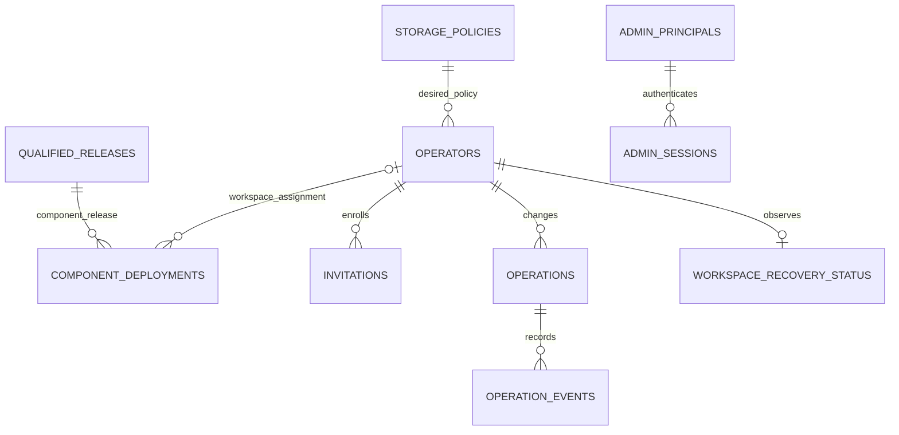
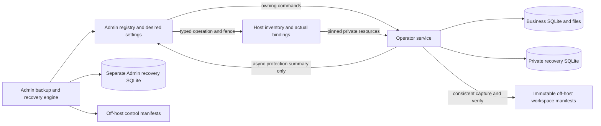

# Store ownership, conventions and relationships

[Database schema catalog](../DATABASE_SCHEMA.md) · [Shared conventions](overview.md)

Part of the schema master. Proposed hosted tables are design contracts, not claims of implemented schema. Executable definitions belong exclusively under `application/database/`; see [resource ownership](overview.md#required-schema-definition-location).

In this guide: [Store boundaries and current implementation](#store-boundaries-and-current-implementation) · [Required schema definition location](#required-schema-definition-location) · [Schema conventions](#schema-conventions) · [`alembic_version` — each SQLite store](#alembic_version--each-sqlite-store) · [Relationships](#relationships)

## Store boundaries and current implementation

| Store | Authority and readers | Current evidence / proposed resources | Design reference |
| --- | --- | --- | --- |
| Operator business SQLite | Domain modules own records, business audit and files. Only the owning operator runtime accesses it. No Admin/session/billing tables. | Current [baseline](../../application/database/sqlite-migrations/versions/0001_initial_schema.py), [environment](../../application/database/sqlite-migrations/env.py) and [module guides](../README.md#current-modules) own existing definitions. No H01 business-table additions. | [Module guides](../README.md#current-modules) · [Persistence](../platform/persistence.md) |
| Admin SQLite | Central assignments, desired settings, Admin sessions, infrastructure operations/audit and non-authoritative workspace protection summaries. Admin backup/recovery authority is in the separate Admin recovery DB. Admin/control service only; gateway reads through a bounded service port. | `application/database/admin-migrations/` is a scaffold. H02 delivers the complete Pilot 0 structural baseline/FK closure and protected deployment metadata; H03–H05 own behavior/population. Proposed `modules/hosted_admin/` owning adapter. | [Registry, policies and releases](admin-registry.md) · [Identity and login](admin-identity.md) · [Operations and audit](admin-operations.md) |
| Admin recovery SQLite | Admin service owns platform/control backup catalog, checkpoints, recovery operations/audit and authenticated recovery mode. Remains intact when the main Admin DB is restored/replaced. | Proposed `application/database/admin-recovery-migrations/`, independent Alembic configuration/version and private persistent recovery directory; not a new service or VM. | [Admin recovery schema](admin-recovery.md) |
| Host inventory SQLite | Privileged agent owns actual resource identities, operator UID/GID allocations, external ingress/fences and effect receipts for one host. Control service reads typed observations, never opens the file. | `application/database/host-inventory-migrations/` is a scaffold; H02 implements its baseline and agent adapter. Protected configuration pins location/host identity. | [Host inventory schema](host-inventory.md) |
| Per-operator hosted-access SQLite | Effective access/session authority, source fences and bounded storage admission. Owning runtime only; Admin/agent use typed application commands. | Current [schema](../../application/apps/server/app/modules/hosted_access/infrastructure/schema.py), [store](../../application/apps/server/app/modules/hosted_access/infrastructure/session_store.py). Replace greenfield inline schema creation with proposed `application/database/hosted-access-migrations/` and separate Alembic configuration. | [Operator access and usage schema](operator-access.md) |
| Per-operator recovery SQLite | Operator service owns workspace backup checkpoints, catalog and restore operations independently of the business DB. Only normal/authenticated recovery mode uses the store; no offline customer restore/decrypt command. Never replace it with business data during restore. | Proposed `application/database/recovery-migrations/`, separately versioned resources in a private control directory mounted persistently into the operator container. Local composition can use this recovery boundary without a hosted-access/login dependency. | [Operator recovery schema](operator-recovery.md) |
| Off-host immutable manifests | Recovery object membership, integrity and key references; catalog rows are verified projections, not an alternate editable manifest. | H05 implements verified publication/readback; no relational table per backed-up object required. | [Backup and recovery design](../hosting/design/mvp/recovery.md) · [Initialization and retention](lifecycle-and-validation.md) |

H01.2 supplies [independent resource scaffolds](../../application/database/README.md)
at the five hosted resource paths above, with per-store configuration and unavailable
execution guards. They contain no baselines or table definitions; owning adapters,
initializers and packaging remain proposed H02–H05 work. Other paths labelled proposed
remain implementation destinations, not claims of existing implementations. Admin
and inventory are different trust boundaries even on one VM. Business DB IDs and
host/access IDs may be logical references across stores; never declare a cross-store
foreign key or imply a transaction spans those files. No operator mounts another
operator's tree, the Admin DB or host inventory. Live secrets/keys are outside all
business archives; hashes/references below are not secret material itself.

## Required schema definition location

Use independent versioned resource sets under `application/database/` for business,
main Admin, Admin recovery, host inventory, hosted access and per-operator recovery. Table/column definitions, constraints, indexes,
views/triggers and baseline/revision DDL belong exclusively there. Alembic revision
files may be Python, following the existing business pattern; the prohibition is on
schema definitions inside application/runtime modules, not the migration file language.
Keep owning Alembic configurations/environments and packaged schema resources with
these resource sets.

Application services/adapters may invoke the owning resource runner, bind/reflection-map
existing tables, query/mutate records and validate the installed revision/structure.
They must not define an alternate schema or create/alter it with inline SQL/DDL,
`Operations.create_table`, ORM `metadata.create_all`, or startup fallbacks under
`apps/server/app/`, host-agent modules or other runtime code. Derive validation schema
fingerprints from the owning resources rather than maintaining competing DDL in a
validator. Test initialization uses the same resources, not a separate test schema.

The existing hosted-access `infrastructure/schema.py` is a current-code gap, not an
approved pattern. Its definitions must move to `application/database/hosted-access-migrations/`
in the owning implementation slice; adapters retain only schema-resource invocation,
binding and validation. No code move is performed by this design update.

Development uses the same owning schema resources with isolated synthetic stores. All four portals may run locally in development, but that does not merge main Admin, Admin recovery, inventory, hosted-access, operator recovery and business authority or permit connections to production stores. Production local Operator needs its business/local resources only; it does not initialize or serve hosted Admin/Tenant/Owner authority merely because development supports those portals.

## Schema conventions

- `ID` = canonical lowercase UUID TEXT; `REF` = bounded opaque TEXT reference;
  `HASH` = 64-character lowercase SHA-256 TEXT; `TIME` = UTC epoch milliseconds
  INTEGER; `COUNT`/`BYTES` = nonnegative signed-64-bit INTEGER. `REV` starts at 1.
  External seconds/timestamps are converted at the adapter boundary. Business dates
  retain their existing domain conventions.
- The column tables explicitly show nullability and defaults. `—` means no default
  is specified; values must be supplied by the owning initializer/command. REV starts
  at 1 by convention, not by an implicit SQL default. Booleans use INTEGER CHECK IN (0,1). Enum columns use closed CHECK lists.
  IDs are never reused, including after retirement. Policy/release versions are immutable.
- SQLite foreign keys enabled on every connection; RESTRICT deletes unless stated.
  Each store has its own `alembic_version` (defined below), containing
  exactly one owning revision and a validated schema fingerprint/constraint inventory.
  Do not accept version text alone as proof of the actual schema.
- Each update carries expected revision; increment revision atomically. External
  effects have original operation ID, request hash and source fence; no network/host
  call under a SQLite transaction. Store bounded schema-validated JSON only where
  explicitly named; JSON validity alone is insufficient.
- Times, lengths, nonnegative counts and required state-dependent fields are checked.
  References are resolved through registered IDs, never caller-selected filesystem
  paths. Text limits: names 120, email 254, slug 63, status/error codes 80,
  explanations 1,000, object references 1,024. Never persist raw provider tokens,
  passwords, email-link secrets, session cookies or shell output in JSON/audit.
- H01.3 supplies [consumer-neutral shared values and envelope rules](../../application/apps/server/app/platform/hosted_contracts/README.md),
  not implemented hosted tables. Shared idempotency keys are 1–120 registered-reference
  characters; shared opaque references use ASCII letters/digits, dot, underscore,
  colon and hyphen, beginning with a letter/digit, within the existing 1,024-character
  bound. Command/status/error codes use lowercase letters/digits/underscore, beginning
  with a letter, within the existing 80-character bound. Owning schemas/ports must
  apply their closed action/error vocabularies and reference resolution as well.
- One writer authority per store. Owning services use short immediate writes and
  deferred snapshot reads, reusing platform transaction/error/audit patterns.

### `alembic_version` — each SQLite store

| Column | Type | Nullable | Default | Description / column rules |
| --- | --- | --- | --- | --- |
| `version_num` | `TEXT` | No | — | Primary key identifying the single installed owning Alembic revision. |

Exactly one row per store; validate actual schema structure as well as revision text.

## Relationships

Solid relationships in the first diagram below are within the main Admin DB. Inventory/access references
are deliberately shown separately as logical bindings rather than foreign keys.

