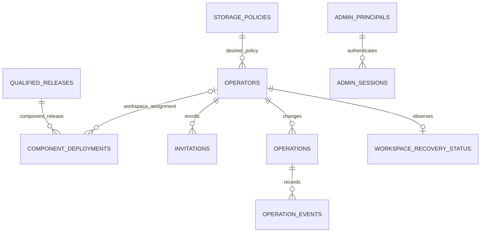
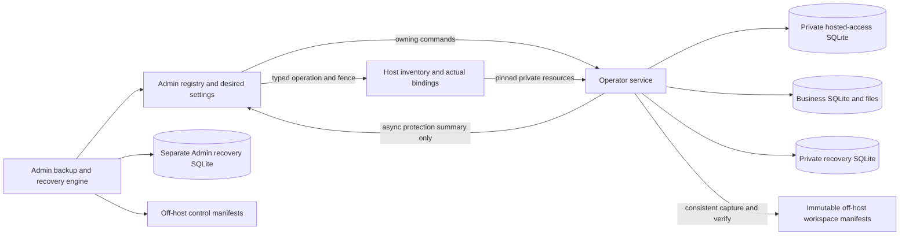

# Database schema overview

This overview and the linked store dictionaries form the schema master. Each table
has one owning definition. Keep table/column descriptions in those dictionaries and
executable definitions under `application/database/`; feature designs reference them.
Separate guides do not merge databases or change their ownership.

## Start here

Read **this overview → the relevant store dictionary → lifecycle and validation**.
For Operator storage/access work, read Admin registry, host inventory and Operator
access together. The store map below links each dictionary and its implementation.

| Your question | Read |
| --- | --- |
| Who owns each store, and what exists? | [Store map](#store-boundaries-and-current-implementation) |
| Where may schema definitions live? | [Resource ownership rules](#required-schema-definition-location) |
| What types and persistence rules apply everywhere? | [Schema conventions](#schema-conventions) |
| How do I discover, initialize or package schemas? | [Schema resource guide](schema-resources.md) |
| How are stores populated, recovered and retained? | [Lifecycle and validation](lifecycle-and-validation.md) |

## Store boundaries and current implementation

Structural readiness is distinct from authentication, application readiness and
release qualification. Implemented baselines create no implicit operators, sessions,
policies or access grants. Planned resources remain unavailable until their owner
delivers and validates them.

| Store | Authority and permitted access | Current resources / implementation | Owning dictionary or guide |
| --- | --- | --- | --- |
| Operator business SQLite | Domain records, business audit and retained files. Only the owning Operator runtime; no Admin, session or billing tables. | Existing [business baseline](../../application/database/sqlite-migrations/versions/0001_initial_schema.py) and [environment](../../application/database/sqlite-migrations/env.py) (includes `FIN-009` `late_fee_policy_versions`, `late_fee_assessments`, `late_fee_waivers`, `late_fee_receipts`, `late_fee_receipt_allocations`, `rent_receipts.payment_batch_id`, and immutability triggers); hosting adds no business tables here. | [Module guides](../README.md#current-modules) · [Persistence](../platform/persistence.md) |
| Main Admin SQLite | Central assignments, desired settings, Admin sessions, infrastructure operations/audit and non-authoritative protection summaries. Admin/control service only; gateway/control consumers use bounded owning ports. | [Admin resources](../../application/database/admin-migrations/): implemented 22-table structural baseline (`admin_0001_initial`), live in Pilot 0 (`H02–H06`) with protected deployment binding, identity, admission, and control-plane services. | [Registry, policies and releases](admin-registry.md) · [Identity and login](admin-identity.md) · [Operations and audit](admin-operations.md) |
| Admin recovery SQLite | Platform/control backup catalog, checkpoints, restore operations/audit and authenticated recovery mode. Admin-owned, independent of the main Admin DB; no extra service or VM implied. | [Admin recovery baseline](../../application/database/admin-recovery-migrations/versions/admin_recovery_0001_initial.py): implemented six-table structural baseline (`admin_recovery_0001_initial`), live in Pilot 0 (`H05–H06`) with resource-derived validation and control backup/restore services. Separate private persistent directory. | [Admin recovery](admin-recovery.md) |
| Host inventory SQLite | Actual resource identities, Operator UID/GID allocations, ingress/fences and child-effect receipts for one host. Privileged agent owns the file; control service reads typed observations only. | [Inventory resources](../../application/database/host-inventory-migrations/): implemented six-table baseline (`host_inventory_0001_initial`), live in Pilot 0 (`H02–H06`) with reservation/receipt adapters, auth-route projections, and scoped native effects. Protected configuration pins host/location. | [Host inventory](host-inventory.md) |
| Per-Operator hosted-access SQLite | Effective access/session authority, source fences and bounded storage admission. Owning runtime only; Admin/agent use authenticated typed commands. | [Access baseline](../../application/database/hosted-access-migrations/versions/access_0001_initial.py): nine tables (`access_0001_initial`), live in Pilot 0 (`H03–H06`) with resource-derived validation, session/step-up/usage services, and explicit binding. Runtime DDL is removed. | [Operator access, sessions and usage](operator-access.md) |
| Per-Operator recovery SQLite | Workspace backup checkpoints, catalog and restore operations. Operator service owns it through normal/authenticated recovery mode, independently of the replaceable business DB. | [Recovery baseline](../../application/database/recovery-migrations/versions/recovery_0001_initial.py): implemented six-table structural baseline (`recovery_0001_initial`), live in Pilot 0 (`H05–H06`) with resource-derived validation and backup/restore services. Separate private control directory persists with the container's resources. Local recovery need not depend on hosted login. | [Operator recovery](operator-recovery.md) |
| Immutable off-host manifests | Recovery object membership, integrity and key references. Catalog rows are verified projections, not another editable manifest; no table per backed-up object is required. | Verified live on Cloudflare R2 + GCP Cloud KMS in H06. | [Recovery design](../hosting/design/mvp/recovery.md) · [Lifecycle and retention](lifecycle-and-validation.md) |

Keep these boundaries even on one VM:

- No Operator mounts another Operator's tree, the Admin DB or host inventory.
- Cross-store IDs are logical references. Do not add cross-store FKs, SQLite ATTACH
  or an implied transaction across files; use owning commands and original receipts.
- Main Admin recovery state survives replacement of the main Admin DB. Operator
  access/recovery authority stays outside restored business data. There is no offline
  customer-workspace restore/decrypt command.
- Live credentials/keys stay outside business archives. Stored hashes and opaque
  references are not the reusable secret material itself.

## Required schema definition location

Each store has an independent versioned resource set under `application/database/`.
Table/column definitions, constraints, indexes, views/triggers and baseline/revision
DDL belong exclusively there, together with owning Alembic configuration/environment
and packaged resources. Revision files may be Python, following the business pattern;
the restriction concerns runtime DDL, not the migration file language.

Runtime services/adapters may invoke owning runners, reflect existing tables,
query/mutate records and validate installed schema identity. They must not create
an alternate schema with inline SQL/DDL, `Operations.create_table`, ORM
`metadata.create_all` or startup fallbacks under `apps/server/app/`, host-agent modules
or other runtime code. Derive structural fingerprints from the same owning resources;
tests use them too, rather than a separate handwritten validator/test schema.

The hosted-access runtime creator has been removed. Current initialization/validation
APIs and installed-resource failure behavior are documented once in the
[schema resource guide](schema-resources.md), with
[live hosted architecture](../hosting/ARCHITECTURE.md#2-state--store-ownership-6-sqlite-stores) in its
owning guide.

Development uses those same resources with isolated synthetic stores. All four
portals may run locally for development, without merging store/actor authority or
connecting fixtures to production. Production local Operator initializes only its
business/local resources, not hosted Admin/Tenant/Owner authority. See the
[deployment boundary](../hosting/design/mvp/scope.md#development-and-production-deployment-boundary).

## Schema conventions

### Shared types and values

| Convention | Meaning |
| --- | --- |
| `ID` | Canonical lowercase UUID stored as TEXT; never reused, including after retirement. |
| `REF` | Opaque TEXT, at most 1,024 characters; ASCII letters/digits, dot, underscore, colon and hyphen, beginning with a letter/digit. Resolve through registered identities, never caller-selected paths. |
| `HASH` | 64-character lowercase SHA-256 TEXT. |
| `TIME` | UTC epoch milliseconds as INTEGER. Convert external seconds/timestamps at the adapter boundary; business dates retain their domain conventions. |
| `COUNT` / `BYTES` | Nonnegative signed-64-bit INTEGER. |
| `REV` | Starts at 1; owning updates compare expected revision and increment atomically. No implicit SQL default unless explicitly declared. |
| Boolean / enum | Boolean INTEGER CHECK IN (0,1); enums use closed CHECK lists. |
| Column metadata | Dictionaries state nullability/defaults explicitly. `—` means callers must supply the value; no default is implied. |

Text bounds are 120 for names, 254 for email, 63 for slugs, 80 for status/error codes,
1,000 for explanations and 1,024 for object references. Shared idempotency keys use
1–120 registered-reference characters. Command/status/error codes use lowercase
letters/digits/underscore, beginning with a letter. Owners apply their closed
vocabularies, text normalization and reference resolution as well.

### Persistence and authority rules

- Enable SQLite foreign keys on every connection; use RESTRICT deletion unless the
  owning dictionary states otherwise. Policy and release versions are immutable.
- Each store has one owning writer authority, short immediate writes and deferred
  snapshot reads, using shared transaction/error/audit patterns.
- External effects carry original operation identity, semantic request hash and
  source fence. Never hold a SQLite transaction across network or host work.
- Check times, lengths, counts and required state-dependent fields. Persist bounded,
  typed/schema-validated JSON only in explicitly named fields; JSON validity alone
  is insufficient. Never store raw provider tokens, passwords, email-link secrets,
  session cookies or shell output in intent/result/audit records.
- The [shared hosted contracts](../platform/hosted-contracts.md) define canonical
  envelopes and hashes, not executable tables, authentication or durable effects.
  Owning repositories/services enforce those additional boundaries.

### `alembic_version` — each SQLite store

| Column | Type | Nullable | Default | Description / column rules |
| --- | --- | --- | --- | --- |
| `version_num` | `TEXT` | No | — | PK identifying the single installed owning Alembic revision. |

Exactly one row per store. Validate the actual resource-derived structure,
constraints/indexes and fingerprint as well as the revision; version text alone is
not readiness. The fingerprint is derived during validation, not another column or
editable registry in this table.

## Relationships

These are representative relationships, not a second full schema. Solid ER edges
are within the main Admin DB; exact columns/FKs remain in the owning dictionaries.

Cross-store arrows below are owning calls, observations or resource bindings, never
cross-store foreign keys or atomic commits.

## Related references

[HOSTED-001 delivery](../hosting/design/mvp/delivery-plan.md#implementation-slices)
owns sequencing; the [hosted design](../hosting/design/HOSTED_MVP_DESIGN.md) owns
future MVP design and [Hosted Live Architecture](../hosting/ARCHITECTURE.md) records
the delivered Pilot 0 architecture. Design acceptance and shipped structure are distinct
from service, provider, native-host and final release qualification.

H03 D1–D16 were accepted November 13, 2026. Its accepted extensions are documented in
[central identity flow state](admin-identity.md#h03-flow-state),
[source authentication state](operator-access.md#h03-authentication-state) and
[protected auth routing](host-inventory.md#h03-authentication-routing-extension).
The current resource status is in the store map; detailed behavior/evidence belongs
in the owning guides rather than being repeated here.

Historical lookup aliases follow. Dated qualification records retain the paths and
hashes from their original commits; reorganizing current prose does not rewrite them.

Table lookup and historical anchors

These links preserve earlier schema-catalog entry points. Column definitions remain
in the owning dictionaries rather than being repeated here.

- [Pilot 0 Admin database](admin-registry.md#pilot-0-admin-database)
- [`control_meta` — H02 protected initialization](admin-registry.md#control_meta--h02-protected-initialization)
- [`storage_policies` — H04 Free policy](admin-registry.md#storage_policies--h04-free-policy)
- [`qualified_releases` — H02 release qualification](admin-registry.md#qualified_releases--h02-release-qualification)
- [`component_deployments` — H02 shared Admin; H04 Operator assignments](admin-registry.md#component_deployments--h02-shared-admin-h04-operator-assignments)
- [`operators` — H03/H04 assignment and desired state](admin-registry.md#operators--h03h04-assignment-and-desired-state)
- [Access-state decision and external enforcement](admin-registry.md#access-state-decision-and-external-enforcement)
- [`invitations` — H03](admin-identity.md#invitations--h03)
- [`admin_principals` — H03](admin-identity.md#admin_principals--h03)
- [`admin_sessions` — H03](admin-identity.md#admin_sessions--h03)
- [`login_handoffs` — H03 central login](admin-identity.md#login_handoffs--h03-central-login)
- [`operations` — H04 supported manual effects](admin-operations.md#operations--h04-supported-manual-effects)
- [`operation_events` — H04](admin-operations.md#operation_events--h04)
- [`admin_audit` — H03/H04](admin-operations.md#admin_audit--h03h04)
- [`workspace_recovery_status` — H05](admin-operations.md#workspace_recovery_status--h05)
- [Admin recovery database — H05](admin-recovery.md#admin-recovery-database--h05)
- [`admin_recovery_meta` — H05](admin-recovery.md#admin_recovery_meta--h05)
- [`control_recovery_operations` — H05](admin-recovery.md#control_recovery_operations--h05)
- [`control_recovery_points` — H05](admin-recovery.md#control_recovery_points--h05)
- [`control_restore_operations` — H05](admin-recovery.md#control_restore_operations--h05)
- [`control_backup_state` — H05](admin-recovery.md#control_backup_state--h05)
- [`control_recovery_audit` — H05](admin-recovery.md#control_recovery_audit--h05)
- [Pilot 0 protected host inventory — H02/H04](host-inventory.md#pilot-0-protected-host-inventory--h02h04)
- [`host_identity`](host-inventory.md#host_identity)
- [`operator_principals`](host-inventory.md#operator_principals)
- [`resource_bindings`](host-inventory.md#resource_bindings)
- [`project_assignments` — H02 if project quotas qualify](host-inventory.md#project_assignments--h02-if-project-quotas-qualify)
- [`ingress_bindings`](host-inventory.md#ingress_bindings)
- [`host_receipts`](host-inventory.md#host_receipts)
- [Pilot 0 per-operator access store](operator-access.md#pilot-0-per-operator-access-store)
- [`access_meta` — H03/H04](operator-access.md#access_meta--h03h04)
- [`access_sessions` — H03](operator-access.md#access_sessions--h03)
- [`access_receipts` — H03/H04](operator-access.md#access_receipts--h03h04)
- [`access_audit` — H03](operator-access.md#access_audit--h03)
- [`usage_state` — H04](operator-access.md#usage_state--h04)
- [`usage_reservations` — H04](operator-access.md#usage_reservations--h04)
- [`draft_leases` — H03 reuse existing unfinished-form fencing](operator-access.md#draft_leases--h03-reuse-existing-unfinished-form-fencing)
- [Per-operator recovery store — H05, normal and recovery modes](operator-recovery.md#per-operator-recovery-store--h05-normal-and-recovery-modes)
- [`recovery_meta` — H05](operator-recovery.md#recovery_meta--h05)
- [`recovery_operations` — H05](operator-recovery.md#recovery_operations--h05)
- [`recovery_points` — H05](operator-recovery.md#recovery_points--h05)
- [`backup_state` — H05](operator-recovery.md#backup_state--h05)
- [`restore_operations` — H05](operator-recovery.md#restore_operations--h05)
- [`recovery_audit` — H05](operator-recovery.md#recovery_audit--h05)
- [Initialization, recovery and retention](lifecycle-and-validation.md#initialization-recovery-and-retention)
- [Later-slice schema additions — not Pilot 0 tables](lifecycle-and-validation.md#later-slice-schema-additions--not-pilot-0-tables)
- [Schema validation matrix](lifecycle-and-validation.md#schema-validation-matrix)

