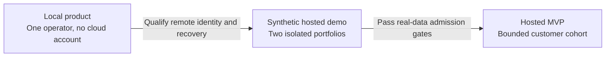

# Hosting plan: local use, two-operator demo, and hosted MVP

Planning baseline; updated October 24, 2026.

This plan defines how local use, the two-operator demonstration and the hosted MVP fit
together. Detailed demo requirements, deployment procedures and acceptance status are
maintained in the linked companion documents.

## 1. Scope and decision hierarchy

Support US customers managing US properties. There is **no additional geographic restriction
on storage, backups, processing, identity services, or other providers**. Choose a US
compute region for operator latency and operational simplicity, not as a data-residency
guarantee. Do not purchase regionalization services or impose US-only backup placement for a
requirement the product does not have.

Cover three operating modes:

| Mode | Intended use | Hosting and identity | Status |
| --- | --- | --- | --- |
| Local | One operator manages their own supported portfolio on their computer | Loopback application, external local workspace, no application account or cloud dependency for manual workflows | Current core product |
| Two-operator demo | Two invited operators, each with a separate persistent synthetic portfolio and multiple devices | Existing Google Cloud VM, separate Unix users/processes/workspaces, qualified Cloudflare Access and tunnel boundary | Protected A/B access is active for acceptance; remaining release checks and general invitations are pending |
| Hosted MVP | A bounded cohort of customers, with one operator per isolated customer workspace and access from multiple devices | Reuse the qualified application and operating pattern, with customer onboarding, isolation, recovery and support gates | Planned; the demo is not evidence of production readiness |

A hosted MVP is an additional delivery stage, not a redefinition of the local MVP. Shared
portfolios, multiple seats and enterprise infrastructure are outside this plan.

The [product brief](../PRODUCT_BRIEF.md), [architecture](../ARCHITECTURE.md),
[decisions](../DECISIONS.md), and [backlog](../FEATURE_BACKLOG.md) remain the product and
implementation authorities. The [demo design](design/HOSTED_DEMO_DESIGN.md) owns accepted
requirements, the [qualification plan](qualification/HOSTED_DEMO_PUBLIC_ACCESS_PLAN.md)
tracks release gates, and the [deployment record](operations/CLOUDFLARE_OPERATIONS.md)
records the installed environment.

Each mode has its own admission criteria. Successful demonstration access does not establish
readiness to host customer data.

## 2. Recommended baseline

Use the smallest operational footprint that passes measured capacity and recovery checks:

- Keep the existing Google Cloud Oregon VM for the two-operator demo. Do not move providers or downsize solely to save a few dollars before qualification.
- Keep one application process/writer per workspace, local SQLite and local attachments, and one combined frontend/backend release.
- Use Cloudflare Access and one named tunnel with fixed per-workspace routes after the application authorization boundary and operator workflows pass acceptance.
- Store completed, application-encrypted recovery archives in a private Cloudflare R2 Standard bucket, separate from the compute provider.
- Keep hosted identity bindings and revocation state outside portable business workspaces. Restoring records must never restore usable authorization.
- Provision the initial hosted cohort administratively. Defer billing, a managed control-plane database, relays and a separate AI gateway.
- Use measured memory, contention, storage growth and operator latency to decide capacity. No fixed number of workspaces per host is established.

No paid load balancer, Kubernetes, serverless rewrite, warm standby, multi-region
deployment, or separate application-shell host is required initially.

## 3. Local operation

Local manual workflows must continue to work without login, hosted configuration, Cloudflare
or an Internet connection.

The product owner performs setup using the supported scripts. Each operator chooses an
external workspace directory outside the source checkout. SQLite and managed attachments
stay together under the workspace contract; file links use stable identities and supported
relative locations.

Preserve the loopback Host/Origin protections. The explicit local-client header expresses
command-line intent and is not remote authentication. Do not expose the local server by
rewriting transport headers or relaxing its checks.

Use the existing complete encrypted backup/export and restore workflows. Optional automatic
local backups use the supported OS credential-store contract; that does not establish an
unattended secret-store solution for a headless server. Synchronize only completed encrypted
archives, never the live SQLite workspace.

Transfers between local and hosted operation use a controlled, validated export/restore
workflow. They are not a raw copy of an open database. Preserve stable IDs, relationships,
financial totals, attachments and audit history. Reestablish external authorization
separately.

## 4. Two-operator demo

### Deployment shape

Retain the recorded Ubuntu 24.04 x86/64 installation in Google Cloud Oregon, with the
current 4 GB E2 baseline, separate epm-a/epm-b service identities, private directories and
independent synthetic workspaces. Confirm the actual machine and disk settings in Console
when qualifying the release.

Keep two supervised services and one private application listener per workspace. Each public
hostname must route only to its assigned process. Keep application ports closed publicly and
retain administrator IAP SSH access. Carry the working per-account TMPDIR settings into
service and administrator commands.

A hosted process replaces the corresponding local process. Never run a second server or
additional Uvicorn workers against the same workspace. A single VM remains a shared failure
domain, which operators must understand.

### Access and operator experience

The accepted design uses exact email allowlists, administrator-approved verified-subject
enrollment, opaque revocable application sessions, exact HTTPS Host/Origin checks and
session-bound CSRF. Authentication must protect APIs, search, recovery, original receipts,
audit and file downloads before disclosure.

Keep host administration, credentials, arbitrary filesystem paths, portable restore and
backup management outside ordinary operator authority. Hiding a control is not
authorization.

Support explicit current-device and all-device logout, visible demo expiry and support
contact, truthful save/error states, and safe same-identity reauthentication. Do not
resubmit consequential commands automatically after an interrupted response or sign-in.

The accepted demo duration is fourteen days from enablement, with an eight-hour maximum
application session bounded by the identity grant and demo expiry. Keep all records
synthetic and external mail, payment and model dispatch disabled.

### Current qualification status

Both approved operators can use their own Home pages. The A/B email-policy matrix, device
logout, fresh sign-in and multi-session revocation have passed their recorded checks. Linux
quota, backup/restore, encrypted reference recovery and scoped lifecycle tests also have
evidence.

Task persistence and access using a foreign record ID are the next prepared checks. File and
receipt isolation, shared editing, final restart/outage behavior, caching and measured
load/latency remain release gates. The tunnel is active for acceptance but disabled at boot.
General invitations remain pending.

Use the [qualification plan](qualification/HOSTED_DEMO_PUBLIC_ACCESS_PLAN.md) for the
current checkpoint and the scope of each result.

## 5. Hosted MVP

### Initial architecture

Retain the modular monolith and one isolated workspace per customer. One operator may use
several devices; multiple people sharing a portfolio require later permission and
collaboration work.

Reuse the qualified demo host where its measured capacity, isolation and funded operating
period support the pilot. For a new host, DigitalOcean in a suitable US region is the
default comparison; AWS Lightsail is an alternative. Avoid an unnecessary provider move when
the existing Google Cloud deployment already meets the gates.

For real customer hosting, qualify per-workspace process/user/volume separation and resource
limits. A container per workspace is the planned packaging/isolation option, not a
capability supplied by merely wrapping the local server in an image. The two-user demo alone
does not prove adversarial customer isolation.

Keep a minimal administrator-managed workspace/host registry and source-owned authorization
stores. Start without a separate Postgres service. Revisit the control-plane database only
when actual account, billing or placement needs justify it.

Keep SQLite, attachments, portable archives and owning domain transactions as the business
authorities. A hosting registry must not become a second customer-record database.

### Onboarding and included UI

A usable hosted MVP includes provisioning the correct workspace, explicit identity approval,
sign-in and reauthentication, logout/revocation, customer-facing expiry/maintenance states,
and clear support/recovery expectations.

Include browser workflows for private files, search, saved forms and original-result
recovery. Preserve dirty input on conflicts, reject stale editors, and prevent
cross-workspace/session cache reuse. Follow the explicit claim/takeover contract wherever
devices share a saved draft.

Do not imply self-service sign-up, billing, team roles or public owner/tenant portals.
Customer onboarding remains administrator-run for the bounded cohort.

### Admission to a real-data pilot

Before onboarding real customer data, record successful tenant-isolation/security checks,
capacity measurements, a complete off-host restore drill, support ownership, a funded
operating period, and the privacy/retention/deletion terms. Select and qualify at-rest
encryption and recoverable key custody before handling sensitive customer records.

Keep a current release and recovery point for a controlled rollback. No availability or
recovery SLA follows automatically from the choice of cloud provider.

## 6. Files, ingress and provider choices

| Boundary | Initial choice | Reason and qualification |
| --- | --- | --- |
| Existing demo compute | Existing Google Cloud Oregon VM | Avoid re-provisioning during qualification; trial credits do not establish ongoing free operation |
| New hosted compute, if needed | DigitalOcean US region; Lightsail alternative | Compare total regional cost and measured performance before moving |
| Public access | Cloudflare Access and named tunnel | Simple fixed ingress; the app still verifies identity/session/workspace authority |
| Application delivery | Packaged frontend and API on the same public origin | One release, straightforward cookies/CSRF, no cross-origin routing layer |
| Live evidence | Local persistent files through owning authenticated APIs | Keeps current integrity, link and rollback behavior |
| Off-host archives | Private R2 Standard storage | Holds only completed encrypted application archives; use automatic/default location unless latency measurements justify a hint |
| Administrative state | Separate protected per-process SQLite | Keep sessions, grants and edit leases out of portable business backups |
| Monitoring | Minimal independent uptime check plus host/service and recovery-age alerts | Use eligible free services where sufficient, with no private payloads in probes or alerts |

R2 supports jurisdictional placement, but this product does not require it. Automatic
placement and optional location hints serve performance needs; a hint is not a residency
guarantee. See [R2 data
location](https://developers.cloudflare.com/r2/reference/data-location/).

Do not configure R2 as the existing live S3 file adapter just because both use an
S3-compatible API. The current [File
adapter](../../application/apps/server/app/modules/files/infrastructure/content_store.py)
requires bucket versioning and exact VersionId behavior. R2 live-file use, browser presigned
transfers and thumbnails need a separately qualified contract and are deferred.

A US origin alone does not imply geographically restricted edge processing or metadata.
Cloudflare treats tunnel connector placement, traffic processing and metadata localization
as separate controls. No such residency guarantee is required or claimed here. See
[Cloudflare Zero Trust
localization](https://developers.cloudflare.com/data-localization/how-to/zero-trust/).

Use globally delivered public assets only where Access behavior and cache rules are
qualified. Public marketing hosting can be separate, but moving the application to Pages
with an API on another subdomain would introduce a different origin and is not the initial
plan.

## 7. Complete recovery and controlled handover

### Recovery unit and custody

Back up a validated SQLite-consistent database, every required attachment and a manifest
together. Database replication alone is not a complete workspace recovery point.

Encrypt archives before upload. Keep upload credentials outside application workspaces and
unavailable to the application service accounts. Keep recovery passphrases and the
administrator recovery information independently recoverable after host loss.

Back up protected deployment configuration and necessary enrollment information separately
in an administrator-encrypted bundle. Exclude usable sessions, token hashes, Access grants,
connector/model credentials and edit leases. Require fresh authorization after restore.

### Initial schedule and retention

For the demo, the named administrator performs daily application-consistent encrypted
backups and verifies publication, retaining seven successful daily recovery points per
workspace. Stagger A/B maintenance and record how long each interruption lasts. Do not
depend on an unqualified headless keyring.

Use that simple, explicitly supervised recovery model for an initial bounded hosted pilot
only if its disclosed recovery window and operational workload are acceptable. Automation
requires a qualified server secret-store and monitoring contract before anyone calls it
unattended.

Report the actual age of the latest complete verified recovery point. A daily policy allows
up to twenty-four hours of edits at risk only while verification is current; otherwise
disclose the older point and act on the failure. Do not promise minutes of whole-workspace
data loss.

Keep the latest verified point when a new backup fails. Verify a fresh-host restore,
including archive authentication, retained-data validation, attachments, stable IDs and
financial totals, before pruning or claiming recovery readiness.

### Optional layers

Litestream is deferred until a measured recovery requirement justifies continuous database
replication. Qualify its encryption, database compatibility and attachment recovery together
before changing the recovery claim. [Litestream's caveats](https://litestream.io/tips/) are
part of that evaluation.

Provider snapshots may provide a distinct convenience or recovery layer. Keep or remove them
according to demonstrated coverage, restore time and cost after an independent restore
drill. Neither keeping snapshots nor removing them is an automatic rule.

The hosted pilot must explicitly disclose retention and deletion handling, including
retained backups. Longer commercial retention is outside the initial commitment.

### Workspace move or reset

1. Enter disclosed maintenance and stop/drain writes.
2. Create and verify the final complete recovery point.
3. Restore into a new private destination and validate the compatible release and data.
4. Fence the old writer and invalidate stale runtime/session continuations.
5. Switch the fixed routing/binding explicitly, then verify the new workspace and fresh authorization.
6. Have browsers reconcile uncertain operations with their original keys.

Only one workspace instance may accept writes. Do not overwrite a live SQLite file or
silently switch routing while writes continue.

## 8. Performance, concurrency and freshness

Keep the existing WAL/deferred-read/immediate-write model and five-second busy timeout.
Inspect actual connection settings and query plans before tuning. Do not enable
synchronous=NORMAL, mmap/cache changes or a new read-pool design as unmeasured defaults, and
do not reduce acknowledged financial durability to improve a benchmark.

Use set-based owning projections and query budgets. Run representative hot-list query plans
against a reproducible larger seed before adding caches. Measure process memory, CPU
throttling, storage growth, lock waits and p95 latency under at least four simultaneous
browser sessions plus a bounded report and staggered backup.

Build releases off-host. Bound expensive work and stagger it to protect interaction. A
separate report/import worker must not introduce another workspace writer or speculative job
infrastructure.

Keep active pilot workspaces running during their advertised period. Consider a 2 GB host
only after repeating qualification with at least 25% total memory headroom, no OOM/restart
failures, and the same latency gates. Do not assume 10–12 or 15 workspaces fit on a 4 GB VM.

Preserve source revisions and original-key idempotency. Changed payloads using the same key
must conflict; interrupted financial responses must reconcile rather than create another
payment or expense. Background refresh must not overwrite dirty input.

Use one bounded fifteen-second change check per visible browser, with jitter/backoff and
hidden-tab suspension, as specified by the demo plan. Keep independent focus/reconnect,
periodic and property-local time-transition refresh. A revision alone cannot detect a
deadline passing without a write.

Do not add a Home snapshot/cache initially. If measurements later justify one, scope it to
the authorized workspace/runtime/filter/period and expire it on relevant time transitions as
well as data changes.

Cache only qualified fingerprinted public assets. Keep private HTML, APIs, session
responses, errors and downloads non-shared and no-store. Never bypass authentication or
introduce a Cache Everything rule to improve apparent latency.

### Acceptance targets

The [public-access plan](design/HOSTED_DEMO_DESIGN.md#measurement-and-acceptance-targets)
owns the detailed measurement protocol: at least fifty observations per operation/cache
condition in three runs, with reference-network and actual-operator measurements
distinguished.

| Measurement | Target to demonstrate |
| --- | --- |
| Warm authenticated ordinary read at origin | p95 at most one second, preserving owning query ceilings |
| Warm Home usable | p95 at most 1.5 seconds on the reference network |
| Cold assets and initial Home after identity sign-in | p95 at most three seconds desktop / five seconds mobile on the specified reference networks |
| Ordinary non-file mutation | p95 at most 1.5 seconds on the reference network |
| Incremental local authorization | p95 at most 20 ms; at most one indexed auth SELECT per protected request, without routine last-seen writes or remote introspection |

These are release targets, not measured results or universal network guarantees. Measure
maintenance interruptions honestly.

## 9. Security and operations

- Apply least privilege to cloud, registrar, code and administrator accounts, with MFA where supported. Keep service identities and private directories separate.
- Store secrets outside images, source, logs and portable business archives. Qualify key recovery separately from host recovery.
- Use TLS, server-side capabilities, revocation and exact-origin CSRF. Deny ambiguous identity, host or workspace mappings.
- Keep customer evidence and sensitive command input out of infrastructure logs, analytics and alert payloads. Treat identifiers and request metadata as potentially identifying, not automatically harmless.
- Keep support access off by default, explicit, time-limited and audited. Maintain incident, credential-loss, export/deletion and recovery procedures.
- Monitor service health, backup age, disk/memory, errors and certificate/tunnel availability. The demo warns at 80% host disk use and enters write maintenance before 90%, with rollback/cleanup headroom.
- Enforce the accepted demo's 250 MiB whole-workspace budget, 50 MiB file ceiling and concurrent staging/reservation rules before public release. A displayed disk measurement is not quota enforcement.
- Deploy one immutable release with recorded source, dependencies, schema and checksums. Stage qualification before switching the owning process.
- Keep only the current greenfield schema. Do not add automatic startup migrations, schema compatibility layers or a migration fleet as part of this work. Verify release/data compatibility before a switch and retain the validated recovery path.
- State realistic support hours and name the person responsible for daily recovery checks and alerts. Do not imply 24/7 support or SOC 2 certification.

The app does not need native mail/SMS authorization, automatic sending or a managed AI
gateway for this hosting scope. Manual entry and operator sending remain usable. Any
optional assistant/model capability must follow its own approved governance and disclosure
design; hosting does not authorize it.

## 10. Cost and capacity plan

### Current demo

Keep the accepted **USD 30/month infrastructure target**, before tax and domain
registration. It includes actual compute, disk, IPv4, transfer and backup usage. It is a
planning target, not a provider quote or enforced spending cap.

Record gross regional usage before trial credits, keep budget notifications, and review at
least seven days before trial expiry. If ongoing operation is unfunded, take a final
verified off-host backup and suspend deliberately. Do not describe a trial-funded VM as
permanently free.

### Hosted MVP planning example

The following October 23, 2026 reference example uses a 4 GB configuration. Recheck
provider prices before provisioning, then qualify actual capacity:

| Item | Monthly planning amount | Basis |
| --- | --- | --- |
| DigitalOcean Basic Regular 4 GiB / 2 vCPU | USD 24 | Published reference price, subject to chosen region/availability |
| R2 archives and backup operations | USD 1–5 allowance | Estimate only; measure retained archive bytes, requests and restore traffic |
| Monitoring/logging | USD 0–5 allowance | Estimate only; free-tier eligibility and sufficient retention must be verified |
| Domain | USD 1–3 amortized allowance | Estimate only; use actual registration and renewal |
| Planning subtotal | USD 26–37 | Compute plus the stated allowances, not an all-inclusive quote |

DigitalOcean also lists a 2 GiB reference at USD 12, but that is a measured-downsize option,
not the demo's starting instruction. [DigitalOcean
pricing](https://www.digitalocean.com/pricing/droplets).

The dated reference for a comparable Lightsail Linux 4 GB bundle with public IPv4 is USD
24/month. [Lightsail pricing](https://aws.amazon.com/lightsail/pricing/).

The subtotal excludes optional provider snapshots, additional volumes/hosts, excess
transfer, paid identity/monitoring features, AI or integration usage, payment fees, taxes,
support time and legal/compliance work. R2's allowances are account-wide and cannot be
guaranteed per workspace. Verify [R2 pricing](https://developers.cloudflare.com/r2/pricing/)
against actual use.

For a reused Google Cloud host, calculate its actual regional total instead of substituting
the DigitalOcean example. No managed Postgres or dedicated relay/gateway host belongs in the
initial subtotal.

Model additional hosts from measured capacity. Per-customer costs require an observed
workspace density and the complete operating cost, including support and recovery.

## 11. Delivery gates and validation

| Area | Required evidence |
| --- | --- |
| Local happy paths | Operator setup, manual workflows and complete backup/restore work without hosted login or cloud dependency |
| Hosted happy paths and UI | Assigned sign-in, records/files, multiple devices, visible save state, logout and support/expiry feedback |
| Invalid combinations and isolation | Wrong identity/audience/subject/host/workspace, missing CSRF, disabled/expired access and changed IDs fail before disclosure or mutation |
| Idempotency and retry | Original-key recovery yields one effect; changed payload conflicts; authorization precedes receipt lookup |
| Concurrency | Stale edits preserve input; explicit shared-draft takeover fences the former editor; no automatic offline replay |
| Transaction rollback | Domain changes, receipts and audit remain atomic; failed authorization/session setup grants no business authority |
| Persistence/schema | Current baseline and retained validators agree; restart does not revive revoked sessions |
| Backup/restore | Complete off-host archive restores stable IDs, attachments, relationships, totals and history; fresh authorization follows |
| Query budget and latency | Auth query ceiling, owning set-based budgets, time freshness and reference-network targets hold under measured load |
| Operations and faults | Reboot, full disk, identity/tunnel outage, failed backup/reset and rollback have tested, truthful states |

Sequence the work:

1. Preserve and validate local operation.
2. Finish the existing two-operator public-access slices in their recorded order.
3. Demonstrate current off-host recovery and four-browser behavior before invitations.
4. Run the synthetic demo and record operational workload, gross cost and latency.
5. Admit a bounded hosted MVP cohort only after its real-data security, onboarding, recovery and support gates pass.

Actual provider sign-in, cache behavior and fresh-host recovery require deployed evidence.
Unit fixtures, a working DNS name or an HTML response do not establish release readiness.

## 12. Known later commercial gaps

Record these gaps without designing or purchasing their infrastructure now:

- Self-service accounts, billing/entitlements, durable account recovery and a larger placement/control plane.
- Multiple seats, shared-portfolio roles, stronger customer isolation evidence and privileged support controls.
- Qualified unattended recovery, tighter demonstrated RPO/RTO, fleet deployment/upgrades and sustainable support coverage.
- Any future relay/webhook delivery contract, including durable acknowledgement, retry/deduplication and dead-letter handling.
- Optional managed AI or other integrations with separately approved credential custody and cost controls.
- Higher availability, larger-scale unit economics, longer retention and customer-driven compliance/certification requirements.

Availability and recovery commitments require measured service availability,
complete-workspace restore time and an explicitly funded operating model.

## 13. Planning references

The accepted baseline is operational simplicity: independent workspaces, one combined
application origin, local live data, complete encrypted recovery and measured capacity.
Global services remain eligible; US scope applies to customers and properties. Original
planning context is retained in the [archive](archive/README.md).

Planning sources: [product brief](../PRODUCT_BRIEF.md), [architecture](../ARCHITECTURE.md),
[decisions](../DECISIONS.md), [backlog](../FEATURE_BACKLOG.md), [public-access
implementation plan](qualification/HOSTED_DEMO_PUBLIC_ACCESS_PLAN.md), [Google Cloud
deployment record](deployment/GOOGLE_CLOUD_DEMO_DEPLOYMENT.md), and [cost/latency
review](qualification/reports/HOSTED_DEMO_COST_LATENCY_REVIEW_2026-10-23.txt).

Provider documentation linked above was checked October 23, 2026. Recheck prices, account
eligibility, supported features and operational terms before provisioning. This plan does
not make legal or compliance claims.
