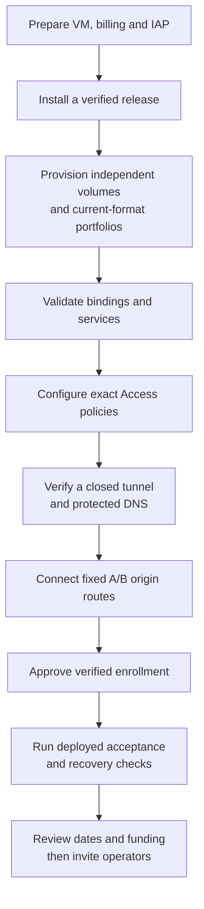

# Google Cloud and Cloudflare deployment guide

Administrator procedure; consolidated October 24, 2026. This describes the accepted hosted
installation. Provisioning sections apply to a **new** host, empty release directory or
empty destination; inspect existing resources before creating them. For current identifiers
and evidence, see the [deployment record](../operations/CLOUDFLARE_OPERATIONS.md). For
recurring actions, use the [operations runbook](../operations/HOSTED_DEMO_OPERATIONS.md).

## Deployment sequence



Follow this order on a new deployment. For the existing installation, use the [qualification
checkpoint](../qualification/HOSTED_DEMO_PUBLIC_ACCESS_PLAN.md) to identify the next step;
completed setup is not repeated.

## Deployment inventory

| Setting | Recorded deployment |
| --- | --- |
| Project display name / ID | `epm-demo` / `project-47b72bb7-ba90-42c9-910` |
| VM / location | `epm-demo`, Oregon `us-west1-b` |
| Machine / OS / disk | E2 medium, 4 GB RAM; Ubuntu 24.04 LTS x86_64; 30 GB Standard persistent boot disk |
| Network / external IPv4 | `default` / ephemeral; application ports remain private |
| Current release | `/opt/epm/releases/signin-nav-20261024` |
| Python / package / schema | CPython 3.14.9 / 0.1.0 / `0001_initial_schema` |
| Private origins | A `127.0.0.1:8001`; B `127.0.0.1:8002` |
| Protected public origins | `https://demo-a.epmdemo.xyz`, `https://demo-b.epmdemo.xyz` |
| Identity / recovery | Cloudflare Access email PIN; named tunnel; private R2 encrypted archives |

E2 medium offers two exposed vCPUs but one sustained fractional vCPU in aggregate, with
bursting. The current 4 GB baseline must pass measured acceptance before any 2 GB resizing.
Google trial expiry is January 22, 2027 and $30 monthly alerts are operator-reported; review
funding by January 15. Alerts do not cap spending.

## 1. Google project, billing, VM and administrator SSH

### Billing and project

Recorded billing settings: trial expiry **January 22, 2027**, and **$30 monthly budget
alerts are configured**. These are operator-reported, not an independent Console audit.
Review funding by January 15, 2027 (at least seven days before expiry). Check remaining
credit and billing status during the regular administrator review.

In the [Google Cloud Console](https://console.cloud.google.com/):

1. Select the Gmail account used to register for the Google Cloud trial.
2. Create or select the dedicated `epm-demo` project. Use **No organization** if applicable and associate the trial billing account.
3. Record the **project ID**, not just the display name. The two differ in this deployment.
4. Under **Billing**, confirm the actual trial credit, expiry date, and billing status.
5. Under **Budgets & alerts → Create budget**, select the demo project, a USD 30 monthly budget, and 50%, 90%, and 100% alerts. Exclude promotional credits from the calculation to monitor costs before those credits offset them.

This E2 medium configuration, disk, and external IPv4 consume trial credit. It is not the
ongoing free-tier VM configuration. Budget alerts do not cap spending or stop resources.
Review costs and trial expiry regularly. Google documents USD 300 for up to 90 days for
eligible trial customers, but the account's displayed terms and remaining balance govern
this deployment. Paid-account upgrade is a separate choice.

Sources: [trial conditions](https://cloud.google.com/signup-faqs),
[budgets](https://docs.cloud.google.com/billing/docs/how-to/budgets), [free-tier
limits](https://docs.cloud.google.com/free/docs/free-cloud-features), [network
pricing](https://cloud.google.com/vpc/network-pricing). Recheck changing provider terms
before reuse.

### New VM settings

Open **Compute Engine → VM instances**. Enable the Compute Engine API for the selected
project if prompted, then **Create instance**.

| Setting | Selection |
| --- | --- |
| Name | `epm-demo` |
| Region / zone | `us-west1` / `us-west1-b` |
| Machine series / type | E2 / `e2-medium` |
| Provisioning model | Standard |
| OS | Ubuntu 24.04 LTS, x86/64 (AMD64), not Ubuntu Pro or ARM64 |
| Boot disk | 30 GB Standard persistent disk; confirm actual type in Console |
| Network / subnetwork | `default` / regional `default` subnet |
| External IPv4 | Ephemeral |
| Network tag | `epm-admin` |
| Allow HTTP / HTTPS traffic | Both unchecked |

Choose **OS and storage → Boot disk → Change → Public images → Ubuntu**, Ubuntu 24.04 LTS
AMD64. E2 requires x86_64, not ARM64.

For an existing VM, click its name, **Edit → Network interfaces → nic0** to inspect the
network and select **External IPv4 address → Ephemeral**, then **Done → Save**. An ephemeral
address can change after stop/start. Assigning it does not open application ports. Avoid
adding GPUs, Cloud SQL, load balancers, or additional disks for this demo.

Sources: [VM
creation](https://docs.cloud.google.com/compute/docs/instances/create-start-instance),
[external
addresses](https://docs.cloud.google.com/compute/docs/ip-addresses/configure-static-external-ip-address).

### IAP-only SSH

First add the **network tag** `epm-admin` under **VM instances → epm-demo → Edit → Network
tags**, then save. Use the VM network-tag field.

Open **VPC network → Firewall → Create firewall rule** in the correct project:

| Field | Value |
| --- | --- |
| Name | `epm-allow-iap-ssh` |
| Logs | Off |
| Network | `default` |
| Priority | `1000` |
| Direction / action | Ingress / Allow |
| Targets | Specified target tags |
| Target tags | `epm-admin` |
| Source filter | IPv4 ranges |
| Source IPv4 ranges | `35.235.240.0/20` |
| Protocols and ports | Specified protocols and ports: TCP `22` only |

Press Enter after typing tag/range values if the Console uses chips. Leave an optional
second source filter unset. Save this rule first, then inspect `default-allow-ssh`. If it
allows TCP 22 from `0.0.0.0/0`, edit it and set **Enforcement → Disabled** in this dedicated
project. Check for any other rule allowing public SSH. Keep ports 80, 443, 8001, and 8002
closed.

IAP tunneling also requires Google IAM authorization; the firewall rule alone does not grant
login. If a different administrator receives an authorization error, review the required IAP
and Compute permissions instead of opening SSH publicly. [Google IAP
instructions](https://docs.cloud.google.com/iap/docs/using-tcp-forwarding)

### Connect and prepare Ubuntu

**Cloud Shell** is the terminal opened with **Activate Cloud Shell** (`>_`) in the Console.
Its prompt contains `@cloudshell`. Connect from there:

```bash
gcloud compute ssh epm-demo \
  --project=project-47b72bb7-ba90-42c9-910 \
  --zone=us-west1-b \
  --tunnel-through-iap
```

Authorize and accept SSH-key generation if prompted. Always use the project ID in the
command. `gcloud compute instances list` lists the selected project's instances.

Once connected, the **VM terminal** prompt contains `@epm-demo`. Run:

```bash
uname -m
cat /etc/os-release
free -h
df -h /
sudo apt-get update
sudo apt-get install -y ca-certificates curl python3 python3-venv python3-pip
timedatectl status
```

Expect `x86_64`, Ubuntu 24.04, roughly 4 GB RAM, a roughly 30 GB root disk, and a
synchronized clock. Keep application property time zones separate from host time
configuration. This capacity is a starting allocation, not measured EPM throughput.

## 2. Build and install a reproducible release

Build on the Mac, not the VM. Use a clean recorded source revision plus any explicitly
recorded patch, fixed runtime dependencies and matching schema resources. Do not copy a
macOS virtual environment onto Linux or replace Ubuntu system Python.

**Mac, repository root:**

```bash
./application/scripts/build_wheel.sh
```

The script checks lint/format/types/contracts, builds React, packages the combined wheel and
verifies its public contents. Use `--install-deps` only when needed. A release bundle
includes wheel, source/release record, SHA256SUMS, schema resources (`alembic.ini`,
migration env and current baseline), stage/verify helpers and any reviewed configuration
helper. Record exact Python patch and Linux dependency set.

**New VM runtime:** inspect the official uv installer before running it; install managed
CPython under `/opt/epm/python`, not the administrator home. The deployed runtime is 3.14.9;
source uses Python 3.14 syntax. Create a new release environment:

```bash
UV_PYTHON_INSTALL_DIR=/opt/epm/python "$HOME/.local/bin/uv" python install 3.14.9
UV_PYTHON_INSTALL_DIR=/opt/epm/python "$HOME/.local/bin/uv" venv --python 3.14.9 --seed /opt/epm/releases/RELEASE/venv
```

Install the current constraints/wheel and schema resources in that release, then run `pip
check`, `stage_schema_resources.py` and `verify_installation.py` with its interpreter.
Verify service-account read/execute access, installed package path, packaged assets and
current schema without PYTHONPATH/PYTHONHOME overrides. Code uses root ownership and
readable/executable permissions (installation umask 022); data and credentials use private
permissions (umask 077).

Transfer the checksum-manifested bundle from Mac or Cloud Shell using IAP:

```bash
gcloud compute scp RELEASE.tar.gz epm-demo: \
  --project=project-47b72bb7-ba90-42c9-910 --zone=us-west1-b --tunnel-through-iap
```

On the VM, compare archive SHA-256, extract into a new staging folder and run `sha256sum
--check SHA256SUMS`. Record a new identifier/checksum for every rebuilt artifact. Provider
installer/build instructions are dated operational references: [uv
installation](https://docs.astral.sh/uv/getting-started/installation/), [managed
Python](https://docs.astral.sh/uv/guides/install-python/), [complete release
contents](../../../manual/deployment.md#release-contents-required-before-deployment).

## 3. Identities, storage and current-format portfolios

Create independent non-login `epm-a` and `epm-b` system users/groups. Their private homes
are `/var/lib/epm-a` and `/var/lib/epm-b`; external backup directories are
`/var/backups/epm-a` and `/var/backups/epm-b`, owner-only. Neither gets sudo/login. Root
owns `/etc/epm`, runtime code, storage images and configuration parent chains.

### Bounded storage contract

Create the root-owned **code** environment with an installation umask such as `022`, so the
service account can traverse directories and execute/read the runtime. Check
interpreter/import access as that account before starting its unit. Keep workspace data,
administrative state and credential files private with `077`; do not recursively relax those
paths.

Each workspace uses a separate **fully allocated 250 MiB ext4 loop image**. The kernel
bounds the combined database, WAL/journals, evidence, temporary uploads and staging, rather
than relying on a directory-size estimate. The service cannot resize/read the root-owned
backing image. Filesystem metadata and reserved space reduce usable capacity: 250 MiB is the
physical ceiling, not a promise of 250 MiB of attachments. The existing 50 MiB per-file
limit is unchanged.

Provisioning requirements, to be executed by the administrator on Linux:

- Root-owned, non-symlink image directory `/var/lib/epm-volumes`, not writable by
  services. Mode `0711` permits services to stat their pinned image without listing
  other images. Each image is root-owned `0600`, exactly `262144000` bytes and
  fully allocated (not sparse). Check host free disk before allocation.
- Format a **new image only** as ext4, with 10% root-reserved blocks, discard and
  deferred initialization disabled
  (`mkfs.ext4 -m 10 -E nodiscard,lazy_itable_init=0,lazy_journal_init=0`).
  Recheck allocation after formatting **and again after first mount and workspace
  initialization**. Never format
  an existing image or operator data. Mount the complete filesystem at
  `/var/lib/epm-a/volume` using `rw,nodev,nosuid,noexec`; not a bind mount. Root
  owns the underlying unmounted mountpoint and protects its parent chain. Use one loop mapping per image, with
  `losetup --find --show --nooverlap` and serialized administrator provisioning.
  Record the exact device/image mapping and persistent mount configuration.
- After mounting, make the mounted filesystem root service-owned `0700` so the
  owner can create the sibling `.workspace.server.lock`; the root-owned image
  remains inaccessible and non-resizable. Inside it, create service-owned `0700`
  `workspace/` and `tmp/`. Set both the
  environment `TMPDIR` and Python's effective temporary directory to
  `/var/lib/epm-a/volume/tmp`. Do not use shared `/tmp` restore locks.
- Keep `/var/lib/epm-a/access/` service-owned `0700` **outside** the volume for
  bounded administrative session state. Keep encrypted backup outputs/staging
  outside the volume too, private to the account running each operation.
- Repeat independently for B. Check mount persistence through a reboot before
  treating this as qualified storage. An absent mount or changed device/image
  fails application startup; do not bypass validation.

Do not enable mount-time discard or run TRIM against the reserved images. For persistent
mounts, include `X-fstrim.notrim` and verify the host's actual TRIM job uses an
fstab/listed-in mode that honors it; do not assume every invocation does. Do not disable
host-wide TRIM merely to exclude these volumes. See [mke2fs
options](https://man7.org/linux/man-pages/man8/mke2fs.8.html) and [fstrim
exclusions](https://man7.org/linux/man-pages/man8/fstrim.8.html).

If an **explicitly verified new scratch image** has allocation holes after initial setup,
root may re-reserve them with `fallocate --keep-size --length 262144000` against that exact
pinned image, after checking its length/mapping and host free space. This preserves data and
length; it is not permission to resize/reformat an operator image. Recheck allocation and
rerun validation. Retained-image allocation and remount evidence is in the [qualification
report](../qualification/reports/HOSTED_DEMO_RECOVERY_2026-10-23.md). Recheck both
allocation and boot behavior for a new deployment.

Root provisions these resources; the application performs no mount, allocation or resize.
Validate image allocation, exact block-device size, backing-file identity, mount flags,
same-device workspace/temp directories, and at least 16 MiB of root-only reserved space. The
implementation inspects these properties at startup and rechecks device/size/free-space
facts per protected business request. Linux distinguishes privileged free blocks from blocks
available to an ordinary user; the adapter uses the latter for admission. See
[statvfs](https://man7.org/linux/man-pages/man3/statvfs.3.html), [ext4
administration](https://docs.kernel.org/admin-guide/ext4.html) and [loop-device overlap
precautions](https://man7.org/linux/man-pages/man8/losetup.8.html).

Request reservations include 16 MiB write headroom (1 MiB for reads, which can audit) plus
three times admitted body bytes for spooling, owning multipart staging and immutable
publication. In-flight reservations are serialized and already allocated bytes remain
counted conservatively. Unknown unsafe body lengths reserve the maximum; bytes exceeding the
admitted length are rejected. At host disk use of 80%, requests log a rate-bounded
administrator warning; at 89%, new business writes return typed maintenance `503`. Quota
admission returns typed `507`. These are not guarantees that every admitted write succeeds:
actual database growth is bounded by the filesystem, and the real FULL/rollback drill is
required. Session/logout controls remain available outside business quota accounting. The
complete body spool is closed on its last replay chunk before owning handler publication;
otherwise the parser/handler/publication could overlap four copies. Raw or explicitly
wrapped storage-full errno failures are typed even after cleanup restores free space.
Original-result reads may require an explicit later retry while an earlier request's
conservative reservation is still unwinding; never resubmit a consequential command under a
new key to compensate.

### Initialize or restore portfolios

Use [demo/seed.py and verify.py](../../../application/demo/README.md) for separate
current-format synthetic portfolios; never generate B by duplicating A's identity. Set
`/var/lib/epm-<instance>/hosted-local.json` to the corresponding mounted
`/var/lib/epm-<instance>/volume/workspace`. The seed catalog/journal directory is also
inside that volume and counts toward quota. Validate schema, relationships, IDs, audit and
financial scenarios before switching a service.

For restore, use a separate private bootstrap config whose `localWorkspacePath` points to an
unused path **other than** the target. Run as the owning user with its volume TMPDIR;
restore only into a new empty external destination:

```bash
sudo -u epm-a env TMPDIR=/var/lib/epm-a/volume/tmp \
  /opt/epm/releases/RELEASE/venv/bin/python -m app \
  --config /var/lib/epm-a/restore-bootstrap.json \
  restore /var/backups/epm-a/seed.epm-backup /var/lib/epm-a/volume/NEW-WORKSPACE
```

Choose the matching B paths/account for B. Enter passphrases only at prompts. Both `backup`
and `export` produce `.epm-backup`; export is an internal archive type. Use the path printed
by the command, never overwrite an existing archive, and preserve literal backslash-newline
continuation when copying commands. No running SQLite file copy, schema migration or
incompatible restore is supported.

## 4. Hosted configuration and service installation

Use the [configuration and route contract](HOSTED_DEMO_CONFIGURATION.md) for protected JSON,
exact UUID/origin/issuer/audience/email, capability and expiry validation. Initialize
administration once as its owner; do not replace an existing administrative database. Its
location is outside the business volume.

1. Record the source revision, wheel/frontend/schema checksums, Python patch,
   dependency lock, local installation verification and focused test results.
   Build from current source; this latest-format work is not a migration of the
   earlier private VM installation.
2. Stop/fence the old writer. Preserve a complete validated encrypted recovery
   point. Restore a compatible current-schema synthetic archive into a **new,
   empty private** destination on the prepared volume; do not copy live SQLite
   or overwrite a live workspace. Use a separate bootstrap configuration whose
   live-workspace path is not the restore destination, as in the
   [Google Cloud runbook](GOOGLE_CLOUD_DEMO_DEPLOYMENT.md).
3. Pin the new workspace path in the local config and use the
   [protected deployment JSON](HOSTED_DEMO_CONFIGURATION.md), including the
   volume, image, exact workspace UUID and external access database. Validate
   workspace/configuration and initialize the administrative store explicitly.
4. Install a reviewed copy of
   `application/deploy/hosted-demo/epm-hosted@.service`. Replace `HOSTED_RELEASE`
   with the exact qualified root-owned release. Set `/etc/epm/hosted-a.env` to
   `EPM_PORT=8001`, B to `8002`; root-owned, service-readable, not writable.
   Validate the unit on Linux with `systemd-analyze verify`. Mask the prior
   `epm@a.service`/`epm@b.service` before switching, one instance at a time.
5. Start only the hosted owner. The template conflicts with the old service,
   requires the mount, preserves resource limits and confines writable paths to
   the volume/access directory. It always binds loopback, disables forwarded
   proxy-header trust and runs one writer. Keep public application ports closed.

The explicit command, with the service account's correct `TMPDIR`, is:

```bash
sudo -u epm-a env TMPDIR=/var/lib/epm-a/volume/tmp \
  /opt/epm/releases/RELEASE/venv/bin/python -m app \
  --config /var/lib/epm-a/hosted-local.json \
  serve-hosted --deployment /etc/epm/hosted-a.json --port 8001
```

Use systemd for supervision, not both this foreground command and a service. There is no
public bind override or local-policy fallback. Qualify the unit's mount/sysfs access under
its actual sandbox before deployment. Ordinary local `serve` remains loopback-only and does
not require hosted infrastructure.

The effective current release is `signin-nav-20261024`, selected by each instance's
`20-signin-navigation.conf` override. The shared template retains `qual-c8aab474`. Inspect
the effective ExecStart when verifying the runtime. New deployments should pin their
qualified release directly. Current limits: MemoryHigh=1G, MemoryMax=1500M, CPUQuota=90%,
RestartSec=5, TimeoutStopSec=60; these are starting controls, not measured capacity.
Restrict writes to each volume/access directory, retain
PrivateTmp/PrivateDevices/ProtectHome/strict filesystem/no privileges and empty capability
bounds. Validate with `systemd-analyze verify`.

## 5. Cloudflare DNS, Access and tunnel

1. Keep Porkbun as registrar; add `epmdemo.xyz` to Cloudflare Free/Full DNS and
   delegate to the exact assigned nameservers. Recorded pair: `bonnie.ns.cloudflare.com`
   and `vasilii.ns.cloudflare.com`. Account linking alone is not delegation.
   Confirm Active. Preserve unrelated records; imported parking A records
   207.207.210.107/.229 and wildcard/www `pixie.porkbun.com` are historical parking,
   not application origins. Do not expose the VM IP through application DNS.
2. Configure team `epmdemo.cloudflareaccess.com`, email one-time PIN and two
   self-hosted applications, each exact hostname and its own email-only Allow.
   Use distinct audiences, eight-hour duration, no wildcard/path/broad domain/
   Everyone/Bypass rule, no extending policy override, no Accept-all-IdPs or
   One Client authentication. Store actual emails/audiences privately.
3. Use the application's policy tester for all four A/B email decisions. Both
   identities must have a prior Access login. OTP code-sent UI is deliberately
   generic; lack of email alone is not policy-evaluation evidence.
4. Authorize cloudflared on the Mac. Keep the account certificate there (directory
   0700, file 0600); transfer only the scoped tunnel JSON over IAP. Named tunnel:
   `epm-demo`, ID `c29cb930-4166-4105-90a3-32d72fc04f46`.
5. Install the verified official cloudflared 2026.10.3 Linux AMD64 binary under
   `/usr/local/lib/epm-cloudflared/2026.10.3/cloudflared`, using a dedicated
   non-login `epm-tunnel` user. `/etc/epm-tunnel` is root:epm-tunnel 0750;
   config/credentials are 0640. Never transfer the management certificate or put
   a runtime token in arguments, history or environment. A/B cannot read credentials.
6. Validate an initially closed `http_status:404` ingress. Establish outbound
   connectivity (including documented port 7844), readiness and credential/sandbox
   behavior before mapping origins. Create exact CNAMEs with
   `cloudflared tunnel route dns TUNNEL_ID HOSTNAME`, without overwriting unrelated
   records. Verify unauthenticated shell/API/receipt requests reach Access.
7. Validate exact origin rules and unmatched fallback, then start the dedicated
   `epm-cloudflared.service`. No Host/Origin rewrite. The unit has strict filesystem,
   private temp/devices/no privileges, 128M memory-high/256M memory-max and private
   metrics at 127.0.0.1:20241. Its `/ready` is connector readiness, not app acceptance.

```yaml
tunnel: c29cb930-4166-4105-90a3-32d72fc04f46
credentials-file: /etc/epm-tunnel/credentials.json
no-autoupdate: true
metrics: 127.0.0.1:20241
ingress:
  - hostname: demo-a.epmdemo.xyz
    service: http://127.0.0.1:8001
  - hostname: demo-b.epmdemo.xyz
    service: http://127.0.0.1:8002
  - service: http_status:404
```

## 6. Enrollment, rollout and acceptance

The first actual verified email PIN sign-in creates only a pending enrollment. Verify the
subject/email against the intended configuration and activate through the owner-account
administrator CLI. The browser must explicitly Continue. Refresh and verify encrypted
administrator references after binding/configuration changes. Ordinary operators get no
SSH/Google credentials or host administration.

Keep one writer per workspace. The old `epm@a/b` units stay masked; current hosted units are
enabled. The tunnel is currently **running but disabled at boot** for acceptance. Final boot
enablement, actual caching/latency/load/fault acceptance and invitations are tracked in the
[qualification plan](../qualification/HOSTED_DEMO_PUBLIC_ACCESS_PLAN.md). Enablement and
invitations follow the recorded acceptance gates.

For Cloud Shell uploads, original private Mac port forwarding, initial `demo-001` bundle
hashes/commands and historical restore paths, use the [preserved initial deployment
record](../archive/2026-10-24-sources/GOOGLE_CLOUD_DEMO_DEPLOYMENT.md). That private
local-mode port-forwarding procedure is not a bypass for hosted Host and identity checks.
Current administrators use IAP plus the runbook's exact-Host probes.

## Provider references

These links were used during October setup; recheck before new provisioning: [Cloudflare
locally managed
tunnels](https://developers.cloudflare.com/cloudflare-one/networks/connectors/cloudflare-tunnel/do-more-with-tunnels/local-management/create-local-tunnel/),
[JWT
validation](https://developers.cloudflare.com/cloudflare-one/access-controls/applications/http-apps/authorization-cookie/validating-json/),
[OTP
behavior](https://developers.cloudflare.com/cloudflare-one/integrations/identity-providers/one-time-pin/),
[policy
testing](https://developers.cloudflare.com/cloudflare-one/access-controls/policies/policy-management/#test-your-policies),
[tunnel
firewall](https://developers.cloudflare.com/cloudflare-one/networks/connectors/cloudflare-tunnel/configure-tunnels/tunnel-with-firewall/).
