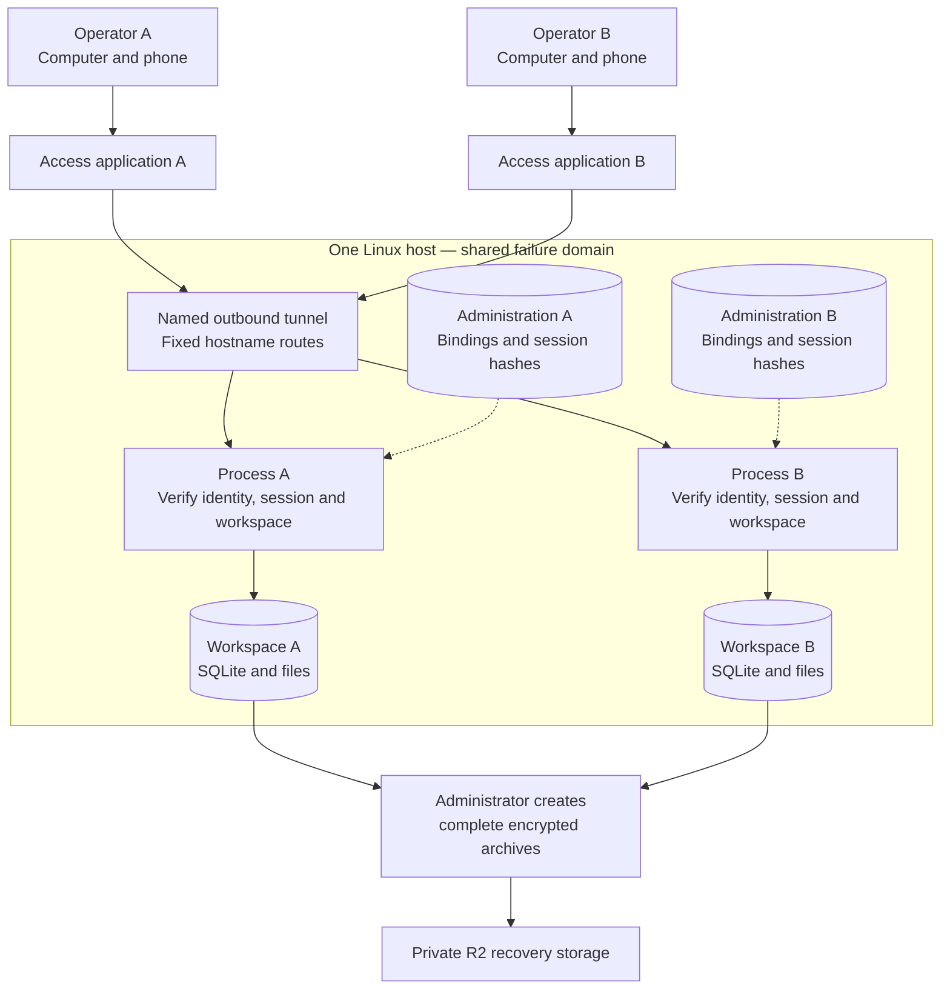
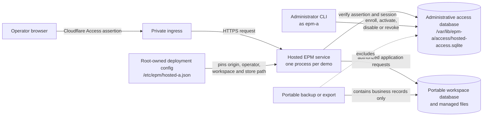

# Hosted demo design and accepted decisions

Accepted October 23, 2026; consolidated October 24, 2026.

This document defines the bounded two-operator experiment. For current deployment and
acceptance status, start with [the hosting review index](../README.md). Requirements here do
not mark SAAS-001, SEC-001 or SEC-002 complete.

## Goal and relationship to existing plans

Give two invited operators ordinary HTTPS links to their own persistent synthetic
workspaces, usable from a phone or computer without SSH, Google Cloud accounts, or local
software installation.

The [deployment guide](../deployment/GOOGLE_CLOUD_DEMO_DEPLOYMENT.md) applies this contract
to the existing Ubuntu E2 VM and separate `epm-a`/`epm-b` workspaces. The design follows the
[architecture](../../ARCHITECTURE.md), [product decisions](../../DECISIONS.md), [security
contract](../../platform/security-and-audit.md), [operator
experience](../../ui/operator-experience.md) and [frontend
architecture](../../ui/frontend-architecture.md).

The product brief and agreed decisions defer remote access and authentication beyond the
local MVP. The product owner has accepted this bounded synthetic hosted experiment alongside
that MVP, associated with SAAS-001, SEC-001, and SEC-002 in the
[backlog](../../FEATURE_BACKLOG.md#future-saas--cloud-identity-and-collaboration). It does
not complete those larger features, change their ordered dependencies, introduce commercial
billing, or authorize a shared portfolio. Normal local use remains available without an
account or cloud dependency. This document records the accepted scope and decisions.

## Target topology and boundaries

The hostname chooses a fixed process; it does not supply authority. Each process checks its
own identity, session and workspace binding before returning private data. Business archives
and administrative references have separate recovery contracts.

Use two Access applications and exact email allowlists, one named tunnel with two fixed
routes, and the existing isolated Unix users/workspaces. Each application process verifies
its own configured Access issuer and audience, exact public origin, provisioned subject,
expected workspace ID, and current session state. Unknown hosts and unmatched tunnel routes
fail closed. Never select a workspace filesystem path from a request, email header, or
client-supplied ID.

The application remains one process/writer per workspace. A hosted process replaces the
corresponding local process; do not run both against the same workspace or add Uvicorn
workers. Both processes share a VM failure domain. The administrator retains IAP SSH access;
application operators receive no VM credentials.

## Accepted cost and latency policy

The recommendations from the [cost and latency
review](../qualification/reports/HOSTED_DEMO_COST_LATENCY_REVIEW_2026-10-23.txt) are adopted
for this experiment. Recommendations in the commercial/MVP source notes do not override
these choices.

- Keep the existing Oregon E2 `e2-medium`, Ubuntu VM, two systemd services, one named tunnel and combined frontend/backend release during qualification. E2 medium exposes two vCPUs but provides one sustained fractional vCPU in aggregate, with bursting; do not size it as two dedicated cores. Keep both workspaces running during their advertised demo period.
- Use Cloudflare's eligible free Zero Trust/Access plan, an existing administrator-controlled domain where available, and `demo-a.<domain>` / `demo-b.<domain>`. If no suitable domain exists, purchase one ordinary domain and record its actual registration/renewal cost before deployment. The domain and operator email values remain deployment inputs, not unresolved architecture choices.
- Do not add managed Postgres, relay servers, an AI gateway, Pages, Workers, a separate background host, Kubernetes, Spot capacity, or a paid load balancer for this demo. Use the current private origin and same-origin `/api` routing. Keep the external IPv4 until a cheaper alternative with working outbound connectivity is qualified; do not introduce Cloud NAT just to remove it.
- Keep live SQLite and attachments on local persistent disk, with file bytes served through authenticated owning APIs. Select R2 Standard as the off-host destination for completed, encrypted application archives only. Do not select it as the current S3 file provider: that adapter requires bucket versioning/VersionId, which R2 does not supply. Direct browser presigned transfers and thumbnails are deferred until file-traffic measurements justify a separately qualified contract.
- Qualify compression and caching for approved fingerprinted assets on the existing public origins. Verify actual `Content-Encoding`, browser reuse and Cloudflare cache eligibility/hits with Access enabled. Keep private HTML, APIs, sessions, errors and downloads non-shared and `no-store`. No Cache Everything rule, cross-origin API split or authentication bypass is allowed to improve apparent performance.
- Keep existing WAL/deferred-read/immediate-write behavior and the configured five-second busy timeout. Do not introduce `synchronous=NORMAL`, new read-pool assumptions, or mmap/cache tuning as unmeasured defaults. Inspect actual settings and measured hot query plans before tuning; acknowledged financial durability cannot be reduced as a latency optimization.
- Preserve live Home reads and independent attention refresh. A change marker is an additional fifteen-second visible-browser poll with jitter/backoff and hidden-tab suspension, not a replacement for focus/reconnect, periodic refresh or `nextTransitionAt`. No Home snapshot/cache is required initially. Any later cache must include authorized workspace/runtime/scope/filter/period identity and expire on both source changes and relevant time transitions; reconsider only after the existing latency gate fails under measured hosted load.
- Target USD 30/month for ongoing infrastructure before tax and domain registration, using actual regional/account prices and all compute, disk, IPv4, transfer and backup usage. This is a planning target, not a quote or spending cap. Retain the USD 30 budget notifications, record gross usage before trial credits, and review at least seven days before trial expiry. The product owner decides whether to fund ongoing hosting; do not silently upgrade billing or promise the demo beyond funded operation. Plan a final off-host backup and orderly suspension if funding is not arranged.
- Evaluate a 2 GB configuration only after the current baseline passes and measurements suggest sufficient headroom. Qualification must repeat on the smaller machine, with adjusted per-service limits, at least 25% total memory headroom, no OOM/restart failures, and the latency gates below under four-browser/background load. Trial credits alone are not a reason to change provider or region. Keep Oregon unless measured invited-user latency justifies a controlled move.

### Measurement and acceptance targets

These are acceptance targets. Results are recorded separately in the qualification plan.
Separate origin execution from browser/network time and measure first login/PIN delivery
independently. Record client location, device, network RTT/bandwidth, release, cold/warm
cache state, p50/p95, request/byte counts, peak total/ per-service memory, CPU throttling,
lock waits and restart counts.

| Measurement | Acceptance target |
| --- | --- |
| Warm authenticated Home/API origin response, including authentication | p95 at most one second for ordinary bounded reads; preserve owning query ceilings |
| Warm Home usable in browser | p95 at most 1.5 seconds on the reference network: RTT at most 100 ms and throughput at least 20 Mbps |
| Cold application assets plus initial Home, after identity sign-in | p95 at most three seconds on the reference desktop network; at most five seconds on the reference mobile network: RTT at most 150 ms and throughput at least 10 Mbps |
| Local shell/navigation feedback | p95 at most 100 ms; remote content loading remains visible and distinct |
| Ordinary non-file mutation completion | p95 at most 1.5 seconds on the reference network; never trade original-key recovery for a faster ambiguous result |
| Incremental local authentication/session overhead | p95 at most 20 ms; one indexed local authorization SELECT per protected request, no routine auth-maintenance write or provider call |

Use at least fifty observations per measured operation/cache condition, repeated in three
runs. Exercise A and B with two visible browser sessions each, first without background
load, then with a bounded report and staggered backup workload. A backup requiring that
workspace's process to stop is a disclosed maintenance interruption; measure its duration
and the other workspace's latency, rather than claiming uninterrupted service for the
stopped workspace. Test actual operator networks separately and disclose slower links
instead of presenting reference-network targets as universal guarantees. Prioritize query
plans, request duplication, auth overhead and asset bytes before caches, extra processes or
resizing.

## Application and security boundaries

Local mode remains single-operator and usable without cloud identity or a network
dependency. Hosted mode adds a provider-neutral `hosted_access` boundary and keeps domain
ownership, transaction rules, revision checks and original-result recovery. One process owns
each workspace; browsers do not synchronize SQLite files. Both workspaces share a host
failure domain. Neither Unix account may read the other workspace, tunnel credential,
recovery credential or administration socket.

The public sign-in exception permits only `GET /sign-in`, no Origin header, HTML acceptance,
Fetch Mode `navigate` and Fetch Destination `document`. This lets a top-level Cloudflare
return reach the public shell. Cross-site APIs/files, mutations, iframe/fetch requests and
foreign Origin headers remain denied.

The ordinary app logout revokes app authority only. Broader identity sign-out uses the
clearly labelled Cloudflare renewal/logout link; it may affect other Access sessions. Email
OTP may present a new login form for another application. A code-sent message or absent
email is not proof of a policy decision; application policy tests and actual
authorized/unauthorized requests are separate evidence.

## Implementation responsibilities and acceptance evidence

### 1. Hosted configuration and scope

- Record the administrator-controlled domain, `demo-a`/`demo-b` hostnames, A/B allowed emails and deployment start time. The product owner/current Google Cloud project administrator owns operations, retention, recovery and trial-cost decisions; designate a contact before invitations. Use the R2 backup destination and retention policy below. Actual domain/email/account identifiers must be supplied, not invented.
- Use separate synthetic portfolios, Cloudflare email one-time PIN sign-in, an eight-hour absolute maximum application session, and a fourteen-day renewable demo starting when that operator is enabled. Keep external mail, payments, assistant/model calls and their credentials disabled. These settings define the demo boundary.
- Define an explicit deployment mode and typed, administrator-only configuration. Require public origin, issuer, Access audience, expected workspace ID, identity binding, expiry, and enabled capabilities at startup; reject missing/ambiguous configuration.
- Preserve the existing local transport policy and no-login launch behavior. Do not repurpose a development-origin exception, rewrite Host/Origin to loopback, trust arbitrary forwarded headers, or treat `X-EPM-Local-Client` as authentication.
- Produce a route inventory: public sign-in shell/static assets, authenticated workspace routes, denied host-administration functions, and operator session endpoints. Unknown routes must not become alternate access paths.

**Required evidence:** validated startup configuration, route inventory and deployment
inputs.

### 2. Identity, enrollment and sessions

- Use a `hosted_access` module to own identity bindings, sessions, revocation and demo policy, with domain/application/infrastructure/API separation. Keep Cloudflare/JWT verification in its infrastructure adapter behind application ports; business services must not interpret provider tokens or query its ORM tables directly.
- Bootstrap verifies the signed Access assertion: allowlisted algorithm, signature, issuer, application audience, expiry, and applicable time claims. Use fixed trusted key-discovery endpoints, bounded timeouts, bounded key caching/refresh, and fail closed when verification cannot complete.
- Bind the verified `(issuer, subject)` to the intended operator and workspace. Pre-provision the exact allowed email and workspace; first verified sign-in creates a pending enrollment without business access. The administrator confirms that verified subject before activation. Rebinding requires administrator disablement, revocation and explicit replacement; never silently rebind after an email/account change or authorize from a plain email header.
- Keep one service-owned administrative SQLite store per process at `/var/lib/epm-a/access/hosted-access.sqlite` or `/var/lib/epm-b/access/hosted-access.sqlite`, outside each portable `workspace/` and its bounded volume. The `hosted_access` infrastructure owns its separate SQLAlchemy/Alembic schema and retained validation. Root-owned service-readable configuration under `/etc/epm/` pins deployment/origin/workspace identity; no remote request selects paths or edits this binding. Admin CLI operations use the owning application ports. Protect each store with private owner permissions and the existing service isolation. Keep only the current greenfield schema, without migration-compatibility work.

The administrative access database controls who may use this hosted process. It is not
part of the portable workspace, its backup archives, or workspace restore operations.
An ordinary release can keep this store and its unexpired sessions; an explicit disable,
revocation, or fresh-demo reset deliberately fences them.

- Generate 256-bit random opaque session tokens, persist only SHA-256 token hashes, and use `__Host-epm_session` cookies with Secure, HttpOnly, Path `/` and SameSite=Lax. Use a random session-bound CSRF value for exact-origin unsafe operations. Do not store tokens in URLs, browser localStorage, workspace tables, recovery forms, logs, or portable archives.
- On every protected request, require a valid Access assertion plus a valid application session and matching subject/host/workspace, active operator, session generation, and demo expiry. Bound application session expiry by the verified identity grant. Do not transparently renew a session solely because an old Access token remains valid.
- Verify JWTs locally with a bounded trusted-key cache, a fifteen-minute maximum cache age, single-flight refresh and a two-second refresh timeout. Known unexpired cached keys may verify assertions during a provider outage; unknown/expired keys that cannot be refreshed fail closed. On every protected request perform one indexed local session/operator/generation/expiry projection. Do not call remote introspection or update session last-seen for ordinary reads. Fixed session expiry is the earlier of eight hours, the verified grant expiry, and demo expiry.
- Current-device logout immediately revokes that app session, clears its cookie, and prevents that assertion from bootstrapping a replacement session. Other valid app sessions remain usable. All-device logout or disablement invalidates every app session through a durable generation/cutoff check. Bootstrap is an explicit sign-in action, never an automatic retry; reject blocked assertion fingerprints/old issuance times. Restoring administrative data never restores usable sessions.
- For full identity sign-out, use Cloudflare's documented `/cdn-cgi/access/logout` flow and clearly label its broader Access-session effect; it is not a per-application-only logout feature. Require a newly verified eligible assertion after revocation, and test that Access SSO cannot silently bypass the app's bootstrap fence. Permanent disablement also removes the email allow policy and revokes Access sessions administratively. App denial is immediate even when Cloudflare revocation propagation is delayed; no blanket provider-token cache can override it.

**Required evidence:** restart-persistent sessions, explicit enrollment, bounded
verification, fail-closed outage behavior, and tests for revoked, expired,
foreign-subject/audience, and malformed assertions. Fixture tokens alone do not qualify the
real identity-provider flow.

### 3. Transport and authorization before disclosure

- Compose hosted identity/authorization before workspace bootstrap or any protected response. Validate the configured HTTPS Host/Origin independently of the listener's loopback transport address. Trust forwarded metadata only through the defined private ingress, not arbitrary caller headers.
- Require a session-bound CSRF token and exact allowed Origin for unsafe requests, including multipart uploads. Specify the narrowly allowed navigation/session-bootstrap cases; missing Origin must not become a CLI-header bypass. Keep browser-generated API calls same-origin.
- Bind the process to exactly one provisioned workspace. Verify the configured workspace ID at startup and fence requests if the workspace/runtime changes unexpectedly. A session is not authority over another process or restored directory.
- Enforce coverage for domain APIs, bootstrap, search, audit, Intake evidence, Files metadata/downloads, saved-form recovery, original receipts, exports, and diagnostics. Reauthorize before returning an idempotent replay result.
- Keep workspace creation/open/relocation, arbitrary local-path import, portable backup/restore, credentials, hosted enrollment, and process administration unavailable to ordinary demo operators. Make these capability decisions on the server as well as in navigation. Review the current Settings and recovery endpoints explicitly.
- Serve live file bytes only through owning, authorized APIs using local storage. Apply the accepted same-origin compression/cache policy above; do not introduce presigned R2 URLs, Pages, cross-origin APIs or a shared private-response cache.
- Apply bounded request/body/upload handling and rate limits at relevant session and file boundaries. Specify typed errors that distinguish unauthenticated, forbidden, expired demo, CSRF, maintenance, and quota conditions without leaking another workspace's existence.

**Required evidence:** a route-by-route authorization inventory, no direct-origin/header
bypass, no cross-workspace data through errors/cache/receipt keys, and unchanged local-mode
security tests.

### 4. Verified actors and domain authority

- Pass a provider-neutral authenticated actor context from the request boundary into application operations. Do not let callers supply their own audit identity or infer identity from record ownership/contact fields.
- Extend Audit-owned actor validation/presentation and the current schema/retained-data validators for hosted operators. Retain the actor identity on every consequential domain action and required sensitive read within existing transaction boundaries.
- Preserve original actor attribution on replay; a second caller must not rewrite history. Keep domain mutations, audit events, receipts, and dependent records atomic.
- Preserve stable record/workspace IDs, relationships, financial totals, and append-only history in exports/restores. Portable business history may retain a safe hosted actor reference, but not live sessions, Access grants, signing/connector secrets, or restored authorization.
- After restore, require fresh hosted authorization binding and runtime/session identities. Restoring business history must not reactivate old browser sessions.

**Required evidence:** actor-bearing domain and sensitive-read tests, atomic rollback,
retained-history validation, and portable restore with authorization remaining
revoked/unbound.

### 5. Operator sign-in and session experience

- Operator opens the assigned hostname, completes the Cloudflare email-PIN flow, and enters only the assigned workspace. Use the existing visual system and responsive/keyboard behavior rather than a separate prototype shell.
- Display the workspace label, "Demo — your changes are saved", synthetic-data reminder, expiry, current session state, and sign-out controls. Show truthful disabled/maintenance/expired states and a clear administrator contact path.
- Include current-device logout and all-device logout with feedback. Clear private query caches, recovery/editor context, and session-bound state on logout, subject change, or workspace/runtime change. A different identity must never receive retained private input from the preceding session.
- On authentication expiry, pause writes and preserve only permissible in-memory input for explicit same-identity/workspace reauthentication. Do not automatically resubmit a consequential action or show stale data as current. Restore submitted/unknown attempts through their original keys only after authorization succeeds.
- Hide host-only Settings/actions using server-provided capabilities and explain unavailable functions. Prove the server also rejects direct API calls to those functions.
- Add real-browser acceptance for sign-in, wrong email, logout/revocation, expiry during editing and download, deep links, narrow screens, both themes, keyboard focus, and meaningful error recovery.

**Required evidence:** usable end-to-end operator workflows included in this work; no
separate future UI backlog is required to finish the demo.

### 6. Multiple-device consistency and recovery

- Audit existing source revision checks and idempotent operation contracts on the exposed workflows. Lost financial responses must reconcile the original key rather than dispatch a new payment/expense. Changed payloads using the same key must conflict.
- Keep edits on stale-revision conflicts for explicit review; background refresh never overwrites a dirty form. Maintain one server writer and bounded database contention.
- Keep saved unfinished forms/source drafts owned by the provisioned operator and workspace. Independent drafts remain independent; shared-draft resume requires an explicit edit-lease claim/takeover plus the source revision. Use a five-minute lease renewed at most once per minute while that editor is visible and active. An expired/replaced lease rejects the former editor's next save without losing input; opening a page never silently takes over. Lease authority is transient hosted state excluded from portable business backups; restored drafts require a fresh claim.
- Preserve revision-safe shared preferences and per-device presentation state. Use the accepted focus/reconnect/time-transition refresh and fifteen-second bounded change poll. Retain independent live attention checks; a revision alone never proves time-sensitive information is current. No row-by-row polling or initial snapshot/cache infrastructure is required.
- Show disconnected/stale/partial states and retain the existing property-local time behavior. No queued offline mutations or automatic command replay after reconnect/sign-in.

**Required evidence:** A and B each use at least two simultaneous devices/sessions, with
tested stale edits, saved-form takeover, interrupted responses, independent drafts, and no
cross-workspace cache/recovery contamination.

### 7. Demo controls and recovery operations

- Keep the existing private Unix directories and one writer per workspace. Carry the working per-account `TMPDIR`, systemd supervision, and resource limits into the hosted release; do not reintroduce shared `/tmp` restore-lock permission failures.
- Enforce a 250 MiB whole-workspace budget and the existing 50 MiB per-file ceiling, counting retained database/journal/evidence content and reserved in-flight upload/staging bytes. Reject operator writes exceeding the budget with a typed quota error; do not bypass reservations using concurrent uploads. Define bounded transaction/storage accounting and space for rollback/audit/cleanup before implementation completion, and test boundary growth rather than claiming that a displayed disk measurement enforces a quota. Backup archives live outside this budget but remain included in host disk monitoring. Warn the administrator at 80% host disk use and enter write-maintenance before 90%; reserve cleanup/recovery headroom.
- Implement administrator expiry, disable/re-enable, and reset procedures. Fence requests, drain/stop the owner process, retain a validated recovery point, prepare a replacement, verify it, and switch explicitly. Rotate runtime/session generations and invalidate stale browser continuations. Do not overwrite a live SQLite file.
- Use administrator-run daily application-consistent encrypted backups, retaining seven successful daily recovery points per workspace in a private R2 Standard bucket with distinct deployment/workspace/object names. Keep local live files. Enter encryption passphrases interactively from the administrator's password manager; do not introduce an unqualified headless keyring or claim unattended backups. A dedicated upload credential is held outside application workspaces and inaccessible to the app accounts; the administrator stages only completed encrypted archives for upload. Budget storage/operations using actual sizes; account free-tier allowances are shared and not guaranteed per workspace.
- Validate each archive, verify completed off-host publication and record backup age before pruning; retain the latest verified recovery point if a new attempt fails. Disclose up to twenty-four hours of edits at risk only while daily backup verification is current; otherwise show the actual stale recovery point and require administrator action. Back up the protected deployment configuration and enrollment information separately in an administrator-encrypted recovery bundle, excluding usable sessions, token hashes, edit leases, Access tokens and provider credentials. Host loss/administrative restore requires fresh enrollment or verified rebinding and new sessions.
- The product owner/current project administrator owns daily backup execution, alert checks and recovery for this two-operator trial. Stagger A/B backup maintenance and monitor the other workspace. Review failed/missing daily backups before allowing the demo to continue under an unchanged recovery claim. Unattended operation is a later qualified extension with an explicit headless secret-store design, not a hidden dependency for this manual schedule.
- Record release source, Python patch/dependencies, schema and wheel checksums, operator/workspace bindings, maintenance owner, trial expiry, and backup age. Keep credentials outside the record and business archives.
- Rehearse reboot, restore into a new private destination, operator disablement, expired demo, full disk, auth-key outage, tunnel outage, and failed reset. Define visible maintenance/rollback behavior and who acts on failures.

**Required evidence:** current off-host recovery point and successful restore drill,
enforced lifecycle/limits, recoverable administrator configuration, and bounded failure
behavior. The Mac seed exports alone do not protect subsequent VM edits.

## Accepted decision register

The product owner accepted these decisions on October 23, 2026. The qualification plan
records their implementation and deployed verification.

| Decision | Accepted choice |
| --- | --- |
| Scope | Two independent synthetic portfolios, one operator each, multiple devices, explicit hosted mode; local MVP and larger SAAS/SEC feature scope remain distinct |
| Domain and invitations | Reuse an administrator-controlled domain where possible; otherwise one ordinary domain; exact `demo-a`/`demo-b` hostnames and per-operator email policies |
| Identity ownership | `hosted_access` module and provider-neutral application ports; separate per-process protected administrative SQLite; root-owned pinned deployment config |
| Enrollment and sessions | Administrator-approved verified subject enrollment; 256-bit opaque sessions hashed server-side; SameSite=Lax host-only secure cookies; session-bound CSRF; eight-hour absolute maximum bounded by identity/demo expiry |
| Logout and disablement | Immediate local session/generation fences; explicit reauthentication and old-assertion bootstrap denial; accurately labeled broader Cloudflare logout; no automatic consequential retry |
| Drafts and permissions | Independent drafts plus explicit shared-draft claim/takeover and stale-editor rejection; ordinary operators cannot administer host paths, secrets, runtime or backups |
| Demo lifecycle | Fourteen days from enablement, administrator renewal/reset only, no nightly/silent reset; rotate session/runtime authority on reset/restore |
| Storage and quotas | Local live database/evidence; 250 MiB workspace budget, 50 MiB file ceiling, concurrent staging reservations and disk headroom |
| Backups | Manual daily verified encrypted archives to private R2 Standard, seven successful daily points per workspace, independent administrator passphrase custody; no assumed headless keyring |
| Operations owner | Product owner/current Google Cloud project administrator owns backup, recovery, retention and trial-cost review; supply a working contact before invitations |
| Runtime cost | Existing Oregon E2 medium and one named tunnel, eligible free Access, no extra platform services; USD 30/month infrastructure target with recorded actual estimate, expiry decision and measured resizing gate |
| Latency | Local JWT verification and one indexed session read, same-origin asset compression/cache, existing live Home reads and time-aware refresh, numeric p95 targets before extra caching/infrastructure |
| Tunnel credentials | Locally managed named tunnel; dedicated Unix identity, credential JSON/file paths, no runtime account-management certificate or command-line token |
| Rollback | Fence/stop the affected writer, validate a complete recovery point, switch only a tested compatible release/data pair; failed acceptance disables public routing rather than bypassing authorization |

## Alternatives and later scope

The October 15 provider comparison and custom code-only alternative are retained in the
[original
research](../archive/2026-10-24-sources/HOSTED_DEMO_DESIGN.md#free-and-lower-cost-hosting-options).
Those dated offers are historical research, not current price or capacity claims. The
accepted deployment uses the existing Oregon E2 medium; 2 GB remains a later measured
resizing option. No Oracle dependency remains.

### Shared-portfolio extension

Map two distinct identities to one workspace/server; do not share one credential. Add
authenticated actor propagation for every write and sensitive read, workspace membership on
every endpoint, operator-owned drafts/preferences and receipt visibility rules. Both can
initially have the same manager role, while host administration remains separate. The
concurrency rules above still apply. This is genuine multi-user scope aligned with
SEC-001/SEC-002; this experiment retains independent workspaces.

Real customer data, high availability, custom code-only authentication and shared portfolio
collaboration need separate scope/design. The [Hosting Plan](../Hosting_Plan.md) covers
local operation, the demo and hosted MVP; the project supports US customers and properties
without an added data-residency requirement. Commercial infrastructure gaps remain
documented there and are not expanded by this consolidation.

## Source boundaries

- Local transport: [browser_transport.py](../../../application/apps/server/app/platform/browser_transport.py).
- Database execution: [sqlite_engine.py](../../../application/apps/server/app/platform/sqlite_engine.py) and [workspace SQLite store](../../../application/apps/server/app/modules/workspace/infrastructure/sqlite_store.py).
- Operator recovery/preferences: [persistence models](../../../application/apps/server/app/modules/operator/infrastructure/sqlalchemy_models.py).
- Audit attribution: [Audit models](../../../application/apps/server/app/modules/audit/domain/models.py).
- Browser behavior: [frontend architecture](../../ui/frontend-architecture.md).
- Packaging: [wheel deployment contract](../../../manual/deployment.md).

Only the current greenfield schema/format is supported. Use validated compatible complete
backup/restore; neither copying a live database nor automatic schema downgrade is a recovery
contract.
