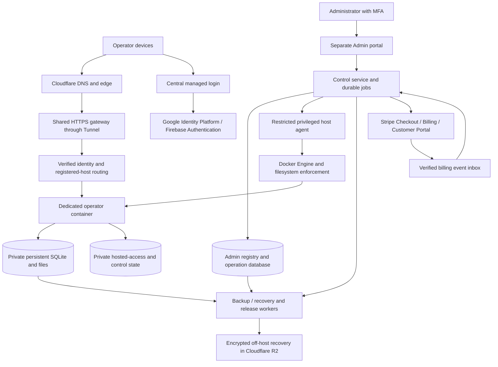

# Hosted MVP design

Accepted direction consolidated November 10, 2026.

**Status: design only.** This document records the confirmed fresh hosted-MVP
proposal. It does not implement features, authorize deployment or real charges,
mark backlog items delivered. [HOSTED-001](../../FEATURE_BACKLOG.md#now--hosted-mvp-then-tenant-and-owner-portals) now schedules implementation; this document does not authorize deployment or live charges by itself. Prices, allowances
and capacity/recovery targets below require the stated measurement and launch gates.

## 1. Purpose and scope

Give independent property managers an ordinary browser application, administered
through an Admin portal, with isolated workspaces and automated provisioning,
subscriptions, backups and release management. Start with a few operators and grow
toward 100 as demand and measured capacity justify it. Do not provision for 100 on
day one. Target US customers/properties under the existing product scope; no additional
storage/backup residency requirement was introduced in this discussion.

One verified operator identity owns one workspace and one subscription. Their
multiple devices have the same full business permissions. No shared logins, staff
roles, multiple-workspace switching or shared-portfolio collaboration in this MVP.
Full permission remains subject to authentication, account state, maintenance,
record revisions and storage admission; it never grants host administration.

### Relationship to the repository

The [product brief](../../PRODUCT_BRIEF.md), [application architecture](../../ARCHITECTURE.md),
[current UI guide](../../ui/operator-experience.md) and [backlog](../../FEATURE_BACKLOG.md)
provide business/application context. Existing demo documents retain their original
scope and evidence; they are not silently rewritten by this proposal. In particular,
the older two-operator, fixed-volume, manual onboarding/recovery and Cloudflare Access
customer-login design is not the target for this fresh commercial offering.

The current `hosted_mvp` checkout contains the local modular monolith, hosted-access
foundations and older deployment tooling. It does not already provide this Docker
control plane, automated subscription lifecycle or complete unattended recovery.
The prior conversation's implementation claims on other branches are not evidence
that those changes exist here. Use only current schemas for initial deployment;
future upgrades of actual customer workspaces still require safe schema evolution.

### Included and deferred capabilities

| Included in this hosting design | Outside this task |
| --- | --- |
| Admin portal, managed identity, invitations and automated provisioning | New property-management business workflows |
| Operator subscription UI/billing, storage metering/enforcement | Import implementation, including Universal Reader |
| Automated backup, recovery tooling, usage/health monitoring | Tenant/owner portals and property-payment implementation |
| Independently scheduled operator upgrades and controlled recovery | Local/cloud synchronization and offline hosted writes |
| Multi-device access to one operator workspace | Teams, enterprise SSO, customer-managed encryption keys and zero-knowledge encryption |

Imports will be supported on **all tiers** when delivered through their functional
backlog. Do not advertise unimplemented imports as available. Tenant access/payments
are intended future paid benefits, but are deferred and cannot be sold as currently
available. Initially, paid plans must stand on storage and stronger recovery alone.

Preserve the shared business core for optional free, single-operator local use.
Local launch has no hosted login or subscription enforcement. Hosting-specific
identity, control-plane and billing services are separate compositions. Do not add
synchronization or require a cloud account to perform local manual workflows.

Delivery begins with [Pilot 0](#pilot-0--five-invited-free-operators), before paid
plans and broader automation. Its explicit operating rules override the later billing,
update-scheduling and idle-wake defaults for that stage only. The remaining sections
define the subsequent hosted MVP target, not prerequisites to build every automation
before learning from the pilot.

## 2. Plans and financial envelope

### Provisional product catalog

| Benefit | Free | Paid 1 — provisional $10/month | Paid 2 — provisional $20/month |
| --- | --- | --- | --- |
| Usable workspace allowance | 50 MB | 200 MB | 1 GB |
| Business application and supported imports | Included | Included | Included |
| Backup cadence | Nightly | Recent recovery-point target of 15 minutes | Recent recovery-point target of 15 minutes |
| Retention | Seven nightly points | Fine-grained points for latest 24 hours, then daily through 30 days | Fine-grained points for latest 24 hours, then daily through 90 days |
| Idle runtime | May suspend after approximately 15 minutes | Keep warm initially | Keep warm initially |
| Tenant portal/payments | Not included | Intended future benefit; not delivered here | Intended future benefit; not delivered here |

Prices are provisional USD monthly product prices, not researched market benchmarks
or authorization to charge. Measure representative portfolios before publishing
allowances. Use exact decimal bytes: 50,000,000 / 200,000,000 / 1,000,000,000.
There is no fixed property/space entitlement in this fresh plan. Recovery assistance
and data export remain available to Free operators; paid plans improve available
recovery points and history, rather than charging for release of existing data.

### Operating budgets and demand validation

- Launch target: **$250/month before credits**, replacing the earlier $20 target.
- Growth target: **$300/month before credits at 100 operators**, subject to measured
  workload, paid/free mix and retained recovery data. These are different operating
  stages; do not interpolate a guaranteed cost per operator.
- Include compute, persistent storage, backups, authentication, transactional email,
  networking and monitoring. Track billing/payment-provider fees separately and
  disclose them in the unit-economics model; tenant payment fees are out of scope.
- The user reports Google credits of approximately $300/month until February.
  Confirm actual account terms/end date before financial planning. Credits fund
  validation and experiments; they do not reduce the recorded steady-state cost.
- Admin authorizes a spending envelope. Automation may place/provision capacity
  within it, using qualified profiles. Exceeding it requires explicit approval.
  Budget alerts are not enforcement. Account for delayed metering and outstanding
  allocations; never promise an exact final cloud invoice ceiling from an alert.
- If capacity does not fit, preserve safety/UX, stop new admissions or unfulfillable
  upgrades, and present measured alternatives. Do not silently exceed the envelope
  or reduce protection to claim the requested operator count fits.

Validate interest before credits expire. Agreed pilot gate: five genuine invited
operators, at least three doing recurring work weekly for four consecutive weeks,
at least one informed paid subscriber after paid plans launch, and no unresolved
critical data-loss or cross-operator isolation defect. Pilot 0 measures activation,
repeat use and support/cost evidence without requiring or accepting payment. Track activation, repeat use, paid conversion,
support effort and gross cost per active operator. Seeded/demo logins do not count.
Pivot or redesign if results justify it; avoid building a large platform ahead of demand.

## 3. Architecture and trust boundaries

### Initial deployment and growth

Start with Google Compute Engine, a persistent block disk and Docker Engine. Install
through supported VM startup/cloud-init mechanisms; pin images by immutable digest
in Artifact Registry. No Kubernetes initially. Docker Compose may define shared
services; a single template and the operator registry generate per-operator runtime
specifications. Do not manually maintain unrelated configurations for every operator.

A durable worker invokes a narrow host agent using registered IDs and fixed operation
kinds. Docker handles container lifecycle/restart policies. A bounded reconciler
compares desired versus actual owned containers and reports drift. Health failures
while a process remains alive need monitored remediation; Docker restart policies
alone do not provide that behavior. Intentional suspension must remain distinct
from a crash or failed deployment, including after a host reboot.

Keep persistent workspaces outside container writable layers and image directories.
Replacing/deleting a container does not delete its workspace. One authoritative
application writer per operator; no automatic horizontal replicas for one SQLite DB.
The gateway forwards to private container endpoints; no operator container exposes
a direct public listener. The public Admin HTTP process and operator containers
never receive an unrestricted Docker socket or generic host command capability.

Use non-root container identities, private mounts, bounded scratch/logs, enforced
memory/CPU/process limits, appropriate network restrictions and a restricted image
filesystem. Qualify isolation, directory ownership and storage enforcement on the
actual host. Containers share a kernel, disk and host failure domain; they are not
separate VMs or a complete security boundary without those controls.

Grow by measured placement across additional hosts within the budget. Include
shared gateway/control services, paid warm containers, Free wake-up capacity,
background work, recovery staging and retained disabled allocations in commitments.
Sleeping containers reduce memory demand but do not reduce the bill of an otherwise
running VM. Prefer packing and justified host changes rather than claiming per-request
serverless economics. Avoid repeated disruptive resizing merely to follow short bursts.

The initial 100-operator workload target is approximately 20 concurrently active
operators, with multi-device sessions included. This is a qualification assumption,
not a hard permission limit at operator 21. Test bursts, simultaneous wake-ups and
backpressure. Never admit an unsupported population based solely on the assumption
that most Free operators will remain asleep. Paid warm residency also consumes
capacity when those operators are not actively using the app.

Reconsider Kubernetes when multi-host scheduling/operations become substantial,
especially if the host agent starts becoming a general orchestration platform.
Kubernetes does not itself solve SQLite data availability, billing or schema-safe
rollback. Single-node Kubernetes also shares the VM failure domain.

### Public subdomains and authentication

Use a flat operator namespace such as `workspace.example.com`. Admin chooses a
suggested available public slug; normalize/validate it, reserve infrastructure names
such as `admin`, `login`, `api`, `www`, `support` and `billing`, and bind it to immutable
operator/workspace IDs. Do not derive it automatically from a private email address.
Keep slugs stable initially; a later rename requires controlled routing/authentication
and invitation updates. Do not reassign a retired slug while old links can reach
another operator's data without a deliberate reuse policy.

Wildcard DNS/certificate/Tunnel configuration routes to the gateway, which separately
exact-allowlists provisioned hosts. A wildcard route's final catch-all does not reject
unknown operator-shaped subdomains by itself. Knowing a slug grants no access.
Use a flat namespace compatible with qualified certificate coverage; deeper names
need explicit certificate planning. Keep Admin on a distinct hostname and authority.

Use Google Identity Platform/Firebase Authentication for Google sign-in plus email-link
login, with a billing-enabled project and verified email-delivery quotas. Use one
fixed central authentication domain and exact OAuth callback; do not assume wildcard
OAuth redirects. Authenticate, validate the intended operator assignment and redeem
a short-lived single-use handoff bound to the initiating browser/state and exact
operator origin. The operator origin sets its own Secure, HttpOnly, host-only cookie.
No parent-domain session cookie, arbitrary return URL or identity token in a redirect
URL. EPM must implement and test this handoff; it is not automatically supplied by Firebase.

Use short-lived managed credentials and supported refresh with revocable application
sessions to offer remembered sign-in up to 30 days on trusted devices. This is not
an instruction to configure a Firebase session cookie beyond its supported duration.
Require recent authentication for sensitive account/billing/recovery confirmations.
Provide device-only/all-device logout and local account/session fencing. Valid
sessions/verified entitlements survive a temporary provider outage only within their
existing validity; never extend expired authority indefinitely. No provider request
on every business read. Exact origin/CSRF and current source authority still apply.

Admin requires MFA and an explicit Admin role. Customer identity is not an Admin role. Link Google/email sign-in methods only
through the managed provider's verified account-linking flow; matching email text
alone must not silently merge identities or create another workspace.
Cloudflare Access may protect the small Admin audience but is not required for all
operator identities. Support staff see operational metadata by default; time-limited
business-data access needs a separate explicit reason/authorization and audit. Platform
recovery authority means this offering must not claim zero-knowledge encryption.

## 4. State ownership and dependable automation

| Owner | Authoritative information |
| --- | --- |
| Managed identity provider | Verified external subject and authentication proof; EPM owns the assignment to an operator/workspace |
| Stripe | Subscription/payment facts and provider transaction references |
| Admin/control database | Operator metadata, stable IDs/slug, assignments, desired subscription settings, jobs, reservations, applied-result references and operational audit |
| Protected host inventory/agent | Actual directory/container/image/host identities, physical enforcement and effect observations |
| Operator hosted-access/control store | Effective account/session authority, source fences and command receipts; bounded hosted storage accounting/control state |
| Operator business workspace | Domain records, files, revision conflicts, business receipts and audit |
| Recovery catalog | Verified immutable recovery-point manifests, object references, encryption-key references, expiry and restore evidence |

A small single-writer control-plane SQLite store is a reasonable initial candidate;
qualify it with bounded workers/queries. This is not the operator business database,
and it does not require a managed relational service on day one. Reassess it as
multi-host/control-plane availability needs grow. Operator containers must not open
that database or another operator's hosted-access store.

Keep desired settings separate from verified effective settings. Generate minimal
protected runtime configuration from admitted control records and registered bindings;
files are runtime projections, not a second editable operator registry. Store secrets
in protected secret/key mechanisms outside business exports, images and browser data.

Use durable jobs, original idempotency keys and semantic request hashes. In short
owning transactions record intent before external effects, then verify and checkpoint.
Duplicate matching submissions return the original operation/result; changed intent
under the same key conflicts. Retry inspects effects and source receipts rather than
assuming a timeout means nothing happened. Keep per-instance mutation ownership,
monotonic revisions/fences and bounded worker claims; disable/revoke wins over stale
activation. Do not hold a DB transaction across Docker, network, backup or provider work.

External operations cannot commit atomically with SQLite. Persist unknown outcomes,
retain necessary reservations and reconcile them through the original operation.
Use bounded verified webhook inbox/outbox processing, stable event IDs, semantic
source commands and periodic provider reconciliation. Handle duplicate/out-of-order
events without rolling a subscription or source fence backward. Workers and Admin
pages must not expose raw secrets, sessions, business contents or shell output.

## 5. Admin creation and automatic onboarding

Admin selects **Add operator** and supplies display name, exact sign-in email,
available workspace slug, support contact and proposed plan. Default to Free and an
empty workspace. An optional small synthetic dataset is a per-operator demonstration
choice, not a required population or count; demo activity is excluded from pilot metrics.
Admin may propose a paid plan but cannot authorize an undisclosed charge on behalf
of the operator. Explicit complimentary grants must be audited, time-bounded and
capacity-qualified, never hidden quota edits.

The creation flow is:

1. Validate identity/slug uniqueness, qualified release/profile, available capacity
   and spending envelope. Show the reviewed assignment before submission.
2. Admit one durable job and reservations; return a Pending row immediately. Closing
   the browser does not cancel or resubmit it.
3. Allocate private persistent workspace/control/scratch resources, publish the
   protected configuration and initialize actual source authority with access disabled.
4. Start/verify the source, initialize business data, verify routing/isolation and
   create a verified off-host recovery point. Progress is async with retained status.
5. Send a short-lived single-use invitation only when ready. Keep the recipient/URL
   assignment pinned and invite sending deduplicated; expiry of an invitation is
   not expiry of the account. Provide controlled resend/reissue.
6. The operator signs in with the invited verified identity and claims the assignment.
   Automatically enable it only when current readiness/recovery and identity checks
   all pass. Admin's invitation is the routine authorization: no second manual
   identity approval/completion click is required for an ordinary successful claim.
7. Show the operator their workspace, Free plan, usage and any proposed paid offer.
   Paid activation requires the operator's checkout authorization and confirmed payment.

**Business access remains disabled while setup runs**, including seeding and exception
handling. A healthy container or authenticated but unassigned identity is insufficient.
Failed steps remain Pending/Needs attention with safe reasons and retry lookup. Never
create another workspace, discard partial records or enable access simply to clear an
error. Retire resources only through ownership-verified, reviewed cleanup.

Admin overview/detail shows operator count, qualified capacity, plan/effective allowance,
usage/freshness, service state, backup age, release and operation history. Separate
Pending setup, Ready for claim, Active, Suspended runtime, Access disabled and Needs
attention. An idle suspended container is not a disabled operator. Keep the UI responsive
while jobs run; show retry/reconciliation actions rather than raw infrastructure tools.

## 6. Subscription and storage workflows

Use Stripe Checkout/Billing/Customer Portal for monthly USD subscriptions. Defer annual
plans, coupons and custom commercial contracts. Verify signatures and current provider
state; a successful browser return is not payment proof. Show prorated upgrade charges
before acceptance. Prices/tax configuration must be verified before real charging.

### Upgrades, downgrades and payment failures

| Event | Required behavior |
| --- | --- |
| Upgrade | Check/reserve applicable capacity, obtain operator payment authorization, confirm payment, then apply/verify allowance, recovery and warm-runtime policy through one durable operation. Show Applying until effective facts are verified. |
| Upgrade failure | Preserve the last verified effective settings and retry/reconcile the original operation. Conclusively undelivered benefits require provider compensation and notice. Unknown outcomes require reconciliation before blindly refunding or reversing a change. |
| Downgrade | Schedule at next renewal. Warn if usage exceeds the target. At the effective date apply the reduced product entitlement while retaining existing data; use a safe temporary physical ceiling until usage fits. Do not silently keep charging the old plan. |
| Renewal payment failure | Existing paid subscribers receive a seven-day payment grace with provider retries/notices. Then Free restrictions apply without deleting records. A failed first-time upgrade never receives unconfirmed paid benefits. |
| Cancellation | Stop renewal; preserve paid benefits to the paid-period end, then Free rules. Existing backups retain their promised expiry; new points follow Free cadence/retention. Cancellation is not account deletion or logout. |

Reserve capacity before checkout where feasible, but reconcile delayed payment and
reservation expiry; do not overcommit or lose the charge if the browser closes.
Provider status, desired plan, last verified effective entitlement and operation state
are separate facts. Receipt/audit and observed revisions determine Applied, not an
editable plan badge. New policy cannot override a later account disable or maintenance gate.

### What storage means and how it is enforced

Count business database usage and retained managed files using the owning logical
usage definition, without counting shared file content twice. Do not meter attachments
alone or double-count database/WAL representations of the same committed state.
Include retained history/versions; archiving does not free retained bytes. Keep billing
usage reproducible and reconcilable, not a rounded `du -sh` scan after each edit.

Exclude backups, scratch, hosted authentication/control and physical database/allocation
headroom from advertised usable storage, but reserve and monitor them in host budgets.
Use bounded application growth reservations plus qualified filesystem hard byte/inode
limits for private persistent trees; ext4 project quotas are a candidate mechanism.
Docker memory/CPU limits do not enforce bind-mounted workspace storage. Do not create
an OS/filesystem/image per operator solely to express a tier. Qualify the chosen host
quota mechanism, attribution, restart/restore and escape prevention before activation.

Warn around 80% and 95%. At the allowance, retain login, billing repair, reads/exports,
backups and supported storage-reducing actions. Reject unadmitted growth clearly while
preserving form input. Safe cleanup/accounting uses bounded operational headroom; there
is no unlimited “small edit” exemption. Kernel exhaustion/commit failures still require
owning transaction rollback, cleanup and uncertain-result handling.

A smaller product allowance can coexist temporarily with larger physical limits for
retained over-quota data after downgrade. Track that commitment explicitly and block
additional growth. Never lower kernel ceilings below actual usage or erase files to
force a downgrade. Apply increases before promising usable capacity; fence/drain and
verify decreases in the safe order. Larger tiers do not automatically lift individual
request/file limits; those remain qualified API/workload limits.

### Operator account UI

Settings shows plan, one workspace usage/allowance indicator, freshness, remaining space,
backup protection state, upgrade/change/cancel controls and pending operation status.
Both portals use async reads with retained stale values, independent errors and bounded
visible-page polling. Unknown is not zero; payment-confirmed is not Applied. Refresh
never resets a form, scroll or selection, and never submits another consequential action.
Use existing light/dark, responsive and keyboard-accessible UI patterns.

## 7. Idle workspaces, sessions and multiple devices

Free containers may suspend after approximately 15 minutes without human activity;
paid containers stay warm initially. Automatic polling does not count as human activity.
Track activity across all devices with bounded ephemeral/control observations rather
than turning every request into business history. No suspension while admitted writes,
uploads, exports or owned background work still require the runtime.

A persistent gateway validates the intended assignment, starts the registered container
once through a deduplicated wake operation, and shows a safe waking page. Private
business content is unavailable until source checks pass. Target a few-second wake;
measure it under cold starts, simultaneous demand, image availability and contention.
On wake failure provide status/retry without resubmitting the original write. Scheduled
backups and required work operate independently of whether the app is asleep.

Multiple devices retain full permissions but not last-writer-wins behavior. Stale saves
conflict, preserve input and provide comparison/review. Independent records remain
independently editable. Shared unfinished forms require explicit ownership/takeover
where applicable; opening a tab never silently steals another device's edit authority.
Do not add offline mutation queues or automatic replay after reconnect, wake or upgrade.

## 8. Backup, recovery and retirement

Use unattended, platform-managed encryption keys, scoped identities and separately
protected key custody. No operator-entered passphrase is required for scheduled backup
or automated recovery. This is not customer-managed-key or zero-knowledge encryption.
Choose a proven incremental/deduplicated encrypted backup implementation only after a
component proof; encrypting whole independent archives before deduplication can defeat
the expected savings. Include GCP upload traffic and retained bytes in the cost model.

A recovery point is a completed, verified off-host database-and-file state with manifest,
workspace identity, schema/release compatibility, exact content references, digest and
key reference. Never copy an actively changing SQLite file as though it were a snapshot.
Use supported consistent capture and stable/versioned file references; hold writer gates
only as required for consistency, not throughout a slow upload. Publish the point last.

Free has a roughly 24-hour recovery-point objective while nightly protection is healthy.
Paid has a 15-minute objective for recent data. Schedule frequent enough to include
capture/upload/verification time; “cron every 15 minutes” alone cannot prove it. Retain
fine-grained paid points for 24 hours and thin older points to the daily history in the
catalog. Do not promise every historical 15-minute point throughout 30/90 days.

Monitor the age of the latest **completed recoverable off-host point** and test restores.
On protection failure keep the workspace usable, mark degraded protection and alert Admin;
never show a stale successful job as healthy. These are engineering objectives, not
unconditional guarantees or a contractual SLA. Alert/recovery procedures must expose
actual achieved protection and unresolved incidents.

Operators request recovery; Admin initially selects a point and confirms an automated
restore. Show point time and consequences, fence/drain the source, restore to a separate
private destination, validate full retained data/files and ownership, then switch over.
Retain the pre-restore state until acceptance. Reconcile current identity/subscription
and revoke affected app sessions; an archive must not restore old sessions, old paid
grants or a previously enabled access flag. Free receives recovery assistance too.
Defer unrestricted operator-triggered rollback.

The Admin registry, mappings, admitted versions/configuration, subscription references,
operation history and recovery catalog need separate encrypted off-host control recovery.
Keep keys/credentials and reproducible infrastructure recovery available outside the
failed VM. A business archive alone cannot rebuild routing/ownership. Reconstruct and
reconcile host/provider/source state before reopening access; never replay queued grants
or unknown jobs automatically from an old control snapshot.

Target recovery within four hours as a measured engineering objective, not a 24/7
contractual promise. Externally alert on host loss and automate understood repairs.
Host-loss recovery must remain executable without its hosted Admin portal. Avoid
unattended cross-host takeover until fencing and restore correctness are proven;
never start a second writer merely because a health probe timed out.

Distinguish **Disable access**, **Cancel subscription** and **Retire workspace**.
Retirement needs explicit workspace confirmation, reason, export opportunity and scheduled
deletion date, with an initial seven-day recovery window. Explain primary versus backup
expiry and retained operational audit. Do not immediately recycle ownership or slugs.
An inactive Free account is not automatically deleted; Admin reviews retirement.
Retained disabled data still consumes monitored capacity.

## 9. Independently scheduled release upgrades

Admin approves one qualified immutable image/schema release, then automation rolls it
out per operator. Start with an internal canary and bounded batches; failures stop further
rollout. No arbitrary published-tag auto-updates. Operators may run different eligible
versions temporarily; pin image/schema compatibility and retain needed rollback artifacts.

Operator Settings stores a preferred update window and explicit time zone. Suggest a
low-activity time; offer **Accept suggested time**, **Choose another time** and **Update
now** when scheduling is needed. Avoid prompting on every small release. Notify in
advance and support bounded deferral, initially up to seven days. Disclose an urgent
security exception; it does not permit unsafe interruption of a committed operation.

Prefer no human activity across devices for approximately 15 minutes, with no in-flight
owned work. Before interruption warn active/returning users, drain admitted commands,
resolve uncertain outcomes and preserve acknowledged unfinished forms. At a chosen time,
activity may require a visible deferral/finishing-work step; do not drop an active write.

The owning job establishes a verified pre-upgrade recovery point, fences/stops the sole
writer, applies required schema changes and starts the pinned image. Verify runtime,
source binding, data integrity and required smoke checks before reopening. Only that
job may remove its gate; a later disable always wins. Existing sessions may remain only
when still eligible; reload incompatible UI/assets safely without replaying old commands.
A returning operator sees Updating and a clear continuation path.

Automatic restore to the pre-upgrade point is allowed only while access remains fenced
and no operator writes were accepted afterward. Once business writes resume, preserve
them and require a controlled forward fix or reviewed recovery; blindly restoring an
older DB would erase legitimate work. Merely running the old image is not a schema-safe
rollback. An idle Free container can receive a new image assignment without starting
solely for rollout, but required schema validation must occur before serving it again.

## 10. Monitoring, reliability and cost qualification

Use in-app status and transactional email for invitations, subscriptions, quotas, updates
and relevant recovery notices. Admin gets actionable infrastructure, failed provisioning,
backup and rollout alerts. Deduplicate repeats and send recovery notices; do not rely on
an operator visiting the app to detect a failed backup. Select a transactional-mail
provider with measured delivery/quota/cost before launch; do not build an SMTP service.

Measure per-host/container memory, CPU, disk/inodes, IO, restarts, wake/read/write latency,
job queues, backup-point age, restore duration, retained recovery bytes and service cost.
Product adoption metrics distinguish real recurring work from demos/polling. Keep logs
and traces bounded, access-controlled and free of session credentials, full request
bodies, document contents and unnecessary financial/customer details. Exclude advertising
tracking and session recording from this scope.

Before selecting host sizes/qualified population, measure empty and representative
portfolios, all tiers, paid warm residency, multi-device activity, 20 active operators
at the 100-registered stage, bursts and simultaneous wake-ups, imports/uploads when
supported, updates, backup/restore and control-plane overhead. Record dataset, workload,
limits, concurrency, p95 latencies and failure behavior. No capacity claim follows from
idle RAM, container count or a successful small synthetic seed alone.

Cost worksheet must include persistent and retained inactive data, backup cadence and
retention, deduplication under realistic changes, GCP-to-R2 traffic, auth/email limits,
monitoring/log retention and billing-provider charges. Forecast the all-paid/warm case
as well as a mostly-Free cohort. If targets do not fit, present the measured tradeoff
for approval rather than quietly weakening an entitlement or overcommitting the host.

## 11. Suggested delivery and acceptance order

This sequence is scheduled as HOSTED-001 in the [backlog](../../FEATURE_BACKLOG.md). Start H01 below; Pilot 0 is the first usable release milestone. Tenant and owner portals follow in PORTAL-001/002, outside hosting acceptance.

1. Prove container/private storage isolation, persistent SQLite, gateway/subdomain
   routing and identity handoff; measure the small-host workload and gross cost.
2. Prepare Admin-lite creation/invitations, Free nightly recovery, basic Settings
   usage and a full operator/control-plane restore rehearsal. Bounded manual operations
   may support this stage; complete automatic provisioning remains a subsequent target.
3. Run **Pilot 0: five invited operators, Free plans only**, under the operating
   rules and acceptance gates below. Observe real use and operational cost before
   investing in subscriptions and wider automation.
4. Complete automated provisioning and verified quota enforcement, paid recent
   recovery and retention, billing inbox/reconciliation, self-service plan changes,
   compensation and failure states. Do not charge for a benefit before it can
   actually be delivered and verified.
5. Deliver independent update scheduling, canary rollout, schema-safe recovery,
   idle suspension/wake, operator notices and representative multi-device acceptance.
6. Run the paid pilot, validate repeat use/payment/support effort, then expand
   admission toward measured 100-operator capacity within the spending envelope.

### Pilot 0 — five invited Free operators

Pilot 0 is an invitation-only learning stage, capped at five real operators. It uses
the Free 50 MB workspace allowance, nightly verified off-host backups and seven
nightly recovery points. No paid enrollment, Stripe integration, checkout or billing
credentials are needed. Show **Free pilot**, usage and support/recovery information
in Settings; do not expose paid upgrade controls as available.

| Area | Pilot 0 delivery |
| --- | --- |
| Admin-lite provisioning | Admin records the verified operator assignment, slug, Free allowance and operation status, then runs a supported provisioning action/script. Show Pending/Ready/Needs attention and safe retry status. Manual completion is acceptable; no generic shell or Docker socket in the public Admin process. Retain original operation/resource identities so a retry cannot duplicate a workspace or enable an uncertain result. |
| Onboarding and isolation | Keep dedicated containers/private SQLite/files, managed identity, registered-origin routing and host-only sessions. Business access stays disabled through preparation/seeding and readiness checks. Admin may manually verify readiness; the invited verified identity must still claim the correct assignment. |
| Backups and recovery | Run nightly consistent database-and-file capture with verified off-host manifests and backup-age alerts. Rehearse operator and control-plane restore, including recovery without the failed host, before admitting real records. Admin may initiate and supervise recovery; retain the source, validate the restored destination and fence the old writer before reopening. |
| Releases | Use one announced maintenance window for the whole cohort. Notify all five operators, preserve unfinished input, drain admitted work across devices, capture a verified pre-update recovery point and apply a pinned compatible release. No per-operator window preferences or scheduling automation. Preserve post-reopen writes; a maintenance window does not make destructive rollback safe. |
| Runtime | Keep all five containers running within qualified host capacity. No idle suspension or wake automation; polling and concurrent devices do not trigger lifecycle changes. Monitor health and use documented restart handling. |
| Manual operations | Provisioning completion, exceptions, recovery and maintenance may be handled manually through restricted supported tools. Record who acted, result/unknown state, elapsed time and follow-up; manual handling does not bypass identity, isolation, source fences, safe retries or backup verification. |
| Storage and cost | Show measured usage/freshness and enforce bounded storage admission through qualified limits or conservative supported write gates. Monitor physical headroom and alert before exhaustion; do not rely only on a scan after a write. Record gross cloud spend before credits, retained backup bytes/traffic, support incidents and Admin minutes per operator/task. Full automated tier changes and quota reconciliation follow in step 4. |

Pilot admission requires the isolation/identity proofs from step 1, a successful
nightly backup and rehearsed restore, supported safe provisioning/retry, sufficient
capacity for five continuously running containers, and a named operational owner.
Manual work must be visible and repeatable through a short runbook, not unrecorded
changes to authority or resource ownership.

Review activation, weekly repeat use, backup freshness, restore results, user friction,
Admin time and before-credit spend with this cohort. Use the four-week repeat-use
measurement above; payment conversion is evaluated only in the later paid pilot.
Proceed to step 4 when observed demand and operating effort justify the investment;
otherwise revise or stop admissions. No paid feature or 100-operator capacity claim
follows from Pilot 0 alone.

### Implementation slices

Implement sequentially as cohesive backend/UI/operations changes. Each row depends on
its predecessor unless explicitly stated; no row is marked implemented here. Start with
current-checkout evidence, not implementation claims or schema resources from another
branch. Pilot 0 releases at H06; H07–H12 must not delay that learning milestone.

| Slice | Delivery and implementation boundary | Acceptance before proceeding |
| --- | --- | --- |
| H01 | Baseline and deployment contracts. Inventory `application/apps/server/app/modules/hosted_access`, `application/deploy/hosted-demo`, workspace backup services and existing hosted browser tests. Define owning Admin registry, protected inventory, effective hosted-access authority, current schemas and typed host-agent commands. Record proof choices for quotas, backups, keys, mail and image packaging. | Document reuse/gaps, resource ownership, exact capacity/accounting definitions and reproducible component-proof commands. No live deployment required to begin. Reject generic shell/path selection and public Docker access. |
| H02 | Dedicated container/storage foundation on GCP with Cloudflare gateway. Package pinned application assets/schema; persistent private workspace/control/scratch, registered subdomains and restricted host operations. Keep Pilot 0 runtimes warm. | Two isolated test operators, persistent data across replacement/reboot, unknown-host denial, one writer, bounded memory/disk/inodes and measured five-warm-container headroom. No customer records yet. |
| H03 | Managed identity and central-login handoff. Admin MFA, exact invited-identity assignment, host-only app sessions, revocation, logout and simultaneous-device access with existing revision/draft fences. | Cross-origin/workspace/role denial; no identity-token URL leak; single-use handoff replay fails; stale saves preserve input. Local launch still works without cloud login. |
| H04 | Admin-lite and Free usage. Add/list/detail operator UI, default empty/optional synthetic portfolio, pinned Free 50 MB allowance, operation identities/status and supported manual provisioning completion/retry. Operator Settings shows Free pilot, usage/freshness and support; hide unavailable upgrades. | Pending → Ready/claim → Active only after source checks; no business access during setup/failure. Retried/unknown results do not duplicate resources. Safe growth rejection, retained reads/export/cleanup and physical headroom. |
| H05 | Nightly verified off-host recovery. Consistent SQLite/files capture, encrypted key custody/catalog, seven nightly points, stale-backup alerts, control-plane recovery and Admin-run separate-destination restore. Automate nightly capture; recovery may be supervised. | Rehearsed data/files and host-loss/control restore, corrupt/missing-object rejection, new fences/session revocation, retained pre-restore state. Completed recoverable-point age drives health, not job start time. |
| H06 | Pilot 0 release and operations. Admit only five genuine invited Free operators. One announced maintenance window, supported manual provisioning/recovery/exception handling, named support owner and cost/time worksheet. | H01–H05 proofs retained; before-credit spend and Admin time observable; backup alerts and restore runbook usable. No Stripe, paid plan controls, individual update scheduling or idle/wake automation. Observe four-week recurring-use evidence before deciding to expand investment. |
| H07 | Automated provisioning and control reconciliation. Durable jobs/reservations, typed restricted agent, verified source receipts, deduplicated invites and automatic claim/readiness activation; Admin retry/reconciliation UI. | Interrupted effects, duplicate clicks, stale workers and later disable preserve ownership and one outcome. No second manual Admin completion required on normal onboarding; no network/host operation under a DB writer lock. |
| H08 | Full tier enforcement and paid recovery readiness. 50 MB/200 MB/1 GB logical usage, application reservations plus qualified kernel ceilings, downgrade overage handling, paid recovery cadence/retention, both-portal usage/health views. Use test entitlements until billing qualifies. | Reconcile metering/physical attribution; safe commit rollback and retained over-quota data; reserved operational headroom; verified 15-minute recent-point objective, 24-hour fine-grained and 30/90-day daily history. Do not sell unproven protection. |
| H09 | Stripe operator subscriptions and Settings change/cancel UI. Checkout, verified inbox/provider reconciliation, desired/effective plan, prorated upgrades/capacity, compensation, scheduled downgrade/cancel and renewal grace. | Sandbox duplicate/out-of-order events, lost browser return, delayed/failed payment, unapplied paid benefits and grace end all reconcile safely. No initial paid benefits without confirmed payment. Real charging requires explicit release approval and published qualified prices. |
| H10 | Independent release operations. Admin qualified release/canary/bounded rollout, operator suggested window/time zone/deferral and notices, drain across devices, compatible image/schema checks, safe pre-upgrade recovery. | Failed canary halts rollout; unfinished input survives; admitted work drains; no second writer; automatic data rollback only before post-reopen writes. |
| H11 | Free idle suspension/wake. All-device human activity, owned-work gates, gateway deduplicated wake, safe waking/error UI and independent due-work scheduling. | Polling never keeps a workspace alive; no suspended admitted work; wake/reboot storms bounded; no automatic write replay. Measure cold/warm latency; paid stays warm initially. |
| H12 | Paid pilot and capacity qualification. Real-use/operator support evidence, complete monitoring/runbooks, measured admission/spending envelopes and staged growth toward 100. | Approve real charges separately; verify five genuine invitees/three weekly users for four weeks and at least one informed paid subscriber. Test approximately 20 active of 100 plus bursts, warm mix, restore and costs; do not claim unmeasured capacity. |

HOSTED-001 completion requires H01–H12 acceptance; H06 is a limited release, not
completion of paid automation. PORTAL-001/002 can prepare contracts after H03, but
public paid portal activation requires the relevant H07–H12 hosted gates and their
own payment/privacy acceptance. These portal features are not included in Pilot 0.

### Required validation matrix

Apply this matrix to the capability being admitted. Pilot 0 must pass identity,
isolation, persistence, retry, backup/restore, multi-device conflict and operational
cost gates using its simpler workflows. Billing, paid retention, individual scheduling
and idle-wake cases remain later-stage gates, not Pilot 0 requirements. Mark deferred
cases as not applicable to Pilot 0 rather than claiming they passed.

| Area | Required evidence |
| --- | --- |
| Happy paths | Admin creates/claims a Free workspace; independent devices work; paid checkout applies verified benefits; both portals agree on usage/status; scheduling/wake and restore succeed. |
| Invalid combinations | Wrong host/identity, unknown/reserved slug, unready workspace, invalid tier, over-budget capacity, unsafe mount/path, invalid image/schema and forged billing/invitation/handoff are rejected. |
| Idempotency/retry | Lost responses, duplicate clicks/events, out-of-order subscription updates, invitation resend, interrupted Docker/config publication and worker restart preserve one operation/effect. Changed input under the same key conflicts. |
| Transactions and failure | Business/audit/receipt rollback, quota failure during commit, staged-file cleanup, unknown external effects, stale worker leases, later disable, schema-failure rollback and post-reopen write preservation. |
| Persistence/schema | Current exact store schemas, separate authority, proper SQLite/WAL capture, one writer, committed runtime policy, supported image/schema combinations and no portable-backup credentials. |
| Backup/restore | Database plus files, incremental chain/key availability, promised retention, actual off-host-point age, corrupted/missing objects, separate control recovery, host loss and no revival of historical sessions/grants. |
| Authentication/isolation | Cross-subdomain login/CSRF/replay/open-redirect tests; host-only cookies; another operator's API/cache/file denial; container/host-agent authority and direct-origin access denial; MFA-protected Admin. |
| Billing/storage | Payment-before-apply, capacity reservation expiry, confirmed versus unknown delivery/refund, grace/end-of-period changes, over-quota retention, request versus account limits, physical ceilings and no silent deletion. |
| Multi-device/updates | Stale edits/takeover, visible/hidden tabs, refresh failure with stale values, scheduled/inactive upgrades, unfinished forms, active uploads and no automatic replay after interruption. |
| Query budget/performance | Bounded set-based Admin projections without per-row workspace/provider calls; bounded polling/reconciliation; headroom under admitted workload, sleeping/warm mix and simultaneous wake-up pressure. |
| UX/accessibility | Clear Pending/Applied/Failed/Unknown/degraded states, retained input/focus/scroll, both themes, keyboard/narrow views, comprehensible quota/billing/update/recovery messages. |
| Operational economics | Before-credit spend at launch and growth; realistic backup bytes/traffic; actionable external alerts, restart/boot behavior, operator/control recovery drill and a documented response when capacity/cost exceeds assumptions. |

This plan does not itself change code, schemas, cloud configuration or deployment.
The backlog now authorizes HOSTED-001 implementation in the order above. Final technical selection of quota/backup mechanisms, host sizing and
transactional email is an implementation proof gate, not permission to omit the promised
workflow. New product/price promises need measured acceptance before publication.

## 12. Primary-source constraints used in this design

- [Docker production Compose](https://docs.docker.com/compose/how-tos/production/) and
  [restart policies](https://docs.docker.com/engine/containers/start-containers-automatically/):
  single-server deployment is supported; intentional stops and crashes need distinct policy.
- [Docker daemon access](https://docs.docker.com/engine/security/protect-access/): protect
  management authority; do not expose its socket to public app processes.
- [SQLite WAL](https://www.sqlite.org/wal.html): live WAL participants must share a host;
  network-file sharing is not a transparent path to multiple writers/hosts.
- [GCP persistent storage](https://docs.cloud.google.com/compute/docs/disks/persistent-disks)
  and [supported container deployment](https://docs.cloud.google.com/compute/docs/containers/deploying-containers):
  persistent data is separate from container lifecycle; use supported installation tooling.
- [Cloudflare wildcard DNS](https://developers.cloudflare.com/dns/manage-dns-records/reference/wildcard-dns-records/),
  [Universal SSL coverage](https://developers.cloudflare.com/ssl/edge-certificates/universal-ssl/limitations/)
  and [Tunnel configuration](https://developers.cloudflare.com/tunnel/features/locally-managed-tunnels/configuration-file/):
  qualify flat-host coverage and independently reject unknown wildcard-matched hosts.
- [Google OAuth](https://developers.google.com/identity/protocols/oauth2/web-server),
  [Firebase email links](https://firebase.google.com/docs/auth/web/email-link-auth) and
  [session cookies](https://firebase.google.com/docs/auth/admin/manage-cookies): exact
  callback/authorized-domain rules and supported credential/session lifetimes apply.
- [Identity Platform pricing](https://cloud.google.com/identity-platform/pricing) and
  [Firebase limits](https://firebase.google.com/docs/auth/limits): verify actual provider
  class, email delivery and billing-enabled project limits, not MAU alone.
- [Stripe subscriptions](https://docs.stripe.com/billing/subscriptions/webhooks),
  [pending updates](https://docs.stripe.com/billing/subscriptions/pending-updates) and
  [customer portal](https://docs.stripe.com/customer-management): asynchronous provider
  facts require verified events and reconciliation; EPM still owns effective entitlements.
- [R2 pricing](https://developers.cloudflare.com/r2/pricing/),
  [Compute pricing](https://cloud.google.com/products/compute/pricing/general-purpose),
  [disk pricing](https://cloud.google.com/compute/disks-image-pricing),
  [network pricing](https://cloud.google.com/vpc/network-pricing), and
  [Stripe pricing](https://stripe.com/billing/pricing): recheck exact region/account,
  retained bytes, traffic and provider fees before approving the financial model.
