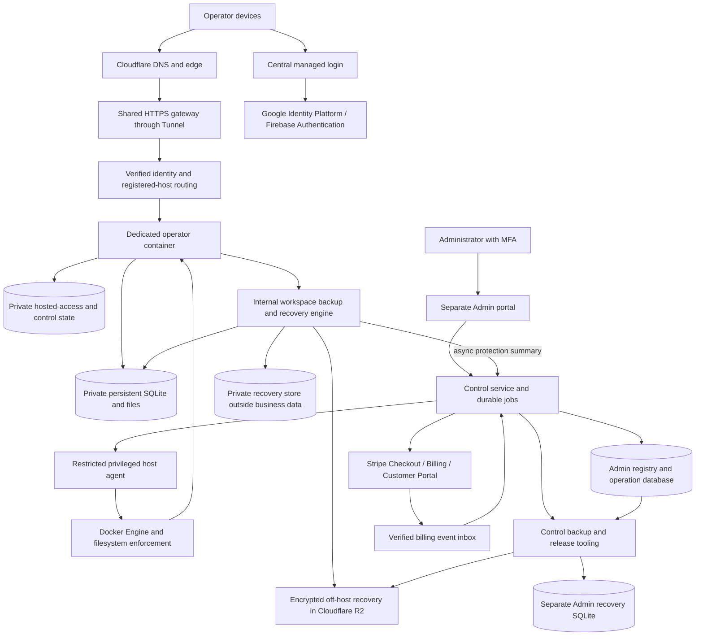

# Hosted MVP design

Accepted direction consolidated November 10, 2026.

**Status: design only.** This document records the confirmed fresh hosted-MVP
proposal. It does not implement features, authorize deployment or real charges,
mark backlog items delivered. [HOSTED-001](../../FEATURE_BACKLOG.md#now--hosted-mvp-then-tenant-and-owner-portals) now schedules implementation; this document does not authorize deployment or live charges by itself. Prices, allowances
and capacity/recovery targets below require the stated measurement and launch gates.

## 1. Purpose and scope

Give independent property managers an ordinary browser application, administered
through an Admin portal, with isolated workspaces and automated provisioning,
subscriptions, backups and release management. Start with a few operators and grow
toward 100 as demand and measured capacity justify it. Do not provision for 100 on
day one. Target US customers/properties under the existing product scope; no additional
storage/backup residency requirement was introduced in this discussion.

One verified operator identity owns one workspace and one subscription. Their
multiple devices have the same full business permissions. No shared logins, staff
roles, multiple-workspace switching or shared-portfolio collaboration in this MVP.
Full permission remains subject to authentication, account state, maintenance,
record revisions and storage admission; it never grants host administration.

### Relationship to the repository

The [product brief](../../PRODUCT_BRIEF.md), [application architecture](../../ARCHITECTURE.md),
[current UI guide](../../ui/operator-experience.md) and [backlog](../../FEATURE_BACKLOG.md)
provide business/application context. Existing demo documents retain their original
scope and evidence; they are not silently rewritten by this proposal. In particular,
the older two-operator, fixed-volume, manual onboarding/recovery and Cloudflare Access
customer-login design is not the target for this fresh commercial offering.

The current `hosted_mvp` checkout contains the local modular monolith, hosted-access
foundations and older deployment tooling. It does not already provide this Docker
control plane, automated subscription lifecycle or complete unattended recovery.
The prior conversation's implementation claims on other branches are not evidence
that those changes exist here. Use only current schemas for initial deployment;
future upgrades of actual customer workspaces still require safe schema evolution.

### Included and deferred capabilities

| Included in this hosting design | Outside this task |
| --- | --- |
| Admin portal, managed identity, invitations and automated provisioning | New property-management business workflows |
| Operator subscription UI/billing, storage metering/enforcement | Import implementation, including Universal Reader |
| Automated backup, recovery tooling, usage/health monitoring | Tenant/owner portals and property-payment implementation |
| Independently scheduled operator upgrades and controlled recovery | Local/cloud synchronization and offline hosted writes |
| Multi-device access to one operator workspace | Teams, enterprise SSO, customer-managed encryption keys and zero-knowledge encryption |

Imports will be supported on **all tiers** when delivered through their functional
backlog. Do not advertise unimplemented imports as available. Tenant access/payments
are intended future paid benefits, but are deferred and cannot be sold as currently
available. Initially, paid plans must stand on storage and stronger recovery alone.

Preserve the shared business core for optional free, single-operator local use.
Local launch has no hosted login or subscription enforcement. Hosting-specific
identity, control-plane and billing services are separate compositions. Do not add
synchronization or require a cloud account to perform local manual workflows.

Delivery begins with [Pilot 0](#pilot-0--capacity-qualified-free-operators), before paid
plans and broader automation. Its explicit operating rules override the later billing,
update-scheduling and idle-wake defaults for that stage only. The remaining sections
define the subsequent hosted MVP target, not prerequisites to build every automation
before learning from the pilot.

### Development and production deployment boundary

| Portal | Local development | Production hosted | Production local installation |
| --- | --- | --- | --- |
| Admin | Supported | Supported | Not supported |
| Operator | Supported | Supported | Supported, single operator |
| Tenant | Supported | Supported after PORTAL-001 qualification | Not supported |
| Owner | Supported | Supported after PORTAL-002 qualification | Not supported |

Local development of Admin/Tenant/Owner is for building and testing their hosted
workflows, not a customer-facing local deployment option. Retain separate actors,
stores and authorization boundaries in the development composition. Use isolated
synthetic workspaces, local test origins and explicit development configuration;
any test identity/provider/mail/payment adapters must be development-only, with
no production credentials, real payment dispatch or connection to production stores.
The production local composition serves only the Operator portal and its supported
local workflows; it must not register Admin/Tenant/Owner APIs or grant their roles.
This restriction concerns portal-specific actors/endpoints; local Operator property,
tenant and owner management workflows remain available.
Hosted deployment serves the respective portals under their existing origin/identity
boundaries; development does not weaken production login, MFA or grants.

H02/H03 and each portal's detailed design must specify local launch/configuration,
test-origin and fixture contracts plus production rejection tests. This development
support does not add production tenant/owner portals to Pilot 0 or make unqualified
payment features available locally.

### Local development and Linux qualification environments

Use Docker Desktop on the Mac for routine hosted-container development and browser/API
integration testing. Existing native Python/Vite local-Operator development remains
supported. Container build/launch configuration still requires H02's detailed design;
this environment choice does not imply those workflows are already implemented.

Retain the separate Lima ARM64 `epm-quota-test` VM as the isolated native Linux
qualification lab for filesystem quotas, privileged host-agent boundaries, sandbox
escape tests and actual reboot persistence. Keep it stopped when unused. No extra VM
is needed for ordinary portal work, and Docker Desktop tests do not replace native
quota or exact Google-host qualification. See the [quota reuse guide](../qualification/HOSTED_PROJECT_QUOTA_REUSE.md#development-versus-native-qualification).

Preserve upstream evidence/source pins and existing lab trees. Before installing
Docker, changing the kernel/filesystem/tooling or otherwise altering the retained lab,
retain a recoverable baseline and record a new environment/source identity; rerun the
applicable native tests. H02 must specify any such changes before implementation.
Use synthetic data and isolated source snapshots; do not share production workspaces,
cloud credentials or Mac virtual environments with the qualification guest.

## 2. Plans and financial envelope

### Provisional product catalog

| Benefit | Free | Paid 1 — provisional $10/month | Paid 2 — provisional $20/month |
| --- | --- | --- | --- |
| Usable workspace allowance | 50 MB | 200 MB | 1 GB |
| Business application and supported imports | Included | Included | Included |
| Backup cadence | Nightly | Recent recovery-point target of 15 minutes | Recent recovery-point target of 15 minutes |
| Retention | Seven nightly points | Fine-grained points for latest 24 hours, then daily through 30 days | Fine-grained points for latest 24 hours, then daily through 90 days |
| Idle runtime | May suspend after approximately 15 minutes | Keep warm initially | Keep warm initially |
| Tenant portal/payments | Not included | Intended future benefit; not delivered here | Intended future benefit; not delivered here |

Prices are provisional USD monthly product prices, not researched market benchmarks
or authorization to charge. Measure representative portfolios before publishing
allowances. Use exact decimal bytes: 50,000,000 / 200,000,000 / 1,000,000,000.
There is no fixed property/space entitlement in this fresh plan. Recovery assistance
and data export remain available to Free operators; paid plans improve available
recovery points and history, rather than charging for release of existing data.

### Operating budgets and demand validation

- Launch target: **$250/month before credits**, replacing the earlier $20 target.
- Growth target: **$300/month before credits at 100 operators**, subject to measured
  workload, paid/free mix and retained recovery data. These are different operating
  stages; do not interpolate a guaranteed cost per operator.
- Include compute, persistent storage, backups, authentication, transactional email,
  networking and monitoring. Track billing/payment-provider fees separately and
  disclose them in the unit-economics model; tenant payment fees are out of scope.
- The user reports Google credits of approximately $300/month until February.
  Confirm actual account terms/end date before financial planning. Credits fund
  validation and experiments; they do not reduce the recorded steady-state cost.
- Admin authorizes a spending envelope. Automation may place/provision capacity
  within it, using qualified profiles. Exceeding it requires explicit approval.
  Budget alerts are not enforcement. Account for delayed metering and outstanding
  allocations; never promise an exact final cloud invoice ceiling from an alert.
- If capacity does not fit, preserve safety/UX, stop new admissions or unfulfillable
  upgrades, and present measured alternatives. Do not silently exceed the envelope
  or reduce protection to claim the requested operator count fits.

Validate interest before credits expire. Agreed pilot gate: at least five genuine invited
operators, at least three doing recurring work weekly for four consecutive weeks,
at least one informed paid subscriber after paid plans launch, and no unresolved
critical data-loss or cross-operator isolation defect. Pilot 0 measures activation,
repeat use and support/cost evidence without requiring or accepting payment. Track activation, repeat use, paid conversion,
support effort and gross cost per active operator. Seeded/demo logins do not count.
Pivot or redesign if results justify it; avoid building a large platform ahead of demand.

## 3. Architecture and trust boundaries

### Initial deployment and growth

Start with Google Compute Engine, a persistent block disk and Docker Engine. Install
through supported VM startup/cloud-init mechanisms; pin images by immutable digest
in Artifact Registry. No Kubernetes initially. Docker Compose may define shared
services; a single template and the operator registry generate per-operator runtime
specifications. Do not manually maintain unrelated configurations for every operator.

A durable worker invokes a narrow host agent using registered IDs and fixed operation
kinds. Docker handles container lifecycle/restart policies. A bounded reconciler
compares desired versus actual owned containers and reports drift. Health failures
while a process remains alive need monitored remediation; Docker restart policies
alone do not provide that behavior. Intentional suspension must remain distinct
from a crash or failed deployment, including after a host reboot.

Keep persistent workspaces outside container writable layers and image directories.
Replacing/deleting a container does not delete its workspace. One authoritative
application writer per operator; no automatic horizontal replicas for one SQLite DB.
The gateway forwards to private container endpoints; no operator container exposes
a direct public listener. The public Admin HTTP process and operator containers
never receive an unrestricted Docker socket or generic host command capability.

Use non-root container identities, private mounts, bounded scratch/logs, enforced
memory/CPU/process limits, appropriate network restrictions and a restricted image
filesystem. Qualify isolation, directory ownership and storage enforcement on the
actual host. Containers share a kernel, disk and host failure domain; they are not
separate VMs or a complete security boundary without those controls.

Grow by measured placement across additional hosts within the budget. Include
shared gateway/control services, paid warm containers, Free wake-up capacity,
background work, recovery staging and retained disabled allocations in commitments.
Sleeping containers reduce memory demand but do not reduce the bill of an otherwise
running VM. Prefer packing and justified host changes rather than claiming per-request
serverless economics. Avoid repeated disruptive resizing merely to follow short bursts.

The initial 100-operator workload target is approximately 20 concurrently active
operators, with multi-device sessions included. This is a qualification assumption,
not a hard permission limit at operator 21. Test bursts, simultaneous wake-ups and
backpressure. Never admit an unsupported population based solely on the assumption
that most Free operators will remain asleep. Paid warm residency also consumes
capacity when those operators are not actively using the app.

Reconsider Kubernetes when multi-host scheduling/operations become substantial,
especially if the host agent starts becoming a general orchestration platform.
Kubernetes does not itself solve SQLite data availability, billing or schema-safe
rollback. Single-node Kubernetes also shares the VM failure domain.

### Public subdomains and authentication

Use a flat operator namespace such as `workspace.example.com`. Admin chooses a
suggested available public slug; normalize/validate it, reserve infrastructure names
such as `admin`, `login`, `api`, `www`, `support` and `billing`, and bind it to immutable
operator/workspace IDs. Do not derive it automatically from a private email address.
Keep slugs stable initially; a later rename requires controlled routing/authentication
and invitation updates. Do not reassign a retired slug while old links can reach
another operator's data without a deliberate reuse policy.

Wildcard DNS/certificate/Tunnel configuration routes to the gateway, which separately
exact-allowlists provisioned hosts. A wildcard route's final catch-all does not reject
unknown operator-shaped subdomains by itself. Knowing a slug grants no access.
Use a flat namespace compatible with qualified certificate coverage; deeper names
need explicit certificate planning. Keep Admin on a distinct hostname and authority.

Use Google Identity Platform/Firebase Authentication for Google sign-in plus email-link
login, with a billing-enabled project and verified email-delivery quotas. Use one
fixed central authentication domain and exact OAuth callback; do not assume wildcard
OAuth redirects. Authenticate, validate the intended operator assignment and redeem
a short-lived single-use handoff bound to the initiating browser/state and exact
operator origin. The operator origin sets its own Secure, HttpOnly, host-only cookie.
No parent-domain session cookie, arbitrary return URL or identity token in a redirect
URL. EPM must implement and test this handoff; it is not automatically supplied by Firebase.

Use short-lived managed credentials and supported refresh with revocable application
sessions to offer remembered sign-in up to 30 days on trusted devices. This is not
an instruction to configure a Firebase session cookie beyond its supported duration.
Require recent authentication for sensitive account/billing/recovery confirmations.
Provide device-only/all-device logout and local account/session fencing. Valid
sessions/verified entitlements survive a temporary provider outage only within their
existing validity; never extend expired authority indefinitely. No provider request
on every business read. Exact origin/CSRF and current source authority still apply.

Admin requires MFA and an explicit Admin role. Customer identity is not an Admin role. Link Google/email sign-in methods only
through the managed provider's verified account-linking flow; matching email text
alone must not silently merge identities or create another workspace.
Cloudflare Access may protect the small Admin audience but is not required for all
operator identities. Support staff see operational metadata by default; time-limited
business-data access needs a separate explicit reason/authorization and audit. Platform
recovery authority means this offering must not claim zero-knowledge encryption.

## 4. State ownership and dependable automation

| Owner | Authoritative information |
| --- | --- |
| Managed identity provider | Verified external subject and authentication proof; EPM owns the assignment to an operator/workspace |
| Stripe | Subscription/payment facts and provider transaction references |
| Main Admin/control database | Operator metadata, stable IDs/slug, assignments, desired subscription settings, jobs, reservations, applied-result references, operational audit and observed workspace protection summaries. No authoritative Admin recovery catalog/queue. |
| Admin recovery database | Separate private SQLite owned by the Admin service: control backup catalog/checkpoint, recovery operations and audit; retained while the main Admin DB is restored. |
| Protected host inventory/agent | Actual directory/container/image/host identities, physical enforcement and effect observations |
| Operator hosted-access/control store | Effective account/session authority, source fences and command receipts; bounded hosted storage accounting/control state |
| Operator business workspace | Domain records, files, revision conflicts, business receipts and audit |
| Per-operator recovery store / immutable manifests | Operator service owns workspace backup checkpoints, verified catalog and restore operations outside the replaceable business DB. Admin receives non-authoritative protection summaries; separate control manifests protect the platform. |

A small single-writer control-plane SQLite store is a reasonable initial candidate;
qualify it with bounded workers/queries. This is not the operator business database,
and it does not require a managed relational service on day one. Reassess it as
multi-host/control-plane availability needs grow. Operator containers must not open
that database or another operator's hosted-access store.

Keep desired settings separate from verified effective settings. Generate minimal
protected runtime configuration from admitted control records and registered bindings;
files are runtime projections, not a second editable operator registry. Store secrets
in protected secret/key mechanisms outside business exports, images and browser data.

Use durable jobs, original idempotency keys and semantic request hashes. In short
owning transactions record intent before external effects, then verify and checkpoint.
Duplicate matching submissions return the original operation/result; changed intent
under the same key conflicts. Retry inspects effects and source receipts rather than
assuming a timeout means nothing happened. Keep per-instance mutation ownership,
monotonic revisions/fences and bounded worker claims; disable/revoke wins over stale
activation. Do not hold a DB transaction across Docker, network, backup or provider work.

External operations cannot commit atomically with SQLite. Persist unknown outcomes,
retain necessary reservations and reconcile them through the original operation.
Use bounded verified webhook inbox/outbox processing, stable event IDs, semantic
source commands and periodic provider reconciliation. Handle duplicate/out-of-order
events without rolling a subscription or source fence backward. Workers and Admin
pages must not expose raw secrets, sessions, business contents or shell output.

## 5. Admin creation and automatic onboarding

Admin selects **Add operator** and supplies display name, exact sign-in email,
available workspace slug, support contact and proposed plan. Default to Free and an
empty workspace. An optional small synthetic dataset is a per-operator demonstration
choice, not a required population or count; demo activity is excluded from pilot metrics.
Admin may propose a paid plan but cannot authorize an undisclosed charge on behalf
of the operator. Explicit complimentary grants must be audited, time-bounded and
capacity-qualified, never hidden quota edits.

The creation flow is:

1. Validate identity/slug uniqueness, qualified release/profile, available capacity
   and spending envelope. Show the reviewed assignment before submission.
2. Admit one durable job and reservations; return a Pending row immediately. Closing
   the browser does not cancel or resubmit it.
3. Allocate private persistent workspace/control/scratch resources, publish the
   protected configuration and initialize actual source authority with access disabled.
4. Start/verify the source, initialize business data, verify routing/isolation and
   create a verified off-host recovery point. Progress is async with retained status.
5. Send a short-lived single-use invitation only when ready. Keep the recipient/URL
   assignment pinned and invite sending deduplicated; expiry of an invitation is
   not expiry of the account. Provide controlled resend/reissue.
6. The operator signs in with the invited verified identity and claims the assignment.
   Automatically enable it only when current readiness/recovery and identity checks
   all pass. Admin's invitation is the routine authorization: no second manual
   identity approval/completion click is required for an ordinary successful claim.
7. Show the operator their workspace, Free plan, usage and any proposed paid offer.
   Paid activation requires the operator's checkout authorization and confirmed payment.

**Business access remains disabled while setup runs**, including seeding and exception
handling. A healthy container or authenticated but unassigned identity is insufficient.
Failed steps remain Pending/Needs attention with safe reasons and retry lookup. Never
create another workspace, discard partial records or enable access simply to clear an
error. Retire resources only through ownership-verified, reviewed cleanup.

Admin overview/detail shows operator count, qualified capacity, plan/effective allowance,
usage/freshness, service state, backup age, release and operation history. Separate
Pending setup, Ready for claim, Active, Suspended runtime, Access disabled and Needs
attention. An idle suspended container is not a disabled operator. Keep the UI responsive
while jobs run; show retry/reconciliation actions rather than raw infrastructure tools.

## 6. Subscription and storage workflows

Use Stripe Checkout/Billing/Customer Portal for monthly USD subscriptions. Defer annual
plans, coupons and custom commercial contracts. Verify signatures and current provider
state; a successful browser return is not payment proof. Show prorated upgrade charges
before acceptance. Prices/tax configuration must be verified before real charging.

### Upgrades, downgrades and payment failures

| Event | Required behavior |
| --- | --- |
| Upgrade | Check/reserve applicable capacity, obtain operator payment authorization, confirm payment, then apply/verify allowance, recovery and warm-runtime policy through one durable operation. Show Applying until effective facts are verified. |
| Upgrade failure | Preserve the last verified effective settings and retry/reconcile the original operation. Conclusively undelivered benefits require provider compensation and notice. Unknown outcomes require reconciliation before blindly refunding or reversing a change. |
| Downgrade | Schedule at next renewal. Warn if usage exceeds the target. At the effective date apply the reduced product entitlement while retaining existing data; use a safe temporary physical ceiling until usage fits. Do not silently keep charging the old plan. |
| Renewal payment failure | Existing paid subscribers receive a seven-day payment grace with provider retries/notices. Then Free restrictions apply without deleting records. A failed first-time upgrade never receives unconfirmed paid benefits. |
| Cancellation | Stop renewal; preserve paid benefits to the paid-period end, then Free rules. Existing backups retain their promised expiry; new points follow Free cadence/retention. Cancellation is not account deletion or logout. |

Reserve capacity before checkout where feasible, but reconcile delayed payment and
reservation expiry; do not overcommit or lose the charge if the browser closes.
Provider status, desired plan, last verified effective entitlement and operation state
are separate facts. Receipt/audit and observed revisions determine Applied, not an
editable plan badge. New policy cannot override a later account disable or maintenance gate.

### What storage means and how it is enforced

Count business database usage and retained managed files using the owning logical
usage definition, without counting shared file content twice. Do not meter attachments
alone or double-count database/WAL representations of the same committed state.
Include retained history/versions; archiving does not free retained bytes. Keep billing
usage reproducible and reconcilable, not a rounded `du -sh` scan after each edit.

Exclude backups, scratch, hosted authentication/control and physical database/allocation
headroom from advertised usable storage, but reserve and monitor them in host budgets.
Use bounded application growth reservations plus qualified filesystem hard byte/inode
limits for private persistent trees. Ext4 project quotas are the preferred candidate
for H02 evaluation based on the selectively imported qualification work below, subject
to fresh native Docker/GCP proof; historical success is not runtime qualification.
Docker memory/CPU limits do not enforce bind-mounted workspace storage. Do not create
an OS/filesystem/image per operator solely to express a tier. Qualify the chosen host
quota mechanism, attribution, restart/restore and escape prevention before activation.

Warn around 80% and 95%. At the allowance, retain login, billing repair, reads/exports,
backups and supported storage-reducing actions. Reject unadmitted growth clearly while
preserving form input. Safe cleanup/accounting uses bounded operational headroom; there
is no unlimited “small edit” exemption. Kernel exhaustion/commit failures still require
owning transaction rollback, cleanup and uncertain-result handling.

A smaller product allowance can coexist temporarily with larger physical limits for
retained over-quota data after downgrade. Track that commitment explicitly and block
additional growth. Never lower kernel ceilings below actual usage or erase files to
force a downgrade. Apply increases before promising usable capacity; fence/drain and
verify decreases in the safe order. Larger tiers do not automatically lift individual
request/file limits; those remain qualified API/workload limits.

### Operator account UI

Settings shows plan, one workspace usage/allowance indicator, freshness, remaining space,
backup protection state, upgrade/change/cancel controls and pending operation status.
Both portals use async reads with retained stale values, independent errors and bounded
visible-page polling. Unknown is not zero; payment-confirmed is not Applied. Refresh
never resets a form, scroll or selection, and never submits another consequential action.
Use existing light/dark, responsive and keyboard-accessible UI patterns.

## 7. Idle workspaces, sessions and multiple devices

Free containers may suspend after approximately 15 minutes without human activity;
paid containers stay warm initially. Automatic polling does not count as human activity.
Track activity across all devices with bounded ephemeral/control observations rather
than turning every request into business history. No suspension while admitted writes,
uploads, exports or owned background work still require the runtime.

A persistent gateway validates the intended assignment, starts the registered container
once through a deduplicated wake operation, and shows a safe waking page. Private
business content is unavailable until source checks pass. Target a few-second wake;
measure it under cold starts, simultaneous demand, image availability and contention.
On wake failure provide status/retry without resubmitting the original write. Before a planned stop/suspension, finish protection of all admitted business/file
changes and persist the checkpoint. No workspace writes occur while stopped; an
unchanged stopped workspace needs no repeated full upload. On wake/restart reconcile
actual source/file generations and catch up unprotected changes before claiming health.
External monitoring alerts on stale/unknown dirty protection; it does not run routine
workspace backups. H11 must qualify this stop/wake contract before enabling suspension.

Multiple devices retain full permissions but not last-writer-wins behavior. Stale saves
conflict, preserve input and provide comparison/review. Independent records remain
independently editable. Shared unfinished forms require explicit ownership/takeover
where applicable; opening a tab never silently steals another device's edit authority.
Do not add offline mutation queues or automatic replay after reconnect, wake or upgrade.

## 8. Backup, recovery and retirement

Use unattended, platform-managed encryption keys, scoped identities and separately
protected key custody. No operator-entered passphrase is required for scheduled backup
or automated recovery. This is not customer-managed-key or zero-knowledge encryption.
Choose a proven incremental/deduplicated encrypted backup implementation only after a
component proof; encrypting whole independent archives before deduplication can defeat
the expected savings. Include GCP upload traffic and retained bytes in the cost model.

### Internal workspace backup and recovery

The operator service owns routine workspace backup and self-service restore. An internal
background runner performs scheduled consistent capture, encryption/upload, verification
and retention without holding the SQLite writer during slow transfer or blocking normal
UI reads. It is not a second uncoordinated business writer. There is no always-running
outside workspace-backup/recovery service or mandatory Admin dispatch per operation.

A private per-operator recovery SQLite store, outside the business tree being restored,
keeps operation receipts, verified points, backup checkpoint and restore progress. Its
schema resources live under `application/database/recovery-migrations/`. The service
reports bounded protection summaries asynchronously to Admin; Admin downtime does not
stop backup or restore. Admin monitors/supports but does not own routine workspace jobs.
Authentication/access state remains separately protected and is not restored with data.

Track the protected business revision, retained-file generation and source incarnation,
not an in-memory dirty bit alone. If consistent comparison proves no changes, reuse
verified content instead of uploading another full copy; nightly verification/retention
may reference the same immutable content. Keep actual capture/verification times and
show “unchanged since verified point” separately from a fresh capture. Unknown or unreadable
state never counts as unchanged. A crash can leave committed changes unprotected; startup
must reconcile/catch up and surface degraded protection until destination verification.
A planned stop/upgrade completes backup of unprotected changes before stopping. Retain
seven nightly recovery points where produced, and never expire the only usable point
just because no new data required a replacement. Retained object references govern cleanup.

A recovery point is a completed, verified off-host database-and-file state with manifest,
workspace identity, schema/release compatibility, exact content references, digest and
key reference. Never copy an actively changing SQLite file as though it were a snapshot.
Use supported consistent capture and stable/versioned file references; hold writer gates
only as required for consistency, not throughout a slow upload. Publish the point last.

Free has a roughly 24-hour recovery-point objective while nightly protection is healthy.
Paid has a 15-minute objective for recent data. Schedule frequent enough to include
capture/upload/verification time; “cron every 15 minutes” alone cannot prove it. Retain
fine-grained paid points for 24 hours and thin older points to the daily history in the
catalog. Do not promise every historical 15-minute point throughout 30/90 days.

Monitor the latest **completed recoverable off-host point**, current-versus-protected
source/file generations and proof freshness, and test restores. Show genuinely verified
unchanged state separately; never refresh capture time or infer unchanged merely because
the container is stopped.
On protection failure keep the workspace usable, mark degraded protection and alert Admin;
never show a stale successful job as healthy. These are engineering objectives, not
unconditional guarantees or a contractual SLA. Alert/recovery procedures must expose
actual achieved protection and unresolved incidents.

Operators select and authorize recovery of their own workspace without Admin approval.
Settings → Data & Backup lists verified eligible recovery points (latest selected by
default), with capture time/property-independent display zone, protection status and
clear warning that newer changes will be rolled back. Show a restore preview with
workspace, selected point, current source revision and affected devices; require recent
authentication and explicit confirmation bound to that exact preview. Never restore
from a missing, corrupt, unverified, incompatible or different-workspace point.

Admit one idempotent restore operation; present progress and original-result lookup
across devices. The job validates capacity/keys/compatibility, fences and drains all
workspace writers/background dispatch, retains the current state, restores
to a separate private destination, validates complete data/files and ownership, then
switches bindings. Preserve a healthy pre-state through consistent capture; if the business DB is damaged,
keep the original tree intact as pre-restore/forensic state rather than requiring it to
be a valid backup. If that preservation or safe destination allocation fails, stop and
expose technical assistance; never overwrite the only source copy. Reject conflicting restore/upgrade jobs.
Failures retain the original safe binding or a fenced Needs attention state, never an
unvalidated destination. No automatic replay of user writes after restore.

Reconcile current identity/subscription and revoke affected app sessions before
reopening; an archive cannot restore old sessions, paid grants or enabled flags. The
operator signs in again to inspect and accept the restored workspace. Retain pre-restore
state until acceptance and the defined recovery cleanup; restoring that state requires
another explicit reviewed operation if newer writes exist. Future payment collection
stays fenced until provider/mandate reconciliation succeeds. Tenant/owner sessions
have no authority to restore a workspace. This self-service capability applies to Free
and paid plans alike; available recovery points follow their plan/retained history.

### Authenticated recovery mode and failure handling

Start a minimal recovery mode in the same operator service/image when business DB
validation/open fails. Bootstrap authentication, the private recovery store, recovery UI,
verified-backup list and original-operation status before business service composition;
never require a healthy business DB to render them. It uses current hosted identity/access
(or the existing local loopback/OS-owner boundary), not an authentication bypass. If auth
or recovery metadata cannot be validated, fail closed: no restore or decryption bypass
is offered. Support repairs the service/identity boundary before an operator can retry.

The internal engine drains requests/jobs, closes all business DB connections and owns an
exclusive workspace recovery gate during restore. A crash-safe locator/intent protocol
switches a validated separate business directory inside the existing protected persistent
mount; no Docker socket, generic host shell or mount privilege goes into the operator
container. Unavoidable host binding changes use the restricted registered-ID helper,
not an Admin approval/dispatch workflow for ordinary recovery. Restart inspects retained
operation/phase/locator evidence before any normal business opening, so interrupted
restore cannot silently initialize an empty workspace or start competing writers.

The current hosting scope excludes a dedicated offline operator-workspace restore or
decrypt/export command. Do not expose an offline-recovery endpoint, hidden Admin action,
CLI flag or environment switch that impersonates an operator or skips authorization.
If a container cannot start, support repairs/recreates its runtime from a qualified
image while retaining private data/control directories, then the operator reauthenticates
in recovery mode. If current identity/binding cannot be established, recovery stays
unavailable rather than accepting historical credentials from a backup.

#### Clean runtime rebuild, then authenticated restore

When the Operator container cannot start, use **Repair runtime**, not “reset operator
to empty.” Support/qualified host tooling performs this infrastructure operation; it
cannot choose or authorize a business recovery point. The operator subsequently restores
through the authenticated recovery screen:

1. Record a retry-safe runtime-repair operation bound to the existing operator/workspace,
   registered resource binding, qualified compatible release and expected source fence.
   Stop/fence the former runtime; never start another writer on an uncertain stop.
2. Retain the original business tree, access/recovery stores and protected key references.
   Replace only the failed runtime/container from the qualified image. Preserve the
   operator/workspace IDs, subscription and current disabled/enabled intent; do not run
   Add operator, synthetic seed, business initialization or account re-enrollment as a
   shortcut. Missing identity/control state first needs separately verified repair.
3. Start minimal recovery mode without opening/migrating/initializing the business DB.
   Revoke old app sessions and require current operator authentication and the same
   strong-step-up/exact-action confirmation as any restore. Runtime-repair authority
   never grants access to decrypted business records or authorizes rollback.
4. The operator selects a verified own-workspace backup. Allocate an empty **separate
   restore destination**, verify key/manifest/schema compatibility, then run the normal
   internal restore/validation/switchover. Do not overwrite or delete the original tree.
5. Reopen only after current authority and integrity checks pass; retain previous data
   until acceptance and controlled cleanup. No automatic return to business service just
   because a replacement container is healthy. Conflicts/failures remain inspectable
   under the original repair/restore operation identities.

Recovery requires a usable verified backup and available keys; runtime replacement
cannot manufacture missing data. An empty staging directory is not a new empty portfolio
and never changes workspace identity. H02/H05 must qualify this sequence, including
container replacement, missing auth metadata, incompatible backups and interruption;
H05 still needs its detailed design before implementation.

For host loss, privileged platform tooling may rebuild infrastructure and protected
control state, but cannot authorize a customer workspace rollback or provide a customer
backup plaintext-export feature. Mount only the verified workspace/control resources
into their registered operator runtime; any missing catalog reconstruction occurs there,
after fresh operator authentication, through verified own-workspace manifests. No
permanently running outside workspace recovery service is required.

#### Recovery security release gate

Require current own-workspace identity, recent strong step-up authentication qualified
in H03/H05 and single-use confirmation bound to the exact point, workspace, source epoch
and preview. A normal logged-in cookie or Admin session alone is insufficient. Reject
cross-workspace points, expired/replayed confirmations, arbitrary filesystem/object/key
references and untrusted redirect/download destinations. The service chooses destination
roots and scoped key/object references; browser/API callers never supply them. Recovery
produces only the registered workspace, not downloadable plaintext archives or attacker-
selected storage. Use least-privilege own-prefix object access and protected key custody;
no platform-wide decryption/bucket credentials in any portal/container.

Audit every authorization/attempt/outcome without secrets or business contents. Test
stolen-session-only attempts, forged Admin/user roles, cross-workspace object/key IDs,
replay, path/symlink escape, development adapter enablement and tampered manifests. H05
must pass an explicit security review and these negative tests before enabling restore;
otherwise show it unavailable. Later offline customer-recovery capability requires a
new explicit design/security decision, not a default H05 fallback.

These controls reduce exposure; do not promise zero probability of attack or protection
from a fully compromised host/platform administrator. Platform-managed keys retain a
privileged trust boundary, as already disclosed; removing a command does not create
zero-knowledge encryption. This limitation must remain clear in the security review.

#### Separate Admin backup and recovery store

Admin backup/recovery uses a separate private SQLite database/schema, owned by the
Admin service and located outside the main Admin DB and its restore destinations.
`application/database/admin-recovery-migrations/` exclusively defines its versioned
schema; no runtime DDL. Its control_recovery_points, control_restore_operations,
control_recovery_operations, checkpoint/meta and audit tables remain available when
main Admin state is corrupt or being replaced. See the [schema master](../../DATABASE_SCHEMA.md#admin-recovery-database--h05).

Normal Admin backup and authenticated recovery mode can run in the same Admin service;
no additional service/VM is required. Bootstrap this store and the protected current
recovery-authority binding before opening main Admin data. Strong Admin MFA/step-up and
explicit point/target confirmation cannot depend on old principal/session rows from
that damaged DB or its archive. H03/H05 must qualify current identity/revocation and
protected bootstrap policy; otherwise Admin recovery is unavailable. Operator identities
never grant platform recovery authority.

The recovery DB owns operation identities/checkpoints/audit, with only local FKs; main
Admin, inventory, principal and release IDs are logical references with owning validation.
Do not require a main Admin operations/admin_audit transaction to admit or finish recovery.
Restore main Admin into a separate destination, validate schema/data/source bindings,
advance control fences, revoke historical sessions and reconcile providers/pending work
before reopening. Keep prior main Admin data and this recovery DB until acceptance;
never replace the recovery DB with the main Admin archive or replay old jobs/grants.

If the Admin service cannot start, existing restricted platform recovery tooling uses
the same protected store/engine with exclusive ownership and fresh recovery authority;
this is not an offline customer-workspace restore/decrypt command. Whole-host loss still
requires off-host manifests and independently protected bootstrap/key custody: initialize
an explicit fresh recovery incarnation and reconstruct verified catalog evidence without
automatically importing runnable operations. A separate local file alone is not host-loss
protection. H05 rehearses both main-DB-only loss and loss of the recovery DB/entire host.

The Admin registry, mappings, admitted versions/configuration, subscription references,
infrastructure operation history and the separate Admin recovery catalog need
encrypted off-host protection/reconstruction evidence. Workspace recovery metadata is protected/reconstructible through
its own manifests, not dependent on an Admin catalog of every workspace point.
Keep keys/credentials and reproducible infrastructure recovery available outside the
failed VM. A business archive alone cannot rebuild routing/ownership. Reconstruct and
reconcile host/provider/source state before reopening access; never replay queued grants
or unknown jobs automatically from an old control snapshot.

Target recovery within four hours as a measured engineering objective, not a 24/7
contractual promise. Externally alert on host loss and automate understood repairs.
Host-loss recovery must remain executable without its hosted Admin portal. Avoid
unattended cross-host takeover until fencing and restore correctness are proven;
never start a second writer merely because a health probe timed out.

Distinguish **Disable access**, **Cancel subscription** and **Retire workspace**.
Retirement needs explicit workspace confirmation, reason, export opportunity and scheduled
deletion date, with an initial seven-day recovery window. Explain primary versus backup
expiry and retained operational audit. Do not immediately recycle ownership or slugs.
An inactive Free account is not automatically deleted; Admin reviews retirement.
Retained disabled data still consumes monitored capacity.

## 9. Independently scheduled release upgrades

Admin, Operator, Tenant and Owner have independently versioned, qualified release
artifacts and rollout operations. Upgrading one portal does not automatically upgrade
the others. Admin approves a target component release; Operator deployment remains
independent per operator workspace, while Admin and the initial Tenant/Owner portal
assets have deployment-wide assignments. Tenant/Owner release delivery is future
portal work, not Pilot 0 scope. Each artifact declares its API, source/runtime,
authentication and owned/readable schema compatibility in a pinned manifest.
All release assignments use the common component_deployments table described in the
[schema master](../../DATABASE_SCHEMA.md); scope distinguishes per-workspace Operator
rows from deployment-wide Admin/Tenant/Owner rows. Operator identity records do not
carry a duplicate desired release.

Retain the shared modular business backend and one writer per workspace. Independent
portal releases do not require another writer, database copy or four microservices.
Tenant/Owner assets may be deployed independently through their qualified serving
boundary and call authorized source APIs; new server capabilities are delivered by
the owning runtime release. Test each portal against every admitted backend version
it may route to. Use compatible API evolution so component versions can coexist;
reject an unsupported pairing rather than force a silent all-portal update.

A schema change belongs to the store owner, not to a frontend artifact. Admin upgrades
may change only their owning control schemas through the qualified runner; Operator
runtime upgrades own business/access changes. Portal asset-only upgrades neither run
schema DDL nor restore databases. A genuinely incompatible shared dependency needs an
explicit reviewed prerequisite/maintenance plan and compatibility evidence; independent
release selection is not a promise of arbitrary version mixing or zero downtime.

The following scheduling workflow applies to Operator releases. Admin/portal component
rollouts use their own canary, notices and bounded operation, without automatically
changing operator update preferences or stopping unrelated workspace writers.
Start with an internal canary and bounded batches; failures stop that component
rollout. No arbitrary published-tag auto-updates. Operators may run different eligible
versions temporarily; pin image/schema compatibility and retain needed rollback artifacts.

Operator Settings stores a preferred update window and explicit time zone. Suggest a
low-activity time; offer **Accept suggested time**, **Choose another time** and **Update
now** when scheduling is needed. Avoid prompting on every small release. Notify in
advance and support bounded deferral, initially up to seven days. Disclose an urgent
security exception; it does not permit unsafe interruption of a committed operation.

Prefer no human activity across devices for approximately 15 minutes, with no in-flight
owned work. Before interruption warn active/returning users, drain admitted commands,
resolve uncertain outcomes and preserve acknowledged unfinished forms. At a chosen time,
activity may require a visible deferral/finishing-work step; do not drop an active write.

The owning job establishes a verified pre-upgrade recovery point, fences/stops the sole
writer, applies required schema changes and starts the pinned image. Verify runtime,
source binding, data integrity and required smoke checks before reopening. Only that
job may remove its gate; a later disable always wins. Existing sessions may remain only
when still eligible; reload incompatible UI/assets safely without replaying old commands.
A returning operator sees Updating and a clear continuation path.

Automatic restore to the pre-upgrade point is allowed only while access remains fenced
and no operator writes were accepted afterward. Once business writes resume, preserve
them and require a controlled forward fix or reviewed recovery; blindly restoring an
older DB would erase legitimate work. Merely running the old image is not a schema-safe
rollback. An idle Free container can receive a new image assignment without starting
solely for rollout, but required schema validation must occur before serving it again.

Pilot 0 still uses one announced maintenance window and supported manual operations.
Its Admin and Operator artifacts/assignments are separate from H02, even if deployed
together in that window. H10 adds independent scheduling/automation; Tenant/Owner
backlogs supply their independently deployable artifacts when implemented. For a
component-only rollout, restore its prior compatible artifact without rolling back
shared business data. Runtime/schema recovery retains the existing pre-write rollback
and post-reopen data-preservation rules.

## 10. Monitoring, reliability and cost qualification

Use in-app status and transactional email for invitations, subscriptions, quotas, updates
and relevant recovery notices. Admin gets actionable infrastructure, failed provisioning,
backup and rollout alerts. Deduplicate repeats and send recovery notices; do not rely on
an operator visiting the app to detect a failed backup. Select a transactional-mail
provider with measured delivery/quota/cost before launch; do not build an SMTP service.

Measure per-host/container memory, CPU, disk/inodes, IO, restarts, wake/read/write latency,
job queues, backup-point age, restore duration, retained recovery bytes and service cost.
Product adoption metrics distinguish real recurring work from demos/polling. Keep logs
and traces bounded, access-controlled and free of session credentials, full request
bodies, document contents and unnecessary financial/customer details. Exclude advertising
tracking and session recording from this scope.

Before selecting host sizes/qualified population, measure empty and representative
portfolios, all tiers, paid warm residency, multi-device activity, 20 active operators
at the 100-registered stage, bursts and simultaneous wake-ups, imports/uploads when
supported, updates, backup/restore and control-plane overhead. Record dataset, workload,
limits, concurrency, p95 latencies and failure behavior. No capacity claim follows from
idle RAM, container count or a successful small synthetic seed alone.

Cost worksheet must include persistent and retained inactive data, backup cadence and
retention, deduplication under realistic changes, GCP-to-R2 traffic, auth/email limits,
monitoring/log retention and billing-provider charges. Forecast the all-paid/warm case
as well as a mostly-Free cohort. If targets do not fit, present the measured tradeoff
for approval rather than quietly weakening an entitlement or overcommitting the host.

## 11. Suggested delivery and acceptance order

This sequence is scheduled as HOSTED-001 in the [backlog](../../FEATURE_BACKLOG.md). Start H01 below; Pilot 0 is the first usable release milestone. Tenant and owner portals follow in PORTAL-001/002, outside hosting acceptance.

1. Prove container/private storage isolation, persistent SQLite, gateway/subdomain
   routing and identity handoff; measure the small-host workload and gross cost.
2. Prepare Admin-lite creation/invitations, Free nightly recovery, basic Settings
   usage and a full operator/control-plane restore rehearsal. Bounded manual operations
   may support this stage; complete automatic provisioning remains a subsequent target.
3. Run **Pilot 0: invited operators within qualified capacity, Free plans only**, under the operating
   rules and acceptance gates below. Observe real use and operational cost before
   investing in subscriptions and wider automation.
4. Complete automated provisioning and verified quota enforcement, paid recent
   recovery and retention, billing inbox/reconciliation, self-service plan changes,
   compensation and failure states. Do not charge for a benefit before it can
   actually be delivered and verified.
5. Deliver independent update scheduling, canary rollout, schema-safe recovery,
   idle suspension/wake, operator notices and representative multi-device acceptance.
6. Run the paid pilot, validate repeat use/payment/support effort, then expand
   admission toward measured 100-operator capacity within the spending envelope.

### Pilot 0 — capacity-qualified Free operators

Pilot 0 is an invitation-only learning stage. Five operators are an initial qualification
target, not a hard-coded cap; Admin may add more dynamically within verified capacity. It uses
the Free 50 MB workspace allowance, nightly verified off-host backups and seven
nightly recovery points. No paid enrollment, Stripe integration, checkout or billing
credentials are needed. Show **Free pilot**, usage and support/recovery information
in Settings; do not expose paid upgrade controls as available.

Admission is capacity-based, not an operator-count constant. Admin-lite Add operator
checks current warm-runtime memory/CPU/IO headroom, physical byte/inode commitments,
backup retention and restore staging capacity, support effort and the approved spend
envelope. Count active, pending and unknown provisioning commitments; retained disabled
data still consumes disk/backup capacity. Persist the reviewed capacity-profile/evidence
reference and admitted resource commitment in the provisioning operation's typed request.
Serialize admission in the control transaction so concurrent Add actions cannot spend
the same headroom. Unknown effects retain their commitments until reconciled.

Admin may invite another operator without a code/configuration change to a hard-coded
cohort size when that admission fits the current qualified profile. If measurements no
longer cover the proposed population or protection/support is degraded, show Capacity
review required, keep the request pending and qualify additional capacity first. No
silent overcommit, automatic VM purchase or broader H07 scheduler is required: Pilot 0
may use a supported manual capacity review with recorded evidence. Extra operators
remain Free, warm and in the same announced maintenance window. Five real invitees
remain the minimum adoption-evidence target, not an admission ceiling; do not wait for
paid automation or completion of the four-week demand review merely to add an operator
that already fits qualified capacity.

| Area | Pilot 0 delivery |
| --- | --- |
| Admin-lite provisioning | Admin records the verified operator assignment, slug, Free allowance and operation status, then runs a supported provisioning action/script. Show Pending/Ready/Needs attention and safe retry status. Manual completion is acceptable; no generic shell or Docker socket in the public Admin process. Retain original operation/resource identities so a retry cannot duplicate a workspace or enable an uncertain result. |
| Onboarding and isolation | Keep dedicated containers/private SQLite/files, managed identity, registered-origin routing and host-only sessions. Business access stays disabled through preparation/seeding and readiness checks. Admin may manually verify readiness; the invited verified identity must still claim the correct assignment. |
| Backups and recovery | The operator service runs nightly consistent database-and-file capture with verified off-host manifests/checkpoints and external protection alerts. Rehearse operator and control-plane restore, including recovery without the failed host, before admitting real records. Operator chooses/authorizes workspace recovery; the internal engine executes it, through authenticated recovery mode with no offline operator restore/decrypt command and no separate approval; retain the source, validate the restored destination and fence the old writer before reopening. |
| Releases | Use one announced maintenance window for the whole cohort. Notify all admitted operators, preserve unfinished input, drain admitted work across devices, capture a verified pre-update recovery point and apply a pinned compatible release. No per-operator window preferences or scheduling automation. Preserve post-reopen writes; a maintenance window does not make destructive rollback safe. |
| Runtime | Keep all admitted containers running within qualified host capacity. No idle suspension or wake automation; polling and concurrent devices do not trigger lifecycle changes. Monitor health and use documented restart handling. |
| Manual operations | Provisioning completion, exceptions, recovery and maintenance may be handled manually through restricted supported tools. Record who acted, result/unknown state, elapsed time and follow-up; manual handling does not bypass identity, isolation, source fences, safe retries or backup verification. |
| Storage and cost | Show measured usage/freshness and enforce bounded storage admission through qualified limits or conservative supported write gates. Monitor physical headroom and alert before exhaustion; do not rely only on a scan after a write. Record gross cloud spend before credits, retained backup bytes/traffic, support incidents and Admin minutes per operator/task. Full automated tier changes and quota reconciliation follow in step 4. |

Pilot admission requires the isolation/identity proofs from step 1, a successful
nightly backup and rehearsed restore, supported safe provisioning/retry, sufficient
capacity for the admitted continuously running container population, and a named operational owner.
Manual work must be visible and repeatable through a short runbook, not unrecorded
changes to authority or resource ownership.

Review activation, weekly repeat use, backup freshness, restore results, user friction,
Admin time and before-credit spend with this cohort. Use the four-week repeat-use
measurement above; payment conversion is evaluated only in the later paid pilot.
Proceed to step 4 when observed demand and operating effort justify the investment;
otherwise revise or stop admissions. No paid feature or 100-operator capacity claim
follows from Pilot 0 alone.

### Implementation slices

Complete a detailed design for each slice before starting its implementation, covering schema, UI, infrastructure/setup and validation as applicable. H01 has a detailed design; later slices require their own before implementation. Implement sequentially as cohesive backend/UI/operations changes. Each row depends on
its predecessor unless explicitly stated; no row is marked implemented here. Start with
current-checkout evidence, not implementation claims or schema resources from another
branch. Pilot 0 releases at H06; H07–H12 must not delay that learning milestone.

| Slice | Delivery and implementation boundary | Acceptance before proceeding |
| --- | --- | --- |
| H01 | [Baseline, schema and deployment contracts](HOSTED_MVP_H01_DESIGN.md). Inventory `application/apps/server/app/modules/hosted_access`, `application/deploy/hosted-demo`, workspace backup services and existing hosted browser tests. Design the store ownership map and complete Pilot 0 schema for the Admin registry, protected inventory, effective hosted-access authority, separate Admin recovery and per-operator recovery stores, reusing business schema ownership. Define typed host-agent commands. Document tables/columns, constraints, indexes and initialization ownership; defer paid/automation-only tables to their owning slices. Record proof choices for quotas, backups, keys, mail and image packaging. | Review the Pilot 0 ER/relationship diagram, store/data dictionary and schema-resource plan; document reuse/gaps, resource ownership, exact capacity/accounting definitions and reproducible component-proof commands. No live deployment required to begin. Reject generic shell/path selection and public Docker access. |
| H02 | Dedicated container/storage foundation on GCP with Cloudflare gateway. Package pinned application assets and the owning schema resources; validate fresh initialization and schema identity without defining a second schema authority; persistent private workspace/control/scratch, registered subdomains and restricted host operations. Keep Pilot 0 runtimes warm. Reuse the imported ext4 quota primitives/sandbox/harness through the [H02 reuse contract](#h02-project-quota-reuse-contract), adapting only after detailed design. | Fresh source-pinned native Linux, Docker and exact GCP quota/isolation/reboot proofs required; historical 8A pass is input only. Two isolated test operators, persistent data across replacement/reboot, unknown-host denial, one writer, bounded memory/disk/inodes and measured warm-container headroom for the admitted population (initial proof target: five). No customer records yet. |
| H03 | Managed identity and central-login handoff. Admin MFA, exact invited-identity assignment, host-only app sessions, revocation, logout and simultaneous-device access with existing revision/draft fences. Own identity/session/invitation/revocation schema delivery and validation against H01. | Cross-origin/workspace/role denial; no identity-token URL leak; single-use handoff replay fails; stale saves preserve input. Local launch still works without cloud login. Pass the schema acceptance contract below. |
| H04 | Admin-lite and Free usage. Add/list/detail operator UI, default empty/optional synthetic portfolio, pinned Free 50 MB allowance, operation identities/status and supported manual provisioning completion/retry. Operator Settings shows Free pilot, usage/freshness and support; hide unavailable upgrades. Own Admin-lite provisioning/status, operation-result and Free usage/allocation schema delivery. | Pending → Ready/claim → Active only after source checks; no business access during setup/failure. Retried/unknown results do not duplicate resources. Safe growth rejection, retained reads/export/cleanup and physical headroom. Pass the schema acceptance contract below. |
| H05 | Nightly verified off-host recovery. Consistent SQLite/files capture, encrypted key custody/catalog, seven nightly points, stale-backup alerts, separate Admin recovery DB/schema with its own backup checkpoints/operations/audit and main-Admin-DB-independent authentication, plus internal operator-authorized restore, recovery-mode UI with strong step-up and no offline workspace restore/decrypt command. Keep catalog/checkpoints/restore operations in private recovery storage outside business data; Admin observes async summaries, without approval or routine dispatch. Include recent-auth preview/confirmation, safe locator switch and interruption handling. Own recovery-point/manifest/catalog and restore-operation schema delivery. | Rehearsed data/files and host-loss/control restore including damaged main Admin DB, damaged Admin recovery DB and retained restore evidence; reject cross-store FKs/old-session authority and corrupt/missing objects, new fences/session revocation, retained pre-restore state, cross-operator denial, duplicate/conflicting restore handling and verified operator authorization; Admin outage independence, corrupt business-DB startup, crash mid-switch and denial when identity/runtime cannot be established; clean-runtime repair preserves IDs/data and requires operator-authorized restore into separate staging, never empty reinitialization. Security review/negative tests gate restore availability. Verified point/commit coverage drives health, not job start time; proven unchanged state is shown separately from an unknown/stale source. Pass the schema acceptance contract below. |
| H06 | Pilot 0 release and operations. Admit genuine invited Free operators within qualified capacity; five is the initial test target, not a cap. One announced maintenance window, supported manual provisioning/recovery/exception handling, named support owner and cost/time worksheet. | H01–H05 proofs retained; before-credit spend and Admin time observable; backup alerts and restore runbook usable. No Stripe, paid plan controls, individual update scheduling or idle/wake automation. Observe four-week recurring-use evidence before deciding to expand investment. |
| H07 | Automated provisioning and control reconciliation. Durable jobs/reservations, typed restricted agent, verified source receipts, deduplicated invites and automatic claim/readiness activation; Admin retry/reconciliation UI. Own durable job/claim, reservation, effect-receipt and reconciliation schema additions. | Interrupted effects, duplicate clicks, stale workers and later disable preserve ownership and one outcome. No second manual Admin completion required on normal onboarding; no network/host operation under a DB writer lock. Pass the schema acceptance contract below. |
| H08 | Full tier enforcement and paid recovery readiness. 50 MB/200 MB/1 GB logical usage, application reservations plus qualified kernel ceilings, downgrade overage handling, paid recovery cadence/retention, both-portal usage/health views. Use test entitlements until billing qualifies. Own tier-policy/allocation, usage/reservation, overage and paid-retention schema additions. | Reconcile metering/physical attribution; safe commit rollback and retained over-quota data; reserved operational headroom; verified 15-minute recent-point objective, 24-hour fine-grained and 30/90-day daily history. Do not sell unproven protection. Pass the schema acceptance contract below. |
| H09 | Stripe operator subscriptions and Settings change/cancel UI. Checkout, verified inbox/provider reconciliation, desired/effective plan, prorated upgrades/capacity, compensation, scheduled downgrade/cancel and renewal grace. Own provider inbox, subscription projection, effective-entitlement and compensation-operation schema additions. | Sandbox duplicate/out-of-order events, lost browser return, delayed/failed payment, unapplied paid benefits and grace end all reconcile safely. No initial paid benefits without confirmed payment. Real charging requires explicit release approval and published qualified prices. Pass the schema acceptance contract below. |
| H10 | Independent Admin and per-operator release operations; define future Tenant/Owner release contracts. Admin qualified release/canary/bounded rollout, operator suggested window/time zone/deferral and notices, drain across devices, compatible image/schema checks, safe pre-upgrade recovery. Own release compatibility, update preference/schedule and rollout-operation schema additions. | Qualify old/new component and API/schema combinations; one component update leaves other compatible assignments unchanged. Failed canary halts its rollout; unfinished input survives; admitted work drains; no second writer; automatic data rollback only before post-reopen writes. Pass the schema acceptance contract below. |
| H11 | Free idle suspension/wake. All-device human activity, owned-work gates, gateway deduplicated wake, safe waking/error UI and independent due-work scheduling. Own runtime desired/observed state, wake-operation and bounded activity-state schema additions where durable state is required. | Polling never keeps a workspace alive; no suspended admitted work; wake/reboot storms bounded; no automatic write replay. Measure cold/warm latency; paid stays warm initially. Pass the schema acceptance contract below. |
| H12 | Paid pilot and capacity qualification. Real-use/operator support evidence, complete monitoring/runbooks, measured admission/spending envelopes and staged growth toward 100. | Approve real charges separately; verify at least five genuine invitees/three weekly users for four weeks and at least one informed paid subscriber. Test approximately 20 active of 100 plus bursts, warm mix, restore and costs; do not claim unmeasured capacity. |

#### H02 project-quota reuse contract

Use the [selective quota import](../qualification/HOSTED_PROJECT_QUOTA_REUSE.md),
from `Admin_UI_Workflow` at `cba6a7bf2561de06634abbddff0b60782949e6fc`, as an
implementation input rather than rebuilding the low-level Linux quota work. The
[import manifest](../qualification/PROJECT_QUOTA_IMPORT_MANIFEST.json) records exact
upstream blobs/hashes and unchanged historical evidence. Importing these files did
not implement H02, register a runtime capability or qualify project-backed sources.

| Imported material | H02 treatment |
| --- | --- |
| `project_quota.py` | Reuse protected ext4 filesystem/binding checks, inheritance, hard byte/inode limit operations and observations behind the restricted host-agent port. Actual resource IDs/roots come from protected inventory, never browser requests. |
| `project_sandbox.py` plus `quota_sandbox_exec.c` | Preserve the combined sandbox/security intent and ioctl escape protections. The old systemd profile and launcher are not a ready-made Docker policy; design and requalify the complete container/host boundary. |
| `quota_actor.py` and `project_quota_qualification.py` | Reuse adversarial UID workloads and disposable native harness for EDQUOT, deleted-open usage, unsafe binding/enforcement rejection, isolation/escape, remount and actual reboot tests. Keep explicit root-Linux opt-in and fresh disposable-image guards. |
| Focused tests and historical reports | Keep regression inputs and evidence byte-for-byte with original pins. The current import's 23 passing contract tests/Ruff checks are not a new native quota pass. |

The historical post-reboot run passed only for its local ARM64 Linux kernel,
filesystem, tools, sources and systemd/seccomp boundary. Imported `project_quota.py`,
`project_quota_qualification.py` and `project_sandbox.py` differ from that report's
source hashes; `quota_actor.py` and the C launcher match. Never relabel the historical
pass as proof of the current files, Google VM or Docker runtime. Preserve failed runs
and exact source/tool/configuration pins when producing new qualification evidence.

H02 detailed design must define these steps before integration:

1. Map ProjectBinding/host operations to the current inventory, project-ID uniqueness,
   source fences and private resource roots in the [schema master](../../DATABASE_SCHEMA.md).
   Retaining the old package namespace for import reproducibility does not authorize
   importing the old Admin schema/router/provisioning implementation.
2. Rerun current-source primitive qualification in an isolated Linux laboratory. Use
   Docker Desktop for ordinary Mac development and retain `epm-quota-test` for native
   tests, stopped when unused. Preserve its baseline before installing Docker or
   changing kernel/filesystem/tools; record and requalify the changed environment.
3. Qualify actual non-root Docker UID mappings, capabilities, mount/project mutation
   denial, syscall/ioctl restrictions, inheritance and cross-workspace isolation.
   Bound every writable path, including container layers/tmpfs, SQLite/WAL, uploads,
   scratch, logs and private auth/recovery storage. Neither CPU/RAM limits nor old
   systemd evidence alone prove the persistent storage boundary.
4. Re-prove enforcement, resource identity and persistence after container replacement
   and host reboot on the exact admitted Google Cloud host/kernel/filesystem/Docker
   configuration. Never format or change features on an existing data filesystem
   through Add operator; any host preparation needs its own reviewed H02 setup plan.
5. Measure physical byte/inode ceilings and operational/restore reserves for Free 50 MB
   and the admitted warm population; synthetic fault-test limits are not production
   profiles. H04 owns logical metering/reservations. The old source-ledger/collector
   stack was not imported and needs separate design/review before any later reuse.
6. Publish current component/native/cloud results and limitations in the
   [acceptance register](../qualification/HOSTED_MVP_ACCEPTANCE.md). No production
   quota activation or application-only fallback is admitted before the applicable
   current-runtime and native-host gates pass.

This reuse contract supplements H02 scope; it does not replace H02's detailed
container/network/IAM/schema-resource/local-launch design or permit implementation
before that design is complete. No VM/cloud changes or new qualification runs are
performed by documenting this plan.

#### Schema ownership and acceptance contract

The [database schema master](../../DATABASE_SCHEMA.md) is the single dictionary for
store ownership, tables/columns, relationships, initialization and schema acceptance.
[H01 detailed design](HOSTED_MVP_H01_DESIGN.md) defines the corresponding use cases,
source inventory, typed contracts, UI handoff and proof plans. Both are design, not
implemented schema resources. Keep later feature additions in the master rather than
duplicating column lists in individual slices.

H01 owns the logical schema design and store boundaries needed for Pilot 0, not
implementation of all future tables. H03–H05 implement and refine their parts of
that design before H06 admission. H02 packages/initializes the owning resources;
it does not become an independent schema designer. H07–H11 design their additions
before feature implementation, maintaining the same ownership map and dictionary.
H06 and H12 retain schema/version pins with release evidence rather than adding
new domain tables merely for qualification.

| Store/boundary | H01 Pilot 0 design | Later owning additions |
| --- | --- | --- |
| Admin/control registry | Stable operator/workspace/slug assignment, pinned Free allowance, readiness/provisioning status, operation identity/result and operational audit; H03/H04 implement their records. | H07 automation jobs/claims/reservations/effect references; H09 subscription desired state/provider references; H10 releases, schedules and rollout operations; H11 runtime lifecycle operations. |
| Admin recovery store | Separate admin_recovery_meta, control backup checkpoint, control_recovery_operations, control_recovery_points, control_restore_operations and control_recovery_audit; H05 owns persistence/authenticated recovery mode while main Admin data is replaced. | H10 release/schema compatibility must include this store. Off-host manifests/bootstrap reconstruct a lost catalog with previous jobs inert. |
| Protected inventory | Registered host/container/directory identities and resource ownership/limits; specify whether each fact is persisted in an owning store or generated as protected configuration. H02 initializes verified bindings; H04 records provisioning results. | H07 reconciliation observations; H08 physical allocation changes; H10/H11 verified release/runtime effects. No second editable registry in config files. |
| Per-operator hosted-access/control | Effective account/identity assignment, invitation/session/revocation facts, source fences and bounded Free storage admission/operation receipts; H03/H04 deliver them. | H08 metering/reservations/overage; H09 effective subscription capability; H10/H11 applicable execution/runtime fences. Operator processes never open the Admin DB. |
| Per-operator recovery store | Private recovery_meta, checkpoint, operation/audit, recovery_points and restore_operations outside business data; H05 implements internal normal/authenticated recovery modes; no offline operator restore/decrypt entry point. Admin owns only summary projection and separate platform/control recovery. | H08 paid cadence/retention qualification; H10 pre-upgrade point links. Immutable manifests permit explicit catalog reconstruction without a central workspace catalog. |
| Operator business workspace | Existing owning module tables remain domain authority; identify any required interface/schema changes explicitly. Keep live hosted credentials/session authority outside portable business records. | Portal/Finance/Payments changes belong to their functional backlogs, not HOSTED-001. Do not add billing or session tables to the business baseline. |

For each persisted record, the owning slice must deliver:

- An updated relationship diagram and data dictionary: purpose/owner, column name,
  type, units/time basis, nullability/default, primary/foreign/semantic identity,
  uniqueness/check constraints, indexes, lifecycle/retention and sensitive fields.
  Cross-store identifiers are logical references with validation/reconciliation,
  not unsupported cross-database foreign keys or atomic-commit claims.
- One authoritative schema definition and reproducible initialization/version check
  per store, following the business workspace's versioned Alembic/resource pattern
  where SQLite is used. Keep every executable definition under `application/database/`, with separate main Admin, Admin recovery,
  host-inventory, hosted-access and per-operator recovery resource sets alongside the business baseline.
  Runtime modules consume/validate these resources; no inline DDL, ORM `create_all`
  or alternate startup schema definitions. Document exact
  resource/code paths as they are implemented and package them with the release.
- Initial population ownership/order, transaction boundaries, revisions/fences,
  operation keys/semantic hashes and safe retries. Free policy/assignment must exist
  before activation; desired state is distinct from verified effective state.
- Focused proof of fresh initialization, valid/invalid combinations and constraints,
  duplicate/changed-key retries, transaction rollback, supported schema/version
  rejection, persistence after restart, consistent backup/restore and bounded indexed
  query behavior without per-operator lookups. Include code/schema/artifact pins.

Before the first deployment keep the latest greenfield format/baseline only; no
legacy-data migration or compatibility project. Once Pilot 0 contains real records,
subsequent releases must evolve those actual stores safely, qualify upgrades from
admitted versions and preserve accepted writes. Do not recreate a deployed Pilot 0
store to avoid an upgrade. Update the schema dictionary/diagram and matching resource,
model, validators and tests together; schema acceptance is part of the slice, not
an unspecified documentation task after completion.

HOSTED-001 completion requires H01–H12 acceptance; H06 is a limited release, not
completion of paid automation. PORTAL-001/002 can prepare contracts after H03, but
public paid portal activation requires the relevant H07–H12 hosted gates and their
own payment/privacy acceptance. These portal features are not included in Pilot 0.

### Required validation matrix

Apply this matrix to the capability being admitted. Pilot 0 must pass identity,
isolation, persistence, retry, backup/restore, multi-device conflict and operational
cost gates using its simpler workflows. Billing, paid retention, individual scheduling
and idle-wake cases remain later-stage gates, not Pilot 0 requirements. Mark deferred
cases as not applicable to Pilot 0 rather than claiming they passed.

| Area | Required evidence |
| --- | --- |
| Happy paths | Admit an additional Pilot 0 operator (including a sixth) when qualified capacity permits; Admin creates/claims a Free workspace; independent devices work; paid checkout applies verified benefits; both portals agree on usage/status; scheduling/wake and restore succeed. |
| Invalid combinations | Excess/unknown capacity held for review and concurrent admissions cannot double-spend commitments. Wrong host/identity, unknown/reserved slug, unready workspace, invalid tier, over-budget capacity, unsafe mount/path, invalid image/schema and forged billing/invitation/handoff are rejected. |
| Idempotency/retry | Lost responses, duplicate clicks/events, out-of-order subscription updates, invitation resend, interrupted Docker/config publication and worker restart preserve one operation/effect. Changed input under the same key conflicts. |
| Transactions and failure | Business/audit/receipt rollback, quota failure during commit, staged-file cleanup, unknown external effects, stale worker leases, later disable, schema-failure rollback and post-reopen write preservation. |
| Persistence/schema | Current exact store schemas, separate authority, proper SQLite/WAL capture, one writer, committed runtime policy, supported image/schema combinations and no portable-backup credentials. |
| Backup/restore | Internal backup/restore independent of Admin availability; damaged-business-DB authenticated recovery mode; unavailable/auth-damaged runtime fails closed with no offline restore/decrypt bypass; checkpoint reconciliation after commit-before-crash and file-only changes; interrupted locator switch and no second writer. Database plus files, incremental chain/key availability, promised retention, actual off-host-point age, corrupted/missing objects, separate Admin recovery DB/catalog and current recovery-authority bootstrap, loss of main Admin without losing recovery state, loss of recovery store/whole host and no revival of historical sessions/grants. |
| Authentication/isolation | Cross-subdomain login/CSRF/replay/open-redirect tests; host-only cookies; another operator's API/cache/file denial; container/host-agent authority and direct-origin access denial; MFA-protected Admin. |
| Billing/storage | Payment-before-apply, capacity reservation expiry, confirmed versus unknown delivery/refund, grace/end-of-period changes, over-quota retention, request versus account limits, physical ceilings and no silent deletion. |
| Multi-device/updates | Independent Admin/Operator/Tenant/Owner version assignments, compatible old/new portal-to-runtime combinations, incompatible pairing rejection and component-only rollback without business-data rollback; stale edits/takeover, visible/hidden tabs, refresh failure with stale values, scheduled/inactive upgrades, unfinished forms, active uploads and no automatic replay after interruption. |
| Query budget/performance | Bounded set-based Admin projections without per-row workspace/provider calls; bounded polling/reconciliation; headroom under admitted workload, sleeping/warm mix and simultaneous wake-up pressure. |
| UX/accessibility | Clear Pending/Applied/Failed/Unknown/degraded states, retained input/focus/scroll, both themes, keyboard/narrow views, comprehensible quota/billing/update/recovery messages. |
| Operational economics | Before-credit spend at launch and growth; realistic backup bytes/traffic; actionable external alerts, restart/boot behavior, operator/control recovery drill and a documented response when capacity/cost exceeds assumptions. |

This plan does not itself change code, schemas, cloud configuration or deployment.
The backlog now authorizes HOSTED-001 implementation in the order above. Final technical selection of quota/backup mechanisms, host sizing and
transactional email is an implementation proof gate, not permission to omit the promised
workflow. New product/price promises need measured acceptance before publication.

## 12. Primary-source constraints used in this design

- [Docker production Compose](https://docs.docker.com/compose/how-tos/production/) and
  [restart policies](https://docs.docker.com/engine/containers/start-containers-automatically/):
  single-server deployment is supported; intentional stops and crashes need distinct policy.
- [Docker daemon access](https://docs.docker.com/engine/security/protect-access/): protect
  management authority; do not expose its socket to public app processes.
- [SQLite WAL](https://www.sqlite.org/wal.html): live WAL participants must share a host;
  network-file sharing is not a transparent path to multiple writers/hosts.
- [GCP persistent storage](https://docs.cloud.google.com/compute/docs/disks/persistent-disks)
  and [supported container deployment](https://docs.cloud.google.com/compute/docs/containers/deploying-containers):
  persistent data is separate from container lifecycle; use supported installation tooling.
- [Cloudflare wildcard DNS](https://developers.cloudflare.com/dns/manage-dns-records/reference/wildcard-dns-records/),
  [Universal SSL coverage](https://developers.cloudflare.com/ssl/edge-certificates/universal-ssl/limitations/)
  and [Tunnel configuration](https://developers.cloudflare.com/tunnel/features/locally-managed-tunnels/configuration-file/):
  qualify flat-host coverage and independently reject unknown wildcard-matched hosts.
- [Google OAuth](https://developers.google.com/identity/protocols/oauth2/web-server),
  [Firebase email links](https://firebase.google.com/docs/auth/web/email-link-auth) and
  [session cookies](https://firebase.google.com/docs/auth/admin/manage-cookies): exact
  callback/authorized-domain rules and supported credential/session lifetimes apply.
- [Identity Platform pricing](https://cloud.google.com/identity-platform/pricing) and
  [Firebase limits](https://firebase.google.com/docs/auth/limits): verify actual provider
  class, email delivery and billing-enabled project limits, not MAU alone.
- [Stripe subscriptions](https://docs.stripe.com/billing/subscriptions/webhooks),
  [pending updates](https://docs.stripe.com/billing/subscriptions/pending-updates) and
  [customer portal](https://docs.stripe.com/customer-management): asynchronous provider
  facts require verified events and reconciliation; EPM still owns effective entitlements.
- [R2 pricing](https://developers.cloudflare.com/r2/pricing/),
  [Compute pricing](https://cloud.google.com/products/compute/pricing/general-purpose),
  [disk pricing](https://cloud.google.com/compute/disks-image-pricing),
  [network pricing](https://cloud.google.com/vpc/network-pricing), and
  [Stripe pricing](https://stripe.com/billing/pricing): recheck exact region/account,
  retained bytes, traffic and provider fees before approving the financial model.
