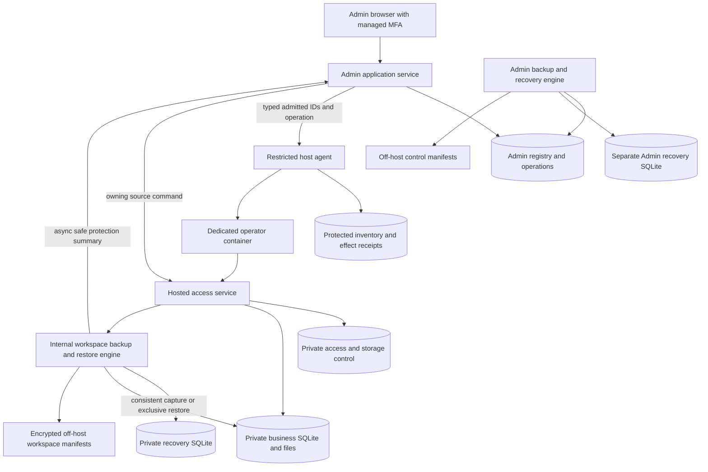

# HOSTED-001 H01 — Baseline, ownership and deployment contracts

Status: H01.1–H01.7 contracts/scaffolding and focused validation delivered; ready
for contract-review handoff. Fresh hosted runtime/deployment acceptance is not established.
See the [pinned H01.1 evidence report](../qualification/reports/HOSTED_MVP_H01_1_BASELINE_2026-11-10.md)
for current-code reassessment, delivery ownership and focused regression results.
The [H01.2 evidence report](../qualification/reports/HOSTED_MVP_H01_2_RESOURCES_2026-11-10.md)
records the unavailable scaffolds and initialization/packaging handoff.
The [H01.3 evidence report](../qualification/reports/HOSTED_MVP_H01_3_CONTRACTS_2026-11-10.md)
records bounded values, semantic hash vectors and pure original-outcome comparison.
No fresh hosted runtime or deployment is established. Implements the H01 design obligation in the [hosted MVP slices](mvp/delivery-plan.md#implementation-slices).
The [database schema master](../../database/README.md) owns all table/column definitions.
This document owns use-case boundaries, initialization/order, interfaces and proof tasks.

## Scope and deliverables

H01 establishes contracts before H02 starts container/host integration. It covers the
complete data model needed through H06, with implementation owned by H02–H05. It does
not require Stripe, an orchestration scheduler, paid recovery, idle-wake or portal tables.
No code change is authorized by this design-writing task itself.

| H01 deliverable | Completion evidence |
| --- | --- |
| Current-code inventory | Exact current paths/behavior and reuse/replace/new decisions below, pinned to implementation-start commit in the eventual proof report. |
| Store ownership and schema | Reviewed master dictionary/ER diagrams, explicit persisted versus generated facts, resource initialization and source/restore authority. |
| Typed deployment/application contracts | Validated IDs, revisions, fences, effect identities and bounded outcomes described below; proposed OpenAPI/CLI types implemented in their owning slices. |
| Proof specifications | Reproducible harness requirements, observations and pass/fail criteria for storage/backup/identity/packaging; implementations/results supplied H02–H05. |
| UI contract | Admin-lite and operator states/actions with async/loading/conflict behavior, delivered H03/H04; no UI deferred to a separate backlog. |

Design defaults introduced here (for example Admin session duration, transient record
retention and bounded JSON sizes) are explicit engineering choices for the pilot, not
claims that the existing runtime already enforces them. Change them in the master and
relevant tests together if qualification shows a need.

## Current implementation assessment

| Existing boundary | Evidence | H01 disposition |
| --- | --- | --- |
| Hosted source config | [configuration.py](../../../application/apps/server/app/modules/hosted_access/application/configuration.py) | Existing `hosted_demo`, eight-hour sessions and 250 MiB loop-image budget are old release assumptions. Replace with the fresh hosted composition, its session policy and Free 50 MB allowance. Operators remain active unless Admin explicitly disables or retires them. No old deployed-data migration is required. |
| Hosted schema/session store | [schema.py](../../../application/apps/server/app/modules/hosted_access/infrastructure/schema.py), [session_store.py](../../../application/apps/server/app/modules/hosted_access/infrastructure/session_store.py) | Per-workspace hosted-access store, despite older “administration” naming; not a central Admin registry. Reuse private-file/schema validation, generation/session and transaction concepts. Move all schema definitions to `application/database/hosted-access-migrations/`; runtime modules only invoke resources, bind tables and validate the store; H03 adapts from pending manual enrollment to verified invitation/claim. |
| Identity adapter | [cloudflare_identity.py](../../../application/apps/server/app/modules/hosted_access/infrastructure/cloudflare_identity.py) | Older Access identity is not the central Google/email-link target. H03 adds qualified managed proof/handoff and keeps explicit operator actor/context checks. |
| Storage admission | [storage_budget.py](../../../application/apps/server/app/modules/hosted_access/application/storage_budget.py) | Reuse fail-closed admission/error and cleanup concepts. Existing in-memory reservations/physical volume constants do not implement reproducible logical Free usage or crash-safe reservations. H04 adds source-bound accounting; H02 proves physical enforcement. |
| Recovery publication | [recovery_publication.py](../../../application/apps/server/app/modules/hosted_access/infrastructure/recovery_publication.py) | Existing private JSON ledger/upload checks are inputs, not proof of unattended keys, new catalog, consistent incremental retention or full control-plane recovery. H05 qualifies and implements the new boundary. |
| Business schema | [baseline](../../../application/database/sqlite-migrations/versions/0001_initial_schema.py), [env.py](../../../application/database/sqlite-migrations/env.py) | Preserve domain authority and packaging pattern. H01 proposes no business table changes; billing/auth remain outside it. |
| Runtime/deployment | [earlier systemd template](../../../application/deploy/hosted-demo/epm-hosted@.service), [hosted bootstrap](../../../application/apps/server/app/bootstrap/hosted_access.py) | Old deployment is reference only. H02 adds pinned Docker/private persistent mounts/registered-host gateway; do not expose existing loopback composition by relaxing middleware. |
| Existing UI/tests | [hosted session UI](../../../application/apps/web/src/app/hosted-session.tsx), [hosted tests](../../../application/apps/web/tests-hosted) | Reuse safe session-change/draft fencing patterns; tests are regression inputs, not evidence that new login/roles/containers pass. H03/H04 add new fixtures/browser proofs. |

No central Admin module/schema, Docker control plane or hosted-MVP release is established
by the code inventory. New proposed resource paths are identified in the master rather
than linked as if they already exist.

## Schema definition placement

Accepted H02 decisions refine the structural handoff: H02 delivers the complete
main-Admin baseline/FK closure and inventory baseline; H03–H05 retain owning application
behavior/population and access/recovery resources. See the [H02 decisions](HOSTED_MVP_H02_DESIGN.md#resolved-design-decisions)
and [schema catalog](../../database/README.md). H01 scaffold evidence remains unchanged.

All executable schema definitions belong under `application/database/`, using the
separate resource sets in the [schema master](../../database/overview.md#required-schema-definition-location).
Application/agent modules must contain no inline schema DDL, table-creation operations,
ORM `create_all` or alternate initialization fallback. Existing database Alembic Python
revisions remain a valid resource format. Runtime adapters consume those resources;
this design document and the master dictionary describe them without becoming a
second executable definition. Acceptance must verify fresh/test/package initialization
uses the same owning resources and no competing runtime schema creator remains.

## Development versus production composition

Follow the [portal deployment matrix](mvp/scope.md#development-and-production-deployment-boundary): Admin, Operator, Tenant and Owner all support local development; production Admin/Tenant/Owner are hosted-only, and production Operator supports hosted and local use. Development uses separate synthetic stores and explicit local test origins/identity adapters. It does not merge Admin/access/business schemas, reuse production credentials or bypass production actor checks. H02/H03 define executable local development setup; later portal designs add their own local launch/fixtures. Production local registers only Operator routes; reject attempts to enable hosted roles or development adapters there. H01 defines this contract without implementing development tooling.

### Development environment handoff to H02

Routine hosted-container development uses Docker Desktop on the Mac; native Python/Vite
Operator development remains supported. Retain Lima `epm-quota-test` separately for
native ext4/kernel/sandbox/reboot qualification, stopped when unused. Preserve its
recorded baseline before any Docker/kernel/tool installation and record/requalify the
changed environment. H02's detailed design owns build/launch settings, any lab changes
and the Docker-specific qualification plan; this decision does not implement them or
permit replacing Linux/GCP evidence with Desktop-only tests. See the [current reuse
guide](../qualification/HOSTED_PROJECT_QUOTA_REUSE.md#development-versus-native-qualification).

## Trust and persistence composition

The host agent is privileged only for allowlisted operations against protected roots.
It does not read property/tenant records or receive a generic shell argument. The public
Admin process has neither Docker socket nor direct access to operator databases. The
source may expose a private authenticated command endpoint/Unix socket, pinned by
inventory; it is not an operator-browser route or public capability. Exact private
transport/peer authentication is a required H02/H03 proof result before use.

Admin desired enablement, source effective enablement, managed identity and physical
resource readiness are separate facts. One disable increments the source epoch; stale
claim or provision completion cannot undo it. Registry observation follows source receipt.
No distributed transaction is claimed between any of these stores.

## Internal backup and recovery boundary

Normal backup and restore execute in the operator service. Recovery SQLite is a separate
persistent private file outside the business tree, initialized/validated without business
schema opening. It owns operation identities, checkpoints and verified point/restore
records. Access/session storage remains separate; none is rolled back with business data.
Admin stores only async protection observations plus its own control-plane backup state;
no central transaction is required for routine workspace backup/restore. The master schema
defines exact tables/columns and resource ownership.

Restore obtains an exclusive gate, drains/closes business connections, preserves the
prior tree and validates a separate target before a recoverable in-volume locator switch.
A damaged DB can be preserved as forensic pre-state, not falsely labelled a verified point.
If the service cannot start, repair/recreate the runtime with its private data/control
retained, then require fresh operator authentication. No offline workspace restore or
decrypt/export command is included; damaged auth/control fails closed. H05 must
specify phase/switch crash recovery, identity checks, scoped key/object permissions and
local-versus-hosted backup adapters in its detailed design before implementation.

The failure-recovery path is [clean-runtime rebuild, then authenticated restore](mvp/recovery.md#clean-runtime-rebuild-then-authenticated-restore). A retry-safe Admin/host **Repair runtime** operation replaces only a stopped/fenced container with a compatible qualified image; retain operator/workspace IDs, account/tier authority, business tree, private access/recovery stores and protected key references. It must not initialize an empty business DB, seed data, allocate a new operator identity or bypass current authentication. Bootstrap recovery mode, revoke old sessions and let the operator select/confirm a verified point into a separate empty staging directory. Repair and restore have different actors/operations. If trusted identity or backup/key material is unavailable, stop rather than recreate authority or overwrite data.

H05 restore enablement requires the [recovery security gate](mvp/recovery.md#recovery-security-release-gate): current operator identity, qualified strong step-up, exact-action confirmation, source-selected own-workspace destinations/keys and no recovery-specific plaintext export. An Admin session, replayed request or ordinary stolen cookie alone must not authorize restore. If the required proof/review is incomplete, keep restore unavailable. Fully compromised host/platform authority remains a disclosed residual risk; no zero-risk claim.

## Separate Admin recovery schema and bootstrap

The [Admin recovery database](../../database/admin-recovery.md#admin-recovery-database--h05) is
a separate private persistent store, not tables in main Admin. Its versioned resources
live in `application/database/admin-recovery-migrations/`. H01 defines ownership and
record contracts; H05 implements catalog, checkpoint, local recovery operations/audit,
recovery-mode UI and main-Admin-DB-independent authentication. Main Admin stores remain
ordinary assignments/settings/operations and do not authorize their own restoration.

The same Admin service can run normal backup and minimal recovery mode without opening
the main Admin DB. Resolve current privileged recovery authority from separately
protected bootstrap configuration and qualified strong managed MFA/step-up, not an old
session or restored Admin principal row. Current authority failure is a hard stop. Local
FKs join recovery records only; logical Admin/principal/release/inventory references
are validated through protected bindings/ports. Audit and original recovery operation
commit here even while the main DB is unavailable. Restoring it never replaces this
store, automatically activates old roles/jobs or recreates sessions.

The Admin artifact compatibility manifest pins both main-Admin and Admin-recovery
schema revisions. Initialization/bundling validates them independently; no extra VM or
service is implied. Platform-loss recovery uses off-host verified manifests, key custody
and an explicit protected bootstrap; reconstruct missing recovery metadata with prior
operations inert. Restricted platform tooling may use the same engine under exclusive
ownership; this does not reintroduce an offline customer-workspace restore/decrypt path.
H03/H05 must design/rehearse current recovery-principal verification, corrupt-main-DB,
corrupt-recovery-DB, crash-during-switchover and whole-host loss before enablement.

## Independent release contract

Admin, Operator and future Tenant/Owner releases are separate qualified artifacts with
independent assignments in the common component_deployments table: per-workspace
Operator rows and deployment-wide Admin/Tenant/Owner rows. Operator identities do not
store a second desired release. See the [release policy](mvp/releases.md#independently-scheduled-release-upgrades)
and master release tables. H02 must package Admin and Operator separately, with pinned
API/schema/agent compatibility manifests, even while Pilot 0 uses one maintenance
window. H10 adds independent rollout automation; portal backlogs add their own assets.
Shared business services remain one writer per workspace; an asset-only portal release
cannot migrate or restore the business DB. Unsupported component/runtime pairings are
rejected before deployment, not fixed through an implicit upgrade of every portal.

## Contract families and operation outcomes

Every consequential command carries deployment/operator/workspace IDs, original
operation ID/key, canonical semantic request hash, expected owning revision, access
epoch and typed action parameters. The receiver resolves resources from protected
bindings. Canonical hash includes all consequential parameters and excludes volatile
transport timestamps. Changed intent under a reused key returns a conflict.

| Owner/port | Allowed Pilot 0 commands and observations |
| --- | --- |
| Admin application | Create operator assignment; start/inspect supported provision; repair a failed runtime while retaining identity/data and no business initialization; reissue invitation; inspect usage/readiness; disable/enable with fresh checks; explicit identity rebind; prepare/confirm retirement; observe workspace protection summaries; repair runtime availability without bypassing operator recovery authorization; confirm platform/control restore; record announced maintenance. Creation defaults Free/empty and pins one qualified release. |
| Restricted host agent | Reserve/prepare registered resources; initialize/start/stop admitted container; inspect ownership/mount/image/ceilings; apply qualified limits; stage/switch/retain registered restore target. Retire cleanup requires explicit reviewed resource IDs and proof. No request chooses a path, image tag or command line. |
| Hosted source | Initialize disabled binding; inspect readiness/effective epoch/usage; apply verified claim/enable; disable/revoke; apply maintenance fence/drain; report original operation; verify restore binding. No direct Admin SQL. |
| Login boundary | Validate managed identity and invited assignment; consume invitation; issue/redeem browser/origin-bound handoff; issue/revoke source session. Only hashed capabilities are retained. |
| Operator recovery port | List only own eligible verified points; preview consequences, recent-authenticate and confirm exact point/workspace; admit/query original restore operation. Handled by the internal operator service against its private recovery store, including minimal recovery mode. No Admin privilege, alternate point substitution or exposure of another workspace; local mode retains its supported loopback/OS-owner boundary. |
| Internal backup/recovery engine | Owning operator service schedules consistent workspace capture, encrypts/uploads/verifies manifests, commits its private recovery catalog/checkpoint and runs authorized separate-destination restore. Minimal recovery mode does not bootstrap the business DB; Admin DB/service availability is not required. |
| Admin backup/recovery engine and restricted platform tool | Own main Admin/inventory/config protection through a separate Admin recovery DB, with local catalog/checkpoint/operation/audit and current bootstrap/MFA authority independent of the main DB. Minimal recovery mode does not open a damaged main Admin DB; platform tooling covers service/host failure under exclusive ownership. No cross-store FK, main Admin transaction dependency or customer-workspace restore authority. |

Responses distinguish pending, running, needs_attention, unknown, succeeded and failed;
include current revision, original operation ID and safe action-required code. A timeout
is unknown until effects/receipts are reconciled. Matching retries return the original
identity/result; they do not run another seed, allocate another directory or resend a
claim token. API mapping uses shared problem contracts: 413 oversized content, 409
stale/semantic conflict, 401 unauthenticated, non-disclosing authorization denial,
503 unavailable authority and owning quota-admission errors; retain entered data.

Read projections use bounded 50-row cursors, captured as-of/freshness and independent
section availability. Admin list reads registry/verified projections in set-based queries,
not one synchronous source call per operator. A requested source refresh is async and
returns operation identity/status; unknown usage is not zero. Do not store process-wide
locks or browser polling as authority.

## Provisioning, claim and disable sequence

1. Admin with recent verified MFA reviews operator name, exact email, available public
   slug, support contact, Free allowance, qualified release and empty/optional synthetic
   portfolio. Record `initial_data` and any seed bundle/version in the immutable provisioning
   request/hash, not on the operator row. Validate unique identity/slug and current capacity-qualified
   admission commitments. Five is an initial proof/adoption target, not an admission cap;
   serialize pending/unknown commitments against the qualified profile and spend envelope. After enablement, starting data does not distinguish operator behavior.
2. Admin transaction writes the operator identity, workspace-scoped Operator release
   assignment in component_deployments, original operation and audit. Source access
   remains disabled; UI returns Pending. Supported tool receives the original operation
   ID, resolves registered resources and records host receipts around observable effects.
3. Initialize schemas in private destinations. Pin effective Free policy, source epoch
   and release/bindings, then initialize business data. Optional synthetic seed wraps
   `application/demo/seed.py`; failure remains disabled/Needs attention for explicit
   inspection/cleanup/reseed, not an automatic seed-stage journal/replay engine.
4. Verify ownership/isolation, source contract/schema, exact routing and initial off-host
   recoverability. Admin-lite may supervise/record this completion through the source
   command. It must not edit an active flag in a database to bypass checks.
5. Send single-use invitation. Exact verified issuer/subject claims the intended assignment.
   Source enables only at the current epoch after readiness proof, records receipt and
   audit; central setup state reflects that result. Normal verified claim needs no second
   manual identity approval. Interrupted cross-store completion stays pending/unknown.
6. Explicit Admin disable increments/fences source authority and revokes its sessions.
   Propagate/reconcile the observed result centrally. An active cookie cannot override
   disablement; if source cannot confirm, fail closed and keep the unknown operation
   visible, using supported ingress/host fencing for immediate containment.

Full provisioning automation/worker claims arrive H07. Pilot 0 still uses durable
operation identities and source receipts so manual retries cannot duplicate effects.

## Pilot UI delivery contract

H01 defines these states; H03/H04 implement and test the actual screens:

- Admin list: operator, slug, setup/effective access separately, Free allowance/usage
  and freshness, backup age, release and original operation status. Pending is not
  “active”; inaccessible/stale data is not a healthy checkmark.
- Add operator: the reviewed fields above; no account expiry/read-only/demo-mode
  choices, no paid checkout. Show Free 50 MB explicitly. Disabling a button during
  submission is convenience; command identity/revision is the actual duplicate guard.
- Detail: readiness checks and safe supported retry/status lookup, controlled invitation
  reissue, disable/enable and recovery/maintenance actions with appropriate confirmations.
  No arbitrary shell, path editor or direct Docker controls. Background updates preserve
  form values, focus and scroll; list selection is keyboard accessible.
- Operator Settings: Free pilot, usage/freshness, backup protection/status, support and
  announced maintenance, plus scoped backup selection/restore preview/recent-auth confirmation/progress and minimal recovery mode when business startup fails. Internal execution is the normal path; container/host failure offers runtime-repair assistance; restore remains unavailable until current operator authority is established, with no offline bypass. No Admin approval step. No Stripe/upgrade purchase, personal update schedule or idle
  wake page. Multiple devices have full business permission within source fences.

## Proof plans and remaining implementation gates

[Imported project-quota qualification inputs](../qualification/HOSTED_PROJECT_QUOTA_REUSE.md) are available for H02 design. Reuse is selective: low-level primitives/sandbox/harness and original reports only. Current source differs from three historical pins; re-prove the complete boundary under Docker/GCP before runtime activation.

| Proof | Reproducible setup and pass criteria | Owner |
| --- | --- | --- |
| [Image/schema packaging](../qualification/specifications/image_schema.md) | Build separate immutable Admin/Operator artifacts from pinned source; inspect their compatibility manifests and owning schema resources/frontend assets, no secrets/live workspaces. Fresh-init every store, validate exact revision/structure; reject missing/wrong schema rather than silently recreate. | H02 |
| [Private runtime/physical limits](../qualification/specifications/runtime_limits.md) | Two test operators on qualified filesystem; attempt cross-mount/API/host escape and byte/inode exhaustion including WAL/staging/control/scratch. Record actual quota mechanism, ceilings, ownership, kernel/filesystem version and safe failed-write rollback. Warm-container memory/IO headroom measured for the admitted population, initially targeting five. | H02/H04 |
| [Identity/handoff](../qualification/specifications/identity_handoff.md) | Test managed Google/email-link subject, fixed callback, browser/state/origin binding, duplicate claim/handoff, revoked assignment and Admin MFA. Verify no tokens in URLs/logs and cross-subdomain cookie/CSRF isolation. | H03 |
| [Usage accounting](../qualification/specifications/usage_accounting.md) | Fixed committed DB/file fixtures, duplicate content, retained versions, freelist/WAL, interrupted reservation/source commit and restart. Compare exact logical allowance with separately observed physical reserves; unknown cannot admit unbounded writes. | H04 |
| [Recovery](../qualification/specifications/recovery.md) | Internal scheduled capture, unchanged/file-only/commit-before-crash checkpoint reconciliation, Admin outage, corrupt-business-DB recovery-mode startup and crash-safe locator switch; clean-runtime rebuild preserves IDs/account/data and requires fresh operator-selected restore; strong-step-up confirmation and rejected stolen-session/cross-workspace/replay/path/key attacks; runtime/auth failures remain closed with no offline customer restore/decrypt command; nightly consistent database/file fixtures with changes; off-host readback, missing/corrupt object and unavailable key; separate main-Admin/Admin-recovery DB loss and whole-host restore with old source fenced, local recovery evidence retained and current privileged authentication independent of the damaged main DB and no permanently running outside recovery service. Record achieved point age, duration, retained bytes/traffic and outside-host recovery inputs. | H05 |
| [Operations/economics](../qualification/specifications/operations_economics.md) | Manual add/retry/seed failure, one maintenance window, restart and support rehearsal. Capture original effect identities, Admin minutes and gross before-credit cost; no billing/wake scheduler required. | H04–H06 |

Select the supported host quota mechanism and physical reserve sizes only from the
native proof; no per-operator OS/image is needed solely for a storage tier. Prefer a
proven encrypted incremental/deduplicated backup mechanism, but require a component
proof of consistent capture, key custody and bounded retention/traffic before selecting
it. Identity/email quotas, private transport and provider permissions are actual setup
inputs to qualify, not assumptions that this document has already validated. None blocks
starting the schema/contracts work; all block live admission at their relevant slice.

## Ordered H01 implementation plan

Status: H01.1–H01.7 delivered at contract/scaffold level; H01 review acceptance and H02–H05 feature proofs are not asserted. Execute H01.1–H01.7 in order; these are work units
within H01, not new backlog items. Keep them in one cohesive change where practical,
with separately reviewable commits if needed. H01 is complete when its contracts,
resource scaffolding and proof specifications are executable/reviewable. It does not
complete any H02–H05 feature or authorize a live deployment.

### H01.1 — Pin the implementation baseline and ownership inventory

Delivered November 10, 2026: [baseline, hashes and ownership checklist](../qualification/reports/HOSTED_MVP_H01_1_BASELINE_2026-11-10.md).
Only inventory/evidence work is complete; later contract and feature gates remain open.

Record the implementation-start commit, clean/dirty state and relevant source hashes
in a new H01 evidence report under `docs/hosting/qualification/reports/`. Recheck every
current-code assessment above against that checkout; record reuse, replacement and new
work without importing the older Admin stack. Link the existing quota import manifest
and preserve historical reports unchanged.

Produce an ownership checklist linking each proposed store, command family and UI
state to its H02, H03, H04 or H05 delivery owner. Use the master dictionary's table
headings as the schema checklist; do not copy column definitions into this document.
Identify existing hosted-access tests that will require replacement when H03/H04
change the old schema/session policy. Leave existing local behavior operational.

Exit: all Pilot 0 contracts have one owner; missing implementation is explicitly
listed rather than inferred from old tests or the imported `hosted_admin` namespace.

### H01.2 — Establish independent schema-resource scaffolding

Delivered November 10, 2026: [resource and failure-contract evidence](../qualification/reports/HOSTED_MVP_H01_2_RESOURCES_2026-11-10.md).
All five resource sets remain deliberately unavailable for initialization; no owning
tables, production runner, resource packaging or runtime rewiring is delivered here.

Under `application/database/`, create the proposed `admin-migrations/`,
`admin-recovery-migrations/`, `host-inventory-migrations/`,
`hosted-access-migrations/` and `recovery-migrations/` resource scaffolding, with
documented per-store configuration/runner and packaging requirements. Keep the
existing business resources unchanged. Each store needs its own version namespace,
connection ownership and initialization contract; none may attach another store to
simulate a cross-store transaction.

H01 scaffolding must not install an empty baseline, stamp a revision or report a
store as initialized before its owning tables/constraints exist. Specify the missing
resource outcome explicitly. H02–H05 supply executable baselines, schema-derived
structural checks and data initializers according to the master table ownership.
The existing inline hosted-access schema is replaced atomically with its consuming
adapter/tests in H03/H04, rather than partially rewiring it during H01.

Specify initializer behavior for a new destination, an already matching store,
wrong-store/revision/structure, interrupted initialization and missing resources.
Separate creating an empty schema from inserting protected deployment identity,
Free policy, release assignments or sessions. Initialization must never invent a
workspace/operator identity or grant access. No deployed-data migration is included.

Exit: resource ownership/layout and failure semantics are testable; no second DDL
authority or automatically enabled hosted composition is introduced. Table delivery
and actual fresh-store proofs remain H02–H05 acceptance obligations.

### H01.3 — Implement bounded shared values and operation envelopes

Delivered November 10, 2026: [contract implementation and focused evidence](../qualification/reports/HOSTED_MVP_H01_3_CONTRACTS_2026-11-10.md).
These are shared values and pure comparison helpers, not durable deduplication,
owning action payloads, authorization or production transport integration.

Add a small consumer-neutral hosted-contract package under
`application/apps/server/app/platform/` for the values genuinely shared across owners:
canonical IDs, revisions/epochs, operation identity, request hash, component name,
bounded status/error codes and cursor/freshness envelopes. Keep action payloads and
authorization decisions in their owning application modules. These types must not
import FastAPI, ORM repositories, Docker or cloud clients.

Define canonical semantic hashing with fixed test vectors: stable object-key order,
validated normalized values and explicit absent/null handling; preserve meaningful
array ordering and exclude only declared volatile transport metadata. Every action
must enumerate its consequential fields. Include release, initial-data/seed identity,
scope and expected fences where consequential; never hash arbitrary caller JSON as
an authorization decision. Do not persist secrets in envelopes or fixtures.

Test pending/running/needs_attention/unknown/succeeded/failed outcomes, original-result
lookup and semantic conflict. Reuse shared API problem mapping rather than creating
another HTTP-status policy. Transport timeout is unknown, not a fabricated failure
or permission to repeat an effect.

Exit: strict value/result validation and hash/retry contract tests pass, without
claiming a durable operation repository or actual host-effect deduplication exists.

### H01.4 — Define owning application ports and compatibility manifests

Delivered November 11, 2026: [typed-port and compatibility evidence](../qualification/reports/HOSTED_MVP_H01_4_PORTS_2026-11-10.md).
No production adapter, authentication proof, schema readiness or effect deduplication
is established by these contract fixtures.

Define typed command/observation protocols in the owning application boundaries for
Admin, restricted host operations, hosted source, login, operator recovery and Admin
recovery. Describe inputs, actor requirements, expected fences, safe outcomes and
original-result lookup for every Pilot 0 command listed above. Use deterministic
in-memory test doubles only for contract tests; do not expose placeholder production
routes, runnable recovery commands or a generic shell/path parameter.

The host contract accepts admitted resource/image IDs; protected inventory resolves
paths, project IDs and immutable images. Keep workspace recovery operator-authorized
and Admin recovery separately privileged. An Admin protection projection cannot be
used as the operator's recovery catalog or restore queue.

Define a versioned compatibility-manifest contract for separate Admin/Operator
artifacts and future Tenant/Owner artifacts: component identity, immutable artifact
digest, API/agent compatibility and owned/readable schema revisions, including separate
Admin recovery. Validate per-workspace versus deployment-wide assignment scope.
Represent unresolved native/provider qualification as unavailable evidence, never a
default approval. H02 owns real packaging and private transport authentication.

Exit: consumer/provider contract fixtures validate without cross-store access;
unsupported pairings and caller-selected paths/images fail before effect dispatch.

### H01.5 — Specify proof inputs, reports and packaging handoff

Delivered November 11, 2026: [proof specifications and report/harness evidence](../qualification/reports/HOSTED_MVP_H01_5_PROOFS_2026-11-11.md).
The [six proof specifications](../qualification/specifications/README.md) cover all
families above; executable report validation does not perform target qualification.

Create reproducible proof specifications under `docs/hosting/qualification/`, linked
from the acceptance register. Each specification names setup, safety prerequisites,
exact invocation interface, workload, negative controls, expected observations and
cleanup/retained-failure rules. Specify a common report shape with source/tool/image/
schema pins, environment, actual result, evidence references and remaining limits.
Unrun/native-unavailable checks must remain distinguishable from passes.

H01 may add report-validation tests and non-privileged harness entry-point scaffolding;
it must not run destructive/native quota experiments, alter the retained Lima VM or
provision GCP resources. H02 adapts the imported quota harness after its detailed
design, then supplies new Linux/Docker/GCP evidence. H03 owns managed-identity proofs,
H04 accounting proofs and H05 encrypted backup/key/restore proofs.

Inspect the existing schema staging and installation verification scripts when
specifying packaging handoff: current staging copies only business resources.
Require a declared per-component resource set, matching manifest and rejection of
missing/wrong resources in H02. H01 does not claim that the current wheel or staging
script already packages the new stores, or change local installation behavior.

Exit: every proof in the table above has a reproducible specification and delivery
owner; the register still shows native/cloud/end-user acceptance as not established.

### H01.6 — Freeze UI/API state fixtures and delivery mapping

Delivered November 11, 2026: [fixture validation and delivery evidence](../qualification/reports/HOSTED_MVP_H01_6_UI_CONTRACTS_2026-11-11.md).
The [24 strict synthetic snapshots](../qualification/fixtures/README.md) and
[action-to-port mapping](../qualification/fixtures/ACTION_MAP.md) freeze states,
field defaults and UI delivery obligations, not rendered workflows or live grants.

Write strict synthetic contract fixtures for Admin list/add/detail and Operator
Settings/recovery states. Cover pending versus effective access, known/stale/unknown
usage, independent section loading/failure, unknown operation outcome, disabled
access, retained invalid form values and unavailable restore. Map each action to the
owning application command and its confirmation/authorization requirement.

Keep actual screens and browser acceptance in H03/H04, with recovery UI in H05.
No new H01 screen or separate UI backlog is needed. Record field defaults, bounded
list/cursor behavior and source-refresh-as-async-operation in fixtures so later UI
work cannot silently introduce synchronous per-operator polling or optimistic access.
No paid purchase, scheduler or idle-wake control appears in Pilot 0 fixtures.

Exit: fixtures agree with the master/H01 contracts and have named end-to-end delivery
owners; fixture validation alone does not mark any usable workflow complete.

### H01.7 — Validate, record evidence and hand off to H02

Delivered November 11, 2026: [consolidated validation and handoff](../qualification/reports/HOSTED_MVP_H01_7_HANDOFF_2026-11-11.md)
and [tested source/command pins](../qualification/reports/HOSTED_MVP_H01_7_VALIDATION_2026-11-11.json).
423 focused tests and Ruff checks for all 35 H01 Python files passed. This is ready
for contract review; no native/cloud/provider/browser acceptance or live capability
is established. H02 still needs accepted H01 contract review and its own detailed design.

Run focused tests for new values, manifests, port fixtures, report validation and
schema-scaffold failure behavior. Test doubles may prove local transaction contract
expectations; real per-store rollback/constraint/query-plan proofs remain assigned to
the owning baseline/repository implementation. Do not replace them with mock passes.

Run Ruff check and format check on every changed Python file using
`application/pyproject.toml`. If frontend source/tooling changes become necessary,
run lint, format check and typecheck from `application/`; otherwise record frontend
checks as not applicable. Check changed documentation links and schema/contract
ownership against the master. Run existing focused local/hosted regressions only
where imports or shared boundaries changed; broader tests require a concrete reason.

Publish exact commands/results and remaining gates in the H01 report, link it from
the acceptance register and update this document's status only to the level proven.
H02 can begin its detailed design once the H01 contract review is accepted; H02
implementation still requires its own completed design. No H01 test authorizes live
admission, restores, quota activation or billing.

## H01 acceptance and handoff

H01 design acceptance requires review of the master schema, source inventory and all
contracts above, with unresolved implementation proofs assigned to H02–H05. The H01
implementation handoff should create schema resource skeletons/typed contracts and
proof harness entry points as one cohesive change where practical; it must not claim
later feature implementations or native/cloud qualification from unit fixtures.

| Validation area | Required H01 contract/schema proof when implemented |
| --- | --- |
| Happy path | Free assignment and supported resource/readiness/claim result shapes validate. |
| Invalid combinations | Null policy, wrong IDs/epoch, forged path/role, wrong schema, invalid JSON/result and duplicate cross-tree project ID rejected. |
| Idempotency/retry | Canonical request hashes stable, changed payload conflicts, original effect lookup survives lost response. |
| Rollback | Owning transaction rolls record/audit/receipt back together; cross-store outcomes remain explicit unknown. |
| Persistence | Independent release/component assignments and allowed schema/API pairings validate; master matches initial schema resources/models/validators and exact current-store checks; protected bootstrap creates no operator/session automatically. |
| [Recovery](../qualification/specifications/recovery.md) | Local recovery metadata survives business replacement; Admin is an async observer, not workspace catalog/queue authority; internal/authenticated-recovery ownership and forbidden offline-bypass absence tested; schema/identity pins retained in manifests; sessions/enabled flags are not blindly revived; separate Admin recovery state/authentication survives main Admin replacement; keys/control pointer recover outside host and no cross-store FKs/old runnable grants are introduced. |
| Query budget | Indexed source session lookup; bounded Admin list/progress/catalog; no per-row source/provider call. |
| UI | Reviewable fields/states/error/action contracts; actual accessible async UI acceptance assigned H03/H04, not marked complete by H01. |

Update the master schema when these interfaces are implemented or refined; record
actual component/native/cloud results in the [acceptance register](../qualification/HOSTED_MVP_ACCEPTANCE.md),
not as hypothetical passes in this design. No backlog scope expansion or deployment
is performed by H01 documentation.
