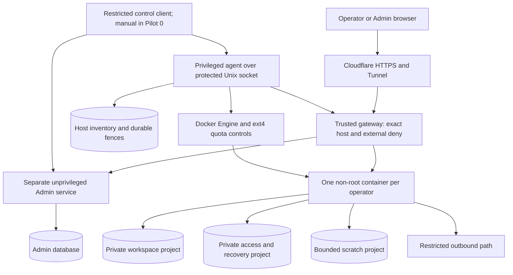

# HOSTED-001 H02 — Container, storage and gateway foundation

[Hosted design index](HOSTED_MVP_DESIGN.md) · [Topic guides](#topic-guides) · [Schema catalog](../../database/README.md)

Status: the infrastructure subset is delivered within its recorded component,
native Linux/Docker and GCP qualification scopes. Final hosted-release promotion,
managed identity, real admission/logical metering and recovery remain unavailable
until their owners complete the [remaining gates](../foundation/qualification-and-handoff.md#remaining-delivery).
Design decisions D1–D13 were accepted November 11, 2026. Qualification observations
are dated and source-pinned; they are not a current live-host inventory or an access grant.

Use this document for accepted architecture and boundaries. The
[foundation guides](../foundation/README.md) consolidate implementation, commands,
measured limits and evidence by topic. Schema dictionaries remain column authorities;
executable runbooks remain command authorities. The earlier ordered plan is
[archived](../archive/HOSTED_MVP_H02_PLANNING_2026-11-13.md), not a required reading path.

## Scope, dependencies and completion

H02 delivers reproducible separate Admin/Operator image candidates, a restricted
host agent, private persistent storage with native enforcement, registered-host ingress,
local development setup and source-pinned Linux/Docker/GCP evidence. It prepares H03
identity, H04 Admin-lite and logical metering, and H05 recovery. It does not deliver
those features early, a general scheduler, Stripe, paid tiers or operator scheduling.

H02 can pass its infrastructure subset without claiming that the complete hosted
release or every six-store packaging case passes. H03–H05 must finish their owning
schemas/assets and requalify the resulting images before H06 admission. Only synthetic
identities/workspaces are permitted during H02. Customer ingress stays held closed.

| Implementation source | Boundary |
| --- | --- |
| [H01 design/contracts](HOSTED_MVP_H01_DESIGN.md), `app.platform.hosted_contracts`, `modules/host_agent/application/contracts.py` | Shared values, manifests and scope/hash/outcome contracts support the typed ingress/fence/receipt boundary; type validation is not live authority. |
| [Schema resources](../../../application/database/README.md), `app.platform.schema_resources` | The owning resources implement the complete main-Admin structural baseline under D1 and the inventory baseline/runner. The other three hosted sets still reject initialization. Missing access/recovery resources stay explicitly unavailable until their owners deliver them. |
| [Selective quota reuse](../qualification/HOSTED_PROJECT_QUOTA_REUSE.md) | Ext4 primitives and adversarial workloads require new proof where imported pins differ; current scoped native/Docker/GCP results are indexed by topic. |
| [Old hosted composition](../../../application/apps/server/app/bootstrap/hosted_access.py), [configuration](../../../application/apps/server/app/modules/hosted_access/application/configuration.py) | Old expiry, `hosted_demo`, Cloudflare Access identity and loop-image assumptions cannot serve as the fresh composition. Do not expose local routes by relaxing transport middleware. |
| [Workspace runtime](../../../application/apps/server/app/modules/workspace/application/runtime.py) | Reuse writer-lock semantics; provide a protected stable lock location for hosted use. Its current parent-directory lock must not become an unbounded or changing path across business-tree replacement. |
| [Schema staging](../../../application/scripts/stage_schema_resources.py), [installation verification](../../../application/scripts/verify_installation.py) | Explicit per-component staging/verification and installed OCI/bundle checks; default local wheel installation remains business-only. |
| [Proof tooling](../../../application/apps/server/app/platform/hosted_proofs/models.py) | Strict report validators and explicit scoped build/native drivers exist. The generic executor and missing owning prerequisites remain unavailable. |

H01 review findings are recorded resolved in the current review file; H02 must retain
those regression checks. That does not qualify host isolation or authorize live admission.

## Host and service topology

Accepted qualification target: one standard, non-Spot Compute Engine VM, Ubuntu 24.04
LTS, Linux amd64, Docker Engine and cgroup v2; start measurement with 2 vCPUs/8 GiB,
a 20-GiB boot disk and a dedicated 50-GiB persistent balanced ext4 data disk. Disk
sizes are starting test inputs, subject to image/log/reserve measurements. Measured results are recorded in the runtime/capacity guide, not an
operator entitlement or permission to admit a fixed cohort. Use the region/zone/domain/account selected
in protected setup; record exact image, kernel, packages, architecture and gross cost.
Do not hard-code a prior demo VM/project. Never install from a moving image tag alone.

Use supported startup/cloud-init provisioning, not deprecated GCE container-declaration
startup tooling. Host setup may format only an explicitly identified, verified empty
new data device during a reviewed setup action. Add operator cannot format, remount
with changed features or enable filesystem features on an existing volume. Retain
the data disk across VM/container replacement; no automatic failover or second writer.

The public Admin process can persist admitted intent through its owning service; it
has no Docker socket or host filesystem access. The restricted control client resolves
that original intent through an Admin-owned authenticated port and invokes only typed
host commands. Pilot 0 permits explicit manual invocation; H07 adds automatic dispatch,
not a new resource authority. H02 qualification uses protected synthetic admission
inputs, never a public production bypass when H03 authentication is absent.

Systemd supervises trusted host components. The per-operator lifecycle owner is
also the restricted host supervisor: Docker automatic restart is disabled and every
start/restart passes its readiness checks. After mount, inventory or quota failure,
keep affected containers stopped/held and alert. D6 selects this single guarded restart
owner instead of an independent Docker restart loop. It is a bounded host guard,
not the H07 general provisioning worker or H11 sleep/wake scheduler.

## Images, entry points and local development

Build separate Admin and Operator OCI artifacts from pinned inputs, plus a pinned
host-agent host installation bundle. Reuse one Python/business source distribution
where useful, but use distinct launch compositions, assets, manifests and permissions.
No generic mode chosen by an HTTP parameter. Record per-platform digests; Mac ARM64
and Linux amd64 images are different proof subjects even from the same source.

Build compiled assets and schema resources in build stages. Final images contain
only declared runtime files and dependencies: no checkout, `.git`, test corpus,
workspaces, synthetic seed output, credentials or runtime compiler. Verify installation
from outside the checkout. Pin Python/dependency/base-image versions compatible with
the actual source syntax, rather than relying only on the broad package minimum.

Admin owns Admin resources; Operator owns business/access/recovery resources; the
agent owns inventory resources. Carry explicit missing/scaffold state for undelivered
resources; do not stamp pretend versions or promote an image with an unavailable
required store. H02 can build candidates with unavailable capabilities; complete
manifest/startup qualification is rerun on later owning-slice artifacts. No placeholder
Admin frontend is presented as a usable Admin portal. Separate health-only composition
from normal application startup, which must validate its actual owned stores.

Production local Operator retains its existing wheel/native launch and local security
boundary. Hosted launch uses explicit protected bindings and never falls back to a
local empty workspace or the old hosted-demo configuration. Until H03 is ready, hosted
business routes are externally denied, including on test hostnames reachable publicly.

Routine development uses Docker Desktop and synthetic fixtures; production adapters,
credentials and data are absent. Only explicit development composition may supply
simulated identity/control adapters. Use the retained Lima `epm-quota-test` for native
ext4/sandbox/reboot tests, stopped when unused; preserve its recoverable baseline before
Docker/kernel changes. Final qualification must also run on the actual Google host.

## Private directories, identities and resource limits

One host filesystem provides separate protected project trees, not an OS or disk image
for each operator. The protected host root, agent inventory and ingress state are not
mounted into Operator containers. Actual root paths are protected deployment inputs under a
host-owned data mount; names below describe roles, not browser-selectable paths.

| Mount or resource | Owner and enforcement |
| --- | --- |
| Workspace tree | Only that operator's runtime UID; business database, retained files and bounded business-local working files. Project byte/inode ceiling includes qualified physical headroom beyond Free logical allowance. |
| Control tree | Same owning operator, private from siblings; access/recovery stores and a stable runtime lock outside replaceable business data. Separately reserved bytes/inodes; never restored with business records. |
| Scratch tree | Same operator, bounded temporary files/uploads/export staging; retention/cleanup by owning services, no unlimited `/tmp` fallback. |
| Container image/root | Read-only image; no writable package cache, source tree, host devices or root bind mount. Bounded tmpfs only where necessary, charged to memory capacity. |
| Logs/core dumps | Structured sanitized stdout with explicitly bounded host log rotation; disable core dumps. Shared log/Docker storage and retained image slots have host reserves. |
| Credentials | Only that component's required secrets through protected read-only delivery; no shared platform credentials in operator images/env dumps. Secret material is excluded from reports and exports. |

Allocate a unique non-root host UID/GID per operator; preserve it across replacement
and retain it until ownership-verified cleanup. Persist the mapping, rather than
hashing UUIDs into an unverified UID or giving all containers the same host UID.
No privileged/container-host namespaces, host network, host PID, extra devices or
Docker socket. Drop capabilities, set no-new-privileges, use a qualified AppArmor
profile and layered architecture-specific seccomp restrictions. The imported C ioctl
launcher depends on the old enclosing systemd allowlist; it is not sufficient alone.
Reproduce its intent with the actual Docker syscall profile and test alternate syscall/
compat paths, inheritance mutation and direct quota calls. Never use unconfined mode
as a compatibility fix. User-namespace remapping is a separate qualification decision,
not a silent addition to a proof made with direct UID mapping.

Set tested memory/CPU/PID/file-descriptor limits. Budget tmpfs, shared memory, logs,
WAL, live/deleted-open files, recovery staging and retained disabled allocations.
Reserve enough for the declared largest supported restore workflow, or expose recovery
unavailable rather than promise an unreserved destination. H05 validates actual restore
capacity; H02 must provide its reservation mechanism and measurement inputs.

No production physical byte/inode numbers are accepted solely from the old small
fault workload. The profile records rounded kernel ceilings, all reservations and
measurements; Free logical storage remains 50,000,000 bytes under H04 accounting.
Kernel quota rounding, operational headroom and downgrade overage are distinct from
advertised entitlement. Never substitute a post-write `du` scan for enforcement.
Production tier fit additionally requires [measured per-tier sizing](mvp/subscriptions-storage-and-runtime.md#per-tier-physical-storage-sizing-acceptance):
allocated-byte/inode peaks at full logical allowance, justified margins and independent
exhaustion/recovery checks at the proposed real limits. The existing synthetic trial
constants do not satisfy that gate; Free qualification remains with admission/recovery
before Pilot 0, and paid qualification precedes paid-tier activation.

## Network, IAM and external access enforcement

Use a dedicated user-defined bridge per operator, with no published operator ports.
The gateway is the only admitted inbound application peer; it has no data mounts or
Docker authority. Host firewall policy must cover Docker forwarding and both IP
families, not rely on host INPUT/UFW rules alone. Deny sibling-container, host-control,
Docker API and cloud metadata/link-local paths, including alternate names/addresses.
Route required HTTPS/DNS through a controlled outbound path with endpoint policy;
validate rebinding/redirect behavior. H03/H05 identify managed identity/backup endpoints.
The Operator's public slug does not grant private network access to another workspace.

Use a host-side cloudflared service with only its Tunnel credential and a private gateway
listener. DNS/TLS may cover flat wildcard names; the gateway still exact-allowlists
registered origins, rejects unknown/reserved hosts and validates Host/forwarded headers
at the trusted boundary. Preserve each original origin to the application. No shared
parent-domain session cookies, token-bearing cache entries or authenticated HTML/API
caching. H03 owns identity, CSRF and session validation; ingress routing is not login.

Use Caddy 2 as the gateway, running under its own unprivileged host identity.
The agent generates the complete registered-host routing projection and loads it
through a permissioned Unix admin socket; disable the default TCP admin listener.
Only cloudflared reaches the loopback HTTP listener. Caddy has neither data mounts nor
agent/Docker credentials. Failed configuration reload may leave the prior config in
place: verify the deny and stop/fence the affected container if it cannot be confirmed.
On reboot load a verified projection from protected inventory, not an independently
editable or blindly resumed autosave. The exact Caddy/package versions are proof pins.

Create scoped Artifact Registry, host bootstrap and secret retrieval permissions;
Operator containers receive neither VM service-account credentials nor cloud resource
administration. Block metadata access from their network, not merely omit a mounted
key. H05 must prove object/key scopes for each workspace: a shared broad R2 credential
plus a configurable prefix is not sufficient isolation. H02 reserves the delivery
boundary but does not claim backup-key qualification.

External deny is durable host-side state projected from admitted Admin authority and
independent of the Operator process. Start every new binding held closed. Ingress
states are held, eligible and blocked, with monotonic access fence and registered
origin/binding generation. Private ingress commands carry original effect identity;
source-local enabled flags and image labels cannot authorize ingress enablement.
H03 supplies verified claim/current source proof; H04 integrates Admin action/progress.

For disable: persist the newer deny, apply it to new/existing connections, verify it,
then reconcile source revocation. Stop/fence the container if terminating long-lived
access cannot otherwise be established. Uncertain effects stay pending/unknown;
confirmed containment with unavailable source is not full disable completion. For
enable: require fresh admitted Admin intent, current fences, ready resources and H03
source/identity proof before removing the deny. Restart reconstructs the last verified
protected projection; missing/corrupt/unverifiable authority stays closed. A temporary
Admin outage alone does not discard a valid existing projection, grant new access or
relax a deny. The privileged host remains trusted; no absolute anti-compromise claim.

Current network/service behavior, native platform evidence and remaining identity
boundaries are consolidated in [Networking and access](../foundation/networking-and-access.md).
Dated platform results retain their original pins; no network proof authorizes customer ingress.

## Persistence, operation identities and initialization

[Inventory dictionary](../../database/host-inventory.md) and
[Admin registry dictionary](../../database/admin-registry.md) remain column authorities.
Implement DDL only in `application/database/` through owning resource runners and
schema-derived validation, never runtime ORM creation or a competing handwritten schema.

| Store or contract | Accepted H02 delivery |
| --- | --- |
| Inventory | Implement `host_identity`, `operator_principals`, `resource_bindings`, `project_assignments`, `ingress_bindings` and `host_receipts`, constraints/indexes and protected initializer from the updated inventory dictionary. These own UID mapping, current ingress fences and child-effect retry evidence. |
| Main Admin | H02 delivers one complete Pilot 0 main-Admin structural baseline, including its FK dependency closure. H03/H04 keep identity/provisioning population and behavior; H05 owns workspace protection reporting. H02 initializes protected deployment metadata only; real qualified-release/assignment population waits for the owning artifact gates. No disabled FKs, operator/session seed or unavailable candidate inserted as qualified. |
| Access and both recovery stores | Keep owning baseline/init work in H03–H05. Package the available declared resource sets, explicitly flag unavailable ones and leave their aggregate qualification cases open. |
| Host commands | Add original parent/effect distinction, ingress command and matching-key lookup. Pin capacity-profile evidence and registered resource/image identities; do not reconstruct original intent from mutable config. |
| Compatibility | Candidate schema/feature availability is not a passed qualification. Inventory agent revisions are independently pinned even though the existing component manifest enum covers portals only. |

Host-effect identity: one Admin parent operation may have multiple stable
child effects. Derive a child ID/key deterministically from parent, kind, target binding,
generation and declared effect slot; never use one parent PK for every host action.
Persist parent reference, child key/hash, canonical non-secret request and pending receipt
before the effect; verify matching scopes/current fences. Matching retries return or
inspect the original effect, changed intent conflicts. Store a highest accepted access
fence outside receipt history so a previously unseen stale enable cannot evade checks.

Keep SQLite writes short: reserve IDs/UIDs/projects/receipt, commit, perform filesystem/
Docker/gateway work, inspect actual ownership and commit a verified result. Never hold
a DB lock across those effects. A crash between phases is unknown, not permission to
allocate a second resource. Deterministic labels are observations, not sole authority.
Inventory is the only allocation ledger; generated root-owned configuration is a
projection. Missing inventory must not be silently reconstructed by adopting arbitrary
containers or initializing an empty registry.

A fresh host initializer validates exact device/mount identity, permissions, quota
accounting AND enforcement, registered deployment and runner/schema identity. It seeds
host identity only from protected input, no operators/sessions or automatic synthetic
portfolio. Bind project inheritance/limits before granting the owning UID write access.
Validate same-store FKs and actual schema structure, not revision text alone. Existing
matching initialization is read-only; mismatch/partial initialization retains evidence.

A hosted stable writer lock lives in the control tree and is shared by every permitted
process that could open the business workspace, including qualification/provision tools.
One Uvicorn worker; no competing scheduler/service initializes or opens a second runtime.
Replacement stops and confirms the old writer is gone before attaching the same business
mount read-write to its successor. Preserve acknowledged data through container replacement;
health/readiness is not established merely by a running process. H05 later owns safe
restore switching, retained-state lifecycle and startup without a healthy business DB.

## Minimal UI and operational handoff

H02 supplies a safe gateway unavailable/maintenance page for known held workspaces:
plain status/support and bounded read retry, no command replay or infrastructure details.
Unknown hosts return a generic denial. Do not show account/setup completion based on
container liveness. Admin add/list/detail, usage UI and operator release projections
remain H03/H04; H02 returns typed observations for those consumers. Include keyboard,
contrast, mobile layout and light/dark validation if a rendered page is introduced.

Health inspection distinguishes process alive, correct mounts/quota, compatible stores,
held ingress, and later source/application readiness. Runtime failure and source authority
failure are separate conditions. Provide a protected inspect/status command with safe
output; no raw shell/paths to browser. Bound polling and remediation attempts, then
raise Needs attention rather than loop/recreate forever. Reconcile actual resource
observations after reboot before permitting writes; no idle-wake automation.

## Validation and evidence

Use [packaging cases](../qualification/specifications/image_schema.md),
[runtime cases](../qualification/specifications/runtime_limits.md) and the
[H02 reuse contract](mvp/implementation-contracts.md#h02-project-quota-reuse-contract).
Expand owning specifications for ingress, effect retries and cloud credential isolation;
version/pin revised specifications before running them. Keep old reports untouched.

| Area | Required proof |
| --- | --- |
| Happy paths | Two distinct synthetic operators; private initialized business fixtures, bounded resources, registered held routes, inspect/stop/replace; then measured warm population initially targeting five, not capped at five. |
| Invalid combinations | Wrong host/device/mount/schema, shared UID/project, missing limits, unsafe path/symlink, wrong image/component, stale fence, forbidden field/service/peer and public private-command access all reject before effects. |
| Idempotency/retry | Lost response at every host-effect boundary; same key/new proposed ID returns original identity, changed hash conflicts; stale unknown start cannot undo a later deny; no duplicate IDs/UIDs/projects/containers. |
| Transactions/rollback | Failed receipt/reservation commit causes no effect; later external failure stays explicit unknown/rejected; disk/inode/WAL/fsync errors preserve consistency and accounting. Do not claim cross-store rollback. |
| Persistence/schema | Owning fresh/read-only reinit/partial/wrong-store checks, actual constraints, root ownership, stale mapping denial, restart/replacement/reboot persistence of data, project limits and deny fences. |
| Backup/restore handoff | Preserve business/control and locks across replacement. Prove consistent synthetic snapshot/reattach and replay fences for inventory; H05 still owns encrypted off-host/whole-host and authenticated workspace restore. No customer offline restore tool. |
| Query/performance | Indexed binding/project/receipt lookup; bounded inspection, no whole-host recursive scan on every edit or synchronous source fan-out; record CPU/RSS/PIDs/latency/IO, log/image/tmpfs and byte/inode reserves under warm/adversarial workloads. |
| Isolation | Cross-UID/mount/network denial; ioctl/quota/inheritance/namespace escape, metadata credential access, direct-origin and forwarded-host spoof denial; local-field tampering cannot raise kernel ceilings or remove external denial. |
| UI/failure | Held/unavailable/unknown status, retained input/no replay, current-authority recheck after reconnect; internal IDs/proofs/diagnostics not exposed. Full browser workflows remain owning-slice gates. |

Execute component, native Lima, Linux Docker and exact GCP proofs separately. Reboot
means an actual guest/host reboot, not restarting a container. Preserve failed lab
trees and raw evidence privately; reports retain sanitized references and hashes.
Do not reuse the native pass after changing sources, image architecture, UID mapping,
seccomp, kernel, Docker or filesystem configuration without applicable requalification.
The evidence register distinguishes H02 infrastructure pass from unavailable later
schema/identity/recovery cases. No customer invitation until H01–H05/H06 gates pass.

## Resolved design decisions

All D1–D13 recommendations were accepted November 11, 2026. The issues that motivated
these decisions are resolved by the boundaries below. Exact package/source pins,
account/domain inputs and measured reserves remain implementation/qualification inputs;
accepting the design does not establish their results. H05 and H10 retain the detailed
work explicitly deferred to them.

| ID | Decision | Accepted implementation boundary |
| --- | --- | --- |
| D1 | Complete main-Admin schema dependency closure in H02. | H02 implements the complete Pilot 0 main-Admin structural baseline in its owning database resources, with all local FKs intact. H03/H04 own auth/Free-policy/operator population and application behavior; H05 owns recovery observations. H02 initializes protected deployment metadata only. |
| D2 | Separate infrastructure candidates from qualified hosted artifacts. | H02 records candidate images/manifests in protected build evidence, never as qualified release rows. Missing H03–H05 schema/assets remain unavailable. Later owners rebuild/retest/promote completed artifacts; real release assignments require qualified releases. The all-store packaging gate completes before H06, not by weakening H02 runtime validation. |
| D3 | Persist unique per-operator host principals. | `operator_principals` in inventory owns UID/GID allocation, retained across replacement/retired resources until verified cleanup. The protected host setup supplies a collision-checked allocation range. No hash-only mapping or shared host UID. |
| D4 | Persist external ingress authority and fences. | `ingress_bindings` in inventory owns per-workspace exact-origin/binding/fence state. Narrow apply/inspect commands generate and verify the gateway projection. New bindings are held closed; a source-local flag cannot authorize enablement. |
| D5 | Persist parent/child effect identity and immutable retry evidence. | `host_receipts` records parent reference, deterministic child ID/key/hash, canonical bounded request and verification. Unique kind/key identifies the original effect. Current access fences live independently in ingress state; cross-store transactions are never implied. |
| D6 | Use one guarded host lifecycle owner. | Systemd-supervised restricted host supervision owns all starts/restarts; Docker automatic restart is disabled. Mount/quota/inventory/deny checks precede starts, including reboot/health remediation. No competing restart loops or H11 wake behavior. |
| D7 | Qualify a concrete initial platform. | Ubuntu 24.04 amd64, Docker/cgroup v2, Caddy 2 with a protected Unix admin socket, and a 2-vCPU/8-GiB non-Spot VM with 20-GiB boot/50-GiB balanced persistent data disks are the starting qualification profile. Pin actual versions and refine reserves/sizing from measurements; ARM64 lab results are separate evidence. |
| D8 | Requalify the combined Docker sandbox. | Start with distinct direct host UID/GID mapping, dropped capabilities, AppArmor and layered syscall/ioctl restrictions. Native/compat escape tests precede activation. User-namespace remapping requires explicit new qualification rather than silently reusing direct-mapping evidence. |
| D9 | Derive physical limits and capacity from measurements. | Publish a versioned capacity profile covering workspace/control/scratch/inodes, retained allocations and backup/restore reserves. H04 owns logical admission; H05 completes restore/retention proof. Never copy small fault limits or equate Free's 50-MB usable allowance to a physical cap. |
| D10 | Defer restore staging/switch execution to H05. | H02 implements active bindings and runtime replacement only. Stage/switch commands fail unavailable without effects. H05 decides staging identity/constraint details while preserving access/recovery authority; reserve capacity now without claiming restore behavior. |
| D11 | Use a fresh hosted composition and stable control-tree writer lock. | Preserve local defaults; do not reuse old expiry/loop-image identity assumptions. Hosted ingress/normal startup stays held until owning H03/H04 requirements are delivered. No deployed-data migration. |
| D12 | Keep source and projection refinements with their owners. | H02 defines ingress/resource effects. H03/H04 implement missing applied-policy/rebind ports, safe release observations and external-deny acknowledgments. Projections are informational; operator scheduling schemas/APIs remain H10. |
| D13 | Qualify protected bootstrap/IAM/egress and secret boundaries. | H02 owns cloud/domain inputs, Tunnel custody, metadata isolation and scoped delivery; H03 owns identity and H05 owns off-host key/object scopes. No shared platform credential, production test bypass or customer admission before relevant proof. |

## Topic guides

| Topic | Current implementation and operating reference |
| --- | --- |
| Artifacts, resources and startup | [Packaging and launch](../foundation/packaging-and-launch.md): separate candidates, Linux dependency closure, installed verification, protected bindings and safe unavailable UI. |
| Persistence and restricted dispatch | [Inventory and host commands](../foundation/inventory-and-host-commands.md): owning baselines, initialization, retained UID/project allocation, immutable parent/child receipts, short transactions and peer-checked transport. |
| Private runtime and sizing | [Runtime and capacity](../foundation/runtime-and-capacity.md): project quotas, stable writer, sandbox, independent stop-only containment, measured workloads, reservations and logical-versus-physical limits. |
| Network and secret boundaries | [Networking and access](../foundation/networking-and-access.md): exact-host Caddy/Tunnel, dual-stack Docker forwarding, controlled egress, scoped IAM, protected credentials and closed service reconstruction. |
| Build, labs and host operation | [Development and host operations](../foundation/development-and-host-operations.md): Docker Desktop, retained Linux VMs, source custody, safe GCP setup/reboot and retained target details. |
| Proof and remaining delivery | [Qualification and handoff](../foundation/qualification-and-handoff.md): scoped validation matrix, retained failures, complete-report limitations and identity/admission/recovery ownership. |

## Completion boundary

The [acceptance register](../qualification/HOSTED_MVP_ACCEPTANCE.md#h02-consolidated-infrastructure-acceptance)
records delivered infrastructure evidence and open release gates. The foundation has
current-source native checks, earlier exactly pinned installed/reboot/network proofs,
measured two/five/six-runtime candidate capacity and a developer/operations handoff.
The qualification VM/disks are stopped and retained; positive business ingress and
operator admission remain disabled.

Whole-runtime and final image/all-store reports retain overall unavailable status
where later owning resources/workflows are missing or unrun. That is the accepted
infrastructure-versus-release boundary, not permission to invent schema versions,
qualified release rows or authority. Managed identity, Admin provisioning UI, logical
usage, encrypted recovery and scheduling do not follow from infrastructure delivery.
Final owners must rebuild and requalify their changed artifacts before Pilot 0 invitations.

Host setup distinguishes protected human choices (account/domain/credentials and
explicit blank-device confirmation) from reproducible tooling. Qualification runs
only against explicit disposable targets. Keep credentials, business data paths and
raw failures outside Git. The separately approved completed old-host reset is
historical evidence, not an ordinary setup or Add operator operation.

## Primary-source constraints checked

These sources constrain implementation choices; they do not certify this deployment.

- [Compute Engine containers](https://docs.cloud.google.com/compute/docs/containers): use startup scripts/cloud-init rather than the deprecated container startup agent.
- [Docker firewall behavior](https://docs.docker.com/engine/network/packet-filtering-firewalls/): account for Docker forwarding rules; host firewall defaults alone are insufficient.
- [Docker seccomp](https://docs.docker.com/engine/security/seccomp/): preserve a qualified syscall boundary rather than using an unconfined profile.
- [Caddy administration API](https://caddyserver.com/docs/api): protect the administration listener with a permissioned Unix socket; a failed load can retain the previous configuration and therefore needs independent deny verification.
- [Cloudflare Tunnel configuration](https://developers.cloudflare.com/cloudflare-one/networks/connectors/cloudflare-tunnel/do-more-with-tunnels/local-management/configuration-file/): a Tunnel ingress/catch-all configuration does not replace application host registration and access authority.
- [GCE metadata](https://docs.cloud.google.com/compute/docs/metadata/predefined-metadata-keys): the host's metadata/identity boundary must be isolated from operator workloads.

This design owns architectural boundaries and accepted decisions. The topic guides
link implemented code, executable runbooks and exact evidence; the schema catalog
owns field definitions. Documentation edits do not change runtime or deployment state.
