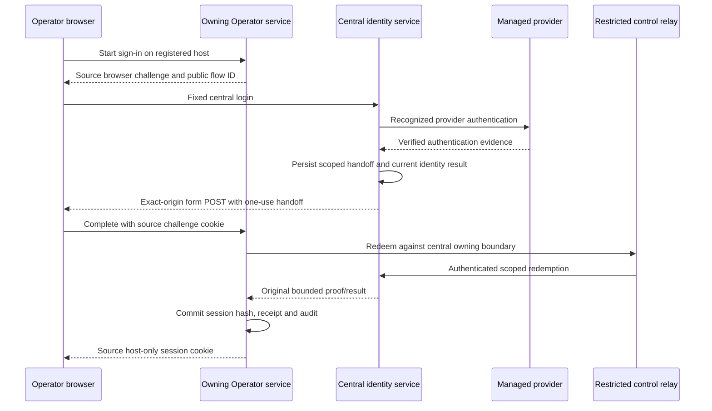

# HOSTED-001 H03 — Managed identity, sessions and central login

[Delivery plan](mvp/delivery-plan.md#implementation-slices) · [Architecture](mvp/architecture-and-access.md) · [Identity schema](../../database/admin-identity.md) · [Source access schema](../../database/operator-access.md)

Status: design decisions D1–D16 accepted November 13, 2026; implementation not started.
The [resolved decisions](#resolved-design-decisions) define the implementation defaults.
This documentation update performs no code, provider configuration, host changes,
invitation to a real operator or release promotion.
Assessment baseline: `hosted_mvp` at `ef85c625`; repin before implementation.

Read scope → workflows → trust and persistence → implementation order → decisions.
Column definitions live only in the schema master. The
[provider research](../../research/HOSTED_MVP_H03_IDENTITY_RESEARCH.md) supplies primary
sources and distinguishes provider capabilities from the recommendations here.

## Scope and completion

H03 supplies managed Google/email-link authentication, separately bootstrapped Admin
MFA, invitation identity/claim logic, browser-bound one-use handoff, source-owned
sessions, logout/device revocation, reauthentication, and the corresponding usable UI.
It replaces the old Cloudflare-assertion authentication composition for fresh hosting.
Production local Operator remains free and needs no hosted identity or Admin store.

The Operator portal already exists. H03 delivers its hosted authentication/security
layer; H04 owns the complete hosted business composition of the existing frontend,
business APIs, provisioned workspace and Free storage/status gates. H04 must prove
ordinary business workflows and two-device use through that composition. H05 supplies
qualified recovery/protection, and H06 admits real users. There is no separate portal
rebuild or separate UI backlog implied by these slices.

| H03 owns | Boundary retained by the next owner |
| --- | --- |
| Admin sign-in/MFA and an authenticated minimal Admin shell; no customer data access | H04 Add/list/detail operator, capacity commitments, Free policy population and provisioning progress |
| Invitation generation/claim/reissue rules and a restricted explicit Pilot 0 delivery action | H04 decides readiness and invokes invitation delivery; H07 adds automatic delivery/outbox processing |
| Access-store baseline, disabled initialization contract, identity/session/draft fences and safe authentication projections | H04 initializes real policy/allocation state and supplies qualified growth admission; H05 implements recovery stores/readiness |
| Exact-host authentication routing, scoped private identity/source transport and current-fence enable/deny integration | H04 orchestrates actual activation; H05 supplies a real verified recovery-point gate; H06 admits real operators |
| Recent-authentication evidence bound to a purpose and exact request | H05 validates recovery point/preview/runtime and owns recovery authorization/UI; H09/H10 own their confirmations |

Completion means the identity workflows work end to end against isolated synthetic
assignments and actual managed test identities, with safe unavailable states for
undelivered owners. H03 does not fabricate policy, backups, qualified releases,
source readiness or an activated customer workspace to demonstrate sign-in. An
authenticated setup-only page grants no business authority. Final normal startup and
all-store artifact promotion remain H05/H06 gates.

## Current code and dependencies

| Boundary | Current evidence | H03 disposition |
| --- | --- | --- |
| Identity and source ports | `modules/hosted_access/application/login_contracts.py`, `source_contracts.py`, `platform/hosted_contracts/authority.py` | Reuse envelopes, scope, epoch and original-result rules. Implement verification of referenced evidence; a validated DTO is not authorization. Add missing lifecycle/method/session-proof fields explicitly. |
| Obsolete authentication to replace | `hosted_access/infrastructure/cloudflare_identity.py`, `application/configuration.py`, `application/service.py` | Existing Cloudflare assertions, manual enrollment, `hosted_demo`, expiry, capability choices and loop-image constants are obsolete for fresh hosting. Replace their production composition; no legacy data migration or supported alternative authentication mode. |
| Source schema | `hosted_access/infrastructure/schema.py`, `session_store.py`, `database/hosted-access-migrations/` | The runtime DDL is obsolete; the owning resource set is unavailable. H03 delivers one current baseline/validator/initializer under `application/database/`, then adapters reflect it. |
| Admin structure | `database/admin-migrations/versions/admin_0001_initial.py` | Main-Admin structural closure exists. Identity behavior, transient flow state and managed-session provenance do not. Implement the accepted H03 fields/tables in this greenfield baseline; do not create a competing auth database. |
| Gateway and network | `host_agent/infrastructure/gateway.py`, `host_services.py`, `network_firewall.py`, `unix_transport.py` | H02 denies eligible routing and supplies host-effect transport, not central login routing or source RPC. H03 must deliver the narrow extensions below and requalify isolation. |
| Launch | `hosted_candidates/startup.py`, `runtime.py` | Normal candidates deliberately remain unavailable while recovery resources are absent. H03 needs an explicit identity qualification composition, not a permissive edit to normal startup. |
| Operator UI and draft fencing | `apps/web/src/app/hosted-session.tsx`, `hosted-session-state.ts`, `hosted_access/infrastructure/draft_leases.py` | Reuse preservation, explicit continuation and edit-lease patterns. Replace Cloudflare/demo/expiry/read-only copy and APIs. Use the current `docs/ui/` guides; UI-001's earlier design is archived. |
| Existing proof cases | [identity_handoff.md](../qualification/specifications/identity_handoff.md), [H02 handoff](../foundation/qualification-and-handoff.md) | Implement the identity driver/browser matrices; do not convert H02 candidates or component fixtures into provider acceptance. H02 review fixes are recorded resolved; rerun their focused regressions, without inheriting new native qualification. |

The business-module architecture, actor context and source-owned transactions remain
unchanged. No property/lease/payment grants or tenant/owner role enum are added.
Admin authority never becomes an `OperatorActor` through role inheritance.

## Operator and Admin workflows

### Sign-in and invitation claim

1. A registered Operator host serves only its safe authentication entry while held.
   It reserves a bounded source login attempt and sets a short-lived host-only browser
   challenge cookie. The return destination is a validated relative UI route, never
   a URL or command. Unknown hosts return generic denial.
2. Navigate to the fixed central login origin with a non-secret flow identifier.
   Central resolves the registered target through owning ports, binds its own browser
   challenge, and shows **Continue with Google** and **Email me a sign-in link**.
   Provider account creation never creates an EPM operator or chooses a workspace.
3. For Google, use the pinned SDK's supported central-domain flow and verify the ID
   token on the backend. For email links, the backend consumes the provider email/code
   through its recognized email-link operation, verifies the returned identity, and
   discards returned refresh credentials. Do not accept arbitrary browser password
   tokens as proof of email-link authentication or silently link accounts.
4. Validate issuer/audience/signature/times, verified email and actual method. Resolve
   an existing exact subject assignment, or atomically consume the current invitation
   against its exact invited email/epoch/revision and bind its verified subject once.
   No email-text match overrides an already bound subject. Different Google/email
   subjects require managed account linking or an explicit audited rebind.
5. Persist claim intent/result; apply the source claim through the private channel.
   Claim, source enablement and gateway eligibility are separate results. Missing H04
   readiness or H05 protection leaves **Identity verified — workspace not ready**.
   Do not consume an invitation for an assignment not ready for claim; after a claim
   commits, a lost response reconciles that claim rather than asking for a fresh invite.
6. When all production gates exist, H04's admitted activation coordinates source
   enable and external eligibility under the current epoch. A newer disable always
   wins. H03 implements the checks/ports; synthetic gates are development-only.
7. Issue one central handoff bound to the exact registered destination, source browser
   challenge, managed identity session, current assignment/epoch and five-minute expiry.
   Deliver the one-use code by an exact-origin form POST, never in an Operator URL.
8. The Operator callback permits that one central Origin only for this route, checks
   its source challenge cookie, and redeems the handoff privately. Reserve the central
   redemption first; commit one source session/receipt/audit; then acknowledge centrally.
   Only the destination emits its own session cookie. A lost cookie response cannot
   recover or mint a second bearer from the same handoff: reconcile the original result
   and start a fresh login if necessary. Preserve the orphaned session for revocation/
   expiry rather than returning its token through a receipt.

### Email completion on another device

Email links use this destination round trip even when opened on the original device,
so one protocol covers both cases without weakening an existing browser binding.

1. The email opens the fixed central origin. Scrub its action capability before other
   resources load, establish a central browser challenge on this device, and ask the
   user to re-enter the invited email. The original attempt ID is only correlation;
   its original browser challenges cannot authorize this device.
2. Central reserves an `email_continuations` record bound to this central challenge
   and the realm-qualified action-code hash before redeeming the code at the provider.
   Verify the recognized email-link result against the original invitation/target and
   current epoch. Atomically retain the managed-session result, mark the continuation
   verified and supersede the original attempt. No source session or handoff exists yet.
   Provider timeout leaves unknown; it does not permit another browser to claim the code.
3. Show **Continue to your workspace**. Navigate to that exact registered destination's
   `/auth/start` with only the public continuation ID. The destination creates a new
   source attempt and its own host-only challenge cookie on this device. It obtains
   the target context through authenticated owning ports; a supplied ID alone grants
   nothing. It emits a one-use signed source-binding assertion for this observed local
   challenge/attempt, continuation, target, epoch/generation and expiry.
4. Return to central by exact-origin form POST, carrying the public identifiers and
   source-binding assertion in the body. Central requires its matching continuation
   browser cookie and current managed proof, verifies the source assertion/registered
   Origin through owning ports, and CAS-pairs one fresh central attempt with that new
   source challenge. Do not accept caller-substituted source attempt IDs or hashes.
5. Issue the normal one-use handoff only for the paired attempt, then POST it to the
   destination as in steps 7–8 above. The destination verifies the new cookie and
   consumes its pairing/nonce. The old attempt cannot issue a handoff on either device.

The continuation lasts at most five minutes and never beyond the original attempt or
managed proof. Its public ID is not a bearer: all pairing/resumption requires the
verified central browser and signed source binding. Only one continuation may reserve
an original attempt/action code. A duplicate from the same verified browser resumes
its existing pairing/result; a different browser or replacement pairing is rejected.
Never return an already emitted handoff/session bearer from retained state. If a
provider/central-cookie/handoff response is lost and safe resumption is impossible,
require a new link/login while retaining the original unknown result for reconciliation.

The original device shows **This link is being completed on another device** or
**Request a new link for this device**; polling reveals no identity proof or destination
cookie. Expired/unknown/superseded flows do not retarget another browser. No email,
provider token, source-binding assertion or handoff bearer enters a redirect URL.
An email opened on another device cannot transfer the first device's renewal lineage
or editor. If that device lacks the prior source cookie, require explicit fresh
sign-in on the completing device rather than treating the public continuation as
proof of the old session.

### Admin sign-in and bootstrap

Use the distinct Admin hostname, separate host-only cookie and an explicit principal
allowlist initialized by a protected, audited setup action. No first-user-wins route
or operator-driven Admin enrollment. Use Google primary authentication plus
provider-managed TOTP. The entry page supports enrollment/challenge for a preauthorized
principal, but issues no Admin session before a completed signed second-factor proof.
Enrolled factors, a new token `iat`, or a Google account's presumed MFA are insufficient.

The shell offers sign out and session/help information; H04 operator-management actions
remain unavailable. Require recent verified MFA, within 15 minutes, before sensitive
Admin commands. Admin sessions have an eight-hour absolute maximum. Lost-factor recovery
uses a documented provider/platform-owner procedure and current protected bootstrap
authority; it is not a public MFA-bypass endpoint. H05 independently qualifies Admin
recovery and cannot trust a restored principal row alone.

### Remembered sessions, renewal and logout

H03 uses no server refresh-token vault. Central uses the provider's server-cookie
pattern, with browser SDK persistence disabled after proof exchange and refresh
credentials discarded. An opaque EPM cookie remains source-local; the provider session
cookie remains central-only and is never forwarded to Operator services.

| Policy | Accepted H03 default |
| --- | --- |
| Operator EPM remembered lifetime | Absolute 30-day ceiling per remembered sign-in lineage; not 30 days of offline/unchecked authority |
| Managed proof | Actual provider expiry, at most 14 days for remembered sign-in; unremembered session at most eight hours and no persistent EPM cookie |
| Renewal | Offer **Renew sign-in** before expiry and after an expiry-only editing pause. Use fresh recognized authentication and a new browser-bound handoff, retain the original 30-day deadline, and apply the atomic replacement/cap rules below. A popup preserves the mounted editor; top-level fallback first explains/preserves unsaved input. |
| Revocation freshness | Central provider checks at most five minutes old; source observations signed/scoped and bounded by that deadline and managed expiry. Refresh asynchronously/on demand with deduplication, never per business read. At expiry, pause admission until verified. |
| Outage | Existing authority remains usable only until its already verified deadlines. No extension on timeout; distinguish temporary unavailability from invalid identity. |
| Sessions | At most 32 live Operator sessions; expired/revoked rows do not count. At the cap, fresh authenticated device-management flow lets the operator choose an old session to revoke before issuance. No silent oldest-device eviction. |

Show the next required renewal accurately; do not promise 30 days without prompts.
Recent authentication uses `auth_time` and completed MFA where required, never token
refresh time. H05 strong restore step-up is an additional gate, not an ordinary session.

#### Renewal admission and cookie replacement

Renewal never turns an expired cookie into authority or extends an old row in place.
The prior session is correlation only until fresh managed proof, destination challenge
and the normal handoff have all been verified. Select the prior row from the observed
source cookie, not a body-supplied public session ID; without it use fresh sign-in.
In one immediate source transaction,
under the same mutation gate as logout/revoke and session issuance:

| Prior source session | Required result |
| --- | --- |
| Still live, unrevoked, same generation/epoch/binding | Replace it atomically: revoke the old row and create one new session. The retiring row frees its own live slot in that transaction, so renewal at 32 live sessions does not require an extra slot. |
| Expired only, still within remembered_until, otherwise current/unrevoked | It may identify the lineage but authorizes no request. Recheck the live count; admit the replacement only if a slot exists. If another device filled the slot, show the existing fresh-auth device-selection/revoke flow. |
| Revoked, generation/epoch/binding stale, disabled, or absolute remembered deadline passed | Reject renewal without changing either row or cookies. Require a new explicit sign-in when account policy permits; it cannot revive the old lineage or edit leases. |

Look up a matching original handoff/issuance receipt before retry admission; a changed
request conflicts. Recheck current source identity, generation, epoch, managed proof/
revocation deadlines, absolute lineage deadline and the cap inside the transaction.
Live means unrevoked, generation/epoch current and expires_at > now; a temporary stale
provider-status observation does not free an otherwise unexpired slot. Concurrent
renewals/new logins serialize; two different handoffs cannot both replace the same row.
A logout that wins the source gate prevents subsequent renewal using that old lineage.

Every accepted renewal creates a new opaque session ID, random cookie and CSRF token,
retains `renewed_from_session_id`, and records the original result/audit atomically.
New expiry is bounded by both the fresh managed proof and original remembered_until.
Deliver the new cookie only once after commit; the old cookie immediately fails.
Lost response retains the new slot/result but never reissues its bearer. An explicit
new login can recover access, with the same live-cap/device-revocation checks.

Old edit leases are not transferred. After same-identity renewal, preserve input and
require **Continue editing** to reacquire each needed lease with current source/session
and form revision checks. If another device changed the form, show the existing
comparison/takeover conflict workflow. Different identity/workspace never inherits input.

Device-only logout revokes the source session and its central managed-session binding;
all-device logout advances source session generation and revokes all corresponding
Operator-purpose central sessions. Neither silently disables the account nor signs out
an independent Admin role. Clear browser cookies, cross-tab caches and edit authority.
Do not automatically sign back in using a still-cached provider assertion. An uncertain
logout closes the UI immediately and offers **Check sign-out status**; never claim
remote revocation completed solely because a cookie was cleared.

## Routing and private authority

No browser chooses service paths, addresses, UID, policy, grant audience or workspace.
Public Admin HTTP stays unprivileged, with no Docker socket or host mounts. Operator
containers still cannot directly contact Admin/private host services. Introduce a
bounded trusted host relay over protected Unix sockets, authenticating peer credentials
and resolving only registered component/binding IDs. Its closed actions forward typed
identity/source commands or observations; it cannot execute shell, select arbitrary
URLs, read business records or mint identity authority. Owning services verify signed
short-lived grants, exact audience/scope/generation/epoch and original request hashes.
The relay is transport, with no second operation ledger; retries use owning receipts.

The Operator private listener runs alongside its public listener in the same process
and uses the same runtime/mutation gate. The host relay reaches a protected source
socket; browser routes never expose that socket or the relay API. Source session bearer
issuance is local to the public handoff callback, never a relay response. Five-second
bounded calls and unknown outcomes prevent a delayed private peer blocking the UI.

H03 extends H02 ingress in two explicitly reviewed ways:

- Shared Admin/login hostnames resolve from protected deployment configuration and
  component manifests, not fake Operator rows. One Admin-owned identity backend may
  serve both exact hostnames with distinct route/cookie policies; no separate Login
  release or shared parent-domain cookie is needed. Verify its private bridge, gateway
  peer and scoped identity-provider egress before exposing it.
- Held Operator hosts may expose only fixed authentication/status paths to the owning
  authentication composition. Business/API/file routes still deny. Eligible business
  routing requires an admitted current enable and H04/H05 proofs. Extend protected
  ingress records with explicit auth-route readiness and binding evidence; source-local
  fields or health alone cannot open either route class. Blocked retirement/disable
  rejects handoff issuance and business access. Requalify existing connections, reboot,
  malformed hosts/headers, method/path normalization and direct-origin denial.

The accepted [inventory extension](../../database/host-inventory.md#h03-authentication-routing-extension)
defines auth-only readiness and its host receipt. Shared Admin/login routes use protected
component manifests and exact deployment origins rather than fake Operator rows or a
second editable allocation ledger. H03.1 seals typed contracts against that dictionary;
H03.6 implements and qualifies them. H02's current closed projection remains authoritative
until the replacement passes its gates.

## Persistence and trust contracts

The [Admin identity dictionary](../../database/admin-identity.md#h03-flow-state)
owns transient attempts, managed sessions and identity command receipts.
The [source dictionary](../../database/operator-access.md#h03-authentication-state)
owns destination challenges and source-session observation extensions. All are private
control data, excluded from portable business export and business restore.

H03 delivers the complete current access-store baseline, including structural usage
tables needed for FK/validation closure; H04 owns usage population and real growth
admission. Missing usage is unknown, not zero. Disabled initialization accepts a typed
admitted Free policy from its owner; H03 tests use isolated fixtures, not production
policy seeding. No runtime DDL, old-table translation or deployed-data migration.

Use immutable identity aliases mapped in protected configuration to exact provider
project/issuer/audience/tenant after verification. Existing REF columns cannot hold
the provider's HTTPS issuer URL. Email normalization lowercases the domain and uses
provider-qualified conservative matching; do not strip dots/plus tags or merge distinct
addresses. Provider subject is the stable assignment key after claim. Changing invited
email/subject/origin requires an explicit rebind, new epoch/generation, revoked pending
capabilities and source acknowledgement; ordinary profile editing cannot do it.

| Operation | Commit and retry boundary |
| --- | --- |
| Start login/email dispatch | Persist bounded attempt before provider/mail work. Rate-limit attempts; duplicate submit retains the attempt. An uncertain email send offers checked explicit resend with cooldown; no plaintext reusable email link retained. |
| Claim invitation | Serialize unique subject/assignment and invitation transition in Admin; retain identity-command receipt. No source/host/provider work under that transaction. Reconcile source claim separately. |
| Handoff redemption | Central reserves the one browser-bound redemption; source commits one session hash + receipt + audit under UNIQUE handoff ID; central acknowledges afterward. No cross-store atomicity claim or raw token replay. |
| Refresh/recent auth | Fresh recognized proof, exact prior session lineage and purpose; no changing subject or extending the absolute remembered deadline. Sensitive challenge binds an exact request hash and is single-use at its consumer. |
| Disable/rebind/revoke | Persist current intent/fence before source/external effects; receipts distinguish containment from source revocation. Newer deny overrides delayed claim/renewal. |

Expiration cleanup follows the [identity dependency graph](../../database/admin-identity.md#identity-retention-and-cleanup).
Twenty-four hours is a minimum diagnostic hold, not a deletion deadline. Referenced
attempts survive live remembered lineages and pending/unknown source results; all
local FKs restrict deletion. Scrub unnecessary personal metadata independently only
when no remaining result needs it. Bounded child-first cleanup rechecks dependencies
inside its transaction; it neither cascades away receipts nor calls another store
while holding a writer. Unresolved holds raise attention instead of disappearing.

Authentication admission and business commit need a shared in-process mutation gate:
recheck current source session/epoch and draft lease before committing; disable/revoke
orders against admitted writes without holding SQLite across network/host operations.
Work already committed is not undone. Upload processing must revalidate before its
source commit. An interrupted cross-store action stays unknown until original-result
inspection; do not reissue a business command after login or create a second workspace.

## API and UI implementation contracts

Paths below are semantic routes whose typed contracts are sealed in H03.1; generate them
from owning schemas. Public URLs carry no authority-bearing query values.

| Surface | Required operation and response |
| --- | --- |
| Central `/auth/start`, `/auth/email-link`, `/auth/complete`, `/auth/email/continue` | Bounded method-specific attempt; generic unassigned/delivery text; recognized managed proof; central-cookie plus signed-source pairing on email return; fixed redirect/form destination. Do not expose operator existence or an arbitrary-token login endpoint. |
| Operator `/auth/start`, `/auth/complete` | Destination challenge, central-bound redemption and cookie response. Cross-origin exception exists only on the completion POST, with exact central Origin and challenge checks. |
| `/api/hosted/session` | Current safe identity/scope, capabilities, expiry/renewal requirement, CSRF token and support. No demo expiry, raw issuer, internal fence/proof, session hash, paths or policy record. |
| `/api/hosted/sessions` | Bounded device page, current-device marker, coarse browser label and last seen; opaque public session IDs. Revoke one/all through CSRF-protected commands and original-result lookup. |
| Admin `/auth/*`, `/api/admin/session` | MFA enrollment/challenge, current explicit principal, eight-hour expiry, recent-auth requirement and sign out. No business payload. |
| Private identity/source ports | Fixed command/observe/original calls with typed authority, immutable operation and receipt. Missing owner returns unavailable; safe projections never become authorization. |

Use Secure, HttpOnly, Path=/, no Domain, `__Host-` cookies with separate Admin, central,
Operator and short-lived challenge names. SameSite=Lax supports qualified top-level
flows; it is not cross-subdomain CSRF protection. Exact Origin plus session-bound CSRF
is mandatory on unsafe routes. Reject duplicate sensitive headers/cookies and malformed
Host/Forwarded inputs. No credentialed wildcard CORS. Callback responses are no-store,
no-referrer, frame-protected, with restrictive CSP and a clean URL before other resources.
Use 401 for missing/expired auth, 403 for wrong scope/origin/method, 409 for fenced conflict,
413 for oversized input, 429 with bounded Retry-After, and 503 for unavailable authority.
Reuse the shared API error helper; never put submitted tokens or raw provider errors in it.

UI acceptance is part of H03:

- Central sign-in, invited-identity mismatch, check-email, email re-entry on another
  device, expired/reissued link, pending workspace, provider outage, MFA challenge and
  sign-out outcomes each have one clear next action and support contact.
- Operator Security section lists/revokes devices and exposes renewal. Loading/error/
  empty states distinguish unavailable from signed out. No paid, recovery-point or
  Add operator UI is presented as available before its owner.
- On session expiry/revoke, pause editing, preserve mounted form input/focus/scroll
  and acknowledged saved forms, and ask for explicit continuation after same-identity
  authentication. Different identity/workspace clears scoped caches and cannot inherit
  the old input or submit it. No automatic mutation replay; ambiguous prior saves use
  existing **Check submissions**/original-result flows.
- Reuse current 5-minute edit leases/60-second renewal and explicit takeover behavior
  with source session/epoch checks. Revoke invalidates edit authority without deleting
  unfinished forms or unresolved attempts. Independent forms remain independently editable.
- Keyboard, focus, status announcements, light/dark, narrow layout, popup blocking,
  back/refresh, two tabs and two independent devices are qualification cases.

## Setup, packaging and operational bounds

Pin the billing-enabled Identity Platform project, central custom domain, exact Google
callback, API/SDK/Admin dependency versions and configured delivery quotas. Use separate
development/provider test identities. No production service-account credential in an
Operator container; central gets only its required identity permissions through
protected delivery. Provider signing keys use bounded cache/discovery; unknown keys
without successful refresh fail closed. Provider and mail calls run outside DB writes.

Implement the auth composition with one writer per owning store and explicit public/
private listeners. Identity-only candidate mode is selected by protected deployment
configuration, never a query/header; it has no business access or recovery bypass.
H03 packages real central/Admin authentication assets; normal application readiness still
requires H04/H05 resources. Rebuild affected component manifests and distinguish scoped
identity acceptance from full qualified release rows. No fake recovery schema or pretend
final qualification to break the dependency cycle.

Use fixed local HTTPS test hosts on separate origins for browser cookie/CSRF tests;
loopback-only synthetic adapters are explicit development composition. Provider emulators
do not establish real MFA, delivery or revocation acceptance. Production local Operator
registers none of these hosted endpoints/adapters and still launches without cloud.

Accepted initial tunable bounds: 15-minute login attempt, five-minute handoff, 60-second resend
cooldown, five email attempts/hour per destination and twenty/hour per network source,
32 live Operator sessions, 50-row session pages, 128 edit leases and indexed expiry
cleanup in bounded batches. Add a deployment-wide mail ceiling below configured provider
quota; do not make one global bucket the only limiter. Hash network/destination rate
keys with a protected rotating key; do not retain full IPs or email-link contents in logs.
Measure the defaults and legitimate multi-device traffic before invitation release.

## Ordered implementation plan

Each work unit is a cohesive backend/UI/operations change within HOSTED-001 H03.
D1–D16 are resolved. Re-read current code and pin sources before starting; provider,
browser, artifact and native acceptance remain execution gates, not unmade decisions.

| Order | Work unit | Exit evidence |
| --- | --- | --- |
| H03.1 | Translate accepted D1–D16 into exact provider/setup inputs, versioned typed contracts, state checks and proof cases. Pin the configured realm, callbacks, signed grant audience/key custody, route manifest and method/renewal policy. | Contracts match the schema master and accepted defaults, with negative fixtures and no undocumented authority. Actual provider/mail/native observations stay unavailable until executed. |
| H03.2 | Implement resource-owned greenfield Admin identity additions and complete access baseline, validators/initializers. Remove runtime DDL path. | Fresh/read-only reinit, exact checks/FKs/indexes, rollback and installed resource tests; dependency-aware expiry cleanup retains live-lineage/unknown-effect evidence without cascades. No implicit operator/policy/session seed. |
| H03.3 | Deliver protected managed-provider configuration and verifier; central Google and backend-mediated email-link flow, bounded mail/revocation/key adapters. | Wrong realm/method/subject/verified-email/time deny; real test-project method and quota proof; no raw credentials in reports. |
| H03.4 | Implement protected Admin bootstrap, Google/TOTP enrollment/challenge, session middleware and minimal usable Admin sign-in/shell/logout. | No first-user bootstrap, no Operator-to-Admin grant, recent MFA proof and explicit account/factor recovery runbook. |
| H03.5 | Implement durable login attempts, email continuations, invitation identity binding/reissue and central identity receipts. | Unique claim and code reservation under concurrency; central-browser-bound continuation and destination round trip; original-attempt supersession; provider timeout/send ambiguity and receipt rollback retain identity. H04 readiness port unavailable by default. |
| H03.6 | Implement protected shared-host/auth-only routing and scoped Unix control relay/source listener, including provider egress. | Actual dual-stack/peer/host/path/method/forged-header denials and reboot persistence; held exposes only authentication; no direct Operator-to-Admin network opening. |
| H03.7 | Implement signed destination pairing, handoff redemption and source session issuance, with scoped identity observations and cross-store reconciliation. | Four browser contexts cannot swap continuation/source assertions/challenges/hosts; two devices racing one link yield one verified pairing. Lost responses expose only original safe results, no token replay. |
| H03.8 | Implement source session authorization, atomic renewal replacement/cap admission, bounded provider-status refresh, recent-auth challenges and disable/rebind/enable primitives. | Active and expiry-only renewals obey the live cap; concurrent issuance cannot exceed 32; logout/epoch changes prevent revival. External deny and H04/H05 gates remain independent. |
| H03.9 | Deliver Operator session/renewal/security UI and device/all-device logout, including cap handling. | Safe projections, async states, popup/fallback, explicit continuation, same/different identity and two-device acceptance. |
| H03.10 | Adapt draft ownership and request admission to current source sessions; preserve local composition and existing forms/submission recovery. | Explicit lease reacquisition after cookie rotation; same-form takeover and distinct-form editing; revoke/expiry/restore fences preserve data; no automatic resubmission or cross-store transaction assumption. |
| H03.11 | Package separate authentication candidates and local development setup; integrate fixed origins, secrets and private manifests. | Installed without checkout; no legacy expiry/Cloudflare fallback, missing H04/H05 resources explicit; production rejects development adapters. |
| H03.12 | Run focused component, real-provider, deployed HTTPS/browser and native changed-boundary qualification; publish sanitized evidence/runbooks. | Identity proof cases and matrix below, changed-file lint/type checks, source/image/provider/config pins and honest remaining H04–H06 gates. No real operator admission. |

## Validation matrix

| Area | Required cases |
| --- | --- |
| Happy paths | Managed Google/email-link, preauthorized Admin TOTP, same/cross-device completion, one claim, remembered/unremembered login, renewal and two devices with full Operator permissions. |
| Invalid combinations | Wrong issuer/audience/tenant/method, unverified email, mismatched subject/invite, expired/future proof, Admin without actual MFA, wrong Origin/cookie/state/host/path, browser authority fields, 413 and throttling. |
| Idempotency/retry | Concurrent invitation claims/redeems; duplicate key changed intent; uncertain provider/mail/source responses; cookie response lost; old handoff/renewal after revoke/rebind; one original result, no second token. |
| Cross-device pairing | Two devices race one email code; only the reserved completing central browser can pair. Inject continuation/attempt IDs or source hashes/assertions, replace a pairing, replay an old link or lose each round-trip response. No old-attempt handoff, retargeted cookie, bearer in a URL or second token. |
| Renewal admission | Active replacement at cap, expiry-only renewal at cap, concurrent renewal/new issuance, same predecessor with different handoffs, fresh proof after device/all-device revoke, absolute deadline, lost replacement cookie, explicit edit-lease reacquisition and revision conflict. Never exceed 32 or revive revoked authority. |
| Rollback | Fail at attempt/claim/session/receipt/audit commits and each cross-store boundary; no grant from rolled-back writes, no lost epoch or assumed provider rollback. |
| Persistence/schema | Current resource-only baselines, FK/unique/state checks, missing/wrong/partial stores and exact read-only reinit. Cleanup with live thirty-day lineage, unknown source claim, referenced expired attempts and predecessor chains; no cascade/FK rewrite, with eventual reclamation after holds retire. |
| Backup/restore | Business archive excludes all auth/control/secrets. Simulated business restore cannot restore sessions or old draft authority. H05 damaged-control/key/catalog recovery remains unavailable; H03 proves its evidence interface, not restore acceptance. |
| Query/performance | Indexed hash/session/epoch lookups; at most one bounded local access read per request, no provider/Admin round trip on each business read. At most one deduplicated provider revocation refresh per active identity per interval; bounded 50-row session pages, cleanup batches and UI timeouts; no N+1 provider calls. |
| Browser/local/native | Four isolated contexts, same-site sibling CSRF, expired tab, long-running request disable, cookie flags/history/referrer/log markers, popup blocked, CSP/no-store, accessibility/themes/narrow layout, default local launch and changed gateway/relay native denial proofs. |

No tests run by writing this design. Implementation must rerun applicable Ruff/frontend
checks and focused regressions; actual provider and deployed-browser proof are separate
from emulator/component passes.

## Resolved design decisions

The user accepted all D1–D16 recommendations November 13, 2026. These decisions resolve
the identified contradictions; provider/project settings and measured qualification
remain implementation inputs. Acceptance is not evidence of a configured provider or
implemented feature.

| ID | Issue resolved | Accepted decision and plan impact |
| --- | --- | --- |
| D1 | Current `issuer: REF` cannot store the real Firebase HTTPS issuer. | Validate exact issuer/project/tenant first, then persist a protected opaque realm alias + Firebase UID. Aliases are immutable realm identities; a changed realm gets a new alias and explicit rebind/revocation, never an in-place remap. Pin the mapping in H03.1; never loosen generic REF constraints. |
| D2 | Thirty-day remembered EPM sessions exceed the provider cookie's two-week maximum; central persistence does not refresh Operator origins. | Keep the absolute 30-day EPM ceiling, actual <=14-day proof, explicit fresh-auth renewal and no refresh-token vault. Periodic prompts are accepted. Continuous unattended 30-day authentication is not an H03 promise. |
| D3 | Admin MFA method, bootstrap and lost-factor recovery are unspecified. | Google + managed TOTP, explicit protected UID bootstrap, signed completed-factor evidence and recent auth; provider/platform-owner recovery with no public bypass. Ordinary Operator login need not enroll MFA; H05 strong restore step-up remains an independent requirement. |
| D4 | Email-link setup enables the password provider, whose token method identifier cannot distinguish the two flows. | Backend-mediated email-code completion with retained recognized-flow provenance; reject arbitrary password ID-token login. Do not consume a code twice to initialize SDK persistence. |
| D5 | H03 owns access resources, but the proposed store includes H04 usage/policy state. | Deliver complete structural closure in H03; H04 supplies real policy initialization/usage/growth admission. Missing usage stays unknown, with no synthetic production allowance. |
| D6 | Claim activation requires H04 readiness/H05 backup; normal H02 candidates reject missing recovery resources. | H03 delivers identity-only qualification and setup-only UI with unavailable gates. H04/H05 later integrate activation; final normal artifact/release qualification stays before H06. No fake backup or weakened startup. |
| D7 | H02 knows only closed workspace routes, not shared Admin/login hosts or held auth entry paths. | Use protected shared-component manifests and the accepted inventory auth-route readiness/receipt extension. Seal contracts in H03.1 and implement in H03.6. Preserve exact-host denial; eligible business routing requires full gates. |
| D8 | H02 network isolation forbids the source/central RPCs H01 ports assume. | Protected bounded Unix relay with registered-ID resolution and independently verified scoped grants. No broad host networking, Operator service-account key or public private-control endpoint. |
| D9 | Current schema lacks durable pre-login challenges, managed-proof lineage and central identity-command outcomes. | Implement the accepted master records/fields; keep raw credentials out and retain cross-store receipts. One handoff commits at most one source session result; a lost cookie requires fresh sign-in, never bearer recovery/reissue from an old receipt. |
| D10 | Literal “no email-link secrets in URLs” conflicts with provider-sent email action links. | Allow only unavoidable initial invitation/provider action capabilities, scrub immediately and redact edge/app/history/trace capture; use fragment invitation secrets and body-only EPM handoffs. Update proof wording for this narrow exception before provider tests. Never allow ID/session tokens in redirect URLs. |
| D11 | Email normalization, linking and reassignment could silently move a workspace. | Conservative provider-qualified email matching only before initial claim; immutable bound UID afterward. Explicit provider linking or audited fenced rebind; no Gmail dot/plus rewriting. |
| D12 | Revocation propagation and provider outage policy are unspecified. | Five-minute maximum provider-status age, existing managed expiry and local source checks. Pause when freshness expires; no indefinite outage grace. Qualify cost/availability at 100 identities before claiming it. |
| D13 | Session cap behavior, current/all-device logout and provider SSO semantics are unspecified. | 32 source sessions; explicit old-device choice at cap; separate Admin/Operator logout; no automatic re-login or silent eviction. Audit provider-wide revocation separately if needed for account compromise. |
| D14 | Invitations need delivery before H07 automatic mail/outbox. | H03 owns link generation/secure explicit send and readiness contract; H04 invokes it when ready. Qualify one managed delivery path, quotas/cooldowns and uncertain-send handling; no reusable plaintext URL in an outbox or ad hoc Admin clipboard workflow. |
| D15 | H01 generic login/source actions omit applied-policy/rebind details and source-session evidence transport. | Finalize typed action/result/receipt extensions in H03.1; H03 implements auth/rebind/fencing, H04 policy/usage behavior and H05 restore application. Do not hide implementation gaps behind evidence-reference strings. |
| D16 | Existing UI claims demo expiry, Cloudflare login, manual enrollment and optional read-only capability. | Replace that flow in fresh hosting with the sign-in/security states above. All assigned Operators have full business permissions subject to access/maintenance/storage gates; no account expiry or second routine Admin claim approval. |

D1–D16 are resolved and reflected in the schema master and ordered plan. Implement
their contracts and qualification gates sequentially; no further approval is required
for these same choices. This does not change HOSTED-001 or portal backlog scope.
