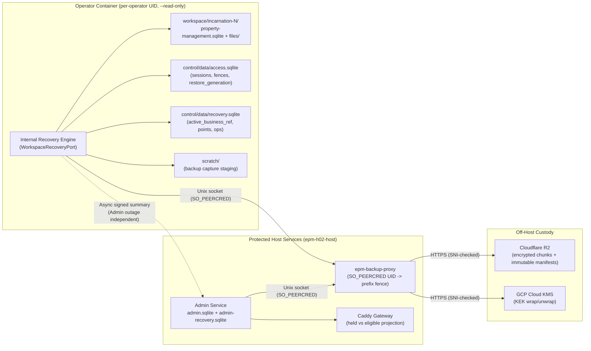

# HOSTED-001 Slice H05 Detailed Design & Implementation Plan — Nightly Verified Off-Host Recovery

**Status:** Implementation & Component Qualification Complete (2026-11-23) — **D1–D12 approved; H05.1–H05.11 complete (component 17/17 proof passed; live GCP `epm-h02-host` execution documented in [H05_RECOVERY_OPERATIONS_RUNBOOK.md](../runbooks/H05_RECOVERY_OPERATIONS_RUNBOOK.md)).**
**Owning Delivery Plan:** [delivery-plan.md](mvp/delivery-plan.md#implementation-slices) (Slice H05)
**Owning Specifications:** [recovery.md](mvp/recovery.md), [subscriptions-storage-and-runtime.md](mvp/subscriptions-storage-and-runtime.md#per-tier-physical-storage-sizing-acceptance), [qualification/specifications/recovery.md](../qualification/specifications/recovery.md), [qualification/specifications/identity_handoff.md](../qualification/specifications/identity_handoff.md)
**Database Dictionaries:** [overview.md](../../database/overview.md), [schema-resources.md](../../database/schema-resources.md), [operator-recovery.md](../../database/operator-recovery.md), [admin-recovery.md](../../database/admin-recovery.md), [operator-access.md](../../database/operator-access.md), [admin-operations.md](../../database/admin-operations.md)
**Prerequisite Handoffs:** [H03.12 exit review](../qualification/reports/HOSTED_MVP_H03_12_EXIT_REVIEW_2026-11-22.md), [H04.9 Free sizing](../qualification/reports/HOSTED_MVP_H04_9_FREE_SIZING.json), [H04.10 exit review](../qualification/reports/HOSTED_MVP_H04_10_EXIT_REVIEW_2026-11-22.md)

---

## 1. Executive Summary & H05 Scope

Slice **H05** delivers verified, unattended off-host backup and operator-authorized restore for Pilot 0 Free workspaces, separate Admin control-plane backup and host-loss recovery, clean-runtime repair (`repair_runtime`), H05 physical backup/restore staging reserve sizing, and the **verified recovery-point gate** that unlocks positive Operator workspace ingress (`desired_state="eligible"`) for the **joint H04/H05 positive workspace qualification**.

**In scope for H05:**
1. Executable greenfield Alembic baselines and schema validation for `recovery.sqlite` (per-operator) and `admin-recovery.sqlite` (Admin control plane).
2. Unattended encrypted off-host nightly backup engine (Cloudflare R2 + GCP Cloud KMS envelope encryption via a host-side prefix-enforcing Backup Object Proxy), consistent SQLite/file capture, change detection (`healthy` vs. `unchanged`), readback verification, 7-point reference-safe retention, and external stale-backup alerting.
3. Operator-authorized restore in both normal mode and minimal recovery mode (when business DB is corrupt/missing), gated by recent strong step-up authentication, single-use exact preview confirmation, crash-safe atomic locator switch (`recovery_meta.active_business_ref`), session revocation (`new_access_epoch`), and forensic pre-state retention — with **zero offline workspace restore/decrypt bypass**.
4. Clean-runtime repair (`repair_runtime`) replacing only the Operator container while retaining IDs, data, access/recovery stores, and key refs, booting into minimal recovery mode.
5. Separate Admin control-plane backup and main-Admin-DB-independent recovery mode (rehearsed for damaged main Admin DB, damaged Admin recovery DB, and whole-host loss).
6. Operator Settings → Data & Backup UI, Minimal Recovery Mode UI, and Admin-lite Backup/Repair/Control Recovery UI (conforming to [operator-experience.md](../../ui/operator-experience.md)).
7. Native Linux/Docker/GCP physical backup/restore staging reserve sizing (`h05_backup_restore_reserve`) plus independent byte/inode exhaustion tests.
8. Positive Operator Gateway routing (`desired_state="eligible"`) and **joint H04/H05 deployed qualification** (2 disposable assignments, 4 isolated browser contexts, all 17 `recovery.json` cases + deferred H03/H04 positive `identity_handoff.json` cases).

**Explicitly out of scope for H05:**
- Paid backup cadences (15-minute RPO / 30–90 day retention) and Stripe billing (H08/H09).
- Automated provisioning/reconciliation loops (H07), independent release rollouts (H10), idle suspension/wake (H11), and Pilot 0 real-customer admission (H06).
- Any changes to local single-operator desktop backup/restore (`LOCAL-002` passphrase workflow remains unchanged).

---

## 2. Current Codebase & Schema Inventory

| Component | Current State in Checkout | Gap to Close in H05 |
| --- | --- | --- |
| `application/database/recovery-migrations/` & `admin-recovery-migrations/` | Scaffolds (`resource_state = scaffold`, `reject_schema_scaffold`, empty `versions/`). | Replace with executable `recovery_0001_initial.py` and `admin_recovery_0001_initial.py`; register in `IMPLEMENTED_REVISIONS` and `validate_identity_records`. |
| `admin_0001_initial.py` | Already has `workspace_recovery_status`, `storage_policies.backup_interval_seconds` / `retained_nightly_points`, `capacity_profiles.recovery_reserve_json`, and `qualified_releases.*recovery_schema_revision`. | Wire async source-authenticated updates to `workspace_recovery_status`; fix `unchanged` projection bug in `admin_control.py:1457`. |
| `access_0001_initial.py` | Already has `access_meta.maintenance_operation_id`, `access_meta.restore_generation`, `draft_leases.restore_generation`, and `access_receipts.kind` (`maintenance_fence`, `restore_binding`). | Align `Drain` (`'drain'`) receipt kind with `source_contracts.py` (see **D7**); implement `maintenance_fence`, `drain`, and `verify_restore_binding` in `SourceLifecycle`. |
| `WorkspaceRecoveryPort` & `AdminRecoveryPort` | Typed contracts & commands exist (`workspace/application/recovery_contracts.py`, `hosted_admin/application/recovery_contracts.py`, `hosted_access/application/ui_contracts.py:Recovery`). | Zero production implementations exist. |
| `hosted_access` runtime & settings | `operator_entry.py:198` hard-codes `readiness=lambda: False`; `operator_identity_runtime.py` omits `protection_reader` and recovery routes. `source_sessions.py` already implements `begin_recent`/`observe_recent`/`consume_recent` step-up. | Wire `recovery.sqlite`-backed `readiness` and `protection_reader`; add minimal recovery-mode boot path and `/api/hosted/recovery/*` routes. |
| `host_agent` gateway & effects | `HostAgentService.execute()` and `gateway.py` unconditionally raise `HostAgentUnavailable` on `stage_restore`, `switch_binding`, and `apply_ingress_policy(desired_state="eligible")`. | Implement `WorkspaceRouteManifest` + verified `eligible` projection (gated by verified H05 protection proof) and `repair_runtime` host effect. |
| Legacy `recovery_publication.py` & `recovery_bundle.py` | Single-tenant JSON ledger, direct `boto3`, passphrase-encrypted `EPMB` archives. | Retire under greenfield MVP scope (**D11**). |
| Frontend (`application/apps/web/`) | `hosted-settings.tsx` and `AdminWorkspace.tsx` already render `protection` status (`Protected` / `Degraded` / `Unavailable`). `src/shared/recovery*` is UI-001 form-draft autosave only. | Build Operator Data & Backup + Minimal Recovery Mode UI, plus Admin-lite Repair Runtime + Control Recovery UI. |

---

## 3. Resolved Design Decisions (D1–D12 — Accepted 2026-11-22)

| ID | Topic | Contradiction / Gap | Accepted Resolution (Greenfield MVP) |
| --- | --- | --- | --- |
| **D1** | Pilot 0 "Admin execution assistance" vs. No-Admin-Execution / No-Offline-Bypass | `PRODUCT_BRIEF.md:58` and `DECISIONS.md:101` mention "Pilot 0 may use manual Admin execution assistance," while `recovery.md:22-26, 67, 114-120` and `operator-recovery.md:76-78` strictly forbid Admin approval/impersonation and any offline workspace restore/decrypt command. | Reconcile explicitly: Pilot 0 manual Admin/host assistance is strictly limited to infrastructure/runtime repair (`repair_runtime`) and Admin control/host-loss recovery. Customer workspace restore is **always** executed by the owning Operator service under operator authentication + strong step-up + exact confirmation, with zero offline workspace restore/decrypt command. |
| **D2** | Backup Engine & Envelope Encryption | `recovery.md:16-18` requires selecting a proven incremental/deduplicated encrypted engine after a component proof, with unattended platform-managed keys outside the host. | Implement a deterministic **content-addressed chunked AEAD backup engine** in Python (`AES-256-GCM` per object/chunk with a per-workspace DEK wrapped by **GCP Cloud KMS**; AAD binds `(deployment_id, operator_id, workspace_id, point_id, schema_revisions, key_ref)`). Deduplicates retained files by `content_sha256` and DB pages/snapshots cleanly across 7 nightly points, requires zero external binaries inside `--read-only` containers, and is proven in **H05.2**. |
| **D3** | Per-Operator Prefix-Scoped Cloudflare R2 Access | `recovery.md:171-172` forbids bucket-wide R2 credentials in any Operator container and requires Admin-outage independence, but standard R2 S3 tokens are bucket-scoped. | Add a dedicated host-side **Backup Object & KMS Proxy** (`epm-backup-proxy`, root-managed private Unix socket under its own host UID holding the R2 + Cloud KMS credentials). Authenticates callers via kernel `SO_PEERCRED` UID → `host_inventory` `operator_id` binding (zero Admin DB dependency), strictly confining each Operator to `deployments/<id>/operators/<operator_id>/...` and Admin to `deployments/<id>/control/...`. Zero R2/KMS credentials ever enter any container. |
| **D4** | Operator Strong Step-Up Mechanism & TTLs | `recovery.md:164-166` requires "qualified recent strong step-up" for Operator restore, while H03 Operators use Google or email-link (TOTP is Admin-only). | Use existing H03 `source_sessions` one-use recent-auth step-up (`begin_recent`/`observe_recent`/`consume_recent`): fresh Google or email-link re-authentication within **10 minutes** (`600_000 ms`), bound via single-use server challenge to exact `request_hash` of `(workspace_id, point_id, source_epoch, preview_id)`. Preview TTL = **10 minutes**; execution authorization TTL = **5 minutes**. |
| **D5** | Main-Admin-DB-Independent Recovery Authority (`recovery_authority_ref`) | `admin-recovery.md:18-26` requires authenticating the Admin recovery principal without opening a damaged `admin.sqlite`. | Mount a root-owned, read-only protected bootstrap policy file (`/run/epm/admin-recovery-authority.json`, pinned by SHA-256 in `admin_recovery_meta.recovery_authority_ref`) containing approved Admin recovery principal `(issuer, subject)` and TOTP/MFA requirements. Admin recovery mode verifies Google + TOTP MFA and live Firebase revocation over the central egress proxy without touching `admin.sqlite`. |
| **D6** | Physical Layout for Restore Staging & Forensic Pre-State vs. H04.9 `prjquota` Trees | Operator container has no Docker/mount privileges (`recovery.md:106-110`), while restore staging and retained prior/forensic trees must have separate physical reserves excluded from the 50 MB logical allowance. | Keep the 3 ext4 `prjquota` trees (`workspace`, `control`, `scratch`). Stage backup captures/chunks in `scratch`. Store business incarnations as sibling subdirectories inside `workspace` (`workspace/incarnation-<gen>/...`, referenced by `recovery_meta.active_business_ref`) so switchover is an atomic SQLite commit in `control/data/recovery.sqlite` and prior/forensic trees remain intact in `workspace/prior-<gen>/`. Expand the `workspace` and `scratch` physical ceilings in **H05.9** native GCP sizing to include measured backup + restore-staging + 1 retained prior-tree reserves (excluded from logical 50 MB metering). |
| **D7** | `access_0001_initial.py` vs. `source_contracts.py` Receipt Kinds | `source_contracts.py:117-126` defines `Drain(action="drain")` and `VerifyRestoreBinding(action="verify_restore_binding")`, while `access_0001_initial.py:153-158` allows `maintenance_fence` and `restore_binding` (omitting `drain`). | Update greenfield `access_0001_initial.py` to add `'drain'` to `access_receipts.kind` CHECK constraint, and map `verify_restore_binding -> 'restore_binding'` in `SourceLifecycle.RECEIPT_KINDS`. |
| **D8** | `admin_control.py:1457` `unchanged` Protection State Bug | `admin_control.py` currently maps `status="protected" if rec_state == "healthy" else "degraded"`, misclassifying `unchanged` as `"degraded"`. | Map both `healthy` and `unchanged` to `Protection.status = "protected"` while surfacing `unchanged` distinctly in Admin & Operator UI copy (*"Protected — unchanged since verified point"*); map `overdue` to `"degraded"`. |
| **D9** | Positive Workspace Gateway Routing (`desired_state="eligible"`) | `auth_projection.py` only projects 3 held `/auth/*` routes; `gateway.py` rejects `desired_state="eligible"`. | Add `WorkspaceRouteManifest` admitting Operator routes (`/auth/*`, `/api/hosted/security/*`, `/api/hosted/settings`, `/api/hosted/recovery/*`, `/api/*`, `/assets/*`, `/sign-in`, `/`, SPA paths) with exact-host/header stripping and forbidden-prefix/websocket denial, enabled **only** when `ApplyIngressPolicy(desired_state="eligible")` carries verified `source_identity_proof_ref` and `resource_readiness_proof_ref` (including H05 verified recovery point proof). |
| **D10** | Overdue Threshold, 7-Point Retention, Alert Channel & Prior-Tree Cleanup | Exact overdue age, alert delivery channel (no mail provider qualified yet), and prior-tree cleanup retention are unspecified. | Overdue threshold: **28 hours** (`100_800_000 ms`) when dirty since last verified point. Retention: **7 most recent distinct verified points** (never expiring the sole usable point when unchanged). External alert channel for Pilot 0: structured alert log + **GCP Cloud Monitoring / webhook alert** (deduplicated per `(operator_id, alert_kind)` with explicit recovery notice). Retained prior/forensic trees: kept until explicit `AcceptRestore` + **7-day** retention (or explicit operator-confirmed cleanup post-acceptance). |
| **D11** | Legacy Pre-HOSTED-001 Recovery Helpers | `hosted_access/{application,infrastructure}/recovery_publication.py` and `recovery_bundle.py` use JSON ledgers and passphrase `EPMB` archives. | Retire both legacy modules in H05 once greenfield `WorkspaceRecoveryPort` / `AdminRecoveryPort` are implemented; keep local desktop `workspace/application/backup_service.py` (`LOCAL-002`) intact. |
| **D12** | Store-Isolation Boundary for `protection_reader` & `workspace_recovery_status` | Need explicit boundary between `recovery.sqlite` (source of truth) and `admin.sqlite` (`workspace_recovery_status` projection). | `operator_entry.py` reads `protection_reader` and `readiness` directly from the Operator's own `recovery.sqlite` + `access_meta` (zero Admin dependency). Admin's `workspace_recovery_status` is updated asynchronously via source-authenticated private-relay summaries (plus `RefreshSource` pull) fenced by `(workspace_id, source_epoch)` and monotonic `source_revision`. |

---

## 4. Architecture & Store / Schema Design

### 4.1 Executable Schema Baselines (Greenfield H05)
1. **Per-Operator `recovery.sqlite`** (`application/database/recovery-migrations/versions/recovery_0001_initial.py`, per [operator-recovery.md](../../database/operator-recovery.md)):
   - `recovery_meta` (singleton `id=1`, `active_business_ref`, `source_generation`, `restore_generation`, `encryption_key_ref`, `namespace_prefix`, `revision`).
   - `recovery_operations` (idempotent command log keyed by `operation_id` and `idempotency_key` + `request_hash`, append-only result/state).
   - `recovery_points` (immutable verified off-host point catalog: `point_id`, `manifest_ref`, `manifest_sha256`, `key_ref`, `business_revision`, `files_generation`, `source_generation`, `business_schema_revision`, `access_schema_revision`, `captured_at`, `verified_at`, `size_bytes`, `retain_until`, `state`: `verified | expired | pruned`).
   - `backup_state` (singleton `id=1`: `last_verified_point_id`, `last_verified_at`, `last_captured_at`, `last_checked_at`, `last_business_revision`, `last_files_generation`, `last_source_generation`, `dirty_since`, `protection_state`: `healthy | unchanged | overdue | unavailable | unknown`, `consecutive_failures`, `last_error_code`).
   - `restore_operations` (`operation_id`, `point_id`, `preview_id`, `request_hash`, `phase`: `prepared | fenced | restored | validated | switched | accepted | needs_attention`, `prior_business_ref`, `prior_tree_kind`: `healthy_pre_state | forensic_damaged`, `staging_business_ref`, `new_source_generation`, `new_access_epoch`, `authorization_expires_at`, `accepted_at`).
   - `recovery_audit` (append-only immutable audit log; zero secrets or customer content).
2. **Admin `admin-recovery.sqlite`** (`application/database/admin-recovery-migrations/versions/admin_recovery_0001_initial.py`, per [admin-recovery.md](../../database/admin-recovery.md)):
   - `admin_recovery_meta` (singleton `id=1`, `deployment_id`, `recovery_authority_ref`, `incarnation_id`, `encryption_key_ref`, `namespace_prefix`, `revision`).
   - `control_recovery_operations`, `control_recovery_points`, `control_restore_operations`, `control_backup_state`, `control_recovery_audit`.
   - Zero cross-DB FKs to `admin.sqlite`; append-only triggers on `control_recovery_audit` and immutable point manifests.
3. **Store Registration & Packaging**:
   - Add `HostedStore.RECOVERY` and `HostedStore.ADMIN_RECOVERY` to `IMPLEMENTED_REVISIONS` in `schema_resources.py` and add structural/immutability validators in `schema_validation.py`.
   - Pin `recovery_schema_revision` in Operator image compatibility manifest and `admin_recovery_schema_revision` in Admin image compatibility manifest.

---

## 5. Key Operational Workflows

### 5.1 Nightly Scheduled Backup & Change Detection (`Capture`)
1. Internal background runner in Operator service wakes on nightly schedule (with jitter) and on startup reconciliation.
2. Reads current `(business_revision, files_generation, source_generation)` from business DB / `access_meta` and compares against `backup_state`.
   - If unreadable/ambiguous → mark `protection_state = 'unknown'`, emit alert, never mark `unchanged`.
   - If identical to `backup_state.last_*` and `last_verified_point_id` is still verified → update `last_checked_at`, set `protection_state = 'unchanged'` (never overwrite `last_captured_at` / `last_verified_at`), done.
3. Acquire brief consistent-snapshot lock → SQLite Online Backup API (`sqlite3.Connection.backup`) into `scratch/capture-<op>/db.sqlite` + snapshot `file_content_locations` manifest → release lock immediately so normal UI reads/writes continue unblocked.
4. Chunk & encrypt DB snapshot + any new retained file blobs (`content_sha256` not yet in R2) using DEK wrapped via `epm-backup-proxy` (Cloud KMS), upload objects via `epm-backup-proxy` (R2).
5. Upload immutable manifest JSON last; perform full off-host readback + SHA-256 + AEAD decrypt verification of manifest and sampled/new objects.
6. Only after readback succeeds: insert `recovery_points(state='verified')`, update `backup_state(protection_state='healthy', dirty_since=NULL)`, prune expired points beyond 7 **only** if unreferenced by any retained point and never pruning the sole usable point, and emit async signed protection summary to Admin.

### 5.2 Operator-Authorized Restore & Minimal Recovery Mode
1. **Startup Mode Detection**: Before composing business APIs, Operator service validates `access.sqlite` and `recovery.sqlite`, then attempts to open and validate `recovery_meta.active_business_ref` (and checks for any unfinished `restore_operations`).
   - If business DB is missing/corrupt or an interrupted restore is present → boot into **Minimal Recovery Mode** (mounts hosted auth + `/api/hosted/recovery/*` + Recovery UI; business routes return `503 recovery_mode_active`; never silently initializes an empty DB).
   - If `access.sqlite` or `recovery.sqlite` cannot be validated → fail closed (`503`).
2. **Preview & Strong Step-Up**:
   - `GET /api/hosted/recovery/points` returns verified own-workspace `recovery_points` (never foreign, unverified, or incompatible points).
   - `POST /api/hosted/recovery/preview` creates a short-lived `preview_id` and deterministic `exact_request_hash` binding `(workspace_id, point_id, source_epoch, preview_id)`.
   - Operator completes fresh Google or email-link step-up via `source_sessions.begin_recent` → `consume_recent(request_hash=exact_request_hash)`.
3. **Crash-Safe Restore Execution (`ConfirmRestore`)**:
   - `prepared` → `fenced` (`SourceLifecycle` executes `maintenance_fence` + `drain`, closing all business DB connections and acquiring exclusive workspace lock).
   - Preserve pre-state: if live DB is healthy, capture consistent pre-state; if damaged, keep existing `active_business_ref` tree intact and mark `prior_tree_kind = 'forensic_damaged'`.
   - `restored` → download manifest + objects via `epm-backup-proxy`, unwrap DEK via KMS, verify every SHA-256 + AEAD tag, write into fresh sibling directory `workspace/incarnation-<new_gen>/`.
   - `validated` → run SQLite `PRAGMA integrity_check`, schema revision check, and file-digest completeness check on the staged incarnation.
   - `switched` → atomically commit `recovery_meta.active_business_ref = new_incarnation`, `source_generation += 1`, `restore_generation += 1`, and invoke `SourceLifecycle.verify_restore_binding` (advancing `access_epoch`, revoking all existing operator sessions, and clearing `maintenance_operation_id`).
   - Operator signs in fresh to inspect and call `AcceptRestore` (`accepted`), enabling policy cleanup of the prior tree.

### 5.3 Clean-Runtime Repair (`repair_runtime`)
- Admin creates `operations(kind='repair_runtime')`; Host Agent fences/stops the old container, verifies `workspace`/`control`/`scratch` quotas and IDs, and starts a fresh container from a compatible qualified Operator image with `EPM_RECOVERY_MODE_REQUIRED=1` (if business DB is damaged) — retaining all IDs, policy, access/recovery stores, and key refs. Never seeds or initializes an empty business DB.

### 5.4 Admin Control-Plane Backup & Host-Loss Recovery
- Periodic `CaptureControl` snapshots `admin.sqlite`, `host_inventory.sqlite`, and non-secret deployment config (excluding sessions/ephemeral queues) via `epm-backup-proxy` into `deployments/<id>/control/...`.
- On damaged `admin.sqlite`, Admin boots into **Admin Recovery Mode** using `admin-recovery.sqlite` and protected `/run/epm/admin-recovery-authority.json` (**D5**), authenticating Admin via Google + TOTP MFA + live Firebase revocation check, and restores `admin.sqlite` into a staged path before atomic switchover.
- On damaged `admin-recovery.sqlite` or whole-host loss, restricted platform recovery CLI reconstructs the catalog from immutable R2 manifests + Cloud KMS + protected bootstrap authority on a clean host, initializes a fresh `incarnation_id` with prior operations inert, and reconciles inventory/provider bindings before reopening.

---

## 6. Positive Workspace Ingress & Joint H04/H05 Qualification Gate

- `operator_entry.py` replaces `readiness=lambda: False` with a live check requiring:
  1. `access_meta.effective_access == 'enabled'` and `maintenance_operation_id IS NULL`.
  2. Business DB healthy at `recovery_meta.active_business_ref` (not in recovery mode).
  3. `recovery.sqlite` `backup_state.last_verified_point_id IS NOT NULL` and `protection_state IN ('healthy', 'unchanged')`.
- `host_agent/infrastructure/gateway.py` and `auth_projection.py` implement `WorkspaceRouteManifest` (**D9**), admitting `desired_state="eligible"` only when `ApplyIngressPolicy` carries verified `source_identity_proof_ref` and `resource_readiness_proof_ref`.
- Joint H04/H05 qualification (**H05.11**) exercises 2 disposable assignments + 4 isolated browser contexts covering eligible claim, cross-device pairing, one-use/lost-response handoff, cookie/CSRF/workspace isolation, renewal & 32-device cap, disable/rebind/logout, multi-device draft fencing, and exact-purpose recovery step-up.

---

## 7. UI Contracts & Acceptance Criteria

1. **Operator Settings → Data & Backup** (`application/apps/web/src/app/hosted-settings.tsx` + new `hosted-recovery.tsx`):
   - Displays `Protected` (`healthy`), `Protected — unchanged since verified point` (`unchanged`, showing actual `captured_at` / `verified_at`), `Degraded` (`overdue`), or `Unavailable` / `Unknown` — never fabricating health or hiding failures.
   - Lists verified own-workspace recovery points (latest selected by default) with capture time, schema compatibility, and clear rollback warning.
   - Implements Preview → Strong Step-Up (`RECENT_AUTHENTICATE`) → Single-Use Confirmation (`CONFIRM_RESTORE`) → Progress / Original-Outcome Lookup (`CHECK_RESTORE`) → Post-Restore Sign-In & Acceptance (`AcceptRestore`).
   - Preserves unfinished form input, focus, and scroll across refreshes; hides all paid-upgrade/Stripe/personal-schedule controls.
2. **Minimal Recovery Mode UI** (rendered by the same Operator frontend bundle when `/api/hosted/recovery/status` reports recovery mode):
   - Operates without any business API calls; shows recovery-mode banner, verified point list, preview/step-up/confirmation, interrupted-restore reconciliation, and fail-closed assistance notice when auth/catalog is unavailable.
3. **Admin-lite Backup Status, Repair Runtime & Control Recovery UI** (`application/apps/web/src/admin/`):
   - Directory & Detail show `workspace_recovery_status` (`healthy`, `unchanged`, `overdue`, `unavailable`, `unknown`) with freshness timestamps via set-based queries only.
   - Detail adds **Repair runtime** (`repair_runtime`) with explicit confirmation and original-operation status lookup; exposes **zero** customer-workspace restore approval/execution or plaintext export buttons.
   - Admin Control Recovery surface operates in both normal and Admin recovery mode (when `admin.sqlite` is unavailable), enforcing independent bootstrap MFA/step-up before previewing/confirming `control_recovery_points` restore.
4. **Accessibility & Responsive Gate**: Semantic landmarks, keyboard navigation, focus restoration, status text + icon pairing, WCAG checks at `390px`, `900px`, `1440px`, and 200% text reflow.

---

## 8. H05 Physical Backup/Restore Reserve Sizing Protocol (Native Linux/Docker/GCP)

Executed on `epm-h02-host` (ext4 `prjquota`, `nodev,nosuid,noexec`) at the full `50,000,000`-byte logical allowance across `database_heavy`, `retained_file_heavy`, and `many_small_files_history` workloads:
1. Measure peak allocated bytes and inodes (kernel quota accounting) for:
   - `scratch`: concurrent SQLite online backup snapshot + chunk encryption staging.
   - `workspace`: live 50 MB incarnation + concurrent staged restore incarnation + 1 retained prior/forensic incarnation.
   - `control`: `access.sqlite` + `recovery.sqlite` with 7 retained points, restore operations, and audit churn.
2. Derive updated Free physical ceilings with justified nonzero margins (`round_up(peak + margin, quota unit)`), updating `h05_backup_restore_reserve` from `"deferred_to_H05"` to pinned measured values in `docs/hosting/qualification/reports/HOSTED_MVP_H05_9_RECOVERY_SIZING.json`.
3. Run independent **byte exhaustion** and **inode exhaustion** tests on restore staging and backup staging, proving clean rollback, retained original business tree, no silent empty init, and honest Operator UI status.

---

## 9. Ordered Implementation Plan

| Slice | Status & Checkpoint | Scope | Primary Files / Modules | Exit Evidence |
| --- | --- | --- | --- | --- |
| **H05.1** | Done ([checkpoint](../qualification/reports/HOSTED_MVP_H05_1_CHECKPOINT_2026-11-22.md)) | **Greenfield Recovery Schemas & `SourceLifecycle` Fences**: `recovery_0001_initial.py`, `admin_recovery_0001_initial.py`, register `HostedStore.RECOVERY`/`ADMIN_RECOVERY`, `access_0001_initial.py` `'drain'` receipt kind (D7), `maintenance_fence`/`drain`/`verify_restore_binding` in `SourceLifecycle`, fix `admin_control.py` `unchanged` projection (D8). | `application/database/recovery-migrations/`, `admin-recovery-migrations/`, `hosted-access-migrations/`, `schema_resources.py`, `source_lifecycle.py`, `admin_control.py` | Schema validation, immutability trigger, and lifecycle fence tests pass. |
| **H05.2** | Done ([checkpoint](../qualification/reports/HOSTED_MVP_H05_2_CHECKPOINT_2026-11-22.md)) | **Backup Engine, Envelope Encryption & `epm-backup-proxy`**: content-addressed chunked AEAD backup engine (D2), Cloud KMS wrapper, R2 client, `SO_PEERCRED` prefix-enforcing `epm-backup-proxy` (D3), retire legacy `recovery_publication.py`/`recovery_bundle.py` (D11). | `modules/hosted_recovery/`, `host_agent/infrastructure/backup_proxy.py` | Component proof of dedup, tamper/corrupt rejection, cross-prefix denial, and readback verification. |
| **H05.3** | Done ([checkpoint](../qualification/reports/HOSTED_MVP_H05_3_CHECKPOINT_2026-11-23.md)) | **Internal Workspace Backup Runner & Stale Alerting**: `WorkspaceRecoveryPort.capture`/`reconcile_checkpoint`, consistent SQLite+file snapshot, `healthy` vs `unchanged` detection, startup crash reconciliation, 7-point reference-safe retention, deduplicated external alert emitter (D10), async signed `workspace_recovery_status` sync (D12). | `modules/workspace/infrastructure/hosted_recovery.py`, `modules/hosted_admin/infrastructure/recovery_status_ingest.py` | Tests for `consistent_scheduled_capture`, `unchanged_file_only_checkpoints`, `source_commit_crash`, `seven_points_incremental_retention`, overdue alerting. |
| **H05.4** | Done ([checkpoint](../qualification/reports/HOSTED_MVP_H05_4_CHECKPOINT_2026-11-23.md)) | **Operator-Authorized Restore & Minimal Recovery Mode**: `PreviewRestore`, `ConfirmRestore`, `AcceptRestore`, `ReconstructCatalog`, strong step-up integration (D4), crash-safe `active_business_ref` locator switch (D6), forensic prior-tree retention, minimal recovery-mode startup in `operator_entry.py`, `/api/hosted/recovery/*` API. | `modules/hosted_access/api/operator_recovery.py`, `operator_entry.py`, `operator_identity_runtime.py` | Tests for `corrupt_business_recovery_mode`, `operator_step_up_exact_confirmation`, `cross_workspace_replay_path_key_denial`, `crash_safe_locator_switch`, `forensic_prior_tree`, `admin_outage_independence`, `no_offline_workspace_bypass`. |
| **H05.5** | Done ([checkpoint](../qualification/reports/HOSTED_MVP_H05_5_CHECKPOINT_2026-11-23.md)) | **Clean-Runtime Repair (`repair_runtime`)**: Admin `repair_runtime` operation + Host Agent container-only replacement preserving IDs, trees, stores, and key refs, booting damaged workspaces into minimal recovery mode. | `host_agent/infrastructure/repair_runtime.py`, `hosted_admin/infrastructure/admin_control.py`, `hosted_admin/api/router.py` | Tests for `clean_runtime_repair` (no empty init, no session carry-over, retains IDs/data). |
| **H05.6** | Done ([checkpoint](../qualification/reports/HOSTED_MVP_H05_6_CHECKPOINT_2026-11-23.md)) | **Admin Control-Plane Backup & Independent Recovery Mode**: `AdminRecoveryPort`, `CaptureControl`, `PreviewControlRestore`, `ConfirmControlRestore`, protected bootstrap authority file (D5), Admin recovery mode without opening `admin.sqlite`, platform host-loss recovery CLI. | `modules/hosted_admin/infrastructure/admin_recovery.py`, `hosted_admin/api/recovery_router.py`, `hosted_access/api/admin_identity.py` | Tests for `separate_admin_recovery_loss` (damaged main Admin DB + damaged Admin recovery DB) and `whole_host_control_loss`. |
| **H05.7** | Done ([checkpoint](../qualification/reports/HOSTED_MVP_H05_7_CHECKPOINT_2026-11-23.md)) | **Positive Workspace Gateway Routing (`desired_state="eligible"`)**: `WorkspaceRouteManifest` (D9), `HostAgentService` + `gateway.py` + `auth_projection.py` eligible projection gated by verified H05 recovery-point proof, `operator_entry.py` live `readiness` + `protection_reader`. | `host_agent/application/auth_routes.py`, `host_agent/infrastructure/auth_projection.py`, `gateway.py`, `host_agent/application/service.py` | Gateway projection & negative gate tests (rejects `eligible` without H05 proof, admits with verified proof, denies forbidden prefixes/websockets). |
| **H05.8** | Done ([checkpoint](../qualification/reports/HOSTED_MVP_H05_8_CHECKPOINT_2026-11-23.md)) | **Operator & Admin Recovery UI**: Operator Settings → Data & Backup + Minimal Recovery Mode UI; Admin-lite backup status, Repair Runtime, and Admin Control Recovery UI. | `application/apps/web/src/app/hosted-settings.tsx`, `hosted-recovery.tsx`, `src/admin/AdminWorkspace.tsx`, `AdminRecovery.tsx` | `npm run lint`, `format:check`, `typecheck`, Playwright specs (`390px`/`900px`/`1440px`, keyboard/focus, recovery mode, step-up, degraded/unchanged honesty). |
| **H05.9** | Done ([checkpoint](../qualification/reports/HOSTED_MVP_H05_9_CHECKPOINT_2026-11-23.md) · [Native GCP sizing JSON](../qualification/reports/HOSTED_MVP_H05_9_RECOVERY_SIZING.json)) | **Native Linux/Docker/GCP Backup/Restore Reserve Sizing**: measure backup + restore staging + prior-tree peaks across 3 workload shapes at 50 MB, derive margins, run independent byte/inode exhaustion tests on `epm-h02-host`. | `application/deploy/hosted-mvp/gcp/qualify_h05_sizing.py`, `docs/hosting/qualification/reports/HOSTED_MVP_H05_9_RECOVERY_SIZING.json` | Signed-off native GCP reserve sizing report with exhaustion/rollback proofs. |
| **H05.10** | Done ([checkpoint](../qualification/reports/HOSTED_MVP_H05_10_CHECKPOINT_2026-11-23.md)) | **Security Review & Negative Gate Verification**: run full negative security suite (stolen session, forged Admin/user role, cross-workspace point/key/manifest, confirmation replay, path/symlink escape, tampered manifest, no offline bypass) before enabling restore. | `application/apps/server/app/modules/hosted_access/tests/test_h05_recovery_security.py` | Security gate pass report; zero unresolved P1/P2 findings. |
| **H05.11** | Done ([exit review](../qualification/reports/HOSTED_MVP_H05_11_EXIT_REVIEW.md), [component 17/17](../qualification/reports/HOSTED_MVP_H05_11_COMPONENT_RECOVERY.json), [runbook](../runbooks/H05_RECOVERY_OPERATIONS_RUNBOOK.md)) | **GCP Live Deployment, 17-Case `recovery.json` Proof & Joint H04/H05 Positive Handoff**: enable Cloud KMS + R2 + `epm-backup-proxy` on `epm-h02-host`, rehearse whole-host loss, run all 17 `recovery.json` cases + joint 2-operator / 4-browser-context positive workspace handoff (`identity_handoff.json`). | `application/deploy/hosted-mvp/gcp/cloud_plan.py`, `qualify_h05_recovery.py`, `docs/hosting/qualification/reports/HOSTED_MVP_H05_11_EXIT_REVIEW.md` | Validated `recovery.json` (17/17) + positive `identity_handoff.json` reports; H05 exit review confirming readiness for H06 Pilot 0 release. |

---

## 10. Design Validation Matrix

| Validation Area | Required Test Coverage |
| --- | --- |
| **Happy paths** | Nightly consistent capture produces verified off-host point in R2 with KMS-wrapped DEK; unchanged workspace marks `unchanged` without rewriting `captured_at`/`verified_at`; 7 nightly points retained and 8th prunes unreferenced objects; Operator previews, completes fresh strong step-up, confirms, switches `active_business_ref`, signs in fresh, and accepts restore; `repair_runtime` replaces container and restores via recovery mode; Admin backs up and restores control plane independently; Gateway projects `eligible` workspace routes once H05 proof passes; joint H04/H05 positive handoff passes across 2 operators / 4 browser contexts; local desktop `LOCAL-002` backup/restore remains unchanged. |
| **Invalid combinations** | Stolen/ordinary session without strong step-up; expired preview/step-up/authorization; mismatched `request_hash`; cross-workspace `point_id`, `manifest_ref`, or `key_ref`; caller-supplied filesystem paths or symlink escapes; Admin session attempting customer workspace restore; Operator session attempting Admin control restore; corrupt/missing R2 object or tampered manifest/AAD; `eligible` gateway request without verified H05 recovery-point proof; `repair_runtime` attempting empty DB init or synthetic seed; offline workspace decrypt/restore attempt (must not exist). |
| **Idempotency & retry behavior** | Replaying `Capture`, `PreviewRestore`, `ConfirmRestore`, `AcceptRestore`, `CaptureControl`, `ConfirmControlRestore`, and `repair_runtime` with identical `idempotency_key` + `request_hash` returns the original `OperationOutcome` without duplicating points, containers, or staging trees; reusing `idempotency_key` with changed semantics returns `SemanticConflict` (`409`); conflicting concurrent restore/backup/upgrade returns `409` without corrupting state; lost browser response reconciles via `CHECK_RESTORE`. |
| **Transaction rollback** | Failed R2 upload or failed readback leaves `recovery_points` and `backup_state` unchanged and never prunes older good points; failed restore validation, crash before `switched`, or physical byte/inode exhaustion (`EDQUOT`/`ENOSPC`) rolls back staging cleanly, preserves `active_business_ref` and prior/forensic tree intact, and never silently initializes an empty business DB. |
| **Persistence & schema validation** | Greenfield `recovery_0001_initial.py`, `admin_recovery_0001_initial.py`, and updated `access_0001_initial.py` pass `validate_schema` and `validate_identity_records`; immutability triggers enforce append-only `recovery_audit`, `control_recovery_audit`, and verified point manifests; `recovery_meta` and `admin_recovery_meta` singleton checks hold; startup reconciles commit-before-crash gaps (`source_commit_crash`) and interrupted restore phases. |
| **Backup / restore** | All 17 `recovery.json` cases pass across `component`, `docker_linux`, `gcp`, and `deployed_browser` levels, including damaged business DB recovery mode, forensic prior-tree retention, damaged main Admin DB, damaged Admin recovery DB, whole-host control loss on a clean disposable host (<4h objective), Admin-outage independence, and zero session/entitlement carry-over from restored archives. |
| **Query-budget & N+1 constraints** | `AdminList`/`AdminDetail` read `workspace_recovery_status` in the existing constant-query set-based join (zero per-operator RPCs or SQLite opens); `GET /api/hosted/recovery/points` and `GET /api/hosted/settings` execute bounded indexed queries on `recovery.sqlite` without R2 network calls on normal reads; background capture never holds SQLite writer locks during R2 upload or blocks concurrent UI reads. |
