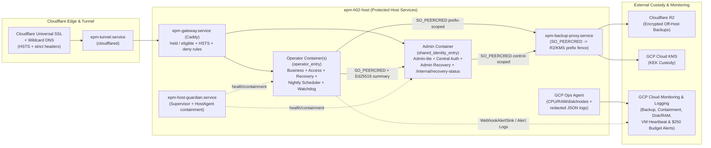

# HOSTED-001 Slice H06 Detailed Design & Implementation Plan — Pilot 0 Release, Observability, Support & Operations Gate

**Status:** Accepted (2026-11-23) — **D1–D10 approved; ready for H06.1 implementation.**
**Owning Delivery Plan:** [delivery-plan.md](mvp/delivery-plan.md#implementation-slices) (Slice H06)
**Owning Specifications:** [operations-and-sources.md](mvp/operations-and-sources.md#monitoring-reliability-and-cost-qualification), [plans-and-budgets.md](mvp/plans-and-budgets.md#operating-budgets-and-demand-validation), [releases.md](mvp/releases.md#operator-visible-release-projection), [subscriptions-storage-and-runtime.md](mvp/subscriptions-storage-and-runtime.md#per-tier-physical-storage-sizing-acceptance), [qualification/specifications/operations_economics.md](../qualification/specifications/operations_economics.md), [qualification/specifications/image_schema.md](../qualification/specifications/image_schema.md), [operator-experience.md](../../ui/operator-experience.md)
**Database Dictionaries:** [overview.md](../../database/overview.md), [schema-resources.md](../../database/schema-resources.md), [admin-registry.md](../../database/admin-registry.md), [admin-operations.md](../../database/admin-operations.md), [operator-access.md](../../database/operator-access.md), [operator-recovery.md](../../database/operator-recovery.md), [admin-recovery.md](../../database/admin-recovery.md)
**Prerequisite Handoffs:** [H02.11 handoff](../qualification/reports/HOSTED_MVP_H02_11_HANDOFF.md), [H03.12 exit review](../qualification/reports/HOSTED_MVP_H03_12_EXIT_REVIEW_2026-11-22.md), [H04.9 Free sizing](../qualification/reports/HOSTED_MVP_H04_9_FREE_SIZING.json), [H04.10 exit review](../qualification/reports/HOSTED_MVP_H04_10_EXIT_REVIEW_2026-11-22.md), [H05.11 exit review](../qualification/reports/HOSTED_MVP_H05_11_EXIT_REVIEW.md)

---

## 1. Executive Summary & H06 Scope

Slice **H06** is the **Pilot 0 release, observability, support, and operational-readiness gate**. It closes the final gap between component-complete H01–H05 code and safely admitting genuine invited Free operators onto the hosted GCP deployment (`epm-h02-host`), with repeatable manual operations, real-time host/backup/cost observability, hardened production containers, and verified end-to-end operational proof (`operations_economics.json` + `image_schema.json`).

**In scope for H06:**
1. **Closure of Prerequisite Live GCP H05 Gates:** Verify resolution of H05 code-review fixes (commit `9b3404bf`), execute native GCP `H05.9` backup/restore reserve sizing (`HOSTED_MVP_H05_9_RECOVERY_SIZING.json`), and execute live GCP 17-case `recovery.json` + 4-browser-context positive `identity_handoff.json`.
2. **Production Runtime & Transport Wiring:** Replace remaining H02/H03 deployment stubs (`shared_identity_entry.py`, `Dockerfile.admin`, `Dockerfile.operator`, `supervisor.py` standalone mode, `epm-backup-proxy` CLI/systemd unit) so deployed containers run the full H01–H05 stack with live readiness, Admin-lite APIs, Admin recovery fallback, async signed protection summaries (`D12`), nightly backup scheduling, and announced maintenance notices.
3. **Observability, Structured Logging & External Alerting:** Deploy GCP Ops Agent + Cloud Logging/Monitoring + uptime/heartbeat checks + Billing Budget alerts; standardize redacted structured JSON logging across hosted services; wire `WebhookAlertSink` / Cloud Monitoring log-based alerts for overdue/failed backups, container containment, host disk/inode/RAM headroom, and host loss.
4. **Security Header Hardening & Support UX:** Complete HTTP security headers (HSTS, `Permissions-Policy`, `X-Content-Type-Options: nosniff`, CSP on business/settings/Caddy routes); surface real support contact on all error/sign-in/settings views; add Admin-lite cohort health/maintenance overview and Operator pre-maintenance / `Updating your workspace` UX.
5. **Immutable Release Packaging & Promotion (`image_schema.json`):** Build separate immutable Admin OCI image, Operator OCI image, and Host Agent bundle from final H01–H06 source and pass all 9 `image_schema.json` cases before promoting into `qualified_releases`.
6. **Pilot 0 Runbooks, Worksheets & `operations_economics.json` Qualification:** Deliver the Pilot 0 Launch Gate, Incident/Support Triage, Announced Maintenance Window, Break-Glass/Retirement runbooks, and Before-Credit Cost + Admin-Minutes + 4-Week Adoption worksheets; pass all 9 `operations_economics.json` cases before inviting real operators.

**Explicitly out of scope for H06 (must NOT be shipped or advertised):**
- Stripe integration, checkout, paid plan enrollment, billing credentials, or paid-upgrade controls (H08/H09).
- Automated provisioning/reconciliation loops or H07 control-plane job scheduler (manual supported completion remains intentional for Pilot 0).
- Per-operator update window preferences or automated canary rollouts (H10).
- Idle container suspension or automatic wake-on-request (H11).
- Tenant/Owner portals (`PORTAL-001/002`), rent payments (`PAY-001/002`), local/cloud sync, staff roles, or 100-operator capacity claims (H12).

---

## 2. Current Codebase, Infrastructure & Qualification Inventory

| Component / Area | Current State in Checkout | Gap to Close in H06 |
| --- | --- | --- |
| **H05 Live GCP Proof** | Component 17/17 tests + 41 review fixes (`9b3404bf`) complete, but `HOSTED_MVP_H05_9_RECOVERY_SIZING.json`, live GCP `recovery.json`, and 4-browser `identity_handoff.json` have **not** been executed on `epm-h02-host`. | Execute H05 follow-up re-review check + live GCP H05.9 sizing, live 17-case recovery, and 4-browser positive handoff before Pilot 0 admission. |
| **`shared_identity_entry.py` & `admin_entry.py`** | `shared_identity_entry.py:123-128,241` hardcodes `AwaitingWorkspaceReadiness()` (`return False`); `shared_identity_entry.py:258` & `admin_entry.py:110` mount `build_admin_identity_app()` **without** `admin_control`, `admin_recovery`, `authenticate_recovery`, or `create_admin_recovery_app` fallback. | Wire live workspace readiness, `AdminControlService`, `AdminControlRecoveryService`, D5 `authenticate_recovery`, recovery-mode boot fallback on damaged `admin.sqlite`, and private summary ingest endpoint. |
| **Async Protection Summary (`D12`)** | `operator_entry.py:267-284` wires `summary_signer_key` but leaves `summary_publisher=None`; `RecoveryStatusIngestService` (`recovery_status_ingest.py:131`) has no mounted HTTP/Unix-socket route. | Wire `summary_publisher` over the private `central_relay` Unix socket to a `SO_PEERCRED` + Ed25519 authenticated internal ingest route in `shared_identity_entry.py`. |
| **Nightly Backup Scheduler & Watchdog** | `HostedWorkspaceRecoveryService` and `AdminControlRecoveryService` implement capture/reconcile/alerting, but no background timer or scheduler invokes nightly captures or periodic overdue checks. | Add jittered internal nightly capture + hourly overdue/dirty watchdog loop in `operator_entry.py` and `shared_identity_entry.py` (with `reconcile_startup()` on boot). |
| **`epm-backup-proxy` Service** | `backup_proxy.py` implements `BackupProxyServer` but has no `main()` / `__main__` CLI and no systemd unit in `host_services.py` / `install_services.py`. | Add CLI entrypoint, dedicated `epm-backup-proxy` system user, R2 credential loading via `LoadCredential`, and hardened `epm-backup-proxy.service` systemd unit. |
| **Dockerfiles & Container Healthchecks** | `Dockerfile.admin` & `Dockerfile.operator` still carry `LABEL epm.acceptance="infrastructure_candidate"`, `ENTRYPOINT ["...hosted_candidates..."]`, `CMD ["--health-only"]`, and plain-HTTP `HEALTHCHECK`. | Switch entrypoints to production `shared_identity_entry` and `operator_entry`, add internal `/health/live` & `/health/ready` probes, and pass all 9 `image_schema.json` checks. |
| **`supervisor.py` Standalone Mode** | `supervisor.py:71-75` runs `Supervisor(registry, engine)` with `agent=None` (which raises `HostAgentUnavailable` and contains containers on `poll()`) and logs via bare `print()`. | Wire production `HostAgent` construction into `supervisor.py` CLI and emit structured JSON containment alerts. |
| **GCP Monitoring, Logging & Budgets** | `cloud_plan.py` & `startup.sh` do not enable Cloud Monitoring/Logging APIs, install GCP Ops Agent, create alert policies/uptime checks, or configure GCP Billing Budget alerts. | Extend `cloud_plan.py` / `startup.sh` with Ops Agent config, log-based backup/containment alerts, host CPU/RAM/disk/inode alerts, VM heartbeat uptime check, and `$250/mo` before-credit budget alerts. |
| **Security Headers & Redacted Logging** | Missing `Strict-Transport-Security` and `Permissions-Policy` across Caddy/apps; `managed_business.py:61` and `operator_settings.py:34` omit `nosniff`/CSP; minimal structured logging across hosted modules. | Add HSTS, `Permissions-Policy`, `nosniff`, and CSP consistently; standardize secret-free structured JSON logging across `hosted_admin`, `hosted_access`, `host_agent`, and `hosted_recovery`. |
| **Maintenance Notice & Support UI** | `operator_entry.py` omits `maintenance_reader`; `central/main.tsx` never renders `supportContact`; `AdminWorkspace.tsx` lacks a cohort health/headroom/maintenance summary card. | Wire `maintenance_reader`, add Admin-lite cohort overview + maintenance announcement control, add Operator pre-maintenance/`Updating your workspace` UX, and render real `supportContact` on all error screens. |
| **Runbooks & Cost/Adoption Worksheets** | Only `H05_RECOVERY_OPERATIONS_RUNBOOK.md` exists under `docs/hosting/runbooks/`. Missing launch gate, incident triage, maintenance window, break-glass/retirement, and cost/adoption worksheets. | Author concise, operator-tested Pilot 0 runbooks and worksheets; qualify all 9 `operations_economics.json` cases. |

---

## 3. Resolved Design Decisions (D1–D10 — Accepted 2026-11-23)

| ID | Topic | Contradiction / Gap | Accepted Resolution |
| --- | --- | --- | --- |
| **D1** | **Pilot 0 Domain & Google OAuth Publishing Status** | `H03.12` verified `project-47b72bb7-ba90-42c9-910` is in Google Auth Platform `Publishing status: Testing` (`1/100` test users) on `epmdemo.xyz`. Admitting real Pilot 0 operators requires either staying in `Testing` with an explicit allowlist or completing Google OAuth verification, and deciding whether Pilot 0 stays on `epmdemo.xyz` or moves to a production domain. | **Stay on `epmdemo.xyz` (or confirm target domain up front) and keep Google Auth Platform in `Testing` mode for Pilot 0** (explicitly adding each invited Pilot 0 operator email to the 100-user Testing allowlist as part of the manual admission checklist). Defer full Google OAuth Production verification until before H12 / open paid launch, avoiding weeks of verification delay during a 5-operator invited pilot. |
| **D2** | **Transactional Email & Notification Channel for Pilot 0** | `operations-and-sources.md:16-17` requires selecting a transactional-mail provider before launch (no custom SMTP), while H03 `POST /auth/email-link` is still held at `403` with the legacy `9/24h` app ceiling even though **Google confirmed a 100 emails/day quota** for Firebase/Identity Platform sign-in links (2026-11-23). Pilot 0 needs invitation delivery, maintenance notices, and recovery/support communication for ~5–10 operators. | **For Pilot 0, use manual Admin email from a real owned support mailbox** for out-of-band invitation claim URLs (per H04 D4) and announced maintenance notices; enable `POST /auth/email-link` for Operator sign-in/step-up within Google's confirmed **100 emails/day** quota (raising the app-side `mail_rate_store` daily ceiling from `9/24h` to a conservative `90/24h` headroom cap alongside Google Sign-In). Defer integrating a programmatic transactional-mail API (e.g., Postmark/Resend) to H07 when automated invitations launch. |
| **D3** | **Host Observability, Logging & Alerting Stack** | `operations-and-sources.md:19-24` requires per-host/container CPU, RAM, disk/inodes, IO, restarts, latencies, backup age, and bounded secret-free logs; `recovery.md:229` requires external host-loss alerting; H05 D10 wired `StructuredLogAlertSink` only (no live sink/channel). | **Use GCP-native lightweight observability on `epm-h02-host`:** install **GCP Ops Agent** (exporting host CPU/RAM/disk/inode metrics + `journald` & Docker JSON logs to Cloud Logging with 30-day retention and secret-redacting filters), configure **Cloud Monitoring alert policies** (VM uptime/heartbeat for host loss, disk/inode >80%, RAM >85%, log-based alerts on `epm.hosted_recovery.alerts` and `epm-host-guardian` containment), routed to the operational owner's email (and optional `WebhookAlertSink` URL). Zero extra monitoring containers or VMs. |
| **D4** | **Named Operational Owner, Support Contact & Pilot 0 Disclosure** | `delivery-plan.md:74` requires a named operational owner and real support contact (currently placeholder `support@epmdemo.xyz`); `recovery.md:63-65,228` requires explicit disclosure that 4h host-loss RTO / 24h Free RPO are engineering objectives, not contractual 24/7 SLAs. | **Require concrete owner name + real monitored support email** before H06.10 admission (configured via `EPM_SUPPORT_CONTACT` in protected deployment config). Disclose clearly in the Pilot 0 invitation and Operator Settings: *Free invitation-only pilot; best-effort support (named owner, business-hours triage); 24h nightly backup objective with platform-managed encryption keys (not zero-knowledge); shared announced maintenance window; no contractual SLA.* |
| **D5** | **Announced Shared Maintenance Window Mechanism** | `delivery-plan.md:67,99` and `releases.md:45-60,108-113` require one announced maintenance window visible to all admitted operators, draining work, preserving unfinished drafts, and showing `Updating your workspace` during interruption — without adding H10 per-operator scheduling tables. Currently `maintenance_reader` is unwired in `operator_entry.py`. | **Add a single deployment-scoped read-only maintenance announcement file (`/run/epm/maintenance-notice.json`, root-owned, mounted read-only into Operator containers and managed by Admin/host-agent)** containing `{active, window_start_utc, window_end_utc, message, state: "announced"|"in_progress"}`. Wire `maintenance_reader` in `operator_entry.py` to read it, display the unobtrusive banner in Operator Settings + shell header when `announced`, and display `Updating your workspace` (preserving drafts) when `maintenance_operation_id` is active or `state == "in_progress"`. Zero new SQLite tables required. |
| **D6** | **Nightly Backup Scheduler & Watchdog Execution Model** | Neither Operator nor Admin currently runs a periodic backup loop; H05 D3/D12 mandate Admin-outage-independent workspace backups. | **Run an internal jittered asyncio background task inside `operator_entry.py`** (deterministic per-workspace nightly jitter window + hourly dirty/28h-overdue watchdog + startup `reconcile_startup()`) and an equivalent **nightly control-backup task inside `shared_identity_entry.py`** (plus systemd `Restart=on-failure` supervision). Keeps backups 100% Admin-outage-independent and single-writer inside each owning service. |
| **D7** | **Async Protection Summary Relay (`D12`)** | `operator_entry.py` has `summary_signer_key` but no `summary_publisher`; `RecoveryStatusIngestService` has no mounted ingest route. | **Add a private Unix-socket relay endpoint (`POST /internal/recovery-status`) on `shared_identity_entry.py`** reachable only through the existing `central_relay` Unix socket, authenticated by `SO_PEERCRED` UID + Ed25519 signature verification via `RecoveryStatusIngestService`. Wire `summary_publisher` in `operator_entry.py` with bounded timeout (5s) and non-blocking best-effort retry (failure never blocks or invalidates a backup). |
| **D8** | **Production Container Entrypoints & Release Promotion** | `Dockerfile.admin` & `Dockerfile.operator` are still H02 `--health-only` stubs; `HOSTED_MVP_H02_11_IMAGE_ALL_STORES.json` was marked `unavailable` pending H03–H05 schemas. | **Promote both Dockerfiles to production runtime entrypoints** (`shared_identity_entry` and `operator_entry`), add internal loopback/Unix-socket `/health/live` and `/health/ready` checks (never exposed on public Caddy routes), remove `infrastructure_candidate` labels, and run the complete 9-case `image_schema.json` proof before inserting into `qualified_releases`. |
| **D9** | **Cost Envelope, Credits Expiry & Privacy-Preserving Adoption Tracking** | `plans-and-budgets.md:38-62` sets a `$250/month` before-credit launch target, notes ~$300/month GCP credits "until February" (needs actual terms confirmation), and requires tracking 4-week weekly recurring use (≥3 of ≥5 real operators, excluding demos/polling) without session recording or ad tracking. | **Confirm actual GCP credits end date**, configure a **GCP Billing Budget alert** at 50%/80%/100% of `$250/mo` (before credits), maintain a weekly **Pilot 0 Cost & Admin-Minutes Worksheet** (`docs/hosting/qualification/reports/PILOT_0_COST_AND_OPS_WORKSHEET.md`), and measure weekly recurring use strictly via **aggregate non-content workspace business-mutation counts** (e.g., weekly delta in business DB committed revision / audit event count reported in the safe observation summary, excluding seeded/demo assignments and read-only polling). |
| **D10** | **Support Break-Glass & Deliberate Workspace Retirement** | `architecture-and-access.md:143-145` and `recovery.md:234-239` require audited time-limited support access and a 7-day post-retirement recovery window, with no offline customer-data decrypt bypass (H05 D1). | **Document and enforce in runbooks:** (1) Support sees operational metadata only by default; any temporary troubleshooting access requires explicit operator written consent, recorded reason + expiry in `admin_audit`, and zero offline decrypt/restore bypass. (2) Deliberate retirement runs `disable` → capture final verified recovery point → hold retained data/backups for 7 days (reversible via operator-authenticated restore/re-enable) → explicit `retire` + verified cleanup after 7 days. |

---

## 4. Architecture & Operational Data Flow

---

## 5. Ordered Implementation Plan (H06.1–H06.10)

Each slice is one cohesive change with focused validation, lint/format/typecheck gates, and a checkpoint report.

| Slice | Goal & Key Deliverables | Primary Files / Artifacts |
| --- | --- | --- |
| **H06.1** | **H05 Re-Review Closure, Provider Config Re-Pin & Live GCP H05.9/H05.11 Execution.** Verify all 41 fixes in `9b3404bf` via follow-up re-review; update `provider_email_sends_per_day: 100` in the protected host provider config on `epm-h02-host`, re-pin `provider_config_sha256` in `selection.json`, and update `test_identity_contracts.py` (`90`/`100`); provision Cloud KMS + R2 + `epm-backup-proxy` + `/run/epm/admin-recovery-authority.json` on `epm-h02-host`; run native GCP `qualify_h05_sizing.py` → `HOSTED_MVP_H05_9_RECOVERY_SIZING.json`, live 17-case `recovery.json`, and 4-browser positive `identity_handoff.json`. | `HOSTED_MVP_H05_745be9a0_REVIEW_COMMENTS.txt`, `selection.json`, `test_identity_contracts.py`, `HOSTED_MVP_H05_9_RECOVERY_SIZING.json`, live GCP `recovery` & `identity_handoff` reports |
| **H06.2** | **Production Runtime & Host-Service Wiring.** Wire live readiness, `AdminControlService`, `AdminControlRecoveryService`, D5 `authenticate_recovery`, and `create_admin_recovery_app` fallback into `shared_identity_entry.py` / `admin_entry.py`; add `backup_proxy.py` CLI + `epm-backup-proxy.service` systemd unit in `host_services.py`/`install_services.py`; wire real `HostAgent` into `supervisor.py` standalone mode. | `shared_identity_entry.py`, `admin_entry.py`, `backup_proxy.py`, `host_services.py`, `install_services.py`, `supervisor.py` |
| **H06.3** | **Nightly Backup Scheduler, Async Summary Relay (`D12`), External Alerting & Maintenance Notice.** Add jittered nightly capture + hourly overdue watchdog tasks in `operator_entry.py` and `shared_identity_entry.py`; mount `POST /internal/recovery-status` (`SO_PEERCRED` + Ed25519) and wire `summary_publisher`; wire `WebhookAlertSink` config; wire `maintenance_reader` backed by `/run/epm/maintenance-notice.json`. | `operator_entry.py`, `shared_identity_entry.py`, `recovery_status_ingest.py`, `alerting.py`, `operator_settings.py` |
| **H06.4** | **Security Header Hardening & Redacted Structured Logging.** Add `Strict-Transport-Security`, `Permissions-Policy`, `X-Content-Type-Options: nosniff`, and CSP consistently across `auth_projection.py`, `managed_business.py`, `operator_settings.py`, `admin_identity.py`, and `central_identity.py`; standardize secret-free structured JSON logging (replacing `print()` in `supervisor.py`) with negative log-redaction tests. | `auth_projection.py`, `managed_business.py`, `operator_settings.py`, `admin_identity.py`, `central_identity.py`, `supervisor.py`, logging helper |
| **H06.5** | **Pilot 0 UI & UX Polish (Operator + Admin-lite + Central).** Render real `supportContact` on `central/main.tsx` and `admin/main.tsx` error states; add Operator pre-maintenance banner & `Updating your workspace` draft-preserving UX (`shell.tsx`, `workspace-gate.tsx`, `hosted-settings.tsx`); add Admin-lite Cohort Health/Headroom/Maintenance summary card (`AdminWorkspace.tsx`); add Playwright checks at `390px`/`900px`/`1440px` (Light/Dark, keyboard/WCAG). | `hosted-settings.tsx`, `shell.tsx`, `workspace-gate.tsx`, `central/main.tsx`, `admin/main.tsx`, `AdminWorkspace.tsx`, Playwright specs |
| **H06.6** | **Production Container Images, Healthchecks & 9-Case `image_schema.json` Promotion.** Update `Dockerfile.admin` and `Dockerfile.operator` from H02 `--health-only` stubs to production entrypoints + internal `/health/live` & `/health/ready` probes; build immutable Admin, Operator, and Host Agent artifacts; run all 9 `image_schema.json` cases and promote into `qualified_releases`. | `Dockerfile.admin`, `Dockerfile.operator`, `HOSTED_MVP_H06_6_IMAGE_ALL_STORES.json` |
| **H06.7** | **GCP Observability, Alert Policies & Billing Budget.** Extend `cloud_plan.py` and `startup.sh` to enable Cloud Monitoring/Logging, install GCP Ops Agent, deploy log-based backup/containment alerts, host CPU/RAM/disk/inode headroom alerts, external VM heartbeat uptime check, and `$250/month` before-credit Billing Budget alerts; verify synthetic alert delivery and recovery notice. | `cloud_plan.py`, `startup.sh`, `install_services.py`, alert verification report |
| **H06.8** | **Pilot 0 Operational Runbooks, Governance & Cost/Adoption Worksheets.** Author concise runbooks under `docs/hosting/runbooks/`: (1) Pilot 0 Admission & Capacity Review Checklist, (2) Incident Response & Support Triage (incl. break-glass & 7-day retirement), (3) Announced Maintenance Window & Cohort Release, and (4) Before-Credit Cost, Admin-Minutes & 4-Week Adoption Worksheet. | `docs/hosting/runbooks/H06_*.md`, `docs/hosting/qualification/reports/PILOT_0_COST_AND_OPS_WORKSHEET.md` |
| **H06.9** | **9-Case `operations_economics.json` Live Qualification.** Rehearse and record all 9 cases (`manual_add_claim_disable`, `lost_response_retry_original`, `seed_failure_disabled`, `announced_maintenance_restart`, `runtime_repair_support`, `backup_alert_support`, `gross_spend_admin_minutes`, `sixth_capacity_not_cap`, `unknown_capacity_pending`) across `manual`, `gcp`, and `deployed_browser` on `epm-h02-host`. | `application/deploy/hosted-mvp/gcp/qualify_h06_pilot0.py`, `HOSTED_MVP_H06_9_OPERATIONS_ECONOMICS.json` |
| **H06.10** | **Pilot 0 Go/No-Go Exit Review & Real-Customer Admission Gate.** Verify all H01–H06 proofs retained, zero open P0/P1 defects, named operational owner + real support contact sealed, `HOSTED_MVP_ACCEPTANCE.md` updated, and release authorized for invited Free operators (begin 4-week repeat-use observation before any H07+ expansion). | `HOSTED_MVP_H06_10_EXIT_REVIEW.md`, `HOSTED_MVP_ACCEPTANCE.md` |

---

## 6. Test & Validation Matrix

| Validation Area | Required H06 Proof |
| --- | --- |
| **Happy paths** | Fresh production container boot (`Admin` + `Operator` + `epm-backup-proxy` + `epm-host-guardian`); nightly scheduled capture → signed async summary ingested into `admin.sqlite`; announced maintenance notice visible in Operator UI; 5 + 6th capacity-based admission; full 9-case `image_schema.json` and 9-case `operations_economics.json`. |
| **Invalid combinations** | Forged/replayed/cross-operator protection summary rejected by `POST /internal/recovery-status`; non-HTTPS/private-IP/redirecting webhook URL rejected; malformed `/run/epm/maintenance-notice.json` fails safe to `unavailable`; 6th admission exceeding qualified headroom returns `Capacity review required` (never silently overcommits); public request to `/health/live`, `/health/ready`, or `/internal/*` denied by Caddy. |
| **Idempotency & retry** | Lost-response create/provision/enable retry returns original identity (`lost_response_retry_original`); changed payload on same idempotency key returns `409`; duplicate summary ingestion with same `(source_epoch, source_revision)` is idempotent and older revision is ignored; deduplicated alert emitter suppresses repeat alerts until `backup_recovered`. |
| **Transaction rollback** | Interrupted synthetic seed leaves operator `disabled`/`needs_attention` (`seed_failure_disabled`); failed summary ingest rolls back `workspace_recovery_status` without corrupting prior observation; failed maintenance-window upgrade rolls back container while retaining pre-upgrade verified recovery point. |
| **Persistence & schema** | Zero new tables required in H06; all 6 stores (business + 5 hosted stores) pass `image_schema.json` fresh init, read-only re-validation, and drift/wrong-store rejection inside built production OCI images without repo checkout. |
| **Backup & restore** | Live GCP `H05.9` sizing (`restore_readiness: "qualified"`), live 17-case `recovery.json` (including corrupt business DB recovery mode, `repair_runtime`, corrupt `admin.sqlite`, whole-host loss), and `backup_alert_support` (forced capture outage >28h triggers external alert and clears only after verified recovery). |
| **Query budget & N+1** | Admin-lite cohort overview and `/api/admin/operators` remain constant-query set-based reads against `admin.sqlite` (zero per-operator container fan-out); `/health/live`, `/health/ready`, and `maintenance_reader` are O(1) with zero full-DB scans or file hashing. |
| **Security & privacy** | HSTS, `Permissions-Policy`, `nosniff`, and CSP verified on Caddy/Admin/Central/Operator responses; structured log redaction tests prove zero cookies, bearer tokens, Firebase tokens, wrapped/raw DEKs, or business payloads appear in logs or alert payloads. |
| **UI & accessibility** | Playwright component + deployed browser verification at `390px`, `900px`, and `1440px` in Light & Dark themes for Operator maintenance banner, `Updating your workspace` draft preservation, Admin-lite cohort overview, and support-contact error states; zero paid-upgrade controls advertised. |

---

## 7. Pilot 0 Four-Week Post-Launch Evaluation Criteria

After **H06.10** admits invited Free operators, track the following for **4 consecutive weeks** before deciding to invest in **H07–H12**:
- **Adoption gate:** ≥5 genuine invited operators; ≥3 performing recurring business work weekly for 4 consecutive weeks (seeded/demo logins and polling excluded).
- **Reliability & safety gate:** Zero unresolved critical data-loss or cross-operator isolation defects; nightly backup freshness and restore drills verified.
- **Economics & effort gate:** Recorded gross cloud spend **before credits** vs. `$250/month` launch envelope, retained R2 bytes/traffic, support incident count, and Admin/support minutes per operator/task.
