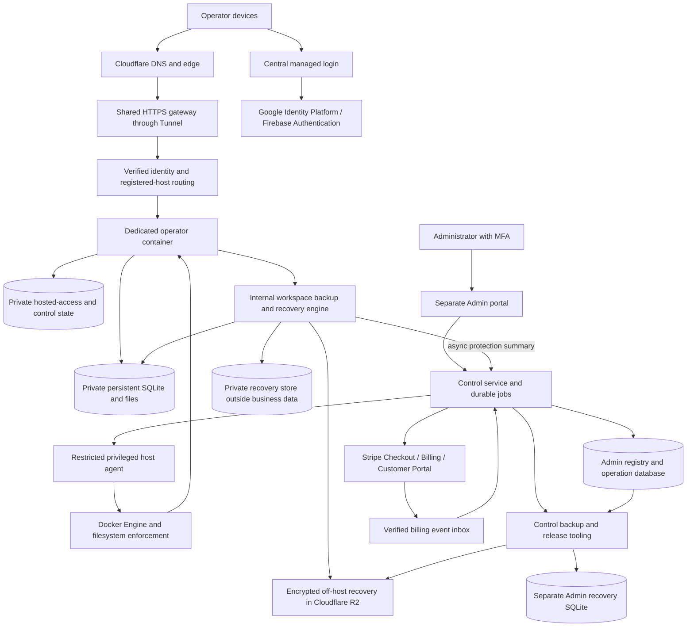

# Architecture, identity and access enforcement

[Hosted MVP design index](../HOSTED_MVP_DESIGN.md) · [Schema catalog](../../../DATABASE_SCHEMA.md)

Part of the accepted HOSTED-001 design. Requirements here do not establish implementation, deployment or qualification; Pilot 0 exceptions are in the [delivery plan](delivery-plan.md).

In this guide: [Architecture and trust boundaries](#architecture-and-trust-boundaries) · [Initial deployment and growth](#initial-deployment-and-growth) · [Public subdomains and authentication](#public-subdomains-and-authentication) · [State ownership and dependable automation](#state-ownership-and-dependable-automation) · [Access intent, local enforcement and external containment](#access-intent-local-enforcement-and-external-containment)

## Architecture and trust boundaries

### Initial deployment and growth

Start with Google Compute Engine, a persistent block disk and Docker Engine. Install
through supported VM startup/cloud-init mechanisms; pin images by immutable digest
in Artifact Registry. No Kubernetes initially. Docker Compose may define shared
services; a single template and the operator registry generate per-operator runtime
specifications. Do not manually maintain unrelated configurations for every operator.

A durable worker invokes a narrow host agent using registered IDs and fixed operation
kinds. Docker executes container lifecycle operations, with automatic restart disabled.
One systemd-supervised restricted host supervisor owns guarded starts/restarts and
verifies mount, inventory, quota and ingress fences before each start, including boot.
Do not run competing Docker/systemd restart loops. A bounded reconciler
compares desired versus actual owned containers and reports drift. Health failures
while a process remains alive need monitored remediation through that same owner.
Intentional suspension must remain distinct
from a crash or failed deployment, including after a host reboot.

Keep persistent workspaces outside container writable layers and image directories.
Replacing/deleting a container does not delete its workspace. One authoritative
application writer per operator; no automatic horizontal replicas for one SQLite DB.
The gateway forwards to private container endpoints; no operator container exposes
a direct public listener. The public Admin HTTP process and operator containers
never receive an unrestricted Docker socket or generic host command capability.

Use non-root container identities, private mounts, bounded scratch/logs, enforced
memory/CPU/process limits, appropriate network restrictions and a restricted image
filesystem. Qualify isolation, directory ownership and storage enforcement on the
actual host. Containers share a kernel, disk and host failure domain; they are not
separate VMs or a complete security boundary without those controls.

Grow by measured placement across additional hosts within the budget. Include
shared gateway/control services, paid warm containers, Free wake-up capacity,
background work, recovery staging and retained disabled allocations in commitments.
Sleeping containers reduce memory demand but do not reduce the bill of an otherwise
running VM. Prefer packing and justified host changes rather than claiming per-request
serverless economics. Avoid repeated disruptive resizing merely to follow short bursts.

The initial 100-operator workload target is approximately 20 concurrently active
operators, with multi-device sessions included. This is a qualification assumption,
not a hard permission limit at operator 21. Test bursts, simultaneous wake-ups and
backpressure. Never admit an unsupported population based solely on the assumption
that most Free operators will remain asleep. Paid warm residency also consumes
capacity when those operators are not actively using the app.

Reconsider Kubernetes when multi-host scheduling/operations become substantial,
especially if the host agent starts becoming a general orchestration platform.
Kubernetes does not itself solve SQLite data availability, billing or schema-safe
rollback. Single-node Kubernetes also shares the VM failure domain.

### Public subdomains and authentication

Use a flat operator namespace such as `workspace.example.com`. Admin chooses a
suggested available public slug; normalize/validate it, reserve infrastructure names
such as `admin`, `login`, `api`, `www`, `support` and `billing`, and bind it to immutable
operator/workspace IDs. Do not derive it automatically from a private email address.
Keep slugs stable initially; a later rename requires controlled routing/authentication
and invitation updates. Do not reassign a retired slug while old links can reach
another operator's data without a deliberate reuse policy.

Wildcard DNS/certificate/Tunnel configuration routes to the gateway, which separately
exact-allowlists provisioned hosts. A wildcard route's final catch-all does not reject
unknown operator-shaped subdomains by itself. Knowing a slug grants no access.
Use a flat namespace compatible with qualified certificate coverage; deeper names
need explicit certificate planning. Keep Admin on a distinct hostname and authority.

Use Google Identity Platform/Firebase Authentication for Google sign-in plus email-link
login, with a billing-enabled project and verified email-delivery quotas. Use one
fixed central authentication domain and exact OAuth callback; do not assume wildcard
OAuth redirects. Authenticate, validate the intended operator assignment and redeem
a short-lived single-use handoff bound to the initiating browser/state and exact
operator origin. The operator origin sets its own Secure, HttpOnly, host-only cookie.
No parent-domain session cookie, arbitrary return URL or identity token in a redirect
URL. EPM must implement and test this handoff; it is not automatically supplied by Firebase.

Use short-lived managed credentials and supported refresh with revocable application
sessions to offer remembered sign-in up to 30 days on trusted devices. This is not
an instruction to configure a Firebase session cookie beyond its supported duration.
Require recent authentication for sensitive account/billing/recovery confirmations.
Provide device-only/all-device logout and local account/session fencing. Valid
sessions/verified entitlements survive a temporary provider outage only within their
existing validity; never extend expired authority indefinitely. No provider request
on every business read. Exact origin/CSRF and current source authority still apply.

Admin requires MFA and an explicit Admin role. Customer identity is not an Admin role. Link Google/email sign-in methods only
through the managed provider's verified account-linking flow; matching email text
alone must not silently merge identities or create another workspace.
Cloudflare Access may protect the small Admin audience but is not required for all
operator identities. Support staff see operational metadata by default; time-limited
business-data access needs a separate explicit reason/authorization and audit. Platform
recovery authority means this offering must not claim zero-knowledge encryption.

## State ownership and dependable automation

| Owner | Authoritative information |
| --- | --- |
| Managed identity provider | Verified external subject and authentication proof; EPM owns the assignment to an operator/workspace |
| Stripe | Subscription/payment facts and provider transaction references |
| Main Admin/control database | Operator metadata, stable IDs/slug, assignments, desired subscription settings, jobs, reservations, applied-result references, operational audit and observed workspace protection summaries. No authoritative Admin recovery catalog/queue. |
| Admin recovery database | Separate private SQLite owned by the Admin service: control backup catalog/checkpoint, recovery operations and audit; retained while the main Admin DB is restored. |
| Protected host inventory/agent | Actual directory/container/image/host identities, physical enforcement and effect observations |
| Operator hosted-access/control store | Effective account/session authority, source fences and command receipts; bounded hosted storage accounting/control state |
| Operator business workspace | Domain records, files, revision conflicts, business receipts and audit |
| Per-operator recovery store / immutable manifests | Operator service owns workspace backup checkpoints, verified catalog and restore operations outside the replaceable business DB. Admin receives non-authoritative protection summaries; separate control manifests protect the platform. |

A small single-writer control-plane SQLite store is a reasonable initial candidate;
qualify it with bounded workers/queries. This is not the operator business database,
and it does not require a managed relational service on day one. Reassess it as
multi-host/control-plane availability needs grow. Operator containers must not open
that database or another operator's hosted-access store.

Keep desired settings separate from verified effective settings. Generate minimal
protected runtime configuration from admitted control records and registered bindings;
files are runtime projections, not a second editable operator registry. Store secrets
in protected secret/key mechanisms outside business exports, images and browser data.

### Access intent, local enforcement and external containment

Retain Admin `operators.desired_access` and per-operator
`access_meta.effective_access` as distinct facts. Admin records intent; the Operator
service applies it and checks sessions locally without a synchronous Admin DB request
for every action. This supports availability and honest pending/unknown status at the
cost of explicit reconciliation. The per-operator access store is internal only;
portals receive safe status projections, not raw rows, fences or binding metadata.

Local source enforcement is not sufficient against a compromised Operator process.
Such a process might alter its own store or bypass its checks. Therefore **Admin
disablement/retirement requires independent external enforcement**: a durable deny
at the trusted gateway outside the operator container, with no direct-origin bypass.
The Operator container cannot modify gateway policy, access the Docker socket or
control host lifecycle. Denial must cover existing and new access, including closing
long-lived connections or stopping/fencing the container when necessary. An enabled
local flag, valid old cookie or healthy container cannot override that deny.

Persist Admin intent before effects and verify external enforcement separately from
source disable/session revocation. Report completion only when both required results
are confirmed against the original operation and current fences. If the source is
unreachable, apply external containment first and show **Contained — source
reconciliation pending** when that containment is verified. Failed or unverifiable
containment remains pending/unknown with an actionable alert, never a completed
disable. No distributed transaction or instant cancellation of already committed
business work is implied.

Preserve external deny/fences across gateway/container restart and replacement;
missing or unverifiable required routing/enablement authority fails closed. Removing
the deny requires a fresh admitted Admin enable operation, current identity/readiness
and matching revisions/epochs. Stale enable or provision completion cannot reopen
access. H02/H03 must design the protected gateway projection, authenticated control
path and proof/reconciliation protocol before implementation; H04 provides safe
progress in Admin. Use the existing owning operation/event/receipt contracts described
in the [schema decision](../../../database/admin-registry.md#access-state-decision-and-external-enforcement),
not a second editable registry. These controls contain a compromised operator runtime;
they do not claim protection against a fully compromised trusted host/control plane.

Use durable jobs, original idempotency keys and semantic request hashes. In short
owning transactions record intent before external effects, then verify and checkpoint.
Duplicate matching submissions return the original operation/result; changed intent
under the same key conflicts. Retry inspects effects and source receipts rather than
assuming a timeout means nothing happened. Keep per-instance mutation ownership,
monotonic revisions/fences and bounded worker claims; disable/revoke wins over stale
activation. Do not hold a DB transaction across Docker, network, backup or provider work.

External operations cannot commit atomically with SQLite. Persist unknown outcomes,
retain necessary reservations and reconcile them through the original operation.
Use bounded verified webhook inbox/outbox processing, stable event IDs, semantic
source commands and periodic provider reconciliation. Handle duplicate/out-of-order
events without rolling a subscription or source fence backward. Workers and Admin
pages must not expose raw secrets, sessions, business contents or shell output.

