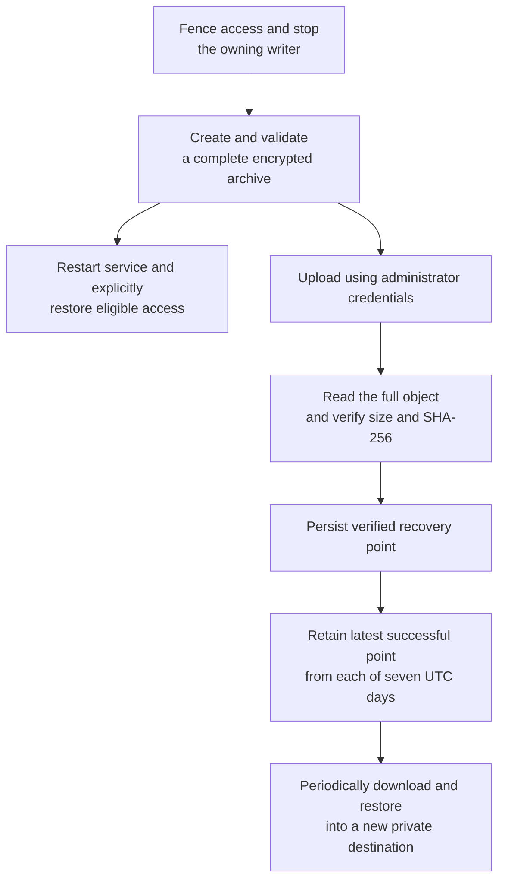
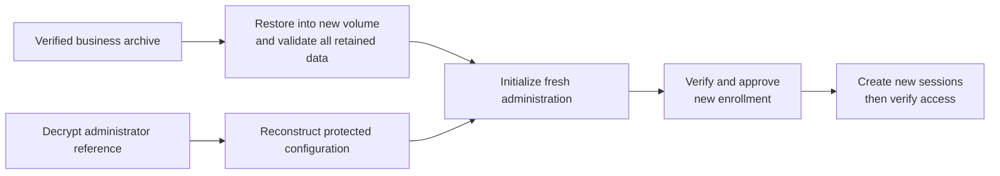

# Hosted demo administrator runbook

Consolidated October 24, 2026. Use this for recurring operation of the recorded deployment.
For the short routine-operation and release-update sequence, use the
[ongoing Google Cloud runbook](GOOGLE_CLOUD_ONGOING_RUNBOOK.md).
[Deployment/setup](../deployment/GOOGLE_CLOUD_DEMO_DEPLOYMENT.md),
[configuration](../deployment/HOSTED_DEMO_CONFIGURATION.md),
[evidence/status](../qualification/HOSTED_DEMO_PUBLIC_ACCESS_PLAN.md) and [deployment
record](CLOUDFLARE_OPERATIONS.md) have separate roles.

The administrator owns daily recovery, passphrase custody, alerts, retention and funding
review. Current runtime: `/opt/epm/releases/signin-nav-20261024/venv`. Use
`hosted-local.json` for current portfolios; old `config.json` selects retained private data.
Never run a second writer or the old local-mode unit beside hosted. Commands below use
`RELEASE` as an explicit qualified-release placeholder.

## Routine inspection

These commands inspect the current state; they do not deploy, restore, restart or activate
anything. Run the SSH command on the **Mac**, using its authenticated Google account:

```bash
gcloud compute ssh epm-demo \
  --project=project-47b72bb7-ba90-42c9-910 \
  --zone=us-west1-b \
  --tunnel-through-iap
```

Then run inside the **VM**:

```bash
sudo systemctl is-active epm-hosted@a.service epm-hosted@b.service
sudo systemctl is-enabled epm@a.service epm@b.service
sudo systemctl show epm-cloudflared.service -p ActiveState -p UnitFileState
sudo findmnt --mountpoint /var/lib/epm-a/volume
sudo findmnt --mountpoint /var/lib/epm-b/volume
sudo stat -c '%s %b %a %U %n' /var/lib/epm-volumes/epm-a.ext4
sudo stat -c '%s %b %a %U %n' /var/lib/epm-volumes/epm-b.ext4
```

Expected recorded states: hosted units active; old units masked (that command may exit
nonzero because masked is intentionally not enabled); tunnel active/disabled-at-boot; both
ext4 mounts with the required restrictions; each image 262144000 bytes, 512008 allocated
512-byte blocks, mode 600/root. Loop device numbers and PIDs can change on reboot and are
not identity checks by themselves.

For A's current workspace/schema binding and local recovery ledger:

```bash
sudo -u epm-a env TMPDIR=/var/lib/epm-a/volume/tmp \
  /opt/epm/releases/signin-nav-20261024/venv/bin/python -m app \
  --config /var/lib/epm-a/hosted-local.json \
  validate-hosted-config /etc/epm/hosted-a.json

sudo /opt/epm/releases/signin-nav-20261024/venv/bin/python -m app \
  --config /var/lib/epm-a/hosted-local.json \
  hosted-recovery-status /etc/epm/recovery-a.json
```

Repeat with B's paths/account for B. Recovery status reads the local ledger only; it neither
decrypts the archive nor contacts R2. The configuration check may reject an expired trial;
do not extend dates or bypass validation merely to make it pass.

For the private unauthenticated A boundary:

```bash
curl --max-time 5 -sS -D - -o /dev/null \
  -H 'Host: demo-a.epmdemo.xyz' -H 'Accept: text/html' \
  http://127.0.0.1:8001/sign-in

curl --max-time 5 -sS -D - -o /dev/null \
  -H 'Host: demo-a.epmdemo.xyz' -H 'Accept: application/json' \
  http://127.0.0.1:8001/api/properties
```

Expected 200/no-store for sign-in and 401/no-store for unauthenticated business reads. Use
B's hostname and port 8002 for B. These local probes do not authenticate an operator or
verify public Cloudflare behavior. Never print credentials, certificate contents,
passphrases, decrypted references or session tokens for review.

Check disk/memory, unit restarts/CPU throttling, errors, exact mounts/full image allocation,
recovery age/retention and Google gross usage before credits. Record observation timestamps;
process IDs/loop numbers are not durable bindings. At host 80% usage investigate warnings;
at 89% new business writes enter 503 maintenance. Workspace quota errors are 507.
Session/logout remains available. Use the deployment guide's storage contract for capacity,
TMPDIR and reservations.

## Billing and funded operation

Trial ends January 22, 2027 and $30 alerts are configured, per operator. Review funding by
January 15. Check actual credit, gross compute/disk/IP/transfer/R2 costs and current
pricing; no automation/reminder or paid upgrade was created. Alerts are not a spending cap.
If funding is not arranged, make final verified off-host backups, fence access, stop the
services/VM and review retained billable resources. Do not silently promise operation beyond
funded dates.

## Recovery workflow



Only a complete, durably verified point can authorize pruning. A failed backup, upload or
read-back leaves the previous verified recovery point in place. Retention errors require an
explicit repair; reference bundles are retained separately.

## Daily manual recovery points

The project administrator owns execution, passphrase custody, alert checks and recovery. The
administrator runs these steps interactively; unattended execution is outside the current
operating model. Stagger A and B; watch the other workspace during maintenance. Prepare
service-private external archive and staging directories with host disk headroom.

For A, disable access using `hosted-admin ... disable`, drain/stop `epm-hosted@a.service`,
and keep it stopped during the complete backup:

```bash
sudo -u epm-a env TMPDIR=/var/lib/epm-a/volume/tmp \
  /opt/epm/releases/RELEASE/venv/bin/python -m app \
  --config /var/lib/epm-a/hosted-local.json \
  hosted-backup /etc/epm/hosted-a.json \
  --output /var/backups/epm-a/DAILY.epm-backup \
  --staging-directory /var/backups/epm-a/staging
```

Choose a new dated output. Enter the existing backup passphrase interactively. The command
holds the same lifetime writer lock as the server, creates a complete application archive,
runs owning archive/retained-data validators, checks its UUID and permits a final backup
after demo expiry. It refuses an active writer. External archive staging does not move live
DB/WAL or ordinary upload staging outside quota. After successful checks, restart the
service; explicitly reactivate the intended subject only if still eligible. Fresh identity
proof/session is required after disablement. A failed backup is not a new recovery point. If
exhausted storage prevents the final backup/audit, leave access fenced and retain the
previous verified point. Use the qualified recovery procedure on a new volume; do not bypass
admission, delete immutable evidence, or mutate SQLite by hand.

The administrator owns a private R2 Standard bucket and a dedicated bucket-scoped credential
with only the required read/write/delete permissions. Never select R2 as the live File
provider, enable public bucket access, or give these credentials to the application users.
Create root-owned `0600` `/etc/epm/recovery-a.json` under root-protected parents; this
example contains placeholders, not credentials:

```json
{
  "deployment_id": "00000000-0000-4000-8000-000000000010",
  "workspace_id": "0efb09a0-5af2-4e6f-904f-154a50ab9445",
  "endpoint": "https://ACCOUNT_ID_32_HEX.r2.cloudflarestorage.com",
  "bucket": "epm-private-recovery",
  "access_key_id": "REPLACE_PRIVATELY",
  "secret_access_key": "REPLACE_PRIVATELY",
  "ledger_path": "/var/lib/epm-recovery/a/ledger.json"
}
```

Use a new deployment UUID and the exact business UUID. The ledger directory and
administrator staging directory must exist, root-owned `0700`, outside the checkout and all
workspaces/volumes, with protected non-symlink root-owned parents. The endpoint requires the
real 32-hex account ID. The qualified release must include its boto3 dependency. As root,
using the appropriate local configuration:

```bash
sudo /opt/epm/releases/RELEASE/venv/bin/python -m app \
  --config /var/lib/epm-a/hosted-local.json \
  hosted-publish-backup /etc/epm/hosted-a.json /etc/epm/recovery-a.json \
  /var/backups/epm-a/DAILY.epm-backup \
  --staging-directory /var/lib/epm-recovery/a/staging

sudo /opt/epm/releases/RELEASE/venv/bin/python -m app \
  --config /var/lib/epm-a/hosted-local.json \
  hosted-recovery-status /etc/epm/recovery-a.json
```

Publication makes a bounded administrator-private copy, revalidates the complete archive and
workspace identity, uploads under `epm/<deployment>/<workspace>/`, then downloads the entire
object and verifies SHA-256/size. No ETag shortcut. The durable verification ledger is saved
**before** any pruning. Retention keeps the latest successful snapshot from each of the
latest seven UTC days; same-day retries do not count as extra days. Failed
upload/read-back/ledger persistence never authorizes pruning the prior point. Prune failure
reports `retentionPending`; repair/retry explicitly. An older seed cannot replace a newer
verified point.

Status reports age from the archive's creation time, not upload time; re-uploading an old
archive does not refresh recovery. Status does not contact R2, so it is not proof of
continued remote availability. A missing/stale (>24 hour) point or pending retention needs
administrator attention. Record the actual verified snapshot time; do not keep promising at
most 24 hours of lost edits when the schedule has failed. Keep failed/new local archives
until reviewed. Budget actual stored bytes and full read-back operations; bucket allowances
are shared. See the [R2 S3 API contract](https://developers.cloudflare.com/r2/api/s3/api/).

## Administrator recovery bundle and host loss

Export a separate encrypted reference bundle as the owning service user into a private
external folder, while the administrative store is available:

```bash
sudo -u epm-a /opt/epm/releases/RELEASE/venv/bin/python -m app \
  --config /var/lib/epm-a/hosted-local.json \
  hosted-recovery-bundle /etc/epm/hosted-a.json \
  --output /var/backups/epm-a/hosted-reference.enc
```

Use a separate password-manager passphrase. The bundle uses production scrypt parameters and
authenticated encryption. Copy the encrypted bundle off-host separately and verify recovery;
never upload its decrypted contents. It includes protected deployment configuration and
approved/pending subject **references**, not sessions, token hashes, leases, Access
assertions or R2/provider credentials. Preserve the local workspace configuration/path
mapping and release record separately in the administrator's protected recovery records.
Keep R2/Cloudflare credentials in the administrator's secret store; the bundle is
intentionally insufficient to restore usable authority.

On host loss, retrieve a verified business archive and the bundle through the administrator
account. The following writes a **new private reference JSON only**; it never initializes or
approves a subject:

```bash
/opt/epm/releases/RELEASE/venv/bin/python -m app \
  --config /PRIVATE/NEW/restore-bootstrap.json \
  hosted-unpack-recovery-bundle hosted-reference.enc \
  --output /PRIVATE/NEW/hosted-reference.json
```

The CLI loads a local configuration before dispatching these commands. On a new host, create
the private bootstrap locator first, pointing `localWorkspacePath` at a new unused external
path; reference unpacking does not initialize it.

Reprovision the qualified volume/release. Restore the business archive using a separate
bootstrap config into a new private destination and external archive staging. Validate all
retained data, IDs, relationships, history, file bytes and financial totals. Reconstruct
protected configuration with correct new paths; initialize a **fresh** administrative
database, then verify/approve fresh enrollment. Never restore live session/lease tables.
Startup also fences a changed restore marker. Keep public routes disabled until new sessions
and isolation pass.

## Restore authority after host recovery



Restoring business records never restores usable sessions or editing authority. The
reference bundle supplies configuration and identity references for administrator review; it
does not grant access by itself.

## Disable, renew, reset and rollback

- `hosted-admin ... disable` and `revoke` remain available after expiry or broken
  business storage. Confirm denial from an existing browser. Permanent removal
  also removes/revokes the provider's Access policy/session; app fencing is immediate.
- Renewal is an administrator change to protected dates (maximum 14-day window),
  followed by stopped-process validation/restart and explicit eligible activation.
  Never silently renew sessions or replay interrupted commands.
- Reset: disable, stop/drain, create/verify the final recovery point, prepare a new
  private synthetic workspace, validate it, then atomically replace protected path/
  identity configuration **while stopped**. A new UUID requires fresh administrative
  binding; a same-UUID restore still requires new runtime/enrollment/session authority.
  Do not overwrite a SQLite file or reuse authority to skip enrollment.
- Failed preparation leaves the old stopped data untouched. Keep explicit maintenance
  until either the new state passes or a compatible previous release/data pair is
  selected. Stop the new writer before rollback; never run both, downgrade an
  incompatible schema, or expose the old local server to bypass hosted checks.

## Credential custody and rotation

Keep actual Cloudflare issuer/audiences, allowed emails, administrator contact, S3 keys and
endpoint in protected inputs; never print whole configuration files. The Mac's
`~/.cloudflared/cert.pem` is an account-management credential and stays on the Mac. The VM
receives only the tunnel-scoped JSON. Root-only recovery JSON is outside app
environments/workspaces; the normal application cannot use it. R2 Standard is a private
encrypted-archive destination, not the live S3 File provider: that adapter needs
versioning/VersionId unavailable in R2.

Rotate credentials through the provider and a reviewed private host-side update; verify new
scoped access before retiring old credentials. Initial setup wizards refuse overwrites and
are not rotation procedures. Credential-rotation/provider revocation outage proof remains
distinct from successful publication evidence.

## Current human verification helpers

Run only the helper appropriate to a pending operation; review recorded results instead of
blindly replaying one-time setup. All PIN/passphrase entry stays private.

| VM helper | Purpose |
| --- | --- |
| `/opt/epm/admin/refresh-admin-references.sh` | Timestamped A/B reference export, R2 read-back, independent decrypt/current-binding verification |
| `/opt/epm/admin/protect-fresh-demos.sh` / `protect-fresh-demo-b.sh` | Recorded fresh-portfolio recovery drills; inspect populated destinations before reuse |
| `/opt/epm/admin/compare-recovery.py` | Stable row/file/audit comparison; permits only exact correlated post-snapshot backup/retention and destination restore additions |
| `/opt/epm/admin/reference-transfer.py` | Encrypted-only bounded R2 publication/independent download |
| `/opt/epm/admin/reference-validate-current.py` | Private decrypted reference versus current approved/pending bindings; outputs only flags/counts |

Retain pre-enrollment and post-enrollment encrypted reference objects separately; reference
retention is manual and does not count toward seven daily business points. Decrypted
verification files stay root-private on the VM. No full bare-host reprovisioning claim
follows from reference decrypt alone.

## Qualification and publication

Use isolated scratch storage for destructive tests. The [qualification
plan](../qualification/HOSTED_DEMO_PUBLIC_ACCESS_PLAN.md) lists exact passed scope,
evidence, current resume action and unfinished gates. After all gates pass, review demo
dates, verified recovery age/custody, budget, support contact and tunnel boot behavior
before invitations. The administrator sends each operator only its assigned URL, sign-in
instructions, synthetic-data restriction, expiry, recovery expectations and support contact.
No sending has been performed by writing this document.
