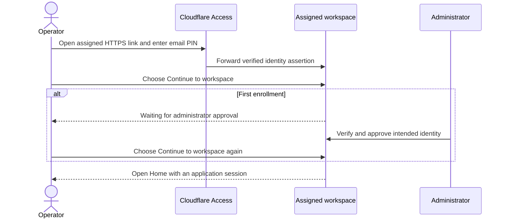

# Operator guide — hosted synthetic demo

For the two approved operators. The administrator supplies your assigned HTTPS link, sign-in
email, expiry and support contact. Both approved accounts are now usable during acceptance;
general invitations remain gated by the [qualification
plan](../qualification/HOSTED_DEMO_PUBLIC_ACCESS_PLAN.md). Use synthetic information only.

## Open your workspace

Use your assigned HTTPS link and complete Cloudflare email sign-in with the invited address.
Choose **Continue to workspace**. If enrollment awaits approval, ask the administrator to
verify/approve it, then continue explicitly. Wrong email or unapproved subjects have no
business access. Deep links retain workflow parameters.

The banner identifies your hostname, active/read-only session, expiry, sign-out actions and
administrator contact. Enter synthetic information only. The other operator has a separate
portfolio. Backups are administrator-managed. “Your changes are saved” describes
persistence, not acknowledgement of every unfinished input or off-host backup: check each
form's own save/receipt status.

## What sign-in grants

The email sign-in and application session are separate. A successful email PIN does not
bypass enrollment approval, demo expiry or workspace authorization.

## Expiry, interruption and recovery

- Expiry/revocation pauses private access and editing. Keyboard focus moves to the
  sign-in heading; the hidden editor cannot be operated. Do not submit a second
  consequential action to compensate for a lost response.
- Same-identity/workspace input may remain in this tab's memory. Renew Cloudflare
  sign-in if needed, then continue explicitly. Nothing is automatically resubmitted.
  Resolve uncertain commands through their original result/recovery controls.
- Closing/reloading loses unsaved memory. Only acknowledged unfinished forms can
  be recovered later. Logout or changed identity/workspace/runtime clears the
  preceding private editor/query context.
- Evidence downloads check access before releasing bytes. Expiry pauses access
  without navigating away or restarting the download. Retry explicitly after
  reauthentication. Already downloaded files cannot be remotely revoked; handle
  and delete them as instructed by the administrator.
- Read-only access allows browsing, not record creation or unfinished-form/
  preference saves. Host paths, secrets, backup/restore, storage maintenance and
  AI administration are unavailable even through direct API requests.
- Unavailable workspace, expired demo and rejected sign-in require administrator
  help. Do not change local server configuration or use someone else's link.

## Sign out

Storage/quota or disk-maintenance errors pause writes without automatically resubmitting
them. Keep the form open and contact the administrator; the existing alert explains the
failure. After an interrupted response, check the original operation result rather than
creating a second payment/expense. If bootstrap is blocked by storage, use **Retry
connection** explicitly after the administrator confirms recovery. Do not assume an error
means the original action rolled back. The administrator must disclose the actual
recovery-point age when daily backup verification is stale; the demo does not promise zero
data loss.

**Sign out this device** closes this application's current session. **Sign out all devices**
revokes other application sessions too; a visible browser detects this on its next protected
request or session check (at most one minute while visible). Neither action erases
downloaded files or promises to log out unrelated applications.

Renew Cloudflare sign-in through the explicitly labelled link before starting a new session
after logout; it can sign out broader Access sessions. Old assertions are deliberately
refused. If logout cannot be confirmed, this browser still closes private content; ask the
administrator to revoke access. Never share tokens or PINs.

## Multiple devices and shared forms

Independent new forms have independent IDs. Resuming a saved form does not claim or silently
take over editing. Choose **Claim editing**; if another editor owns it, use **Take over
editing** only after reviewing the confirmation. Claims last five minutes and are renewed at
most once a minute while visible, focused and actively edited. Idle/hidden editors can lose
their claim.

A replaced/expired claim rejects the previous editor's next save without erasing its input.
Use **Review latest saved form (keep my input)**, review the owning record/source revision
as appropriate, then claim or explicitly take over before saving. A source conflict or
unresolved attempt still requires its original review/reconciliation workflow; a lease is
not permission to bypass it. Sign-in, restore and runtime changes do not restore transient
edit authority.

Visible pages also check a bounded change signal roughly every fifteen seconds with
jitter/backoff. Hidden pages stop polling. A stale-update message means the displayed data
may not be current; the app never queues offline commands. This signal does not replace
Home's independent attention/time-transition refresh.

## Sign-in expectations

A separate workspace may ask for email sign-in again. Its login form is not permission to
enter that workspace. Use only your assigned identity/link; do not share PINs, sessions or
credentials. Cloudflare can show a code-sent message even for a blocked address. Contact the
administrator when your assigned login fails.

Private data requires both a verified identity and an active application session.

## Current demo limits

Each portfolio has a 250 MiB physical workspace budget and 50 MiB per-file limit. Filesystem
metadata/reserved recovery space reduce usable storage. External email, payments and model
calls remain disabled. There is no offline mutation queue, shared portfolio, commercial SLA
or promise of uninterrupted maintenance.

Use the [administrator runbook](HOSTED_DEMO_OPERATIONS.md) for host recovery and the
[qualification plan](../qualification/HOSTED_DEMO_PUBLIC_ACCESS_PLAN.md) for acceptance
evidence. Operators do not need Google Cloud accounts, SSH keys or local software.
