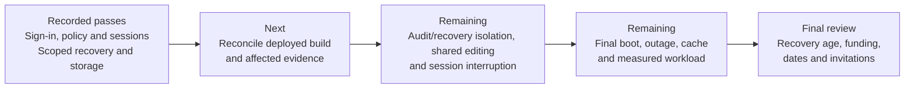

# Hosted demo qualification and remaining rollout plan

Recorded state reviewed October 26, 2026. Requirements live in the
[design](../design/HOSTED_DEMO_DESIGN.md); procedures in
[deployment](../deployment/GOOGLE_CLOUD_DEMO_DEPLOYMENT.md) and
[operations](../operations/HOSTED_DEMO_OPERATIONS.md); exact deployment artifacts in the
[Cloudflare/VM record](../operations/CLOUDFLARE_OPERATIONS.md). This is the sole current
checkpoint.

## Release reconciliation — October 26, 2026

Read-only VM inspection found both hosted services active with effective interpreter
`/opt/epm/releases/release-20261025-03/venv/bin/python`. The installed release directories
include `signin-nav-20261024`, `release-20261025-01`, `release-20261025-02` and
`release-20261025-03`; the first was already the October 24 qualification baseline.
The operator reports four newer deployments. Directory inventory alone does not establish
four subsequent release identities or their acceptance, so reconcile the deployment records
before assigning source revisions, package hashes or test results to the running build.
Current repository HEAD is not proof of the installed source revision.

Follow-up [release reconciliation](../evidence/HOSTED_DEMO_RELEASE_RECONCILIATION_2026-10-26.json)
identified bundle-declared commits `369410f3` (01), `2d344902` (02) and `c96709f4` (03).
All active bundle checksums passed; installed resource verification passed as `epm-a`,
and all 539 installed application files matched the wheel, including seven frontend files.
The current wheel SHA-256 is
`366cb668df59ad9fc6f42ca9984cb72b9fba50a643a2d2e1eaaec5969c9be7cf`.
This confirms installed artifact integrity, not a reproducible clean-source build or browser
acceptance. The fourth reported subsequent deployment remains unidentified. No wizard-state
directory exists in release 03; deployment acceptance and compatible rollback evidence need
separate records. The current checkout's unfinished-form redesign postdates installed commit
`c96709f4`; its new workflow must not be assumed available on the VM.

Both hosted units remain enabled. The actual tunnel unit is `epm-cloudflared.service`:
active, disabled at boot, zero automatic restarts. Both hosted units are active with zero
automatic restarts; old `epm@a` and `epm@b` units remain masked. No restart, deployment or
browser acceptance was performed during this review.

New local pre-release archives exist for A and B at
`/var/backups/epm-{a,b}/before-release-20261025-03.epm-backup`, dated October 25 local time
(October 26 UTC), respectively 497300 and 436418 bytes. Their presence does not prove
off-host publication, restore validation or coverage of subsequent writes. The October 24
R2 restore proofs remain historical evidence.

The remaining security, recovery, concurrency and performance gates still apply. Releases
do not close them automatically. Retain the October 24 results below with their original
scope; check affected boundaries against the installed build before treating them as current.
In particular, repository changes since the baseline affect hosted sign-in renewal, workspace
navigation and form/recovery behavior. Establish which changes are installed, then repeat
the affected acceptance checks; do not infer deployment from a repository commit.

## Current browser checkpoint — October 26, 2026

[Operator-reported renewal and Task audit checks](../evidence/HOSTED_DEMO_RENEWAL_AUDIT_2026-10-26.json)
passed for both instances on release 03; all four saved wizard flags were inspected.
Each operator signed out this device, renewed Cloudflare sign-in, explicitly continued
and reached the correct Home. Own Task creation history was visible; foreign Task
history revealed no events/snapshots, and one filtered activity page contained no foreign
Task event. This closes the scoped Task audit check, not all audit pagination/entities.

[Recovery detail/list isolation](../evidence/HOSTED_DEMO_RECOVERY_ISOLATION_2026-10-26.json)
also passed for both instances. Existing active property-create saved forms were used:
own detail returned, foreign detail rejected without disclosure, and each list included its
own probe/excluded the foreign probe with no next cursor. Both saved pass flags were
inspected. This covers reads of the selected records, not mutation/lease authorization.

[Missing/invalid CSRF checks](../evidence/HOSTED_DEMO_CSRF_2026-10-26.json) were reported
as `403 hosted_csrf_rejected` for both probes on both origins. The probes used same-origin
POST `/api/tasks` with invalid empty JSON and no CSRF header or a fixed invalid value.
No actual sibling-session token was copied; foreign-Origin coverage remains open.

[Uninvited-account policy and live Origin probes](../evidence/HOSTED_DEMO_UNINVITED_ORIGIN_2026-10-26.json)
passed within scope: the policy tester explicitly denied the controlled third account for
both apps. Live A/B listeners rejected missing and foreign Origin with
`403 hosted_origin_rejected`, using exact public Host and invalid empty Task JSON before
authentication. This is policy-test/direct-origin evidence, not third-account browser
authentication or an authenticated cross-site edge test.

**Next:** real shared-form claim/takeover, stale revisions and independent drafts.
Third-account browser denial and actual sibling-token testing remain unproven; the scoped
policy and origin checks above must not be expanded into those claims.
No draft payloads or credentials are collected. An existing
A form has `outcome_unknown` status; leave it untouched and reconcile its original attempt
separately before retrying it.

## Historical acceptance checkpoint — October 24, 2026

Both intended operators are enrolled/active and can use their assigned Home pages.
Cloudflare's application policy tester returned all four intended A/B email decisions.
Device logout/refresh/fresh sign-in and two-independent-session Sign out all devices passed
per operator, with saved success flags. The two synthetic Task records persisted across
refresh and independent sessions, and foreign saved-record access was rejected. Read-only
database inspection found one owning Task, one creation receipt, and one hosted-operator
creation audit event per workspace, with no counterpart Task row. Post-enrollment
administrator references were independently downloaded/decrypted and matched.

Each owner also uploaded, reviewed, and downloaded a synthetic File. Cross-demo metadata,
content, upload-result-by-key, and upload-result-by-operation-ID access was rejected.
Read-only inspection found one owner-only available File/link/upload receipt/audit event per
workspace and verified both stored byte hashes.

Each owner viewed its seeded rent receipt, while cross-demo UI and direct API reads were
rejected. Read-only inspection found one owner-only receipt/allocation and no counterpart
receipt per workspace; its retained audit provenance predates hosted enrollment.

Exact synthetic Task searches returned only the owning workspace's Task. Each bootstrap
response reported its own workspace binding, and read-only manifests/source-row inspection
confirmed distinct A/B UUIDs with one own and no counterpart Task row per workspace.

**October 24 next action (still open):** qualify audit-list/recovery isolation, missing/foreign CSRF and an
additional uninvited identity. The synthetic Tasks and Files are retained as evidence.
Create a new verified business recovery point after the next approved edits; the existing
points predate these records.

At that checkpoint the tunnel was active but disabled at boot, A/B hosted units were
active/enabled, and old local-mode units were masked. Current tunnel/old-unit state needs
reconciliation as described above. General invitations and completion remain pending.

## Path to completion



This diagram summarizes the order of work. The register below states the evidence and
limits; a completed earlier gate does not imply later gates have passed.

## Implementation evidence

Historical focused-test totals are scoped runs, not additive distinct tests or a claim that
every suite ran on the final release. Full records remain in the source archive and
supporting reports.

| Slice | Implemented contract / validation |
| --- | --- |
| 1 | Protected configuration/workspace/route model; 54 focused configuration/local-transport checks |
| 2 | Provider-neutral identity/session ports, RS256 key verification/cache, separate administration, pending enrollment and approval/rebinding; 77 focused checks |
| 3 | Pre-dispatch auth/Host/Origin/CSRF, runtime/capability/route admission, bounded body/rate controls; 152 focused checks plus five route-guard composition tests |
| 4 | Task-local verified actor/threadpool propagation, canonical hosted Audit actors, original-replay attribution, append-order restore marker fencing; 260 scoped checks including encrypted history/evidence and rollback |
| 5 | Packaged sign-in/session UX, capability controls/downloads, late-response fencing; six HTTPS browser checks, five components, ten local-shell and seven composition checks; frontend lint/format/types passed |
| 6 | One-read change marker, visible-only 15-second polling, five-minute hashed edit claims/explicit takeover and atomic authority; eleven combined HTTPS browser checks, 139 hosted/foundation checks and six local-recovery regressions |
| 7 | Linux quota/FULL/upload, installed wheel/sandbox, R2 complete recovery, reference custody, remount/reboot, lifecycle and host-pressure/publication faults passed within stated scope; remaining whole-host/real-provider limits below |
| 8 | Protected real DNS/routes, email PIN/enrollment/Home, A/B policy matrix, device/all-session logout, Task persistence/foreign-record isolation, File/content/upload-result isolation, receipt isolation, and search/bootstrap isolation passed as recorded; concurrency/cache/load/outage gates remain open |

Storage and request-body handling passed 225 focused backend checks (one local Linux-only
skip supplemented by real VM proofs). Earlier source run: 266 checks/one local Linux skip,
twelve packaged HTTPS browser and ten local-shell regressions. October 24 navigation release: 40
focused transport/composition tests and three-file Ruff checks passed; wheel differs from
qualified baseline only in middleware and RECORD. Frontend/schema/dependencies are
byte-identical/unchanged for that historical comparison. These totals do not qualify
`release-20261025-03`; its source/build and check records still need reconciliation.

## Deployed acceptance register

| Boundary | Evidence and result | Scope / remaining work |
| --- | --- | --- |
| Real identity and Home | [Enrollment](../evidence/HOSTED_DEMO_ENROLLMENT_2026-10-24.json), operator confirms both Homes | Does not alone prove all protected endpoints or client workflows |
| Current renewal and Task audit | [October 26 checks](../evidence/HOSTED_DEMO_RENEWAL_AUDIT_2026-10-26.json): logout/renew/Continue/Home and own/foreign Task history plus filtered activity passed for A/B | Operator-reported; one filtered page only; recovery, CSRF, wider entity/pagination coverage and current all-device logout remain |
| Current recovery reads | [October 26 checks](../evidence/HOSTED_DEMO_RECOVERY_ISOLATION_2026-10-26.json): A/B own detail/list success and foreign detail/list no disclosure | Existing active property-create records only; no pagination remaining at check; mutations, leases, retries and other statuses remain |
| Current CSRF probes | [October 26 checks](../evidence/HOSTED_DEMO_CSRF_2026-10-26.json): missing and fixed invalid header both return 403 hosted_csrf_rejected on A/B | Operator-reported, same-origin Task route and invalid payload only; foreign Origin and actual sibling-token probe not established |
| Current uninvited policy / Origin | [October 26 checks](../evidence/HOSTED_DEMO_UNINVITED_ORIGIN_2026-10-26.json): controlled third account explicitly denied by both policy testers; live A/B missing/foreign Origin requests return 403 hosted_origin_rejected | Policy evaluation and direct unauthenticated origin guard only; real third-account browser denial / authenticated cross-site edge not established |
| Email restrictions | [All four application policy decisions](../evidence/HOSTED_DEMO_ACCESS_POLICY_2026-10-24.json) match, operator-reported | OTP non-delivery is supporting only; additional uninvited identity remains |
| Device sessions | [Logout/refresh/fresh login](../evidence/HOSTED_DEMO_DEVICE_LOGOUT_2026-10-24.json) and [multi-session revocation](../evidence/HOSTED_DEMO_MULTISESSION_LOGOUT_2026-10-24.json) passed | Exact browser/device/network not captured; expiry during editing/download and active-session restart remain |
| Task ownership and foreign IDs | [Task persistence/foreign-record check](../evidence/HOSTED_DEMO_RECORD_ISOLATION_2026-10-24.json): each owning workspace has one Task/receipt/hosted-operator creation audit; no counterpart Task row; operator reported foreign saved-record rejection | Synthetic Task scope only; File, receipts, search, bootstrap, audit-list, recovery and cache boundaries remain |
| File and upload-result isolation | [File isolation](../evidence/HOSTED_DEMO_FILE_ISOLATION_2026-10-24.json): owner metadata/download and by-key/by-operation recovery work; foreign metadata/content/result paths reject; stored bytes match retained hashes | Two synthetic maintenance-evidence files only; finance receipts, search, bootstrap, audit-list, recovery, cache and concurrency remain |
| Rent receipt isolation | [Receipt isolation](../evidence/HOSTED_DEMO_RECEIPT_ISOLATION_2026-10-24.json): own detail works; foreign UI/API reads reject; each seed receipt has one local allocation and retained historical audit | Existing seeded receipts only; search, bootstrap, audit-list, recovery, cache and concurrency remain |
| Search and bootstrap isolation | [Search/bootstrap isolation](../evidence/HOSTED_DEMO_SEARCH_BOOTSTRAP_ISOLATION_2026-10-24.json): exact owner Task search and own bootstrap binding work; no counterpart Task row/result | Exact synthetic Task scope only; audit-list, recovery, cache, CSRF, uninvited identity and concurrency remain |
| Public edge and routes | [Unauthenticated edge](../evidence/HOSTED_DEMO_EDGE_2026-10-24.json), [exact routes](../evidence/HOSTED_DEMO_PROVISIONAL_ROUTES_2026-10-24.json), [navigation](../evidence/HOSTED_DEMO_SIGNIN_NAVIGATION_FIX_2026-10-24.json) | Authenticated caching/compression, unmatched route/outage and final tunnel boot behavior remain |
| Portfolio restore | [A](../evidence/HOSTED_DEMO_FRESH_A_RECOVERY_2026-10-24.json), [B](../evidence/HOSTED_DEMO_FRESH_B_RECOVERY_2026-10-24.json): real R2 upload/download/restore and domain verifier | A archive 422727 bytes, B 421320; fresh data has zero managed files; full bare-host rebuild unproven |
| Attachment restore | [Scratch recovery](reports/HOSTED_DEMO_RECOVERY_2026-10-23.md): two files, 51 MiB, hashes unchanged; 42 rows/105 tables | Repetitive data compressed to 120115-byte archive; not a 51 MiB WAN transfer benchmark |
| Reference custody | [Post-enrollment reports](../evidence/HOSTED_DEMO_POST_ENROLLMENT_REFERENCES_2026-10-24.json): 987 bytes each, full read-back/independent GET/decrypt/live-reference match | Fresh enrollment required on restoration; no live sessions/leases/provider keys in bundle |
| Physical volume | [Linux FULL/rollback](reports/HOSTED_DEMO_LINUX_QUOTA_2026-10-23.md), [50 MiB concurrent upload](reports/HOSTED_DEMO_SYSTEMD_UPLOAD_2026-10-23.md), [remount](../evidence/HOSTED_DEMO_REMOUNT_2026-10-23.json) | Bounded tested paths, Coverage is limited to the tested paths and faults |
| Host pressure | [Disposable outer-disk test](../evidence/HOSTED_DEMO_PRESSURE_2026-10-24.json): 503/no partial Task/no receipt, reads/logout remain; recovery/replay one effect | Real OS pressure on disposable disk; VM root was never filled; synthetic identity/in-process HTTP |
| Publication and retention | [R2 fault/pruning checks](../evidence/HOSTED_DEMO_PUBLICATION_FAULTS_2026-10-24.json): real reads/list/delete, typed failures, durable ordering, retry repairs seven points | Simulated dates; checksum/ledger/delete faults injected; no elapsed seven-day or real R2 outage/revocation claim |
| Boot and private transition | [A/B mounts](../evidence/HOSTED_DEMO_AB_BOOT_2026-10-24.json), [hosted boot](../evidence/HOSTED_DEMO_HOSTED_BOOT_2026-10-24.json), [switch/fallback](../evidence/HOSTED_DEMO_PRIVATE_SWITCH_2026-10-24.json) | Boot was before real enrollment/current per-instance override; final-release and tunnel boot verification remains |
| Lifecycle faults | [Installed scratch app](../evidence/HOSTED_DEMO_LIFECYCLE_2026-10-24.json): disablement, expiry, prior-cookie restart denial, restore marker, invalid-archive reset preserving source | Injected key transport/clock; not a real Cloudflare outage or every reset/rollback/lost-host scenario |
| Resource/billing | E2 medium/4 GB; root 25% and A/B 5% used at recorded check; trial Jan 22, $30 alerts per operator | Actual gross regional estimate/credit audit and four-browser/report/backup workload remain |

## Remaining gates, in execution order

0. Reconcile the four reported deployments with installed release/build records and the
   effective A/B commands. Record source/package/frontend/schema/dependency identities,
   previous compatible release/data pair, and actual acceptance evidence. Recheck own Home,
   sign-in renewal, device/all-device logout and Task/File/receipt/search/bootstrap isolation
   wherever installed changes affect them. Include create/update and unfinished-form recovery
   if the new workflow is installed. Preserve prior passes as dated evidence.
1. Task contextual audit and one filtered activity page passed on October 26 for A/B.
   Recovery detail/list reads also passed for the selected A/B active property-create
   records, with no next cursor. Qualify remaining mutation/lease boundaries and audit
   entities/pagination as applicable, foreign-Origin/CSRF and an additional uninvited
   identity. Missing/fixed-invalid CSRF, uninvited-account policy tests and live direct
   missing/foreign-Origin probes passed for A/B on October 26 within their documented scope.
   Do not collect or publish raw PINs, tokens or session cookies.
2. Exercise real shared-form claim/takeover, stale revisions, independent drafts,
   interrupted financial response/original-key recovery, expiry while editing or
   downloading, visible/hidden polling and property-local time transitions.
3. Current tunnel discovery is complete: `epm-cloudflared.service`, active/boot-disabled.
   Record final-release
   active-session restart/reboot and tunnel outage/recovery
   behavior; use approved interruption windows. Distinguish injected provider
   faults from physical/provider outages and retain limits for untested cases.
4. Measure authenticated private no-store/cache bypass, approved hashed-asset
   compression/reuse/edge eligibility and narrow/mobile/keyboard/theme behavior.
5. Run the design's numerical latency/auth/query/load gates: 50 observations per
   operation/cache condition, three runs, four visible sessions, baseline and
   bounded report/staggered backup load. Record client/network/cache state,
   bytes/requests, p50/p95, CPU/memory/headroom/lock waits/restarts, maintenance
   interruption and other-workspace impact. No smaller-instance or cache redesign
   without evidence justifying it.
6. Verify the newer A/B pre-release backups, publish/read back and restore a current
   recovery point including the retained Tasks/Files and later edits. Review current
   backup age/custody, actual gross costs/funding, intended expiry,
   rollback pair, contact and all gate evidence; qualify final tunnel boot enablement
   before general invitations. Keep failed paths closed instead of weakening auth.

## Validation matrix and release gate

| Area | Required evidence |
| --- | --- |
| Happy paths and UI | Both invited operators sign in on phone/desktop, use their own records/files, save changes, and sign out with clear feedback |
| Invalid combinations | Missing/invalid/expired JWT or session, wrong audience/subject/workspace, wrong Host/Origin, missing CSRF, disabled operator, and expired demo fail before disclosure or mutation |
| Isolation | A cannot read/write B through changed hosts, IDs, source links, downloads, search, bootstrap, audit, recovery, receipts, or cached responses; direct API calls cannot bypass hidden controls |
| Retry and idempotency | Lost financial response resolves original result with one effect; changed payload conflicts; unauthorized users cannot probe original-result keys |
| Concurrency | Stale revisions and stale draft edit leases reject without losing input; independent drafts remain independent; one writer per workspace |
| Transaction rollback | Audit/domain/session setup failures leave no partial business consequence or usable unauthorized session; failed reset has a usable prior state or explicit maintenance state |
| Persistence/schema | Current schema, retained validators, hosted actor contracts, administrative state, and runtime binding agree; restart/reboot preserve valid data without reviving revoked sessions |
| Backup/restore | Complete records/evidence/history restore with stable business IDs/totals; credentials and sessions excluded; fresh authorization/runtime required; off-host recovery drill succeeds |
| Query budgets / N+1 | At most one indexed local auth SELECT per protected request; no routine remote introspection or session-maintenance write; no per-row membership/File reads; owning sensitive-read audit remains intact; auth and domain budgets measured separately |
| Cost and latency | Recorded regional gross cost and trial-expiry action; accepted p95/byte/request/memory/CPU gates pass under four-browser/report/staggered-backup load before resizing or new infrastructure |
| Time freshness / cache | Follow-up and property-local date transitions refresh with no domain writes; hidden tabs stop polling; private responses never enter shared caches; qualified hashed assets retain compression and correct caching |
| Real-client and fault behavior | Four simultaneous operator browser sessions, mobile reflow, login expiry, auth-key/tunnel outage, full disk, failed backup, and recovery produce bounded truthful states |
| Local regression | Local mode still works without Cloudflare, login, hosted secrets, or a network dependency; original loopback/Origin rules retain their checks |

Definition of done: all implementation slices and deployed acceptance pass; both ordinary
HTTPS operator workflows are usable; new APIs/contracts and operator/admin documentation are
current; applicable Ruff, frontend lint/format/type and focused test checks pass; current
recovery and rollback evidence exists. Keep deployment and operating commands aligned with
the qualified release. No public-link completion can be inferred from DNS resolving, a
tunnel being connected, or an HTML page loading.

## Deployment inputs and evidence custody

Actual domain/registrar control, per-operator email/verified subject, issuer/AUDs, tunnel/S3
credentials, administrator contact/passphrases and deployment dates are protected inputs,
not guessed examples or committed secrets. Supplied configuration is not a substitute for
measured acceptance. Keep source revision/build/schema/ dependency checksums, identity/path
bindings, quotas, backup/read-back/restore ages, fault durations and maintenance/funding
ownership in the deployment record.

## Isolated storage-fault test procedure

Use a **third disposable Linux workspace**, never A/B, for destructive quota tests. Use the
[deployment storage
contract](../deployment/GOOGLE_CLOUD_DEMO_DEPLOYMENT.md#bounded-storage-contract) and a
strict synthetic deployment (`allowed_email` ending `@example.invalid`). Create a private
marker `<volume>/.epm-destructive-qualification` containing exactly `disposable synthetic
quota qualification only`. As its unprivileged owner, with correct `TMPDIR`, run from the
tested release's source checkout:

```bash
EPM_TEST_HOSTED_QUOTA_DEPLOYMENT=/etc/epm/hosted-scratch.json \
EPM_TEST_HOSTED_QUOTA_LOCAL_CONFIG=/var/lib/epm-scratch/config.json \
  .venv/bin/python -m pytest \
  apps/server/app/modules/hosted_access/tests/test_linux_storage_qualification.py -q
```

The test must execute on Linux and reach real SQLite `FULL` under WAL/FULL durability,
retain the acknowledged row, roll back the attempted transaction, pass integrity validation
and retain root recovery blocks. Also exercise real concurrent uploads, temporary spooling,
typed HTTP failure and an original-result reconciliation after an interrupted write.
Synthetic `StorageFacts` tests do not qualify the kernel or the systemd sandbox. Do not fill
the VM's host filesystem: use a disposable host/disk for the host-disk failure drill.

The full dated test totals, historical checkpoints, approved interruptions, original
paths/IDs/artifact checksums and detailed trace records remain in the [source
archive](../archive/README.md) and [supporting reports](reports). The archive is historical
context; only this checkpoint states what to do next.

## Implementation execution limits

**Usage guard:** save work and stop when weekly remaining usage is at most 3% or five-hour
remaining is at most 10%. Check fresh limits on resumption; historical percentages in source
records are not current limits. Resume only on user direction and above both thresholds.
Human PIN/passphrase steps cannot be replaced by elapsed time.
