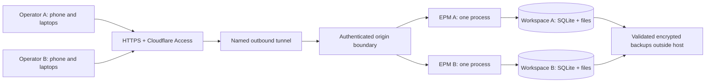

# Two-operator hosted demo: hosting research and proposed design

Research date: October 15, 2026

Status: design proposal only; no implementation, provisioning, or change to existing backlog scope. This is a small hosted-demo track alongside the local MVP. Provider offers are conditional and must be checked at provisioning.

## Recommendation and scope

Use one small Linux host, two isolated EPM processes/containers, and one persistent workspace per operator. Each operator accesses their workspace from ordinary browsers on several devices. Start with synthetic data and disable external integrations. Prefer 2 GB RAM as the initial sizing hypothesis; measure before committing to smaller capacity. Build releases elsewhere, not on the demo VM.

Use Cloudflare Access with an explicit two-email allowlist and emailed one-time PINs, plus a named Cloudflare Tunnel. Assign each operator a memorable demo code/subdomain, such as `demo-a.example.com`; the code identifies a workspace but is not its credential. A reusable short code alone is insufficient for persistent remote access. Cloudflare advertises a free Zero Trust plan for up to 50 users; this supplies an access layer, not a VM. Domain registration and any paid hosting/storage are separate. [Pricing](https://www.cloudflare.com/plans/zero-trust-services/)

Assumption: the two operators evaluate independent portfolios. If both should work on the same portfolio, use the collaboration extension below rather than copying or synchronizing their databases.

## Free and lower-cost hosting options

These are advertised infrastructure offers, not measured EPM capacity. Taxes, domain registration, backups, excess transfer and engineering time are additional. No allocation was attempted.

| Option | Published offer | Assessment for this demo |
| --- | --- | --- |
| Oracle Always Free A1 ARM | 1,500 OCPU-hours and 9,000 GB-hours/month, equivalent to 2 OCPU / 12 GB RAM; 200 GB combined boot/block storage and 10 TB outbound allowance | Strongest ongoing-free candidate. Home-region capacity may be unavailable; idle instances can be reclaimed. Validate Linux ARM dependencies and keep an off-host reset/restore bundle. |
| Google Compute Engine Free Tier | One e2-micro month in eligible US regions; 30 GB-month standard persistent disk; eligible outbound allowance | Tight memory for two processes. A normal external IPv4 address is separately $0.005/hour, approximately $3.65 for 730 hours. Free compute does not imply a zero-cost deployment. |
| AWS Lightsail Linux with IPv4 | $7/month for 1 GB; $12/month for 2 GB, 60 GB SSD and 3 TB transfer | Practical $12/month starting point; credit-based free eligibility is temporary. IPv6-only 2 GB is listed at $10, but requires a front door/network path verified for all clients. |
| DigitalOcean Basic | $6/month for 1 GiB; $12/month for 2 GiB, 50 GiB SSD and 2,000 GiB transfer | Straightforward alternative. Start at 2 GiB, then downsize only after measuring. Provider backups cost extra. |
| Hetzner EU CX23 | Published adjustment: €5.49 / $6.49 monthly, 4 GB RAM, excluding IPv4 and VAT | Good advertised capacity/price, but the product page currently lists unavailable capacity. Verify availability/checkout price rather than planning on it. |
| Existing always-on computer | No new VM charge; electricity, Internet and optional domain still cost money | Cheapest incremental option if suitable hardware exists. Use the same isolated runtime and authenticated tunnel. Sleep, home outages and host security affect availability. |

Official pricing/conditions: [Oracle](https://docs.oracle.com/en-us/iaas/Content/FreeTier/freetier_topic-Always_Free_Resources.htm), [Google Free Tier](https://docs.cloud.google.com/free/docs/free-cloud-features) and [network charges](https://cloud.google.com/vpc/network-pricing), [Lightsail pricing](https://aws.amazon.com/lightsail/pricing/) and [billing eligibility](https://docs.aws.amazon.com/en_en/lightsail/latest/userguide/amazon-lightsail-frequently-asked-questions-faq-billing-and-account-management.html), [DigitalOcean](https://www.digitalocean.com/pricing/droplets), [Hetzner price adjustment](https://docs.hetzner.com/general/infrastructure-and-availability/price-adjustment/) and [availability](https://www.hetzner.com/cloud/cost-optimized/).

Try Oracle if zero recurring VM cost is the priority and uncertain availability is acceptable. Otherwise budget about $12/month for compute plus domain/backup costs. Existing hardware is a useful temporary demonstration host. For an important scheduled demonstration, verify startup and recovery beforehand and have a paid fallback.

Free Render is unsuitable for this persistent SQLite application: its local filesystem is ephemeral and free services cannot attach persistent disks. Moving only the frontend to free static hosting does not remove the backend/storage requirement. A stateless/serverless deployment would require a separate architecture change. [Render free-service constraints](https://render.com/docs/free)

Google's network allowances depend on tier and region; do not mix Standard and Premium allowances. AWS documentation contains older trial wording alongside newer credit-based eligibility, so confirm account-specific terms. Do not deliberately generate idle load to avoid free-tier reclamation. These plans are for ordinary application serving, not local LLM inference.

## Relationship to the hosting plan and current application

The supplied [Hosting Plan](hosting/Hosting_Plan.md) is a future commercial hosting proposal. Its per-customer SQLite isolation, portable deployment, and independent backups fit this demo. Its managed Postgres control plane, billing, relay pair, AI gateway, fleet placement, and availability targets are unnecessary for two synthetic workspaces. Its roughly $75/month starting estimate is therefore not a minimum demo cost. Its third-party incident statistics are not a sound basis for a current provider rejection without comparable first-party evidence.

The current [architecture](../ARCHITECTURE.md), [product brief](../PRODUCT_BRIEF.md), and [security contract](../platform/security-and-audit.md) explicitly describe local single-operator use without authentication. SAAS-001, SEC-001 and SEC-002 in the [backlog](../FEATURE_BACKLOG.md) own future hosting/authentication/authorization. This proposal does not mark those capabilities delivered or expand the local MVP implicitly.

Concrete implementation boundaries:

- [browser_transport.py](../../application/apps/server/app/platform/browser_transport.py) accepts loopback hosts/origins only. Its local-client header is not authentication. Simply adding a tunnel, rewriting the Host header, or suppressing Origin checks is not a supported deployment.
- [sqlite_engine.py](../../application/apps/server/app/platform/sqlite_engine.py) supplies immediate writes and bounded busy waits; [workspace SQLite initialization](../../application/apps/server/app/modules/workspace/infrastructure/sqlite_store.py) enables WAL. One server owns the workspace lock. Multiple browsers can share that one server; multiple server workers must not independently open the same workspace.
- [Operator persistence](../../application/apps/server/app/modules/operator/infrastructure/sqlalchemy_models.py) stores preferences/recovery in a single-operator context. It does not establish user/device authorization or cross-device draft ownership.
- [Audit models](../../application/apps/server/app/modules/audit/domain/models.py) default to a local-operator actor. Verified hosted identity must be propagated through owning operations; access logs alone are not a business audit trail.
- [Frontend architecture](../ui/frontend-architecture.md) already preserves revisions, operation keys, unknown outcomes and workspace/runtime query identity. These are useful foundations, but cross-device behavior needs explicit acceptance.
- The [wheel deployment guide](../../manual/deployment.md) still requires matching schema resources beside the wheel. Use that complete release bundle; the current guide does not authorize a public website.

The Hosting Plan's automatic schema-upgrade/rollback and live-workspace “file copy” language is not an implemented guarantee. For this greenfield demo, seed the current schema and preserve records only through validated compatible backups/restores. Do not copy a running SQLite file independently of journals and attachments.

## Request and data architecture

Use separate Unix identities or non-root containers, private volumes, fixed server-side hostname-to-instance mapping, and memory/disk limits. Neither instance can mount the other's workspace or host administration sockets. Unknown hostnames fail closed. Do not select filesystem paths from request parameters. Container isolation does not protect against host-admin compromise; both workspaces share a host failure domain.

The tunnel initiates outbound connections, allowing the EPM origin ports to remain inaccessible from the Internet. This also permits hosting on an existing always-on machine behind NAT. [Tunnel architecture](https://developers.cloudflare.com/cloudflare-one/networks/connectors/cloudflare-tunnel/)

Each instance has its own expected hostname, Access audience and allowed identity. Validate the Access JWT's signature, issuer, audience and expiry at the origin, then map its verified subject to a provisioned operator. Never trust a plain email header or a client-supplied operator ID. Cache signing keys with bounded refresh and fail closed when verification cannot be completed. Access JWT validation is documented by [Cloudflare](https://developers.cloudflare.com/cloudflare-one/access-controls/applications/http-apps/authorization-cookie/validating-json/).

Implement an explicit hosted transport policy, independent of the unchanged local policy. Accept only the configured HTTPS origin, authenticate every API/download/recovery request, reject cross-origin writes, and require a CSRF token tied to the authenticated browser session for unsafe methods. Trust forwarded headers only from the configured private ingress. Strip caller-supplied identity headers. The local-client marker must confer no hosted privilege. Apply authorization before workspace bootstrap, search, audit, file metadata or receipt lookup can disclose data.

Private APIs, HTML and downloads must not enter shared CDN caches. Public fingerprinted assets may be cached. Serve uploads only through authorized File APIs; no raw workspace mounts. Keep administration/backup paths unavailable to ordinary demo users at the server boundary, not merely hidden in navigation.

## Operator code, sign-in and sessions

Recommended interaction:

1. Administrator provisions A/B and sends each their assigned demo address/code and allowed email.
2. Operator visits the address on any device and signs in with the email PIN. Cloudflare's PIN is single-use and expires after ten minutes. [OTP behavior](https://developers.cloudflare.com/cloudflare-one/integrations/identity-providers/one-time-pin/)
3. The app shows “Demo — your changes are saved,” the workspace label, expiry date, and “Use synthetic information only.” Each device obtains its own session.
4. Signing in on a second device does not terminate the first. Propose an eight-hour session lifetime initially. Provide “Sign out this device” and “Sign out all devices”; the latter must revoke application sessions and the identity-provider session as applicable.
5. Server-maintained operator status/session generation is checked on every request, so administrator disablement or reset blocks old sessions even before a signed token expires. Use Secure, HttpOnly, host-only session cookies; keep credentials out of URL parameters and localStorage. On logout/account change, clear private query caches and editable state.

A minimal host-side registry holds operator ID, verified identity binding, assigned hostname/workspace, active/expired status, session generation and demo expiry. Keep it outside portable business workspaces; it is not a new managed database requirement. Persistent session records must support expiry and revocation without storing raw session tokens. Protect and back up this administrative configuration separately; restored business data does not restore authorization automatically.

If code-only access is essential, use an expiring, revocable, randomly generated secret with at least 128 bits of entropy, entered into a form and exchanged for a session. Store only a hash, rate-limit attempts, avoid token logging, and communicate that possession grants full demo access. This is a separate custom-auth implementation and is not the recommended initial route. A short display code can remain human-friendly because it carries no authority.

## Multiple devices and concurrent changes

All authoritative data stays on the host. Devices send HTTPS requests; they do not download/synchronize SQLite files. SQLite is reasonable for small server workloads with short writes: it allows concurrent readers but only one writer at a time. Network users accessing an application server are different from clients opening the database over a network filesystem. [SQLite guidance](https://www.sqlite.org/whentouse.html)

Proposed behavior:

- Every consequential command retains owning revision checks, an operation key and its canonical fingerprint. Two devices editing the same revision cannot silently overwrite one another: the second receives a conflict, retains its edits, and explicitly reloads/reapplies against current facts.
- A timeout means outcome unknown. Reconcile the original operation key; never generate another key and automatically repeat a financial action. Authorization precedes original-result replay. Separate legitimate requests from separate devices still have distinct keys; semantic duplicate checks/confirmation remain domain responsibilities.
- Serialize short database writes within the one workspace server. Reads and browser rendering remain asynchronous. Handle bounded contention visibly without automatically resending consequential commands. Do not add Uvicorn workers or another writer to improve throughput.
- Refetch visible data on focus/reconnect and after successful local mutations. Add a lightweight authenticated workspace-change marker check approximately every 15 seconds while visible, with jitter/backoff; an updated marker invalidates affected reads. Do not poll every row or full page independently. Keep existing Home minute/date refresh because deadlines can change without writes. Measure request budgets before tightening intervals or introducing SSE.
- Show last-checked time, reconnecting/stale state and partial failures. Never display an all-clear based on failed/stale attention checks. Background refresh must not replace dirty form values.
- Recovery records need stable draft IDs plus owning operator, revision and editor-session identity. A draft can be resumed on another device; use a renewable server-side edit lease and explicit takeover. The previous editor's next save must fail on its stale lease/revision. Separate drafts remain independent, and known/unknown operation attempts remain attached to their original keys. Opening a record on two devices must not implicitly claim the same draft.
- Preferences shared across an operator's devices use revision-safe updates. A small-screen navigation/expansion state can remain per-device. Distinguish “saved draft” from “submitted record.” Unsaved input on one device is not promised to appear elsewhere.
- Offline operation is read-only with a clear disconnected state; no queued offline mutations. Session expiry pauses saving/submitting and preserves only safe in-memory input for reauthentication to the same workspace. Do not replay a submission merely because login succeeded.

## If both operators share one portfolio

Map two distinct identities to one workspace/server; do not share one credential. Add authenticated actor propagation for every write and sensitive read, workspace membership on every endpoint, operator-owned drafts/preferences and receipt visibility rules. Both can initially have the same manager role, while host administration remains separate. The concurrency rules above still apply. This is genuine multi-user scope aligned with SEC-001/SEC-002; the independent-workspace demo should ship first unless collaboration itself is the experiment.

## Demo lifecycle, operations and cost controls

Provision two copies of the synthetic dataset with distinct workspace identities and independent mutable files. Use fixed application versions and record the seed version. Disable real email/payment/model calls and provider credentials. Bound uploads and total storage (initial proposal: 250 MB per workspace, with a lower per-file limit compatible with existing APIs). Enforce caps server-side, report quota errors clearly, and include temporary-file cleanup in disk budgeting.

Propose a 14-day renewable demo, retaining changes until explicit expiry/reset. Reset is an administrator operation: stop new requests, drain writes, stop the workspace process, create a replacement from seed, validate it, rotate workspace/runtime and session identities, switch atomically, and invalidate every old browser continuation. Never overwrite a live database underneath open connections. Do not reset nightly while users expect persistence.

Use existing validated encrypted backup/export machinery, store completed archives outside the host, and test restore. For synthetic demos, a daily backup plus preserved seed is a reasonable initial policy with up to 24 hours of lost edits disclosed. A headless host needs an explicitly supported secret store for unattended backups; do not assume a desktop keyring exists. If this is unavailable, use an administrator-run backup and label the reduced protection. Retain seven daily copies initially; deletion/expiry must cover backups as well as live workspaces. Neither separate database replication nor attachment sync alone establishes a consistent recoverable workspace.

Monitor process health, disk space, memory, error rate and backup age. Set provider budget alerts, but do not treat alerts as spending caps. Apply hard application quotas and disable unused paid services. A free-tier host can still incur storage/IP/traffic charges. Do not promise an SLA from this experiment.

## Ordered delivery proposal

These are proposed slices, not changes to approved backlog dependencies:

1. **Isolation and reproducible runtime:** current release bundle, two private workspaces, one process each, seeded identities, resource bounds and restart supervision.
2. **Hosted identity and transport:** exact host/origin policy, Access verification, subject-to-workspace binding, revocable sessions, CSRF, download/API coverage and no origin bypass. No remote demo access before this passes.
3. **Cross-device consistency:** revision/receipt audit, operator/session identity, draft resume/takeover, visible freshness and safe authentication expiry.
4. **Demo administration:** provisioning/expiry/reset, server-side capability restrictions, storage quotas, off-host backup and restore.
5. **Acceptance and measured sizing:** two operators with at least two simultaneous devices each, including phones and lossy connections. Enable the hosted demo only after isolation and financial retry tests pass.

## Validation matrix

| Area | Required acceptance evidence |
| --- | --- |
| Happy path | A and B each sign in on two devices, see their own persistent records and observe changes after refresh/reconnect |
| Invalid access | A cannot reach B using changed host, IDs, JWT audience, file URL, search, recovery or receipt keys; unauthenticated bootstrap and direct origin access fail |
| Session safety | Expired/revoked sessions cannot read/write; foreign Origin and missing/invalid CSRF fail; logout clears private UI state |
| Concurrency | Simultaneous edits conflict without lost updates; draft takeover rejects the prior editor; independent drafts stay separate |
| Retry/idempotency | Lost payment response resolves original receipt; repeated same request has one effect; changed payload with same key conflicts |
| Rollback | Failed audit/domain child/commit has no partial success; failed reset leaves a usable prior workspace or explicit maintenance state |
| Persistence/schema | Latest baseline and retained validators agree; isolation/identity/session additions are validated; restart preserves committed edits |
| Backup/restore | Restore database and attachments together, verify record/financial totals, exclude secrets, rotate runtime/session state |
| Query/performance | At least four active browsers, bounded freshness polling, responsive navigation, no N+1 amplification; record peak RSS and lock waits |
| Operations | Reboot, disk-full, expired demo, unavailable auth keys, tunnel failure and backup failure have visible bounded failure behavior |

## Decisions and limitations

Recommended defaults are separate workspaces, synthetic data, email OTP, one host with two processes, 2 GB initial RAM, no offline writes, daily backups and 14-day demos. Shared-portfolio collaboration, real customer data, high availability, custom code-only authentication and a commercial hosted tier require separate approval/design. No provider has been provisioned, no performance measurement has been run, and this document does not establish current hosted support.
