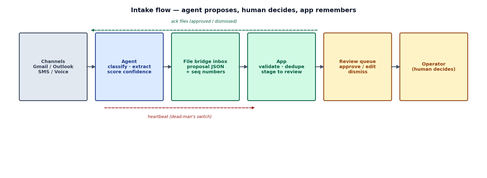
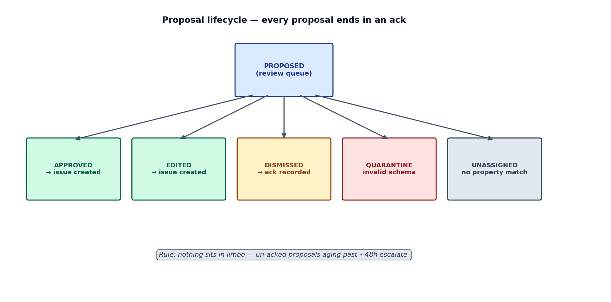
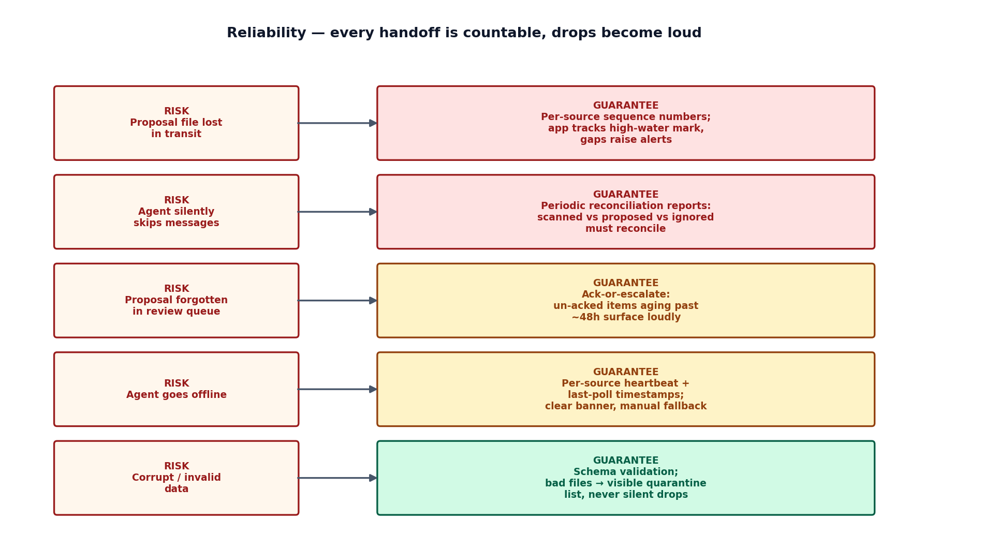
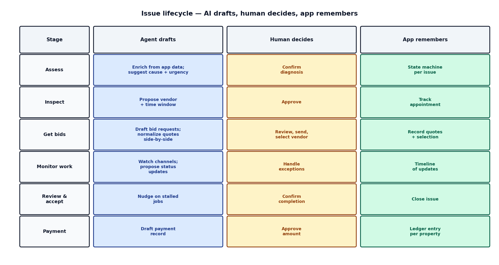

# Agent Triage for Property-Maintenance Intake — Design
*Designed 2026-10-19 with David. Status: design only, not yet filed to Linear.*

## 1. What it is

An agent that watches the channels tenants and vendors already use — email (multiple
mailboxes), SMS, and call transcripts — triages maintenance-related messages, and proposes
structured maintenance issues. A human operator reviews and approves every proposal. The app
never touches email directly; triage runs on the agent side, which holds the channel access.

Product sentence: *every channel your tenants already use, one review queue.*
Sales sentence: *never miss a maintenance emergency* (backed by the audit trail in §6).

## 2. Architecture fit

- Respects the standing decision: the app does no mail plumbing (no OAuth, polling, message
  store). All channel access lives with the agent, via whatever channel integrations that agent provides (device commands, connectors, plugins).
- Transport is the existing file bridge, with strict file ownership: `agent-bridge.json`
  is the app's own configuration — written and read by the app only; the agent never
  touches it. The app writes reference/config files into `.agent-bridge/` for the agent to
  consume (e.g. `properties.json`); the agent writes proposal-only JSON files to
  `.agent-bridge/inbox/` for the app to consume. The app validates, dedupes by idempotency
  key, and stages into a review queue; nothing is committed until the operator approves;
  ack files confirm receipt; heartbeat mtime is the dead-man's switch.
- The bridge is agent-agnostic: any agent implementing the file contract works.

## 3. Agent neutrality

The design is agent-neutral: it supports Muse, ChatGPT, Grok Bot, and any agent
that can implement the file contract. There are no Muse-specific APIs, protocols, or
assumptions anywhere in this design.

- The agent's contract is three file operations: consume the app-exported files in
  `.agent-bridge/` (reference data, triage config), write proposal JSON files to
  `.agent-bridge/inbox/`, and update the heartbeat. `agent-bridge.json` is app-side
  only — the agent never reads it. Every agent above can do this.
- Per-agent differences are confined to two places: how the agent reaches the user's
  channels (email, SMS) and how it reaches the bridge folder. Triage logic, proposal
  schemas, and the human-approval model are identical for all agents.
- Certification tiers: Muse is the certified reference agent (the one dogfooded
  during development); other agents are supported through the BYO-beta path, guarded
  by schema validation and the quarantine list (§6).
- If an agent gains MCP support later, §11 covers the MCP transport option — same
  semantics, different transport.

## 4. Intake flow

1. Operator enables "triage" per property (or globally). The app stores the settings in
   `agent-bridge.json` (app-side config: watched mailboxes, SMS/call sources, categories,
   urgency rules) and exports the agent-facing parts as `.agent-bridge/triage.json` for
   the agent to consume, alongside `properties.json`.
2. App exports read-only reference data for the agent: `.agent-bridge/properties.json`
   (property id, address, units), regenerated on every property change, so the agent can
   resolve "123 Main St #4" without guessing.
3. Agent polls each configured source on its cadence, keeping per-source watermarks on its
   own side. For each candidate message it writes one proposal file to
   `.agent-bridge/inbox/`.
4. App validates schema → dedupes by idempotency key → checks near-duplicates against open
   issues (same property + similar summary within N days, across all sources and mailboxes
   → "possible duplicate," never auto-merged) → stages into the maintenance review queue
   with triage metadata and confidence visible.
5. Operator approves (creates the issue), edits, or dismisses. App writes ack files with the
   decision; agent uses acks to avoid re-proposing and marks items handled on its side.
6. Stale heartbeat → app shows "triage offline," falls back to manual entry.

**Step 4 in detail — the ingestion pipeline (app side)**

The app watches `.agent-bridge/inbox/` (poll every ~30s; OS file watcher where
available). The agent writes each proposal atomically — `*.tmp` then rename to
`*.json` — so the app only picks up settled files.

1. **Parse.** JSON-decode; on failure move the file to `.agent-bridge/quarantine/` and
   log the error. Never silently skip.
2. **Schema-validate** against the shipped proposal schema (in `agent-pack/`).
   Missing/invalid fields → quarantine with the specific violations listed.
3. **Idempotency check.** Look up `idempotency_key` in the app's processed-proposals
   table (SQLite — the source of truth). Already seen with identical content →
   duplicate delivery: make sure the ack file exists (rewrite if missing) and drop.
   Same key but different content → conflict: quarantine + flag (indicates an agent
   bug; should never happen).
4. **Sequence check.** Per source/mailbox, track the high-water `seq`. `seq` ≤
   high-water → out-of-order duplicate, handled as in (3). `seq` > high-water + 1 →
   record the gap, raise a "missing proposals" alert on the health dashboard, but keep
   processing — one missing file never blocks the queue.
5. **Near-duplicate detection.** Against open issues and issues created in the last 14
   days: same `property_id` + same category + within N days + summary word-overlap
   above threshold → stage as "possible duplicate" linked to the existing issue.
   Deterministic heuristic in v1 (no LLM in the app); the operator merges or keeps
   separate. Never auto-merge.
6. **Enrich & route.** Resolve `property_id` → property record for display. Buckets:
   - `classification: ignore` + high confidence → auto-dismiss (logged, recoverable
     from the dismissed filter, acked).
   - `classification: ignore` + low confidence → review queue (the agent might be
     wrong about an emergency).
   - confidence < threshold → "needs review" bucket.
   - `property_id` null → "unassigned" bucket for manual routing.
   - otherwise → main review queue, sorted by urgency then recency.
7. **Stage.** Insert into the proposals table (all fields + raw JSON reference + status
   `pending`), move the inbox file to `.agent-bridge/processed/` (30-day retention),
   update the high-water mark, emit UI updates (queue badge, emergency push
   notification).
8. **Crash recovery.** On startup, reconcile: any inbox file missing from the
   processed table gets ingested; any ingested proposal lacking an ack file gets
   acked.

**Step 5 in detail — acks (app → agent)**

For every consumed proposal the app writes `.agent-bridge/acks/<proposal-id>.ack.json`:

- `proposal_id`, `idempotency_key`, `seq` — link back to the proposal
- `status`: `received` → later updated in place to `approved` | `edited` |
  `dismissed` | `auto_dismissed` | `merged_duplicate` | `quarantined`
- `result_issue_id` — the created issue's id, when approved/edited
- `corrections` — {field: corrected_value} when the operator edited (the learning
  signal)
- `dismiss_reason` — operator-selected reason when dismissed
- `acked_at`, `decided_at` timestamps

Two moments: the ack file is created with `status: received` at ingest time — this is
how the agent knows delivery succeeded and can stop rewriting the proposal. It is
updated in place when the operator decides.

How the agent consumes acks (on its own cadence, polling `.agent-bridge/acks/`):

- `received` → mark delivered, stop re-sending the proposal.
- `approved` / `edited` → optionally mark the source message handled on the agent
  side (archive/label the email per the operator's agent-side settings; never delete).
- `edited` → read `corrections` and adjust future behavior (e.g. remember
  sender-specific property mappings). Learning lives on the agent side; the app only
  supplies the signal.
- `dismissed` / `merged_duplicate` → don't re-propose similar items; tune
  classification.
- Acks are informational — the app is the system of record, so a missed ack never
  corrupts anything. The app garbage-collects ack files older than 30 days; the agent
  is expected to consume well within that window.

**Agent-side ack consumption runbook** (ships in the agent pack — every agent
implements this same procedure)

The agent keeps its own state (location of its choosing — never in the bridge): per-source
watermarks, `proposals_sent` ({proposal_id: {idempotency_key, seq, sent_at}}), an ack
cursor ({ack_id: last seen status}), and learned corrections.

Each cycle runs in this order — acks first, then source scanning — so corrections and
dismissals take effect before new messages are classified:

1. **Discover.** List `.agent-bridge/acks/*.ack.json`; pick up files whose status is
   newer than the cursor. Acks are monotonic (`received` → decided), so the agent
   always acts on the latest status it sees; re-reading is harmless.
2. **Classify by status.**
   - `received` → mark the proposal delivered; remove from the rewrite set. Do *not*
     mark the source message handled yet — the operator hasn't decided.
   - `approved` → mark the source message handled on the agent side per the
     operator's agent-side settings (e.g. apply a "triaged" label, archive it —
     never delete). Drop from the rewrite set.
   - `edited` → same as approved, plus ingest `corrections` into learned state:
     e.g. a corrected `property_id` for sender S becomes a sender→property override
     that outranks future inference; a corrected `category` tunes classification for
     similar messages.
   - `dismissed` → mark handled; record the `dismiss_reason` as a negative signal
     (e.g. "not-maintenance" from this sender → lower propensity to propose similar).
   - `merged_duplicate` → informational; note the dedupe pattern.
   - `quarantined` → bug signal: the agent's own proposal failed schema validation.
     Re-read the schema from the agent pack before writing the next proposal; if
     quarantines recur, surface it in the heartbeat's `last_error`.
3. **Rewrite unacked proposals (at-least-once delivery).** Any proposal in
   `proposals_sent` with no `received` ack after N cycles (~45 min) is rewritten —
   same `idempotency_key`, same `seq` (never a new seq, or the app's gap detection
   fires). Cap at ~5 rewrites, then stop and report in the heartbeat
   (`"proposal X unacked after 5 rewrites — app may be down"`).
4. **Clean up.** If a proposal file still sits in `inbox/` but its ack exists, the
   app's move to `processed/` must have failed — the agent may remove the stale file.
   (Normally the app moves it; this is just belt-and-suspenders.)
5. **Learn, don't get taught.** The app never pushes model updates — it only
   publishes labeled outcomes (acks). The agent turns `corrections` and
   `dismiss_reason`s into its own rules. This keeps agents swappable: any agent can
   implement its own learning while the contract stays identical.
6. **Report health** in the heartbeat: `acks_pending` (app-written, not yet
   consumed), `proposals_unacked` count, `quarantine_hits`. These let the dashboard
   distinguish "agent is behind" from "app is behind."

**Step 6 in detail — heartbeat & agent health**

The agent writes `.agent-bridge/heartbeat.json` atomically (tmp + rename) on every
poll cycle, and at least every 5 minutes while running. Contents:

- `agent_id` (stable instance id), `agent_kind` (Muse / chatgpt / grok / other —
  display only), `agent_version`, `pack_version` (which agent-pack version the agent
  loaded)
- `ts` (ISO 8601 timestamp) and `seq` (monotonic counter — the app trusts `seq` over
  wall clock, so clock skew can't fake liveness)
- `sources`: per-source status — {`source_id`, `last_poll_at`, `last_poll_ok`,
  `last_error` (optional), `last_proposal_seq_written`}
- `pending_proposals`: proposals written but not yet acked, as the agent sees it —
  the app cross-checks this against its own counts (another reconciliation signal)

App-side monitoring (the app re-checks every ~60s; thresholds live in
`agent-bridge.json`, operator-adjustable):

- age < 2× expected interval → **online** (green)
- 2×–4× → **degraded** (amber, show last-seen time)
- > 4× (default ~45 min) → **offline** (red): banner in the app, manual entry stays
  fully available. Nothing is lost — unprocessed messages wait in the mailbox, and
  the agent's watermarks are on its side.
- Content is validated, not just mtime: if mtime advances but `ts`/`seq` stall, the
  agent is alive but wedged → degraded ("agent stuck"). If `ts` skews far from the
  app clock, warn, but rely on mtime + `seq`.

Health dashboard surfacing: status pill, last-seen ("3 min ago"), agent kind +
pack-version mismatch nudge, and a per-source table (mailbox X polled 12 min ago ✓;
mailbox Y — auth error, action needed). Alerting: one push notification when offline
exceeds ~1 hour, and one when a source reports an error (expired mailbox auth is the
common real-world case) — never a stream of repeats.

Failure modes this covers: agent process dead (heartbeat goes stale); agent alive but
one source failing (per-source error while the overall heartbeat stays fresh →
"degraded: 1 of 3 mailboxes failing"); agent wedged (seq stall); app restart (status
recomputed from the file immediately — no in-memory state to lose).

Recovery: when the agent returns, it resumes from its own watermarks and writes any
missed proposals; the app's sequence-gap check (step 4) verifies nothing was lost,
and the dashboard confirms it ("back online — caught up: 14 proposals received").

Heartbeat is advisory only: it never gates writes, and a stale or forged heartbeat
can at worst produce a wrong status display — never corrupt data. If multiple agents
are ever used, each writes `.agent-bridge/heartbeats/<agent_id>.json` and the
dashboard shows one row per agent.

**Independent lifecycles — shutdown & catch-up**

App and agent start and stop fully independently; neither holds irreplaceable
in-memory state. Three durable stores make any restart a reconcile, not a recovery:
the app's SQLite DB (system of record for proposals and decisions), the agent's own
state file (source watermarks, proposals sent, learned corrections), and the bridge
directory itself (durable transport — files wait as long as needed). Restart order
never matters.

*App restart (agent kept working meanwhile):*
1. Reload the processed-proposals table, per-source high-water marks, and the review
   queue — all persisted, so shutdown loses nothing, including undecided proposals.
2. Scan `inbox/`: every file not in the processed table runs through the ingestion
   pipeline (step 4), in (source, seq) order. Proposals the agent wrote during the
   outage are simply waiting files.
3. Repair acks: any ingested proposal lacking an ack file gets one now; any decision
   whose ack update didn't land is re-written (acks are idempotent).
4. Recompute agent status from `heartbeat.json` immediately — no warm-up. Then run
   garbage collection (processed files / ack files past their retention window,
   only after confirming they're in the DB).

*Agent restart (app kept working meanwhile):*
1. Reload its own state (watermarks, `proposals_sent`, ack cursor, corrections).
2. Consume acks **first**: during the outage the operator may have approved, edited,
   or dismissed a whole batch — the agent applies all of it (mark handled, ingest
   corrections) before scanning anything.
3. Reconcile `proposals_sent`: no `received` ack → rewrite (same key, same seq);
   received but undecided for days → leave it (it's the operator's queue; surface the
   count in the heartbeat).
4. Refresh reference data: re-read `properties.json` and `triage.json` — the operator
   may have added a property or changed categories during the outage.
5. Catch up on sources from the watermarks: messages that arrived during the outage
   are triaged now. Watermark discipline: advance only *after* the proposal file is
   durably written, so a crash mid-scan can't skip a message. Process chronologically,
   batched per cycle, with catch-up progress in the heartbeat ("catching up: 212
   messages") — the app sorts the resulting queue by urgency anyway.
6. Write a fresh heartbeat immediately on startup, before the first cycle completes,
   so the app shows "agent is back" within a minute.

*Extended downtime (hours to days):*
- App down, agent up: proposals accumulate in `inbox/` (small JSON files — harmless);
  the agent rewrites unacked proposals up to its cap, then simply waits. Nothing lost,
  nothing duplicated (idempotency keys).
- Agent down, app up: heartbeat goes stale → offline banner; the operator works the
  existing queue and manual entry. Unprocessed messages wait safely in the mailboxes
  (the agent never deletes), bounded only by the mailbox's own retention.
- Ack GC vs. a long-stopped agent: individual ack files are GC'd after 90 days
  (configurable), but the app also maintains `.agent-bridge/acks/digest.json` — a
  compact, never-GC'd ledger of {proposal_id: final status} for every decided
  proposal, regenerated on each decision. On restart the agent reconciles against the
  digest, so full catch-up is always possible no matter how long it was down.
- All timestamps are UTC ISO 8601 for display/aging only; `seq` numbers are the
  ordering truth.

**Expectations (the SLA)**

This is a local-first, bring-your-own-agent system — there is no uptime percentage to
promise. The expectations are about latency, durability, and one quality bar:

- **Freshness (normal operation, defaults):** the agent polls sources every ~15 min
  (`poll_cadence_hint`), so a message typically becomes a proposal within ~10 min and
  in the worst case ~20 min; the app picks up proposals within ~1 min of landing in
  `inbox/`. End-to-end, email → review queue: typically ≤ ~10 min, worst ~20 min.
  Emergency proposals push-notify the operator the moment they land in the queue.
- **Explicitly NOT real-time:** email triage is not a life-safety channel. A burst-pipe
  email can sit for the length of a poll cycle. Tenants with true emergencies should
  be calling, not emailing — the design's job is to make sure the email is never
  *lost*, not to make it instant. (Shortening the poll cadence trades agent cost for
  latency; it's the operator's knob.)
- **Durability (the hard guarantee):** zero loss across any restart combination.
  Every message the agent saw becomes exactly one proposal; every operator decision
  is recorded and eventually reflected to the agent (per-proposal acks + the digest).
  "Eventually" after a restart = within one reconciliation pass: the app's catch-up is
  effectively immediate; the agent's backlog drains over a few cycles (batched,
  progress shown in the heartbeat).
- **The one hard quality bar: emergency recall.** A real emergency classified as
  routine is the worst failure this system can make, so classification errs toward
  over-flagging: false-positive emergencies are acceptable and expected,
  false-negative emergencies are treated as defects and reviewed via the corrections
  in acks. Other accuracy measures (category precision, duplicate-flag precision) are
  Phase 3 metrics — tracked and tuned, not guaranteed.
- **Operator side:** no SLA on human decisions, but undecided proposals older than
  ~48h escalate (see §6), and every stage's timestamps are recorded, so where time
  went is always answerable after the fact.

**Backup & migration**

The entire system lives in one workspace folder (app DB, `agent-bridge.json`,
`.agent-bridge/`, the agent pack) — so backup and migration are one folder, one
operation. The agent keeps its own state (source watermarks, proposals sent, ack
cursor, learned corrections) at `.agent-bridge/agent-state.json`, in the format the
agent pack specifies; the app never touches it except to include it in backups.

- **Backup (app feature):** one-click "Back up now" in Settings plus automatic
  scheduled backups (daily, keep N) → a timestamped, password-encrypted zip of the
  workspace, saved to a folder the operator chooses (local disk, external drive, or
  cloud). Encryption is on by default — backups contain tenant names, addresses,
  and issue details; losing the password means losing the backup, and the app says
  so plainly. Mailboxes themselves are never backed up (they live at the provider);
  watermarks reference provider message ids, which is all the restore needs.
- **Restore / migrate:** install the app on the new computer → "Restore from backup"
  in the setup wizard → the app unpacks, verifies (DB integrity check, schema
  version, required files present), and runs its normal startup reconcile — so even
  a backup taken mid-flight converges: inbox files get ingested, acks repaired,
  agent status recomputed. Then shut down the old instance and point the agent at
  the new workspace path; it resumes from `agent-state.json` exactly where it left
  off — no re-triage of old mail, no lost learning. Health dashboard green +
  heartbeat fresh + review queue intact = migration verified.
- **First run on a fresh agent** (no state to restore): the agent only looks back
  `first_run_lookback_days` (in `triage.json`, operator-set, default 7) instead of
  triaging years of mailbox history.
- **Two instances must never run at once:** one app per workspace (a lockfile
  prevents double-start); two agents claiming the same role are detected via their
  heartbeats and trigger a dashboard warning, not silent cooperation (different
  roles is a supported topology, §7). Cloud-synced
  folders (Dropbox/iCloud) as the *workspace location* are discouraged — partial
  SQLite syncs corrupt; keep the workspace on local disk and let *backups* live in
  the cloud.

**Bridge file contents (App → Agent)**

`.agent-bridge/properties.json` — reference data so the agent can resolve mentions.
Regenerated by the app on every property change; read-only for the agent. Per property:
`property_id` (the app's internal id), `address` (street, city, state, zip), `units`
(list of unit designations), `aliases` (nicknames tenants or vendors use, e.g. "the Elm
St duplex"). Purpose: turn "123 Main St #4" into a `property_id` without guessing.

`.agent-bridge/triage.json` — the agent-facing triage configuration, exported from the
app's settings whenever the operator changes them:
- `mailboxes`: list of {`mailbox_id`, account, labels/folders, `enabled`}
- `sms_sources` / `voice_sources`: which threads, numbers, or voicemail boxes to watch,
  plus enabled flags
- `categories`: the taxonomy [{`id`, `label`}] — app defaults plus the operator's
  customizations
- `urgency_rules`: keyword lists per urgency level (`emergency` / `urgent` / `routine`),
  operator-editable
- `confidence_threshold`: proposals below this go to the "needs review" bucket
- `poll_cadence_hint`: advisory (e.g. every 15 minutes); the agent decides its own rhythm
- `first_run_lookback_days`: how far back a fresh agent scans on first run (default 7)

Purpose: tells the agent *what to watch* and *how to classify*. Everything the agent
needs to know about the operator's intent arrives through these two files — never
through `agent-bridge.json`.

`.agent-bridge/vendors.json` — the vendor book (lifecycle, §7): per vendor `vendor_id`,
name, trades, service areas, preferred flag, past jobs (count, avg cost, avg response
time, operator rating). Regenerated on change; read-only for the agent.

`.agent-bridge/issues.json` — the open-issue watch list (lifecycle, §7): per issue
`issue_id`, property, category, state, vendor, tenant channel reference.
Regenerated on every state change; read-only for the agent. The agent uses it to
know which issues to monitor for updates and which to draft for.

`.agent-bridge/requests/` — work orders from app to agent: the app writes
{`request_id`, `type` (draft_acknowledgment, draft_followup, draft_bid_request,
nudge, ...), `issue_id`, context}; the agent consumes them on its cycle (after
acks, before source scanning) and answers with a `draft` proposal carrying
`in_response_to: request_id`.

## 5. Proposal schema (per message)

- `type`: `maintenance-triage`
- `idempotency_key`: derived from channel message id (email message-id, SMS id, etc.)
- `seq`: per-source sequence number (see §6)
- `source`: `email` | `sms` | `voice` | `manual`; plus `mailbox_id` for email
- `classification`: `new-request` | `vendor-reply` | `chatter` | `ignore` (with reason)
- Extracted: `property_id` (or null → "unassigned" bucket), unit, `category`, `urgency`
  (`emergency` | `urgent` | `routine`), `summary`, suggested trade/vendor
- `confidence`: 0–1; below threshold → "needs review" bucket, never auto-anything
- Channel metadata: sender, subject/timestamp, short snippet (≤500 chars), and a reference
  (message-id) to open the original. Full bodies stay out of the app database.

SMS nuance: group by sender within a time window first, so a six-text saga becomes one
proposal. Voice nuance: transcripts only (voicemail / call summaries); score confidence a
notch lower since speech-to-text is lossy; urgency from keywords
("flooding", "no heat", "locked out").

Categories come from the app's taxonomy, which ships with sensible defaults and is fully
customizable by the operator (rename, add, remove per portfolio). Proposals carry the
matched category so customizations stay debuggable.

## 6. Reliability — prove nothing gets dropped

- **Sequence numbers**: per-source `seq` on every proposal; app tracks highest seen; gaps
  raise a "missing proposals" alert. Drops become loud events.
- **Reconciliation reports**: agent periodically writes a summary proposal —
  "last 24h, mailbox X: 47 scanned, 12 proposed, 33 ignored (reasons), 2 deduped." App
  compares against received. Numbers must reconcile.
- **Ack or it didn't happen**: every proposal ends approved/edited/dismissed; un-acked
  proposals aging past ~48h escalate in the review queue.
- **Quarantine, not silence**: schema-invalid files go to a visible quarantine list with the
  parse error.
- **At-least-once delivery, idempotent app**: agent may rewrite a proposal if unsure it was
  picked up; app dedupes by idempotency key. Duplicates harmless, drops impossible by design.
- **Per-source heartbeats**: last-poll timestamp per mailbox/SMS source; a dead Outlook
  connection shows up instead of going quiet.
- **Pipeline health view + audit trail**: "this week — 132 messages scanned across
  3 mailboxes, 28 issues created, 0 dropped, 0 unreviewed over 48h," plus full per-proposal
  lifecycle history. This is the landlord-facing proof.

## 7. After intake — the issue lifecycle

Pattern at every stage: **AI drafts, human decides, app remembers.** Each issue is a
state machine in the app; the agent reads, enriches, and drafts; the human makes every
judgment call — including sending every message. Draft/assist everywhere, auto-send
nowhere.

### Sidecar configuration — intake and lifecycle are independent

AI is a sidecar to the workflow, never a dependency of it. Intake triage (§4) and
lifecycle assist (this section) are **independent configuration toggles**, per
operator (and per property where it makes sense):

- `intake_enabled` (per source, in the triage config): the agent scans channels and
  proposes new issues.
- `lifecycle_assist_enabled`: the agent drafts, enriches, and monitors open issues.
- All four combinations are valid: neither (a fully manual app), intake only,
  **lifecycle only** (the operator enters issues by hand; the agent still drafts
  acknowledgments, monitors vendor replies, and runs the payment checks), or both.

Guarantees that keep the sidecar a sidecar:

- **Every agent-assisted step has a manual path.** The operator can type the
  acknowledgment, enter a bid reply by hand, record an appointment, or log a
  payment — same state machine, same artifacts. The agent only changes whose labor
  produces the draft.
- **The state machine never branches on how an issue was created.** Issues record a
  `source` (manual / agent proposal) for the audit trail, but transitions,
  timers, and reminders are identical.
- **Toggles can flip mid-lifecycle.** Enabling assist on an existing manual issue
  just adds it to `issues.json`; disabling assist leaves pending drafts in place
  (they're app data), lets outstanding requests expire harmlessly, and the operator
  continues manually.
- **Lifecycle-only mode narrows the agent's watch.** With intake off, the agent
  does not scan for new issues — it monitors only the channel threads attached to
  open issues (from `issues.json`) and answers `requests/`.

**Different agents per role.** The operator may assign different agents to intake
and lifecycle (`agents: {intake, lifecycle}` in `agent-bridge.json`). Plausible
reasons: a cheap, always-on agent fits high-volume triage while a stronger model
suits judgment-heavy lifecycle drafting; the mailbox may live where one agent runs
while lifecycle work stays on a local agent; or the operator pilots a new agent on
one role while the proven one keeps the other. Role rules: only the intake agent
writes intake proposals and consumes their acks; only the lifecycle agent consumes
`requests/` and writes lifecycle proposals; each files its own heartbeat
(`heartbeats/<agent_id>.json`). Two agents claiming the *same* role is a
misconfiguration the dashboard flags; different roles is a supported topology.
Security dividend: inbound mail is untrusted content, so isolating intake contains
the prompt-injection blast radius — the lifecycle agent works from curated app
exports (issues, request contexts), never raw mail.

### Execution tiers — local LLM vs. agent

Not all assist needs the agent. The dividing line is **where the data lives**: if
everything a task needs is already inside the app, a local LLM (running on the
operator's machine — e.g. Ollama/MLX, configured app-side) does it; if the task
must reach outside the app (channels, web), it's the agent's job.

| Task | Local LLM | Agent | Why |
|---|---|---|---|
| Acknowledgment / follow-up / closure drafts | ✓ | ✓ | issue data only |
| Assessment draft | ✓ | ✓ | app supplies history as context |
| Weekly digest, preventive insights | ✓ | ✓ | pure app data |
| Bid normalization (quotes pasted/entered) | ✓ | — | text already in the app |
| Payment-check narrative | ✓ | — | checks themselves are deterministic app logic |
| Photo read (photo uploaded to the app) | ✓ | ✓ | vision model, either side |
| Channel monitoring (vendor/tenant replies) | — | ✓ | needs channel access |
| Scheduling coordination across parties | — | ✓ | messages live in channels |
| Vendor web search | — | ✓ | needs the web |
| Intake triage | — | ✓ | needs channel access (a local model can still classify a message the operator pastes into the app manually) |

Design rules:

- **The local LLM is an app feature, not a bridge participant.** The app calls it
  directly (config in `agent-bridge.json`: enabled, endpoint, model). Its drafts
  land in the same `drafts` table and the same review UX — "AI drafts, human
  decides" holds regardless of which engine drafted.
- **Routing is per task type**, with a setting (`draft_engine: local | agent |
  auto`): auto prefers local (faster, private, free) and falls back to the agent via
  `requests/` when local is off or unavailable. Channel-bound tasks always route
  to the agent.
- **Degradation is graceful in every combination:** agent only, local only, both,
  or neither — the workflow is unchanged; only the drafting labor moves. A weaker
  local model's cost shows up as more operator editing, never as errors shipped,
  because every draft is reviewed.
- **Privacy dividend:** with local drafting, tenant names, photos, and issue
  details never leave the operator's machine for the large class of tasks that
  don't need the outside world. The agent sees only what its channel work requires.

### State machine

`new` → `acknowledged` → `assessing` → (`inspection_scheduled` →) `awaiting_bids` →
`vendor_selected` → `scheduled` → `in_progress` → `reported_done` → `verified` →
`awaiting_payment` → `paid` → `closed`. Side states: `on_hold` (waiting on tenant,
parts, or owner), `declined` (operator decides no action — reason required, tenant
notified via draft), `reopened` (tenant reports still broken → back to `assessing`,
history preserved). Every transition records actor, timestamp, and artifact in an
append-only `issue_events` audit log — the same audit trail that backs the
"never miss an emergency" claim.

### Stage workflows

- **Acknowledge.** Trigger: issue created. The agent drafts the tenant acknowledgment
  from issue data (what was reported, expected next step, rough timing); the operator
  reviews/edits and sends from their own channel, then marks "sent" in the app. The
  app starts the response clock at issue creation and flags acknowledgments that pass
  the operator's target (configurable, e.g. 4 business hours; emergencies get an
  immediate push reminder).
- **Assess.** The agent enriches from app data — property history and equipment
  memory ("water heater installed 2019; two prior leak issues at this property") —
  and proposes likely cause, urgency, and fix-vs-replace leaning. The operator
  confirms or corrects; corrections ride back in acks and teach the agent, exactly
  like triage corrections.
- **Inspect (optional).** The agent drafts the inspection request (vendor or
  self-inspection checklist for the tenant, with photo asks); the operator approves
  and sends; the app tracks the appointment and attaches returned photos/notes to
  the issue.
- **Bids / dispatch.** Two paths: a preferred vendor gets a direct dispatch draft;
  otherwise the agent drafts one bid-request text reused per vendor. Vendor replies
  arrive as proposals linked to the issue (see Integration) and the app normalizes
  them into a side-by-side comparison (price, ETA, warranty, exclusions). The
  operator picks — money and trust decisions are always human.
- **Execute & monitor.** The agent watches the channels for vendor/tenant updates
  ("parts delayed," "can come Thursday") and proposes status updates + revised ETAs
  against the issue. The operator confirms notable changes; routine ones are
  one-tap. The app flags jobs stuck `in_progress` past their ETA.
- **Verify.** Vendor reports done → the agent drafts a completion summary and a
  tenant confirmation request; the operator sends; the tenant's reply is triaged as
  an update to *this* issue, not a new one. Operator or tenant confirmation moves the
  issue to `verified`; a "still broken" reply reopens it.
- **Pay.** The invoice (email or vendor message) arrives as a linked proposal; the
  agent drafts the payment record (vendor, amount, invoice ref). The app checks the
  amount against the approved quote — variance beyond a threshold (e.g. >10%)
  is highlighted before the operator approves. Approval writes the ledger entry
  against the property.
- **Close.** Closure checklist: work verified, invoice paid (or explicitly waived),
  tenant notified. The agent drafts the closure summary; the app archives the issue
  with its full event history and updates equipment memory ("water heater replaced
  2026-10") — which feeds the next issue's Assess stage.

### Leveraging agent capabilities per stage

**Assess — how the agent gets app data.** Three mechanisms, in order of preference:

1. **Request-scoped context (v1 default).** When the app issues a `draft_assessment`
   work request, it embeds exactly what the agent needs in the request's context
   block: the issue's history at this property (past issues in the same category,
   dates, vendors, costs, resolutions), the equipment record (install dates,
   warranties), and open related issues. Bounded, fresh, no bulk export — and a
   privacy feature: the agent only ever sees what the app chose to hand it.
2. **Standing exports.** `.agent-bridge/vendors.json` (new): per vendor — trades,
   service areas, preferred flags, past jobs (count, avg cost, avg response time,
   operator rating). Equipment inventory rides inside `properties.json`.
   Regenerated on change, like everything else.
3. **App MCP queries (future, §11).** Live tools (`get_issue_history`,
   `get_equipment`, `get_vendor_ledger`) replace exports when the agent gains an
   MCP client. Same data, fresher; the file contract stays as the fallback.

**Inspect & Verify — timing coordination.** The agent drafts the scheduling
messages (proposed windows to vendor/tenant); their replies arrive as linked
proposals; the agent parses the agreed time and proposes an `appointment` artifact
(who, when, where) that the app tracks and reminds on. The app can include the
operator's busy blocks in the request context so the agent doesn't propose clashing
windows. Multi-party back-and-forth (tenant proposes, vendor counter-proposes) is
mediated through drafts — the operator confirms the final time. For verification,
the app auto-issues a tenant-confirmation draft request when the vendor reports
done, and a nudge request if the tenant stays silent past the deadline.

**Bids — vendor sourcing approach.** Two tiers, human-gated between them:

1. **App data first.** From `vendors.json` + issue history, the agent ranks known
   vendors for the trade/area: preferred flags, then past performance (response
   time, cost vs. quote, operator ratings). This covers the common case and needs
   no web access.
2. **Web search for the unknown.** New trade, new area, or no satisfactory known
   vendor → the agent searches the web and returns a shortlist marked
   **unverified**: name, contact, review summary, source links. It never contacts
   anyone; the operator picks who receives the bid request. Bid replies are
   normalized by the agent into the comparison table (price, ETA, warranty,
   exclusions), and the app adds one column the agent can't: *cost vs. your
   portfolio average for this trade* — so an $800 faucet job that's 2.3× your
   normal plumbing cost jumps out.

**Pay — the agent double-checks for safety.** The agent's payment-record draft
carries a checks block the operator sees before approving:

- `quote_match`: invoice amount vs. approved quote (variance highlighted past ~10%)
- `duplicate_invoice`: same invoice number/amount/vendor already paid? (the
  classic double-pay)
- `vendor_details_match`: do the payment instructions match the vendor on file? A
  **changed bank account is a blaring red flag** (the standard business-email
  compromise) — the draft says so in plain words.
- `job_verified`: was the work confirmed done before this invoice is paid?

App-side enforcement behind it: no payment record without a linked verified issue
(unless the operator overrides with a written reason), deterministic duplicate
invoice-number check, and an operator-set "large amount" threshold (e.g. $5k) that
shows an extra-care banner. Human approves, always.

**Other leverage** (same pattern everywhere — agent proposes, operator decides):

- **Photo triage.** Tenants send leak photos; a vision-capable agent does a
  first-pass read ("supply-line leak under the sink, not the faucet") attached to
  the proposal. The operator still diagnoses.
- **Preventive insights.** The agent mines issue history for patterns ("3 of 5
  properties had water-heater failures this year; Elm St's unit is 12") and proposes
  `insight` items — non-urgent, dismissible, convertible into planned work.
- **Seasonal prep.** Before rainy season, the agent drafts a per-property checklist
  (gutters, heaters) from equipment memory.
- **Weekly digest.** The app issues a scheduled `digest` request; the agent drafts
  the week in maintenance (opened/closed/stuck/awaiting-decision) for the operator's
  coffee.
- **Document lookup.** On a dispute ("who pays for this?"), the app attaches the
  relevant lease/HOA excerpts to the request context and the agent drafts a
  plain-language read. Assist only — interpretation stays human.

### Integration — same bridge, no new transport

The lifecycle reuses the bridge primitives; three extensions carry it:

- **Linked proposals.** Lifecycle artifacts arrive as proposal files in `inbox/`
  with two extra fields: `kind` (`status_update`, `bid_response`, `invoice`,
  `tenant_reply`, `draft`) and `relates_to_issue_id`. The app stages them on the
  issue's timeline (not the intake review queue) for operator approval.
- **Issue watch list (App → Agent).** The app exports `.agent-bridge/issues.json` —
  every open issue the agent should monitor or draft for: issue id, property,
  category, state, vendor, tenant channel reference. Regenerated on every state
  change, same pattern as `properties.json`.
- **Work requests (App → Agent).** When the operator clicks "draft acknowledgment"
  (or a timer fires — e.g. a stuck-job nudge), the app writes a request file to
  `.agent-bridge/requests/` {`request_id`, `type`, `issue_id`, context}. The agent
  consumes requests on its cycle (acks first, then requests, then source scanning)
  and answers with a `draft` proposal carrying `in_response_to: request_id`. The
  operator reviews the draft in the issue view, edits, sends it themselves, and
  marks it sent — the agent later sees the sent message in the channel and closes
  the loop.
- **Timers are app-side.** Acknowledgment targets, bid-response deadlines, stuck-job
  thresholds, and payment-due dates live in the app, which raises reminders and can
  auto-issue draft requests. The agent never owns a deadline.

### Agent-side work-request runbook (ships in the agent pack)

**Core design (in full):** the governing rule is **closed loop** — every `request_id`
gets exactly one response, a `draft` proposal or a `request_error`. Silence is never
a valid outcome, because the operator must be able to tell "agent is working on it"
from "it fell on the floor." Cycle order: acks first, then requests, then source
scanning. No guessing: unknown request types, missing issue context, or an expired
request (each carries an `expires_at`) get a `request_error`, never a fabricated
draft; soft gaps become bracketed placeholders like `[TIME]` for the operator to
fill. Crash-safe: the response's idempotency key is deterministic
(`req-<request_id>`), so if the agent dies after writing but before recording it,
re-answering on restart is a duplicate the app dedupes — never a second draft. The
operator stays unblocked: the app deletes unconsumed requests to cancel them, and if
the agent is alive but a request goes unanswered for ~an hour, the issue flags
"agent didn't respond" and offers manual drafting.

The agent consumes requests on its cycle — acks first, then requests, then source
scanning — tracking answered requests in its own state. The governing rule is
**closed loop: every `request_id` gets exactly one response.** Silence is never a
valid outcome, because the app (and the operator) must be able to distinguish
"agent is working on it" from "it fell on the floor."

1. **Discover & order.** List `.agent-bridge/requests/*.request.json`; process
   `priority: high` first, then FIFO by `created_at`.
2. **Validate.** Schema-check the request. An unknown `type`, or a hard context gap
   (no such issue in `issues.json`, no tenant channel reference), is answered with a
   `request_error` proposal — never a guess.
3. **Check expiry.** Each request carries `expires_at` (set by the app per type —
   e.g. an acknowledgment draft is useless after a day). Expired on pickup →
   `request_error` with `error: expired`; do not draft.
4. **Assemble context.** Build the draft only from: the request's context block,
   `issues.json`, `properties.json`, the channel thread the agent can see, and its
   learned corrections (tone, names, property quirks). Never invent facts — a soft
   gap (e.g. no appointment window given) becomes a bracketed placeholder for the
   operator to fill, like `[TIME]`; a hard gap is step 2's error.
5. **Respond.** Write one proposal to `inbox/`: {`kind: draft`,
   `in_response_to: request_id`, `relates_to_issue_id`, draft {channel, recipient
   ref, subject, body}, notes}. Its `idempotency_key` is deterministic —
   `req-<request_id>` — so if the agent crashes after writing but before recording
   the answer, re-answering on restart is a duplicate the app dedupes, not a second
   draft.
6. **Cancellation.** The operator cancels by deleting the request in the app; the
   app deletes unconsumed request files, and discards (with reason) any draft that
   already arrived. No tombstones needed.
7. **Timeout visibility (app side).** If the heartbeat shows the agent alive but a
   request stays unanswered beyond its window (default ~1 hour), the app flags
   "agent didn't respond" on the issue and offers manual drafting — the operator is
   never blocked waiting on the agent.
8. **Addressing.** Only the agent assigned the lifecycle role consumes `requests/`
   (§7, Sidecar configuration). An agent confirms its role assignment — set in its
   own setup, echoed in its heartbeat — before consuming; the intake agent never
   touches `requests/`.

### Data model (app side)

`issues` (state, property, category, urgency, vendor, quote, timestamps), `issue_events`
(append-only audit log), `drafts` (issue, kind, text, status:
drafted/approved/sent/discarded), `payments` (issue → ledger entry), plus the
equipment-memory table the Assess stage reads. All of it is in the workspace backup
(§4), so the full lifecycle history migrates with everything else.

## 8. Bundling — ship the contract, not the agent

- **Versioned agent pack** shipped with the app (`agent-pack/v1/`): everything an agent
  needs to implement the contract — (1) the inbox write spec: proposal schemas, atomic
  write rule (tmp + rename), filename convention, sequence/idempotency discipline;
  (2) the heartbeat spec: file format, cadence, per-source status fields; (3) the ack
  consumption runbook (step 5): per-status actions, rewrite rule, learning from
  corrections; (4) the triage instructions: how to classify, urgency rules, when to
  propose vs. ignore; (5) the reference-data format: how to read `properties.json`,
  `triage.json`, and `issues.json`; (6) the lifecycle integration: linked proposal
  kinds (`status_update`, `bid_response`, `invoice`, `tenant_reply`, `draft`), the
  `relates_to_issue_id` field; (7) the work-request runbook: discovery and ordering,
  validation and expiry, the closed-loop rule (exactly one response per
  `request_id`, via `draft` or `request_error`), deterministic idempotency
  (`req-<request_id>`), context-assembly rules, cancellation semantics. App stamps
  expected pack version in `agent-bridge.json`.
- **Setup wizard** in the React UI: linked agent? bridge folder? heartbeat alive? Then a
  "send test proposal" round-trip. Five-minute onboarding for non-technical landlords.
- **Health dashboard**: heartbeat age, proposals in flight, ack latency, pack version
  match/mismatch with update nudge.
- Agent updates are file copies, never reinstalls. A hosted zero-setup agent tier is a
  separate future product decision — not now.

## 9. Phased build

- **Phase 1**: proposal schema, `properties.json` + `triage.json` exports, review-queue
  UI for triage proposals, ack flow, setup wizard.
- **Phase 2**: cross-source/cross-mailbox semantic dedupe, vendor/trade suggestion,
  confidence tuning from operator corrections, per-source health.
- **Phase 3**: metrics (triage precision, time from message to created issue), reconciliation
  reports, pipeline health view, feeding approve/dismiss decisions back into the agent prompt.

## 10. UX — it just works, and they trust it

Users are landlords/property managers, not engineers. Never expose bridge internals:
"your assistant" not "the Muse agent," "connection" not "heartbeat," "suggestions" not
"proposals." Use landlord vocabulary throughout: properties, units, tenants, vendors.

- **The review queue is the product.** One-tap approve / edit / dismiss per suggestion,
  batch actions ("approve all high-confidence"), and a plain-language "why this was
  flagged" on each item. Undo window on every action. Must work well on a phone —
  landlords triage from job sites.
- **Calibrated trust.** Show confidence honestly; visually distinguish low-confidence
  items. Start conservative — everything needs approval. Only after the user sees it
  working, offer opt-in conveniences like auto-create rules ("routine issues for
  property X go straight through"), reversible at any time.
- **Invisible plumbing.** The setup wizard hides everything: green checks, a test
  round-trip, no mention of JSON or folders. Per-agent and per-mailbox settings live
  under Settings, not in the daily flow.
- **Graceful failure.** Offline agent → clear banner ("triage paused — new messages will
  be picked up on reconnect"), never silent. Quarantine and unassigned-property buckets
  are visible and actionable. Empty states teach: "No new maintenance messages —
  last checked 12 min ago."
- **Feedback loop.** One-tap corrections ("wrong property," "wrong category," "not
  maintenance") — as easy as approving. Corrections fix the data now and tune the
  agent over time.
- **Urgency-aware notifications.** Emergencies push immediately; routine items batch
  into a digest. Plus a weekly "what your assistant caught" summary (e.g. "3 emergencies
  triaged, average 4 min to your review") — this is what converts skeptics.

## 11. MCP — where it could fit (future, not v1)

The file bridge exists because the current Muse agent has no MCP client and no raw
localhost HTTP/SSE path — only its declared device commands. MCP lost v1 on that
constraint, not on merit. The natural future shape: the app runs a local MCP server
exposing the same proposal semantics as tools (`list_properties`,
`propose_maintenance_issue`, `get_issue_status`), as an *alternate transport* alongside
the file bridge, not a replacement.

Pros:
- Industry-standard interop story: "works with any MCP client" is arguably stronger
  than a bespoke file format for the agent-agnostic goal.
- No polling: direct tool calls replace the inbox-watch cadence; lower latency, no
  partial-write edge cases.
- Richer reads: agent queries app data on demand (property history, vendors) instead of
  relying on exported snapshots like `properties.json`.
- Rides ecosystem momentum instead of maintaining a custom contract alone.

Cons:
- Doesn't work with the current agent at all — no MCP client, no localhost path. The
  binding constraint is unchanged.
- Harder to inspect: files are dumb, visible, auditable (open the inbox folder and look).
  MCP traffic needs tool-call logging to get the same auditability the reliability story
  (§6) depends on.
- The approval guarantee gets weaker: with files, "agent cannot commit" is structural —
  it can only write to the inbox. With MCP you must carefully expose only `propose_*`
  tools and never `create_*`; the boundary becomes convention instead of physics.
- More moving parts: server lifecycle, auth, versioning — versus writing JSON to a folder.

Recommendation: keep the file bridge as v1 and the lowest-common-denominator transport
(every agent can read/write files). Keep proposal semantics transport-agnostic so an MCP
server can be added later with identical semantics. Revisit when the agent gains an MCP
client or a second certified agent demands it.

## 12. Decisions (from David, 2026-10-19)

1. **Which mailboxes?** The operator/property manager decides — it's per-customer
   configuration in the setup wizard and Settings, not a product-level decision. The
   design supports any number of mailboxes per customer.
2. **Categories?** The app ships an initial category taxonomy; the user can customize
   it (rename, add, remove) per portfolio. Triage proposals carry both the matched
   category and the raw text so customizations stay debuggable.
3. **Draft after intake?** Yes — leverage AI as much as possible while keeping human
   control. The agent drafts tenant acknowledgments and assists through the full issue
   lifecycle (§7); the operator reviews and sends every outbound message. Draft/assist
   everywhere, auto-send nowhere.
4. **AI as a sidecar.** Intake triage and lifecycle assist are independent toggles —
   an operator can skip agent intake entirely (manual issue entry) and still use the
   agent through the §7 lifecycle. The workflow must be complete with no agent at
   all; the agent is labor, not infrastructure.
5. **Two execution tiers.** Lifecycle assist that needs only app data (drafts,
   assessments, digests, insights) can run on a local LLM on the operator's
   machine; tasks needing the outside world (channel coordination, monitoring,
   web search) require the agent. Routing per task type, local preferred when
   available (§7 execution tiers).
6. **Different agents per role are allowed.** Intake and lifecycle may run on
   different agents (capability/cost fit, where each runs, gradual migration) —
   role assignment lives in `agent-bridge.json`; the dashboard flags only
   same-role conflicts.

## 13. Design rationale — why it's built this way

Decisions, recorded with their reasons, so future work doesn't re-litigate them:

- **File bridge as the transport** — because the agent (Muse today) has no MCP
  client and no raw HTTP path to localhost — only declared device commands — so
  files are the lowest common denominator every agent can do. Side benefits turned
  out to be load-bearing: files are inspectable by a non-technical operator, and
  they double as durability (a proposal file simply waits; no message broker, no
  in-flight state to lose).
- **The app does no mail plumbing** (standing decision) — OAuth, polling, and the
  message store stay on the agent side. The app stays local-first and simple, and
  channel credentials never enter the app at all.
- **Agent proposes, app drafts, operator sends — no automatic outbound.** The agent
  will eventually misread something; messages and money cross a trust boundary that
  needs a human. It also makes every agent equally safe to plug in, since the blast
  radius of a bad agent is bounded by the review queue.
- **Strict file ownership** (`agent-bridge.json` is app-side only; the agent never
  touches it) — the agent's contract is three operations, not N files to
  understand. The smaller the contract, the more agents can implement it faithfully.
- **Two-moment acks** (`received` at ingest, decision later) — delivery confirmation
  and human judgment happen on different timelines. The agent needs the first
  immediately (to stop rewriting); the second can take days. One ack file with a
  monotonic status serves both.
- **Closed-loop work requests** — silence is ambiguous: "agent is working on it" and
  "it fell on the floor" look identical without a response. Exactly-one-response
  per request makes every loop auditable and every stall visible.
- **Deterministic idempotency keys** (`req-<request_id>`) — crash-safety without
  coordination. Re-doing work after a crash is safe because duplicates collapse to
  one; neither side needs to ask the other "did you already do this."
- **Sequence numbers as the ordering truth** — wall clocks skew, travel across
  timezones, and lie; a monotonic counter can't fake liveness and can't silently
  skip. Timestamps are for display; seq is for truth.
- **Recall over precision for emergencies** — a missed emergency is the one
  unforgivable failure in this system; a false alarm is one tap to dismiss. So
  classification is deliberately biased toward over-flagging, and low-confidence
  `ignore`s still go to the review queue.
- **One-folder backup** — migration becomes copy, not reconfiguration. The agent's
  watermarks and learned corrections travel with the data, so nothing is re-triaged
  and nothing is re-learned on a new machine.
- **The app never teaches the agent** — it only publishes labeled outcomes (acks,
  digests). Each agent turns those into its own rules. This asymmetry is what keeps
  agents swappable: Muse today, anything tomorrow, same contract.
- **Timers are app-side, never agent-side** — deadlines belong to the system of
  record. The agent does bounded work per cycle and reports health; it never owns a
  promise about the future.
- **AI as a sidecar, independently toggleable** — intake triage and lifecycle assist
  are separate configuration switches because the workflow must be complete with no
  agent at all. An operator who distrusts automated intake can still want drafting
  help on issues they entered by hand; coupling the two would force an all-or-
  nothing choice nobody asked for. The agent is labor, not infrastructure.
- **A local LLM tier exists** — because most lifecycle drafting needs nothing
  outside the app's own data. Routing those tasks to a local model keeps tenant
  data on the operator's machine, costs nothing per call, and works with no agent
  at all; reserving the external agent for channel and web work spends its access
  (and the operator's trust) only where it's actually required.
- **Agents are assigned per role, not per product** — intake and lifecycle are
  different jobs (high-volume classification of untrusted inbound content vs.
  judgment-heavy drafting from curated data), so there's no reason one agent must
  do both. Splitting them buys capability/cost fit and a real security boundary:
  a prompt-injected email can only ever reach the intake agent, whose worst case
  is a bad proposal in a review queue.
